# Page: Overview

# Overview

<details>
<summary>Relevant source files</summary>

The following files were used as context for generating this wiki page:

- [README.md](README.md)
- [dualpipe/__init__.py](dualpipe/__init__.py)

</details>


## Purpose and Scope

This documentation covers **DualPipe**, an innovative bidirectional pipeline parallelism algorithm designed for efficient distributed training of large neural networks. DualPipe achieves full overlap of forward and backward computation-communication phases, significantly reducing pipeline bubbles compared to traditional approaches.

This overview introduces the core concepts, architecture, and benefits of both DualPipe and its variant DualPipeV. For installation instructions, see [Installation & Setup](#1.1), and for deeper technical details about specific implementations, see [Key Concepts](#1.2), [DualPipe Architecture](#2), and [DualPipeV Architecture](#3).

Sources: [README.md:1-3]()

## What is DualPipe?

DualPipe is a pipeline parallelism algorithm introduced in the DeepSeek-V3 Technical Report that optimizes distributed training by enabling full overlap between computation and communication phases. Traditional pipeline parallelism methods often suffer from efficiency issues due to pipeline bubbles (idle time) between ranks. DualPipe addresses this by implementing a bidirectional schedule that maximizes hardware utilization.

DualPipeV is a more efficient variant that uses a concise V-shape schedule derived from DualPipe through a "cut-in-half" procedure, requiring only half the number of devices while maintaining the same pipeline bubble size.

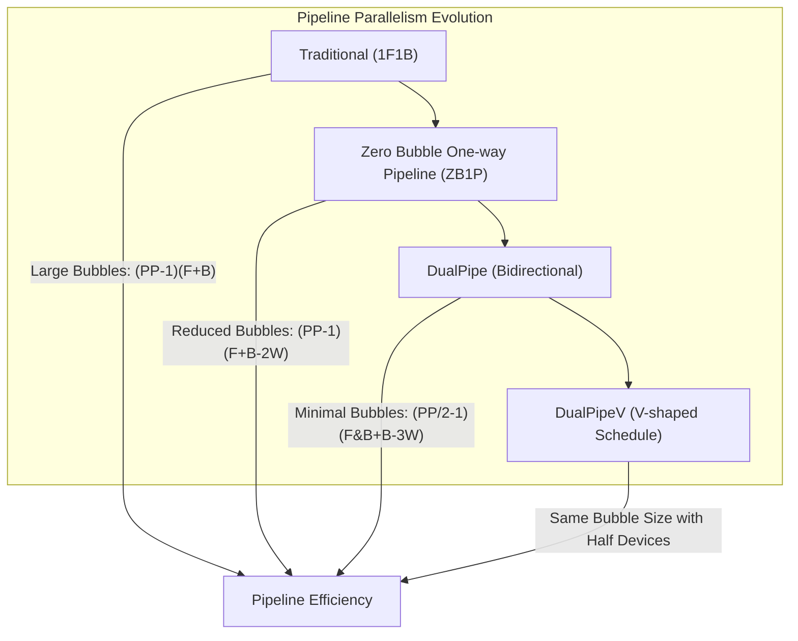

Sources: [README.md:1-16]()

## Key Benefits

DualPipe and DualPipeV offer several advantages over traditional pipeline parallelism approaches:

1.  **Full computation-communication overlap**: Both implementations achieve complete overlap of forward and backward passes.
2.  **Reduced pipeline bubbles**: Significantly smaller idle time compared to traditional methods.
3.  **Efficient resource usage**: DualPipeV achieves the same pipeline efficiency as DualPipe but with half the number of devices.
4.  **Practical trade-offs**: Uses 2× the parameter memory for better computational efficiency.

The following table compares key metrics of different pipeline parallelism methods:

| Method | Pipeline Bubble | Parameter Memory Per Device | Activation Memory Per Device | Number of Devices |
| :--- | :--- | :--- | :--- | :--- |
| 1F1B | (*PP*-1)(𝐹+𝐵) | 1× | *PP* | *PP* |
| ZB1P | (*PP*-1)(𝐹+𝐵-2𝑊) | 1× | *PP* | *PP* |
| DualPipe | (*PP*/2-1)(𝐹&𝐵+𝐵-3𝑊) | 2× | *PP*+1 | *PP* |
| DualPipeV | (*PP*/2-1)(𝐹&𝐵+𝐵-3𝑊) | 2× | *PP*+1 | *PP*/2 |

**Definitions:**
*   *PP*: Number of pipeline stages (must be even).
*   𝐹: Execution time of a forward chunk.
*   𝐵: Execution time of a full backward chunk.
*   𝑊: Execution time of a "backward for weights" chunk.
*   𝐹&𝐵: Execution time of two mutually overlapped forward and backward chunks.

Sources: [README.md:25-36]()

## High-Level Architecture

DualPipe consists of two main implementations: the standard `DualPipe` and the more resource-efficient `DualPipeV`. Both implementations are built on top of PyTorch (version 2.0+) and share core components for weight gradient management and communication.

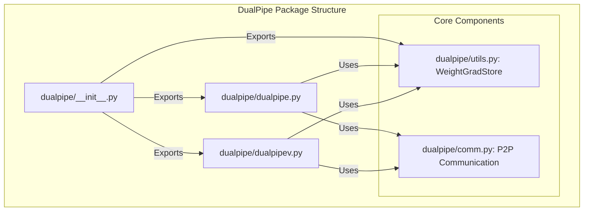

Sources: [dualpipe/__init__.py:1-17](), [README.md:38-47]()

## Pipeline Execution Model

### DualPipe Schedule
DualPipe uses a bidirectional approach where micro-batches flow in two directions through pipeline stages. This schedule achieves full overlapping of computation and communication, minimizing idle time.

### DualPipeV Schedule
DualPipeV implements a V-shape schedule that achieves the same pipeline efficiency with half the number of devices by mapping two pipeline stages to a single physical device.

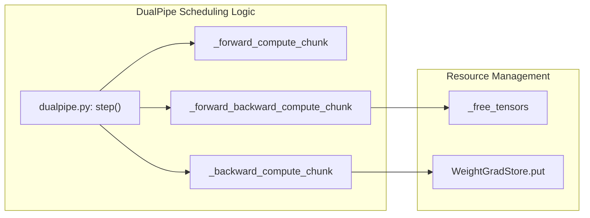

Sources: [README.md:5-23](), [dualpipe/dualpipe.py:228-348]()

## Core Components

The DualPipe repository is organized around these key components:

1.  **`DualPipe` Class**: The main implementation of the bidirectional pipeline parallelism algorithm [dualpipe/dualpipe.py:10]().
2.  **`DualPipeV` Class**: The V-shape schedule variant requiring half the number of devices [dualpipe/dualpipev.py:11]().
3.  **`WeightGradStore`**: Manages weight gradients during pipeline execution to allow for deferred gradient updates [dualpipe/utils.py:10]().
4.  **Communication Utilities**: Handles point-to-point communication (e.g., `set_p2p_tensor_shapes`) between pipeline stages [dualpipe/comm.py:11]().

Sources: [dualpipe/__init__.py:3-9]()

## System Requirements and Compatibility

DualPipe is designed to work with:
*   PyTorch 2.0 and above [README.md:51]()
*   CUDA-capable GPUs for distributed training and NCCL for P2P communication.

For real-world applications, users must implement a custom `overlapped_forward_backward` method tailored to their specific modules to handle the concurrent execution of forward and backward passes.

Sources: [README.md:47-51]()

## Getting Started

To quickly get started with DualPipe, you can run the provided examples:

```bash
python examples/example_dualpipe.py
python examples/example_dualpipev.py
```

For detailed installation instructions, see [Installation & Setup](#1.1). For practical implementation details, see [DualPipe Example Usage](#2.2).

Sources: [README.md:38-47]()

## Citation and Contributors

DualPipe was created and developed by Jiashi Li, Chengqi Deng, and Wenfeng Liang. The research is presented in the DeepSeek-V3 Technical Report. The DualPipeV variant incorporates the "Cut-in-half" concept introduced by Sea AI Lab.

Sources: [README.md:54-69]()

---

# Page: Installation & Setup

# Installation & Setup

<details>
<summary>Relevant source files</summary>

The following files were used as context for generating this wiki page:

- [.gitignore](.gitignore)
- [setup.py](setup.py)

</details>


This page provides technical details for installing and setting up the DualPipe library. DualPipe is a bidirectional pipeline parallelism library designed for distributed training, supporting both the standard DualPipe schedule and the V-shape DualPipeV variant.

## Environment Requirements

DualPipe relies on modern deep learning and distributed communication primitives. The following environment is required:

*   **PyTorch 2.0+**: Necessary for advanced autograd manipulation and distributed features.
*   **CUDA & NCCL**: Required for high-performance GPU communication via `torch.distributed`.
*   **Git**: Required for versioning during source installation.

## Package Structure and Versioning

The library is structured as a standard Python package named `dualpipe`.

### Versioning Logic
The versioning is handled dynamically in `setup.py`. It uses a base version of `1.0.0` and appends the current Git commit hash to ensure unique builds during development.

*   **Base Version**: `1.0.0` [setup.py:17]()
*   **Revision Suffix**: If Git is available, it appends `+<short-hash>`. If Git is unavailable, it appends a timestamp `+YYYY-MM-DD-HH-MM-SS` [setup.py:7-13]().

### Package Layout
The source code is contained within the `dualpipe/` directory, which is specified as the primary package for distribution [setup.py:18]().

| File/Directory | Purpose |
| :--- | :--- |
| `dualpipe/` | Core library source code. |
| `setup.py` | Installation script using `setuptools`. |
| `.gitignore` | Defines excluded paths like `build/`, `dist/`, and `__pycache__` [/.gitignore:1-4](). |

Sources: [setup.py:1-19](), [/.gitignore:1-4]()

## Installation Instructions

### Source Installation
To install DualPipe in editable mode for development, use the following command from the root of the repository:

```bash
pip install -e .
```
This triggers `setup.py`, which identifies the `dualpipe` package and sets up the environment [setup.py:15-19]().

### Verification
After installation, you can verify the package availability by importing the core classes:

```python
from dualpipe import DualPipe, DualPipeV
```

## Setup Data Flow

The following diagram illustrates how the installation and initialization process maps to specific code entities and system requirements.

**System to Code Mapping**
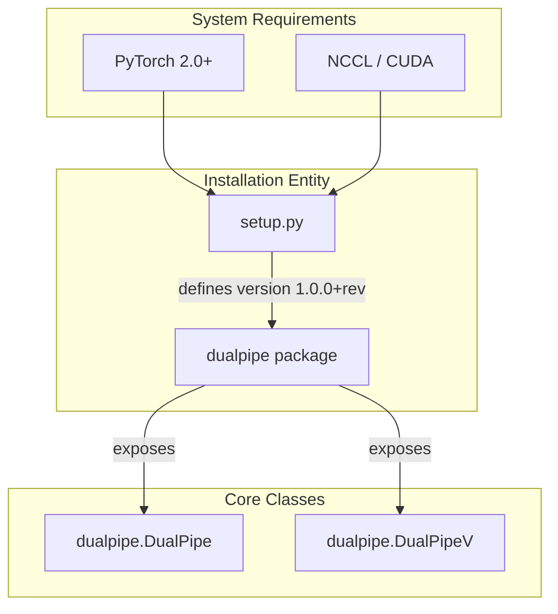
Sources: [setup.py:15-19]()

## Initial Configuration

Setting up a DualPipe instance requires defining the model partitions and communication parameters.

### Required Components for Initialization
1.  **Modules**: A list of `torch.nn.Module` objects representing the stages of the pipeline.
2.  **Process Group**: A `torch.distributed` process group for P2P communication.
3.  **Rank Mapping**: A dictionary mapping the internal pipeline ranks to the global distributed ranks.

**Initialization Logic Diagram**
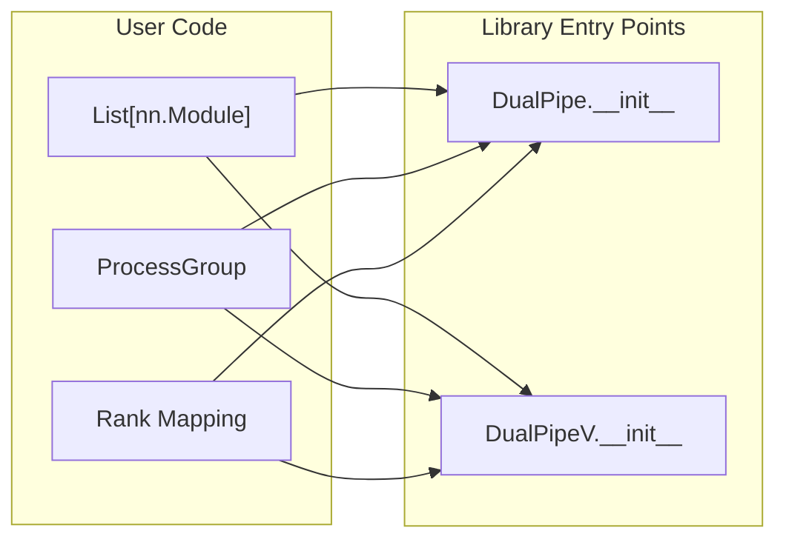
Sources: [setup.py:18]()

## Build Artifacts
When running the installation or build process, the following directories are generated but ignored by version control:
*   `build/`: Temporary build files.
*   `dist/`: Distribution packages (wheels/source distributions).
*   `dualpipe.egg-info/`: Metadata for the installed package.

Sources: [/.gitignore:1-4]()

---

# Page: Key Concepts

# Key Concepts

<details>
<summary>Relevant source files</summary>

The following files were used as context for generating this wiki page:

- [README.md](README.md)
- [images/dualpipe.png](images/dualpipe.png)
- [images/dualpipev.png](images/dualpipev.png)

</details>


This page explains the fundamental concepts of pipeline parallelism and the innovative approaches implemented in the DualPipe repository. It covers the core principles behind DualPipe and DualPipeV, including their scheduling algorithms, memory characteristics, and performance improvements compared to traditional methods.

## Pipeline Parallelism Fundamentals

Pipeline parallelism is a distributed training technique that partitions neural network layers across multiple devices, allowing models that exceed single-device memory limitations to be trained efficiently. This approach divides the model into sequential stages, with each stage executing on a separate device.

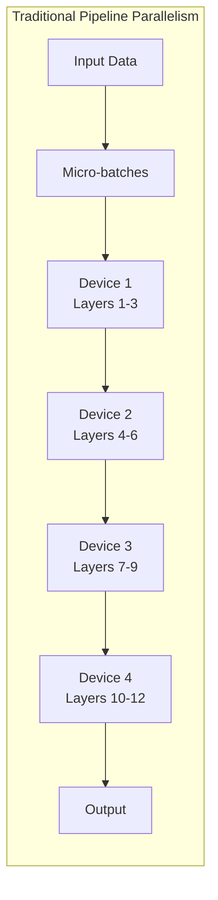

Sources: [README.md:1-69]()

### Traditional Pipeline Parallelism Methods

Traditional pipeline parallelism methods suffer from pipeline bubbles - periods when devices are idle due to dependencies between forward and backward passes.

1. **1F1B (One Forward One Backward)**
   - Sequential execution of forward and backward passes.
   - Simple implementation but significant pipeline bubbles.
   - Bubble size: $(PP-1)(F+B)$ [README.md:28-28]().

2. **ZB1P (Zero Bubble Single Pass)**
   - Improved bubble reduction by splitting backward passes.
   - Bubble size: $(PP-1)(F+B-2W)$ [README.md:29-29]().

Where $PP$ represents pipeline stages, $F$ is forward pass time, $B$ is backward pass time, and $W$ is the weight gradient computation time [README.md:33-35]().

Sources: [README.md:24-36]()

## DualPipe Innovation

DualPipe is a bidirectional pipeline parallelism algorithm introduced in the DeepSeek-V3 Technical Report [README.md:1-3](). It achieves full overlap of forward and backward computation-communication phases, significantly reducing pipeline bubbles.

### Key Characteristics of DualPipe

1. **Bidirectional Pipeline Execution**
   - Simultaneous processing of micro-batches in two directions (forward and reverse) [README.md:9-12]().
   - The micro-batches in the reverse direction are symmetric to those in the forward direction [README.md:10-11]().

2. **F/B/W Computation Phases**
   - **F (Forward)**: Execution of a forward chunk [README.md:34-34]().
   - **B (Backward)**: Execution of a full backward chunk (activation gradients) [README.md:34-35]().
   - **W (Weight)**: Execution of a "backward for weights" chunk [README.md:35-35]().
   - **F&B**: Mutually overlapped forward and backward chunks [README.md:35-36]().

```mermaid
flowchart LR
    subgraph "DualPipe Bidirectional Strategy"
        direction LR
        Input["Micro-batches"] --> Split["Direction Split"]
        
        subgraph "Direction 0 (Forward)"
            F0["Forward Pass"] --> B0["Backward Pass"]
        end
        
        subgraph "Direction 1 (Reverse)"
            F1["Forward Pass"] --> B1["Backward Pass"]
        end
        
        Split --> "Direction 0 (Forward)"
        Split --> "Direction 1 (Reverse)"
        
        "Direction 0 (Forward)" -.->|"Overlapped"| "Direction 1 (Reverse)"
    end
```

Sources: [README.md:1-12](), [README.md:33-36]()

### DualPipe Scheduling and Overlap

DualPipe uses an 8-step schedule to interleave micro-batches. Two cells enclosed by a shared black border in the schedule diagrams have mutually overlapped computation and communication [README.md:11-12]().

| Feature | DualPipe Specification |
| :--- | :--- |
| **Bubble Size** | $(PP/2-1)(F\&B+B-3W)$ [README.md:30-30]() |
| **Parameter Memory** | 2× per device [README.md:30-30]() |
| **Activation Memory** | $PP+1$ per device [README.md:30-30]() |

Sources: [README.md:5-12](), [README.md:24-36]()

## DualPipeV Innovation

DualPipeV is a concise V-shape schedule derived from DualPipe using a "cut-in-half" procedure [README.md:14-16](). It maintains the same bubble efficiency as DualPipe but optimizes device usage.

### Key Characteristics of DualPipeV

1. **V-Shape Topology**
   - Derived by Sea AI Lab as "Cut-in-half" [README.md:16-16]().
   - A single physical device handles two pipeline stages (e.g., in an 8-stage pipeline, Device 0 handles Stage 0 and Stage 7) [README.md:20-22]().

2. **Hardware Efficiency**
   - Requires only $PP/2$ physical devices compared to DualPipe's $PP$ devices [README.md:31-31]().
   - Maintains the same reduced bubble size as DualPipe: $(PP/2-1)(F\&B+B-3W)$ [README.md:31-31]().

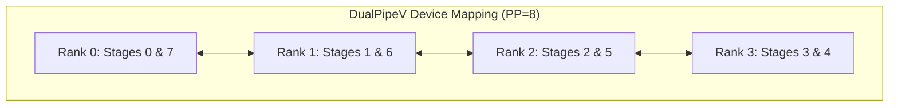

Sources: [README.md:14-22](), [README.md:31-31]()

## Code Connection: Implementation Entities

The innovations described above are implemented through specific classes and methods that manage the complex scheduling and overlap.

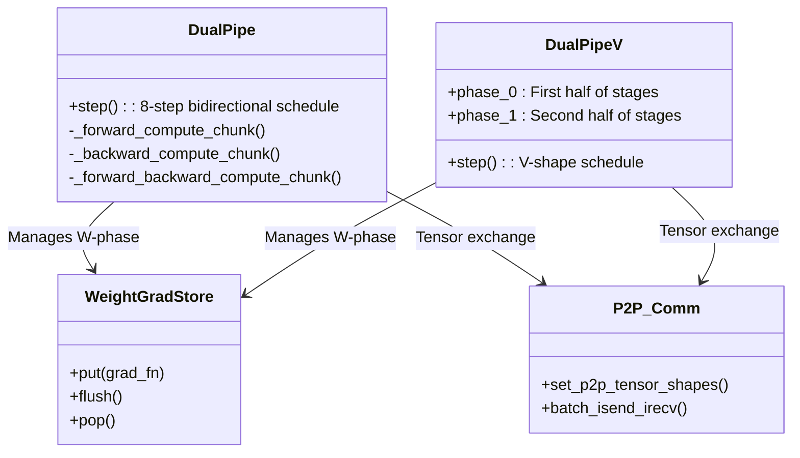

### Overlap Strategy Implementation
For real-world applications, users must implement a custom `overlapped_forward_backward` method tailored to their specific module to realize the theoretical benefits of the $F\&B$ phase [README.md:47-48]().

### Weight Gradient Management
The `WeightGradStore` is a core component that enables the $W$ (Weight gradient) phase to be separated from the $B$ (Activation gradient) phase, which is a prerequisite for the bubble reduction formulas used in both DualPipe and DualPipeV [README.md:34-35]().

Sources: [README.md:47-48](), [README.md:34-35]()

---

# Page: DualPipe Architecture

# DualPipe Architecture

<details>
<summary>Relevant source files</summary>

The following files were used as context for generating this wiki page:

- [dualpipe/dualpipe.py](dualpipe/dualpipe.py)
- [images/dualpipe.png](images/dualpipe.png)

</details>


This document provides a detailed technical overview of the DualPipe pipeline parallelism architecture. DualPipe is a bidirectional pipeline parallelism algorithm introduced in the DeepSeek-V3 Technical Report that achieves full overlap of forward and backward computation-communication phases, significantly reducing pipeline bubbles. For information about the DualPipeV variant, which uses a "cut-in-half" approach with fewer devices, see [DualPipeV Architecture](#3).

## Core Concepts and Design Principles

DualPipe is designed to maximize hardware utilization in distributed training by implementing an innovative bidirectional schedule that reduces pipeline bubbles - the idle periods in traditional pipeline parallelism methods. 

The key design principles of DualPipe are:

1.  **Bidirectional Execution**: Uses both forward and reverse pipeline directions simultaneously.
2.  **Full Computation-Communication Overlap**: Overlaps forward and backward passes with communication.
3.  **Zero-Bubble Optimization**: Strategically uses zero-bubble techniques to further reduce idle time.
4.  **Balanced Pipeline Stages**: Works with an even number of pipeline stages/ranks arranged in two halves.

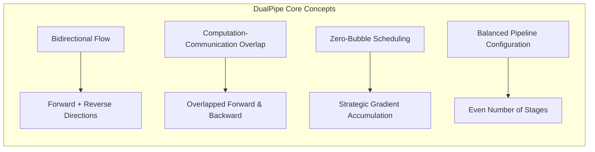

Sources: [dualpipe/dualpipe.py:11-45]()

## System Architecture

DualPipe is implemented as a PyTorch module that encapsulates distributed pipeline parallelism logic. The system requires an even number of pipeline stages distributed across multiple devices.

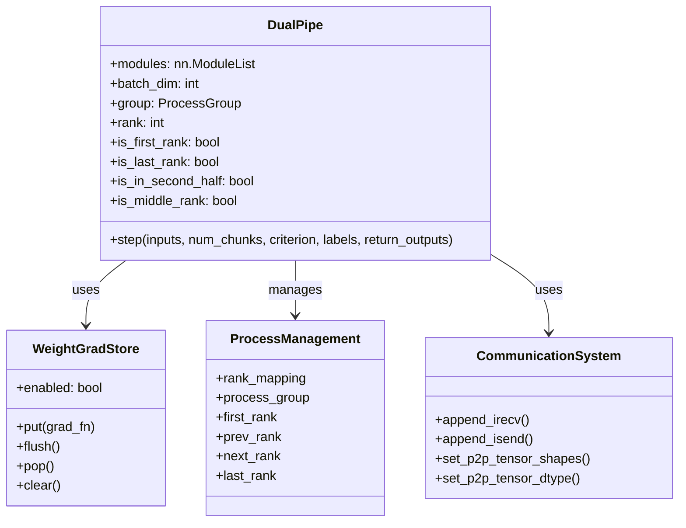

Sources: [dualpipe/dualpipe.py:11-45](), [dualpipe/utils.py:11-13]()

## Pipeline Stage Configuration

DualPipe divides the model into two halves across an even number of ranks (pipeline stages). The directionality and behavior of each rank depends on its position in the pipeline. The `rank_mapping` allows for flexible physical-to-logical rank assignment [dualpipe/dualpipe.py:30-36]().

| Position | Description | Behavior |
|----------|-------------|----------|
| First Rank (0) | Start of forward direction | Receives initial input tensors [dualpipe/dualpipe.py:42]() |
| Last Rank (num_ranks-1) | Start of reverse direction | Receives reverse direction input tensors [dualpipe/dualpipe.py:43]() |
| Middle Ranks | Transition between halves | Special handling for phase transitions [dualpipe/dualpipe.py:45]() |
| First Half Ranks | Ranks 0 to (num_ranks/2-1) | Phase 0 = forward, Phase 1 = reverse [dualpipe/dualpipe.py:44]() |
| Second Half Ranks | Ranks (num_ranks/2) to (num_ranks-1) | Phase 0 = reverse, Phase 1 = forward [dualpipe/dualpipe.py:44]() |

```mermaid
flowchart LR
    subgraph "DualPipe Pipeline Configuration"
        direction LR
        Input1["Input Batch"] --> R0["Rank 0 (First)"]
        R0 --> R1["Rank 1"]
        R1 --> R2["Rank 2"]
        R2 --> R3["Rank 3 (Middle)"]
        R3 --> R4["Rank 4 (Middle)"]
        R4 --> R5["Rank 5"]
        R5 --> R6["Rank 6"]
        R6 --> R7["Rank 7 (Last)"]
        
        Input2["Reverse Input Batch"] --> R7
        R7 -->|"Reverse Direction"| R6
        R6 -->|"Reverse Direction"| R5
        R5 -->|"Reverse Direction"| R4
        R4 -->|"Reverse Direction"| R3
        R3 -->|"Reverse Direction"| R2
        R2 -->|"Reverse Direction"| R1
        R1 -->|"Reverse Direction"| R0
        
        classDef firstHalf fill:#eee,stroke:#333
        classDef secondHalf fill:#ddd,stroke:#333
        classDef middle stroke-width:3px
        
        class R0,R1,R2,R3 firstHalf
        class R4,R5,R6,R7 secondHalf
        class R3,R4 middle
    end
```

Sources: [dualpipe/dualpipe.py:42-45](), [dualpipe/dualpipe.py:334-338]()

## Execution Phases

The DualPipe algorithm executes in 8 distinct steps to orchestrate the bidirectional flow. Each step has a specific purpose in the overall pipeline execution, managed within the `step()` method [dualpipe/dualpipe.py:294-425]().

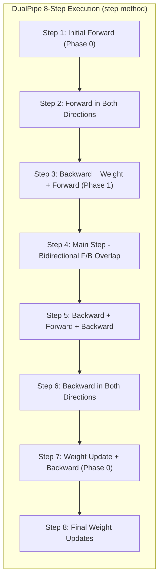

Sources: [dualpipe/dualpipe.py:358-425]()

### Step 1: Initial Forward (Phase 0)

Performs initial forward passes in one direction to fill the pipeline. The number of iterations is determined by the rank's position relative to the pipeline center [dualpipe/dualpipe.py:358-361]().

### Step 4: Main Step - Overlapped Bidirectional Execution

This is the core of DualPipe where forward and backward passes are fully overlapped in both directions. It utilizes `_forward_backward_compute_chunk` to execute concurrent computation [dualpipe/dualpipe.py:382-396]().

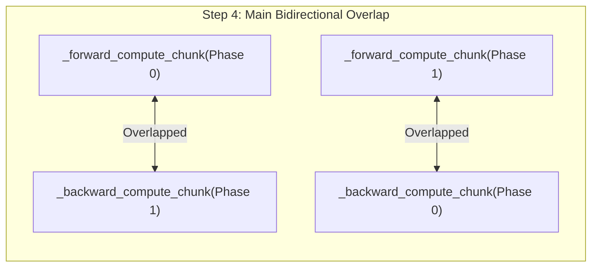

Sources: [dualpipe/dualpipe.py:382-396]()

## Technical Implementation Details

### Input/Output Management

DualPipe divides the input batch into micro-batches that are processed through the pipeline. Each stage maintains several data structures to track these micro-batches, which are reset at the start of every iteration via `_reset_states()` [dualpipe/dualpipe.py:47-65]().

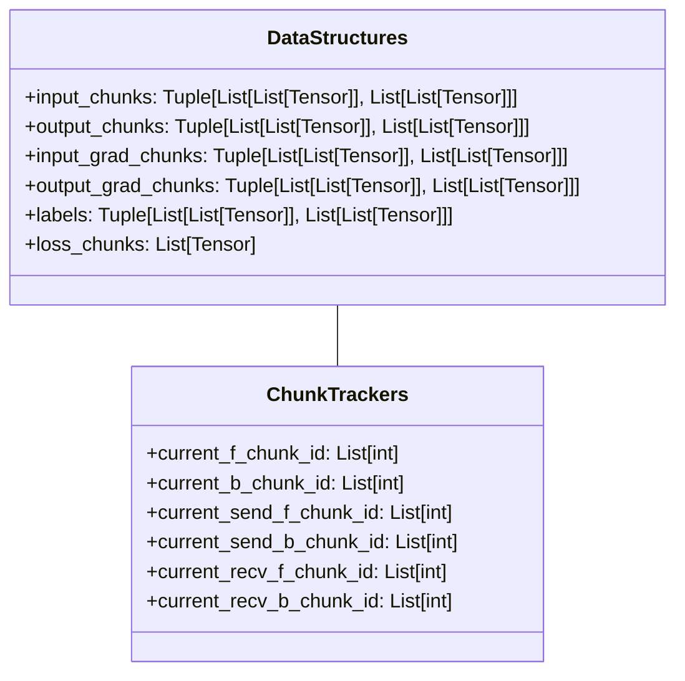

Sources: [dualpipe/dualpipe.py:50-65]()

### Forward and Backward Computation

DualPipe implements several key methods for computation:

1.  `_forward_compute_chunk`: Executes a forward pass for a specific phase [dualpipe/dualpipe.py:67-86]().
2.  `_backward_compute_chunk`: Executes a backward pass with optional zero-bubble optimization via `WeightGradStore` [dualpipe/dualpipe.py:87-120]().
3.  `_forward_backward_compute_chunk`: Overlaps forward and backward computation for maximum efficiency [dualpipe/dualpipe.py:121-183]().

When the model supports it, DualPipe can use custom `overlapped_forward_backward` methods to further optimize the overlapped execution [dualpipe/dualpipe.py:168-171]().

For details, see [DualPipe Implementation](#2.1).

### Communication System

DualPipe uses non-blocking point-to-point communication operations to exchange tensors between pipeline stages. These are orchestrated by methods like `_recv_forward`, `_send_forward`, and `_commit_and_wait_comm` [dualpipe/dualpipe.py:231-292]().

For details, see [DualPipe Implementation](#2.1).

### Zero-Bubble Optimization

DualPipe strategically uses zero-bubble techniques to further reduce pipeline bubbles. This is implemented through the `WeightGradStore` system that manages gradient accumulation and deferred weight gradient computation [dualpipe/utils.py:11-53]().

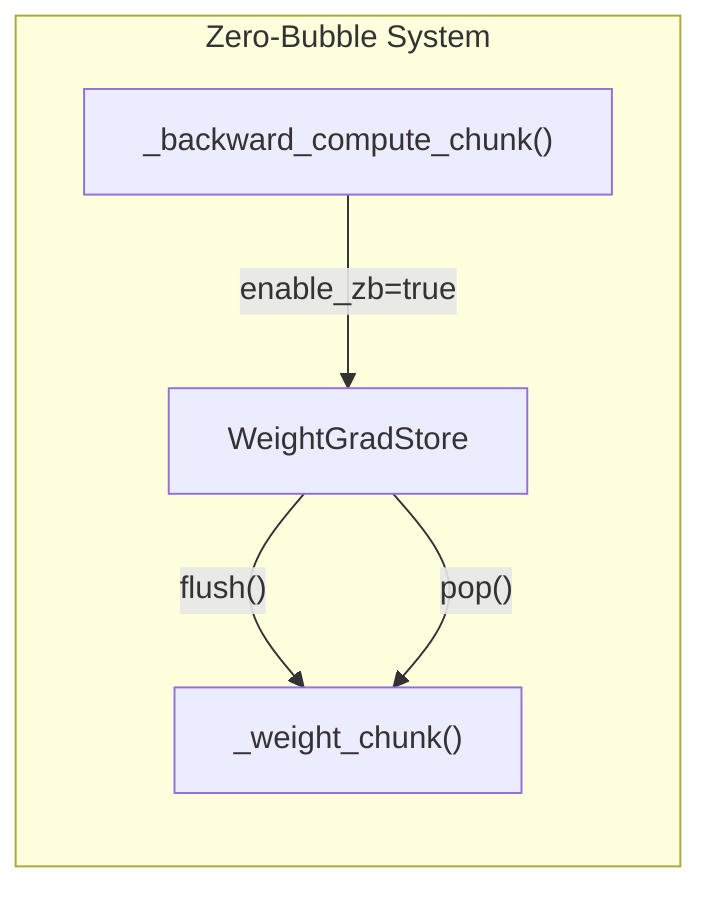

Sources: [dualpipe/dualpipe.py:97-115](), [dualpipe/dualpipe.py:216-224]()

## Step Method API

The main interface to DualPipe is the `step` method, which executes a full forward and backward pass through the pipeline. It handles the splitting of inputs using `scatter` and gathering of results using `gather` [dualpipe/dualpipe.py:294-440]().

### Key Parameters:

| Parameter | Type | Description |
|-----------|------|-------------|
| inputs | torch.Tensor | Input tensors for the model (required only on first/last ranks) |
| num_chunks | int | Number of micro-batches to use (must be even and >= num_ranks*2) |
| criterion | Callable | Loss function used on first/last ranks |
| labels | List[torch.Tensor] | Labels for the loss function |
| return_outputs | bool | Whether to return model outputs |

Sources: [dualpipe/dualpipe.py:294-304]()

For details on usage, see [DualPipe Example Usage](#2.2).

## Memory and Performance Characteristics

DualPipe makes specific tradeoffs to achieve better pipeline efficiency:

| Characteristic | DualPipe | Traditional Methods (1F1B) |
|----------------|----------|----------------------------|
| Pipeline Bubbles | (PP/2-1)(F&B+B-3W) | (PP-1)(F+B) |
| Parameter Memory | 2× | 1× |
| Activation Memory | PP+1 | PP |
| Number of Devices | PP | PP |

Sources: [dualpipe/dualpipe.py:11-45]()

---

# Page: DualPipe Implementation

# DualPipe Implementation

<details>
<summary>Relevant source files</summary>

The following files were used as context for generating this wiki page:

- [dualpipe/dualpipe.py](dualpipe/dualpipe.py)

</details>


This document provides a detailed technical explanation of the DualPipe implementation, focusing on its internal methods and execution flow. For information about using DualPipe in practice, see [DualPipe Example Usage](). For details on DualPipeV, see [DualPipeV Architecture]().

## Overview

DualPipe is a pipeline parallelism system that achieves full overlap of computation and communication to minimize pipeline bubbles in distributed training. The implementation consists of a primary `DualPipe` class, along with supporting utilities for communication and weight gradient management.

```mermaid
classDiagram
    class DualPipe {
        +modules: nn.ModuleList
        +batch_dim: int
        +group: ProcessGroup
        +num_ranks: int
        +rank: int
        +step(x, labels, criterion, ...): Tuple
        -_forward_compute_chunk(phase)
        -_backward_compute_chunk(phase, enable_zb)
        -_forward_backward_compute_chunk(phase0, phase1)
        -_weight_chunk()
        -_free_tensors()
    }

    class WeightGradStore {
        +enabled: bool
        +cache: List
        +funcs_queue: Queue
        +put(func)
        +flush()
        +pop()
        +clear()
    }

    class P2PCommunication {
        +TENSOR_SHAPES: List
        +TENSOR_DTYPE: dtype
        +append_irecv(rank, group, ...)
        +append_isend(rank, group, ...)
        +batch_isend_irecv()
    }

    DualPipe --> WeightGradStore: manages gradients via [dualpipe/utils.py:8-33]
    DualPipe --> P2PCommunication: manages comms via [dualpipe/comm.py:7-38]
```

Sources: [dualpipe/dualpipe.py:11-440](), [dualpipe/utils.py:8-80](), [dualpipe/comm.py:7-38]()

## Class Architecture

The `DualPipe` class [dualpipe/dualpipe.py:11-440]() is implemented as a PyTorch module (`nn.Module`) that encapsulates the pipeline parallelism logic. It manages two model partitions and orchestrates the execution of forward and backward passes across pipeline stages.

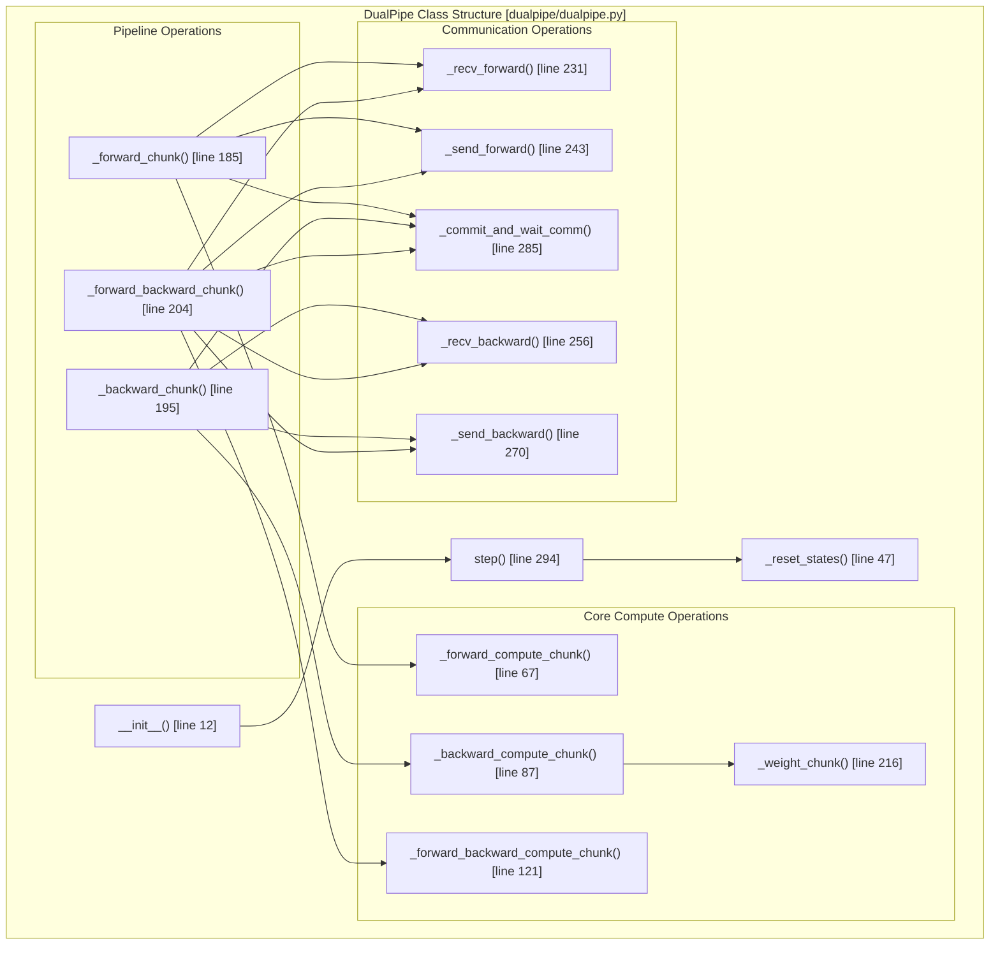

Sources: [dualpipe/dualpipe.py:11-292]()

## Initialization

DualPipe is initialized with model partitions, batch dimension, process group, and an optional rank mapping. The initialization configures the pipeline stages and ranks for effective communication.

Key initialization steps:
1. Assign the two module partitions to `self.module` [dualpipe/dualpipe.py:22]().
2. Determine if `overlapped_forward_backward` is available based on module attributes [dualpipe/dualpipe.py:23]().
3. Configure rank mapping and determine each rank's position (prev, next, first, last) [dualpipe/dualpipe.py:30-40]().
4. Set special flags for first, last, middle, and second-half ranks [dualpipe/dualpipe.py:42-45]().

Sources: [dualpipe/dualpipe.py:12-45]()

## Core Execution Methods

### Forward Operations
`_forward_compute_chunk(phase)` [dualpipe/dualpipe.py:67-86]() executes the forward computation on a micro-batch. It identifies if the current rank is the `is_last_stage` for the given phase (0 or 1) and calculates loss if a criterion is provided [dualpipe/dualpipe.py:75-82]().

### Backward Operations
`_backward_compute_chunk(phase, enable_zb)` [dualpipe/dualpipe.py:87-119]() executes the backward computation. If `enable_zb` is True, it utilizes the `WeightGradStore` to defer weight gradient updates [dualpipe/dualpipe.py:97-114]().

### Combined Operations
DualPipe's key innovation is the ability to overlap forward and backward passes, implemented through `_forward_backward_compute_chunk(phase0, phase1)` [dualpipe/dualpipe.py:121-183](). This method checks for the `overlapped_forward_backward` attribute on the module and calls it to execute both passes concurrently [dualpipe/dualpipe.py:168-183]().

Sources: [dualpipe/dualpipe.py:67-183]()

## Step Function Scheduling Logic

The `step()` method [dualpipe/dualpipe.py:294-440]() orchestrates the entire pipeline execution through an 8-step schedule.

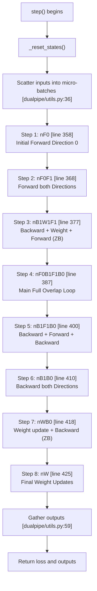

Sources: [dualpipe/dualpipe.py:294-440](), [dualpipe/utils.py:36-80]()

## Communication and Memory Management

### Asynchronous P2P Management
Communication is handled by appending operations to `self.comm_ops` using `comm.append_irecv` and `comm.append_isend` [dualpipe/dualpipe.py:231-283](). The method `_commit_and_wait_comm()` [dualpipe/dualpipe.py:285-292]() triggers the actual batch communication via `comm.batch_isend_irecv()` and clears the operation list.

### Memory Management via _free_tensors
To prevent memory bloat, `_free_tensors()` [dualpipe/dualpipe.py:225-229]() is called periodically. It iterates through a list of tensors and sets their `.data` to a small 1x1 tensor to release the underlying storage [dualpipe/dualpipe.py:228]().

### Weight Gradient Management
The `WeightGradStore` [dualpipe/utils.py:8-33]() acts as a singleton cache for weight gradient functions.
- `put(func)`: Adds a function to the current cache [dualpipe/utils.py:18]().
- `flush()`: Moves the current cache into `funcs_queue` [dualpipe/utils.py:22]().
- `pop()`: Executes the oldest batch of functions in the queue [dualpipe/utils.py:26]().

Sources: [dualpipe/dualpipe.py:225-292](), [dualpipe/utils.py:8-33](), [dualpipe/comm.py:25-38]()

---

# Page: DualPipe Example Usage

# DualPipe Example Usage

<details>
<summary>Relevant source files</summary>

The following files were used as context for generating this wiki page:

- [examples/example_dualpipe.py](examples/example_dualpipe.py)

</details>


This document provides a comprehensive walkthrough of how to use the DualPipe pipeline parallelism implementation in practical applications. We'll explore the example code provided in the repository to demonstrate setup, configuration, and execution of distributed training using DualPipe. For information about the DualPipe architecture and implementation details, see [DualPipe Architecture]() and [DualPipe Implementation]().

## Prerequisites

Before using DualPipe, ensure you have:
- PyTorch 2.0 or above
- A multi-GPU environment
- NCCL backend for distributed communication

## Basic Usage Flow

DualPipe follows a specific workflow for implementing pipeline-parallel distributed training:

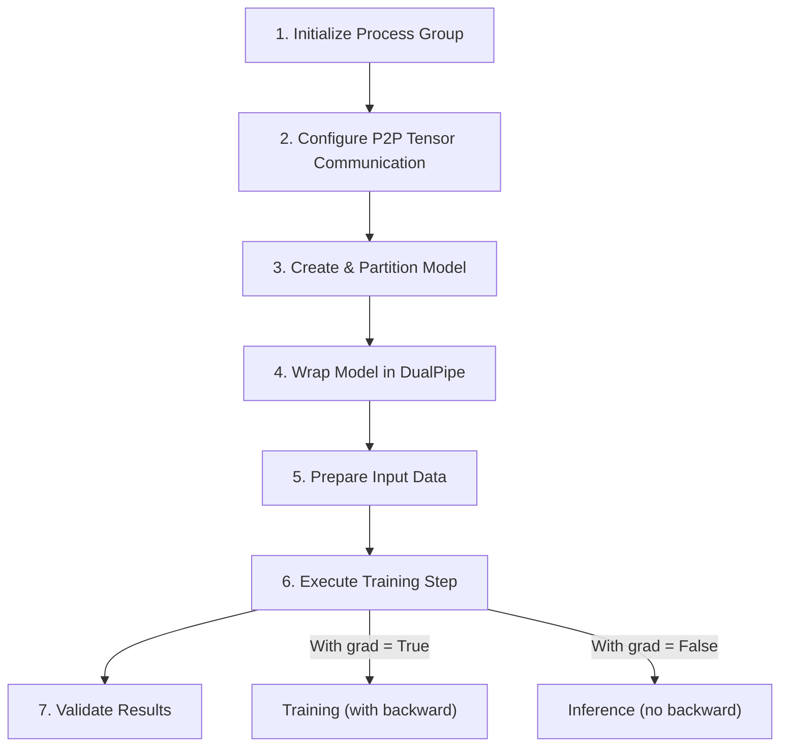

Sources: [examples/example_dualpipe.py:109-193](), [dualpipe/model.py:15-22]()

## Example Implementation Components

The example demonstrates how to use DualPipe with a simple two-stage neural network model. Let's examine the key components:

### Custom Module Definition

The example defines a pipeline stage consisting of two linear layers with a GELU activation in between:

```mermaid
classDiagram
    class PipelineStage {
        +linear1: MyLinear
        +linear2: MyLinear
        +forward(x)
        +overlapped_forward_backward()
    }
    
    class MyLinear {
        +forward(input)
    }
    
    class LinearFunc {
        +forward(ctx, input, weight)
        +backward(ctx, grad_output)
    }
    
    PipelineStage --> MyLinear: contains
    MyLinear ..> LinearFunc: uses
```

Sources: [examples/example_dualpipe.py:13-52]()

The `PipelineStage` class is critical as it:
1. Defines a module that can be partitioned across devices [examples/example_dualpipe.py:42-52]()
2. Implements the required `overlapped_forward_backward` method for DualPipe [examples/example_dualpipe.py:54-83]()

### Implementing Overlapped Forward-Backward Computation

The key to DualPipe's efficiency is the customized overlapped computation implementation. The example provides a implementation in the `overlapped_forward_backward` class method:

```mermaid
sequenceDiagram
    participant F as "Forward Computation"
    participant B as "Backward Computation"
    
    Note over F: Execute forward pass for current chunk
    F->>F: outputs0 = module0(*inputs0)
    F->>F: Calculate loss0 if criterion provided
    
    Note over B: Execute backward pass for previous chunk
    B->>B: loss1.backward() or run_backward(outputs1, output_grads1)
    
    Note over F,B: Both operations happen in parallel<br>in the overlapped implementation
```

Sources: [examples/example_dualpipe.py:54-83]()

This method is crucial for DualPipe's performance as it enables the simultaneous execution of a forward pass for the current micro-batch and a backward pass for the previous micro-batch, minimizing pipeline bubbles. DualPipe calls this method during its 8-step schedule [dualpipe/model.py:228-237]().

### Weight Gradient Management

The example implements custom gradient management through the `WeightGradStore`:

```mermaid
flowchart LR
    LinearFunc["LinearFunc.backward"]-->|"Check if enabled"|WeightGradStore
    WeightGradStore-->|"If WeightGradStore.enabled"|Store["WeightGradStore.put(grad_weight_fn)"]
    WeightGradStore-->|"Else"|Execute["Execute grad_weight_fn() immediately"]
```

Sources: [examples/example_dualpipe.py:26-32](), [dualpipe/utils.py:16-25]()

This custom gradient handling is essential for:
1. Controlling when weight gradients are computed [examples/example_dualpipe.py:29-30]()
2. Optimizing gradient accumulation by deferring heavy matrix multiplications [examples/example_dualpipe.py:26-27]()
3. Supporting DualPipe's overlapped computation strategy where weight gradients are flushed at specific pipeline steps [dualpipe/model.py:265-267]()

## Complete Example Walkthrough

Let's examine the full workflow in the example code:

### 1. Distributed Setup

```mermaid
flowchart TD
    InitDist["dist.init_process_group(backend='nccl')"]-->SetDevice["torch.cuda.set_device(rank)"]
    SetDevice-->ConfigP2P["set_p2p_tensor_shapes(...)<br>set_p2p_tensor_dtype(...)"]
```

Sources: [examples/example_dualpipe.py:112-125]()

The example initializes the distributed environment using NCCL and configures the tensor shapes for point-to-point communication via `set_p2p_tensor_shapes` [examples/example_dualpipe.py:124]().

### 2. Model Creation and Partitioning

For the DualPipe approach, each rank gets assigned two `PipelineStage` modules, following a symmetric pattern:

```mermaid
flowchart LR
    subgraph "Full Model (Reference)"
        direction TB
        M0["Module 0"]
        M1["Module 1"]
        M2["Module 2"]
        M3["Module 3"]
        M0-->M1-->M2-->M3
    end
    
    subgraph "Rank 0 (DualPipe)"
        R0M0["local_modules[0] = Module 0"]
        R0M3["local_modules[1] = Module 3"]
    end
    
    subgraph "Rank 1 (DualPipe)"
        R1M1["local_modules[0] = Module 1"]
        R1M2["local_modules[1] = Module 2"]
    end
    
    M0==>R0M0
    M1==>R1M1
    M2==>R1M2
    M3==>R0M3
```

Sources: [examples/example_dualpipe.py:138-142]()

Each rank in DualPipe manages two modules:
- `local_modules[0]`: The rank's corresponding module from the first half of the pipeline [examples/example_dualpipe.py:138]()
- `local_modules[1]`: The symmetric module from the second half of the pipeline [examples/example_dualpipe.py:138]()

### 3. Input Data Distribution

Input data is split between the first and last ranks in a specific pattern to support bidirectional flows:

```mermaid
flowchart TD
    FullData["Full Input Data (full_x, full_l)"]
    
    FullData-->|"x = full_x.chunk(2)[0]<br>l = full_l.chunk(2)[1]"|FirstRank["Rank 0 (First Rank)"]
    FullData-->|"x = full_x.chunk(2)[1]<br>l = full_l.chunk(2)[0]"|LastRank["Rank PP-1 (Last Rank)"]
    FullData-->|"x = None<br>l = None"|MiddleRanks["Middle Ranks"]
```

Sources: [examples/example_dualpipe.py:145-153]()

This data distribution pattern ensures that:
- The first rank starts the forward pass for the first half and receives labels for the second half [examples/example_dualpipe.py:146-147]().
- The last rank starts the forward pass for the second half and receives labels for the first half [examples/example_dualpipe.py:149-150]().

### 4. Executing the Training Step

The example executes DualPipe's `step` method to run the training process:

```mermaid
flowchart LR
    Inputs["x (Inputs)"]-->DualPipeStep["dualpipe_model.step(...)"]
    NumChunks["num_chunks=20"]-->DualPipeStep
    Criterion["criterion=criterion"]-->DualPipeStep
    Labels["labels=(l,)"]-->DualPipeStep
    ReturnOutputs["return_outputs=False"]-->DualPipeStep
    
    DualPipeStep-->|"Returns"|Loss["loss"]
    DualPipeStep-->|"Returns"|Outputs["outputs"]
```

Sources: [examples/example_dualpipe.py:156]()

The `step` method parameters control:
- `num_chunks`: How many micro-batches to create from the input [examples/example_dualpipe.py:156]().
- `criterion`: What loss function to apply at the end of the pipeline [examples/example_dualpipe.py:156]().
- `return_outputs`: Whether to return the forward pass outputs (useful for inference) [examples/example_dualpipe.py:181]().

### 5. Result Validation

The example validates the results by:
1. Checking that losses match the reference sequential implementation `ref_step` [examples/example_dualpipe.py:160-162]().
2. Verifying gradient correctness by all-gathering gradients from symmetric ranks [examples/example_dualpipe.py:168-176]().
3. Testing both training and inference (with `torch.no_grad()`) modes [examples/example_dualpipe.py:180-181]().

Sources: [examples/example_dualpipe.py:158-192]()

## Key Points for Custom Implementation

When implementing DualPipe for your own models, focus on:

1. **Custom overlapped_forward_backward method**: This is critical for performance and must be tailored to your specific module to ensure the backward of one chunk overlaps with the forward of another [examples/example_dualpipe.py:54-83]().
2. **Tensor communication configuration**: Use `set_p2p_tensor_shapes` to define the expected metadata for NCCL transfers [examples/example_dualpipe.py:124]().
3. **Weight Gradient Management**: Integrate `WeightGradStore` in your `autograd.Function` to allow DualPipe to schedule weight gradient computation during the "W" phases [examples/example_dualpipe.py:29-30]().
4. **Data partitioning**: Ensure you correctly map your model layers to `local_modules[0]` and `local_modules[1]` for the bidirectional schedule [examples/example_dualpipe.py:138]().

| Implementation Aspect | Code Entity / Function |
|-----------------------|-------------------|
| Module Wrap | `dualpipe.DualPipe(local_modules)` [examples/example_dualpipe.py:142]() |
| Parallel Exec | `PipelineStage.overlapped_forward_backward` [examples/example_dualpipe.py:55]() |
| Grad Storage | `dualpipe.utils.WeightGradStore` [examples/example_dualpipe.py:10]() |
| Manual Backward | `dualpipe.utils.run_backward` [examples/example_dualpipe.py:81]() |

Sources: [examples/example_dualpipe.py](), [dualpipe/model.py:15]()

## Running the Example

To run the provided example, use `torch.multiprocessing.spawn` or a standard distributed launcher:

```python
# In examples/example_dualpipe.py
num_gpus = torch.cuda.device_count() // 2 * 2
for ngpus in range(num_gpus, 0, -2):
    test_dualpipe(ngpus)
```

Sources: [examples/example_dualpipe.py:195-202]()

## Summary

DualPipe example usage demonstrates how to implement efficient pipeline parallelism with full overlap of forward and backward computation phases. The key aspects include:

1. Implementing custom modules with the `overlapped_forward_backward` method.
2. Configuring distributed processes and tensor communication metadata.
3. Creating and partitioning models symmetrically across ranks.
4. Managing input and label distribution for bidirectional flows.
5. Using `WeightGradStore` to defer weight gradient computation.
6. Validating results against a sequential reference.

For more advanced usage patterns and implementation details, refer to [DualPipe Implementation]() and [DualPipeV Example Usage]().

---

# Page: DualPipeV Architecture

# DualPipeV Architecture

<details>
<summary>Relevant source files</summary>

The following files were used as context for generating this wiki page:

- [dualpipe/dualpipev.py](dualpipe/dualpipev.py)
- [images/dualpipev.png](images/dualpipev.png)

</details>


## Purpose

This document explains the DualPipeV architecture, a variant of pipeline parallelism that achieves the same efficiency as DualPipe while requiring only half the number of devices. For information about the original DualPipe architecture, see [DualPipe Architecture](#2).

## Overview

DualPipeV is a concise V-shape schedule derived from DualPipe using a "cut-in-half" procedure. It was introduced by Sea AI Lab and integrated into the DeepSeek-V3 architecture as documented in the DeepSeek-V3 Technical Report.

### Key Features

- Implements a V-shape pipeline parallelism schedule [dualpipe/dualpipev.py:11-12]().
- Requires only PP/2 devices compared to DualPipe's PP devices [README.md:14-16]().
- Maintains the same pipeline bubble size as DualPipe [README.md:24-36]().
- Achieves full overlap of forward and backward computation-communication phases [dualpipe/dualpipev.py:23]().

For implementation details, see [DualPipeV Implementation](#3.1).

Sources: [README.md:14-16](), [dualpipe/dualpipev.py:11-23]()

## V-Shape Schedule Concept

### Diagram: DualPipeV V-Shape Schedule

```mermaid
flowchart LR
    subgraph "DualPipeV Pipeline Flow"
        direction TB
        Input["Input"] --> R0["Rank 0"]
        R0 -->|"Forward (Phase 0)"| R1["Rank 1"]
        R1 -->|"Forward (Phase 0)"| R2["Rank 2"]
        R2 -->|"Forward (Phase 0)"| R3["Rank 3"]
        
        R3 -->|"V-turn (self.is_last_rank)"| R3B["Rank 3"]
        
        R3B -->|"Backward (Phase 1)"| R2B["Rank 2"]
        R2B -->|"Backward (Phase 1)"| R1B["Rank 1"]
        R1B -->|"Backward (Phase 1)"| R0B["Rank 0"]
        R0B --> Output["Output/Gradients"]
    end
```

In this diagram, data flows forward through the first half of pipeline stages (Phase 0), then makes a "V-turn" at the midpoint (the physical last rank) before flowing through the second half of the pipeline (Phase 1) on the same devices in reverse order. This differs from traditional pipeline parallelism where data flows linearly through twice as many distinct ranks.

The V-shape schedule allows DualPipeV to effectively simulate a pipeline with `PP` stages using only `PP/2` devices by having each device process data in both the forward and backward directions of the V-shape [dualpipe/dualpipev.py:70-80]().

Sources: [README.md:19-22](), [dualpipe/dualpipev.py:11-12](), [dualpipe/dualpipev.py:70-80]()

## Pipeline Parallelism Comparison

The following table compares DualPipeV with other pipeline parallelism methods:

| Method     | Pipeline Bubble Size             | Parameter Memory | Activation Memory | Required Devices |
|------------|---------------------------------|------------------|-------------------|-----------------|
| 1F1B       | (*PP*-1)(𝐹+𝐵)                  | 1×               | *PP*              | *PP*            |
| ZB1P       | (*PP*-1)(𝐹+𝐵-2𝑊)              | 1×               | *PP*              | *PP*            |
| DualPipe   | (*PP*/2-1)(𝐹&𝐵+𝐵-3𝑊)          | 2×               | *PP*+1            | *PP*            |
| DualPipeV  | (*PP*/2-1)(𝐹&𝐵+𝐵-3𝑊)          | 2×               | *PP*+1            | *PP*/2          |

Where:
- *PP* is the number of pipeline parallelism stages (must be even).
- 𝐹 is the execution time of a forward pass.
- 𝐵 is the execution time of a backward pass.
- 𝑊 is the execution time of a "backward for weights" pass.
- 𝐹&𝐵 is the execution time of overlapped forward and backward passes.

Sources: [README.md:24-36]()

## DualPipeV Class Implementation

The `DualPipeV` class is implemented as a PyTorch module that manages pipeline parallelism using the V-shape schedule.

### Class Structure and Code Entities

```mermaid
classDiagram
    class DualPipeV {
        <<nn.Module>>
        +module: nn.ModuleList
        +overlapped_forward_backward: bool
        +batch_dim: int
        +group: dist.ProcessGroup
        +rank: int
        +is_first_rank: bool
        +is_last_rank: bool
        
        +step(inputs, num_chunks, criterion, labels, return_outputs)
        -_forward_compute_chunk(phase)
        -_backward_compute_chunk(phase, enable_zb)
        -_forward_backward_compute_chunk(phase0, phase1)
        -_weight_chunk()
        -_commit_and_wait_comm()
    }
    
    DualPipeV --* WeightGradStore : uses
    DualPipeV ..> run_backward : calls
    DualPipeV ..> batch_isend_irecv : calls
```

The `DualPipeV` class takes two modules that represent different segments of the pipeline (e.g., layers 0-N and layers N+1-2N) but reside on the same physical device [dualpipe/dualpipev.py:12-22](). It manages a complex scheduling system to ensure efficient overlapping of computation and communication.

Sources: [dualpipe/dualpipev.py:11-42](), [dualpipe/dualpipev.py:107]()

## Execution Flow

The execution of the DualPipeV pipeline is managed by the `step` method [dualpipe/dualpipev.py:288]().

### Diagram: DualPipeV Step Logic

```mermaid
flowchart TB
    Start["step()"] --> Init["_reset_states()"]
    Init --> S1["Step 1: nF0 (Warmup Phase 0)"]
    S1 --> S2["Step 2: nF0F1 (Warmup Phase 1)"]
    S2 --> S3["Step 3: nB1W1F1 (Transition)"]
    S3 --> S4["Step 4: nF0B1F1B0 (Steady State Overlap)"]
    S4 --> S5["Step 5: nB1F1B0 (Cooldown Start)"]
    S5 --> S6["Step 6: nB1B0 (Cooldown Zero-Bubble)"]
    S6 --> S7["Step 7: nWB0 (Final Weight Grad)"]
    S7 --> S8["Step 8: nW (Flush WeightGradStore)"]
    S8 --> End["Return Loss/Outputs"]
```

The `step` method implements the V-shape schedule through a sequence of 8 steps [dualpipe/dualpipev.py:288-411](). The execution is divided into two phases: `phase 0` (forward path of the V) and `phase 1` (backward path of the V).

For a detailed walkthrough of this 8-step schedule, see [DualPipeV Implementation](#3.1).

Sources: [dualpipe/dualpipev.py:288-411]()

## Key Components and Internal Methods

### State Management

DualPipeV maintains several internal state variables during execution to track micro-batch progress across the V-shape [dualpipe/dualpipev.py:43-62]():

- `input_chunks`, `output_chunks`: Tensors for the forward passes of Phase 0 and 1.
- `input_grad_chunks`, `output_grad_chunks`: Gradient tensors for the backward passes.
- `current_f_chunk_id`, `current_b_chunk_id`: Tracking chunk IDs for forward and backward passes.
- `comm_ops`: Pending communication operations to be executed via `dist.batch_isend_irecv`.

Sources: [dualpipe/dualpipev.py:43-62]()

### Computation Methods

DualPipeV implements several key computation methods:

1. `_forward_compute_chunk(phase)`: Executes forward computation for a specific phase [dualpipe/dualpipev.py:63]().
2. `_backward_compute_chunk(phase, enable_zb)`: Executes backward computation, optionally enabling `WeightGradStore` for zero-bubble weight updates [dualpipe/dualpipev.py:84]().
3. `_forward_backward_compute_chunk(phase0, phase1)`: The core overlap method that can call a module's custom `overlapped_forward_backward` hook [dualpipe/dualpipev.py:120]().

Sources: [dualpipe/dualpipev.py:63-126](), [dualpipe/dualpipev.py:127-186]()

## Optimizations

### Zero Bubble Technique

DualPipeV employs a "zero bubble" optimization in several steps to further reduce pipeline bubbles by accumulating weight gradients asynchronously [dualpipe/dualpipev.py:344-350](). This is managed via the `enable_zb` flag passed to `_backward_compute_chunk` [dualpipe/dualpipev.py:84]().

### Overlapped Forward-Backward Computation

For modules that support it, DualPipeV can use an optimized `overlapped_forward_backward` computation [dualpipe/dualpipev.py:165-168](). This allows the model to overlap the forward pass of one micro-batch with the backward pass of another at the kernel level.

For details on how to implement these modules, see [DualPipeV Example Usage](#3.2).

Sources: [dualpipe/dualpipev.py:84](), [dualpipe/dualpipev.py:165-168](), [dualpipe/dualpipev.py:344-350]()

---

# Page: DualPipeV Implementation

# DualPipeV Implementation

<details>
<summary>Relevant source files</summary>

The following files were used as context for generating this wiki page:

- [dualpipe/dualpipev.py](dualpipe/dualpipev.py)

</details>


This document provides a detailed technical explanation of the DualPipeV implementation in the DualPipe library. DualPipeV is an optimized variant of the DualPipe pipeline parallelism system that achieves similar performance with fewer devices by using a V-shaped rank topology. For information about the overall DualPipeV architecture and concepts, see **3.0 DualPipeV Architecture**. For usage examples, see **3.2 DualPipeV Example Usage**.

## Overview

DualPipeV implements a V-shaped schedule for pipeline parallelism that requires only half the number of physical devices ($PP/2$) compared to the original DualPipe implementation while maintaining the same pipeline bubble efficiency. It achieves this by mapping two logical pipeline stages (one from each "leg" of the V) to a single physical device.

```mermaid
flowchart LR
    subgraph "DualPipeV System"
        direction TB
        DPV["dualpipe.dualpipev.DualPipeV"]
        WGS["dualpipe.utils.WeightGradStore"]
        Comm["dualpipe.comm"]
        
        DPV --> WGS
        DPV --> Comm
    end
    
    Inputs["Input Tensors"] --> DPV
    DPV --> Outputs["Output Tensors & Loss"]
    
    subgraph "Schedule (dualpipev.py:330-396)"
        direction TB
        S1["1. nF0"]
        S2["2. nF0F1"]
        S3["3. nB1W1F1"]
        S4["4. nF0B1F1B0"]
        S5["5. nB1F1B0"]
        S6["6. nB1B0"]
        S7["7. nWB0"]
        S8["8. nW"]
    end
    
    Schedule["V-shape Schedule"] --> S1
    S1 --> S2 --> S3 --> S4 --> S5 --> S6 --> S7 --> S8
    
    DPV --- Schedule
```

Sources: [dualpipe/dualpipev.py:11-411](), [dualpipe/dualpipev.py:330-396]()

## Core Components

DualPipeV consists of several key components that work together to implement the V-shaped pipeline parallelism schedule:

```mermaid
classDiagram
    class DualPipeV {
        +module: nn.ModuleList
        +rank: int
        +is_first_rank: bool
        +is_last_rank: bool
        +step(inputs, num_chunks, criterion, labels, return_outputs)
        -_forward_compute_chunk(phase)
        -_backward_compute_chunk(phase, enable_zb)
        -_forward_backward_compute_chunk(phase0, phase1)
        -_weight_chunk()
    }

    class WeightGradStore {
        +enabled: bool
        +cache: List[Callable]
        +funcs_queue: Queue
        +put(func)
        +flush()
        +pop()
        +clear()
    }

    class comm {
        +TENSOR_SHAPES: List
        +TENSOR_DTYPE: torch.dtype
        +append_irecv(ops, src, group)
        +append_isend(ops, tensors, dst, group)
        +set_p2p_tensor_shapes(shapes)
        +set_p2p_tensor_dtype(dtype)
    }

    DualPipeV --> WeightGradStore : uses [dualpipe/dualpipev.py:8-93]()
    DualPipeV --> comm : uses [dualpipe/dualpipev.py:7-279]()
```

Sources: 
- [dualpipe/dualpipev.py:11-43]()
- [dualpipe/utils.py:8-33]()
- [dualpipe/comm.py:7-38]()

### 1. DualPipeV Class
The main class `DualPipeV` implements the V-shaped pipeline parallelism schedule. It handles the distribution of model layers across devices, manages communication between pipeline stages, and orchestrates the forward and backward passes [dualpipe/dualpipev.py:11-411]().

Key attributes:
- `module`: A `nn.ModuleList` containing two `nn.Module` components representing the two halves of the model (Phase 0 and Phase 1) [dualpipe/dualpipev.py:22]().
- `rank_mapping`: Maps the rank in the process group to the actual PP rank to support non-linear topologies [dualpipe/dualpipev.py:30-36]().
- `overlapped_forward_backward`: A boolean flag determined by checking if the module types implement the specialized `overlapped_forward_backward` static method [dualpipe/dualpipev.py:23]().

### 2. Phase 0 and Phase 1 Management
DualPipeV splits the model into two phases. In the V-shape topology:
- **Phase 0**: The "downward" leg of the V (Ranks 0 to $N-1$).
- **Phase 1**: The "upward" leg of the V (Ranks $N-1$ back to 0).
The `is_last_rank` (rank $N-1$) serves as the transition point where Phase 0 outputs are detached and passed to Phase 1 [dualpipe/dualpipev.py:79-80]().

Sources: [dualpipe/dualpipev.py:40-41](), [dualpipe/dualpipev.py:79-80](), [dualpipe/dualpipev.py:115-116]()

## Initialization and Setup

The initialization process [dualpipe/dualpipev.py:12-42]() sets up the rank topology:
1. **Rank Mapping**: It calculates `prev_rank` and `next_rank` using a mapping that allows flexible process-to-stage assignment [dualpipe/dualpipev.py:32-38]().
2. **Device Verification**: It ensures modules are on the current CUDA device [dualpipe/dualpipev.py:21]().
3. **Capability Detection**: It checks if the provided modules support the `overlapped_forward_backward` hook for simultaneous F/B computation [dualpipe/dualpipev.py:23]().

Sources: [dualpipe/dualpipev.py:12-42]()

## V-Shaped Schedule Implementation

DualPipeV implements a 8-step schedule in the `step()` function [dualpipe/dualpipev.py:288-411](). This schedule is designed to keep both Phase 0 and Phase 1 modules busy while overlapping communication.

| Step | Code Section | Description |
| :--- | :--- | :--- |
| **1. nF0** | [dualpipe/dualpipev.py:331-333]() | Initial forward passes for Phase 0 to fill the pipeline. |
| **2. nF0F1** | [dualpipe/dualpipev.py:336-342]() | Simultaneous forward passes for Phase 0 and Phase 1. |
| **3. nB1W1F1** | [dualpipe/dualpipev.py:345-350]() | Backward Phase 1, Weight Phase 1 (ZB), and Forward Phase 1. |
| **4. nF0B1F1B0** | [dualpipe/dualpipev.py:353-367]() | The steady-state overlapped step executing F0, B1, F1, and B0. |
| **5. nB1F1B0** | [dualpipe/dualpipev.py:370-373]() | Draining Phase 1 forwards while continuing Phase 0/1 backwards. |
| **6. nB1B0** | [dualpipe/dualpipev.py:376-384]() | Final backward passes for both phases. |
| **7. nWB0** | [dualpipe/dualpipev.py:387-390]() | Final Phase 0 backward passes and weight updates. |
| **8. nW** | [dualpipe/dualpipev.py:393-396]() | Final weight updates (flushing `WeightGradStore`). |

Sources: [dualpipe/dualpipev.py:330-396]()

## Computation and Overlap Hooks

### _forward_backward_compute_chunk
This method [dualpipe/dualpipev.py:120-185]() is the core of the overlap logic. It handles two scenarios:
1. **Non-overlapped**: It sequentially calls `_forward_compute_chunk` and `_backward_compute_chunk` [dualpipe/dualpipev.py:125-128]().
2. **Overlapped**: It calls the static method `overlapped_forward_backward` on the module class [dualpipe/dualpipev.py:165-168](). This allows the implementation (e.g., a Transformer layer) to use specialized CUDA kernels or streams to run the forward pass of one micro-batch and the backward pass of another micro-batch simultaneously.

### Zero-Bubble (ZB) Integration
During `_backward_compute_chunk`, the `enable_zb` flag controls `WeightGradStore.enabled` [dualpipe/dualpipev.py:93](). When `True`, weight gradients are not accumulated immediately but are instead captured by the `WeightGradStore` and executed later during `_weight_chunk` calls [dualpipe/dualpipev.py:218-226]().

Sources: [dualpipe/dualpipev.py:84-110](), [dualpipe/dualpipev.py:120-185](), [dualpipe/dualpipev.py:218-226]()

## Communication Management

DualPipeV uses a "commit and wait" pattern for P2P communication:
1. **Append**: `_recv_forward`, `_send_forward`, etc., add `dist.P2POp` objects to `self.comm_ops` [dualpipe/dualpipev.py:233-277]().
2. **Commit**: `_commit_and_wait_comm` calls `dist.batch_isend_irecv` with the accumulated ops [dualpipe/dualpipev.py:279-286]().
3. **Wait**: The method waits for the batch to complete before the next computation chunk starts.

```mermaid
flowchart TD
    subgraph "Communication Lifecycle (dualpipev.py)"
        direction TB
        Recv["_recv_forward / _recv_backward"]
        Wait["_commit_and_wait_comm"]
        Compute["_forward_compute_chunk / _backward_compute_chunk"]
        Send["_send_forward / _send_backward"]
    end
    
    Recv -->|append to self.comm_ops| Wait
    Wait -->|dist.batch_isend_irecv| Compute
    Compute -->|append to self.comm_ops| Send
```

Sources: [dualpipe/dualpipev.py:233-286](), [dualpipe/comm.py:15-31]()

## The Main Step Method

The `step()` method [dualpipe/dualpipev.py:288-411]() manages the entire micro-batch lifecycle:
1. **Input Partitioning**: Uses `scatter` to divide the input tensor along `batch_dim` [dualpipe/dualpipev.py:317]().
2. **Schedule Execution**: Iterates through the 8 steps described above.
3. **Output Aggregation**: Uses `gather` to recombine results from micro-batches [dualpipe/dualpipev.py:407]().
4. **State Cleanup**: Calls `_reset_states()` at the beginning and end to clear tensor buffers and the `WeightGradStore` [dualpipe/dualpipev.py:43-61](), [dualpipe/dualpipev.py:315](), [dualpipe/dualpipev.py:410]().

Sources: [dualpipe/dualpipev.py:288-411](), [dualpipe/utils.py:46-63]()

---

# Page: DualPipeV Example Usage

# DualPipeV Example Usage

<details>
<summary>Relevant source files</summary>

The following files were used as context for generating this wiki page:

- [examples/example_dualpipev.py](examples/example_dualpipev.py)

</details>


This page provides a detailed guide on how to use `DualPipeV` for pipeline-parallel distributed training. `DualPipeV` is a concise V-shape schedule that requires only half the physical devices ($PP/2$) compared to `DualPipe` while maintaining the same pipeline bubble efficiency.

## Setting Up Your Environment

Before using `DualPipeV`, ensure your environment meets the following requirements:
- PyTorch 2.0 or above [examples/example_dualpipev.py:9]()
- NCCL backend for distributed communication [examples/example_dualpipev.py:111]()
- Multiple GPU devices for pipeline parallelism [examples/example_dualpipev.py:181-183]()

## Basic Usage Pattern

The typical usage pattern for `DualPipeV` involves defining a model, partitioning it across the V-shape topology, and configuring the P2P communication layer.

```mermaid
flowchart TD
    A["dist.init_process_group"] --> B["Define PipelineStage Module"]
    B --> C["Implement overlapped_forward_backward"]
    C --> D["Partition Modules (V-shape)"]
    D --> E["set_p2p_tensor_shapes & dtype"]
    E --> F["DualPipeV.step()"]
```

Sources: [examples/example_dualpipev.py:109-115](), [examples/example_dualpipev.py:123-124](), [examples/example_dualpipev.py:141]()

## Example Implementation

### 1. Model Definition and Weight Gradient Storage

To support the overlapped backward passes in `DualPipeV`, modules should use `WeightGradStore` to defer weight gradient computation. This allows the schedule to overlap the weight gradient calculation of one micro-batch with the activation gradient calculation of another.

```mermaid
classDiagram
    class LinearFunc {
        +forward(ctx, input, weight)
        +backward(ctx, grad_output)
    }
    class WeightGradStore {
        +enabled: bool
        +put(grad_fn)
    }
    class MyLinear {
        +forward(input)
    }
    
    MyLinear --> LinearFunc : calls apply()
    LinearFunc --> WeightGradStore : defers grad_weight_fn via put()
```

Sources: [examples/example_dualpipev.py:13-34](), [dualpipe/utils.py:16-24]()

In `LinearFunc.backward`, the weight gradient calculation is wrapped in a function and passed to `WeightGradStore.put` if `WeightGradStore.enabled` is true [examples/example_dualpipev.py:26-32]().

### 2. Custom Overlapped Forward-Backward Implementation

A critical component of `DualPipeV` is the `overlapped_forward_backward` method. This method defines how the forward pass of the current stage overlaps with the backward pass of a different stage (or chunk).

```python
    @classmethod
    def overlapped_forward_backward(
        cls,
        module0: "PipelineStage",
        inputs0: List[torch.Tensor],
        criterion0: Optional[Callable],
        labels0: Optional[List[torch.Tensor]],
        module1: "PipelineStage",
        loss1: Optional[torch.Tensor],
        outputs1: Optional[List[torch.Tensor]],
        output_grads1: Optional[List[torch.Tensor]],
    ) -> Tuple[torch.Tensor, Optional[torch.Tensor]]:
        # 1. Forward pass for module0
        outputs0 = module0(*inputs0)
        if criterion0 is not None:
            loss0 = criterion0(*outputs0, *labels0)
        
        # 2. Backward pass for module1 (overlapped)
        if loss1 is not None:
            loss1.backward()
        else:
            run_backward(outputs1, output_grads1)

        return outputs0, loss0
```

Sources: [examples/example_dualpipev.py:54-83]()

The `run_backward` utility is used when `loss` is not directly available, typically for intermediate pipeline stages [examples/example_dualpipev.py:81](), [dualpipe/utils.py:59-62]().

## Detailed Example Walkthrough

### Distributed Setup and P2P Configuration

Before initializing `DualPipeV`, you must define the shapes and data types of the tensors that will be sent between stages.

```python
set_p2p_tensor_shapes([(micro_batch_size, seq_len, hidden_size)])
set_p2p_tensor_dtype(torch.float32)
```

Sources: [examples/example_dualpipev.py:123-124](), [dualpipe/comm.py:19-27]()

### Model Partitioning (V-Shape Topology)

In `DualPipeV`, each physical rank handles two logical stages: one from the "descending" part of the V and one from the "ascending" part. For a pipeline with `pp_size` ranks, there are $2 \times pp\_size$ total stages.

```mermaid
flowchart LR
    subgraph "Rank 0"
        S0["Stage 0"]
        S7["Stage 7"]
    end
    subgraph "Rank 1"
        S1["Stage 1"]
        S6["Stage 6"]
    end
    subgraph "Rank 2"
        S2["Stage 2"]
        S5["Stage 5"]
    end
    subgraph "Rank 3"
        S3["Stage 3"]
        S4["Stage 4"]
    end

    S0 --> S1 --> S2 --> S3 --> S4 --> S5 --> S6 --> S7
```

Sources: [examples/example_dualpipev.py:137-141](), [dualpipe/v_shape.py:16-24]()

The local modules are passed to the `DualPipeV` constructor as an `nn.ModuleList` or `nn.Sequential` containing exactly two modules [examples/example_dualpipev.py:141]().

### Executing the Step

The `step` function manages the complex 8-step bidirectional schedule.

```python
dualpipev_model = DualPipeV(local_modules)

# Training step
loss, outputs = dualpipev_model.step(
    x, 
    num_chunks=num_chunks, 
    criterion=criterion, 
    labels=(l,), 
    return_outputs=False
)
```

Sources: [examples/example_dualpipev.py:141-149](), [dualpipe/v_shape.py:51-60]()

## Numerical Verification

The example demonstrates how to verify the distributed implementation against a sequential reference.

1.  **Reference Step**: A standard `nn.Sequential` model processes all micro-batches sequentially [examples/example_dualpipev.py:90-100]().
2.  **Loss Comparison**: The loss from the first rank of `DualPipeV` should match the reference loss [examples/example_dualpipev.py:152-153]().
3.  **Gradient Comparison**: Gradients for each local parameter are compared against the corresponding parameters in the full reference model using a cosine difference check [examples/example_dualpipev.py:159-160]().

## Performance Considerations

1.  **Overlap**: The efficiency of `DualPipeV` relies on the `overlapped_forward_backward` implementation. If the forward and backward operations are not effectively overlapped by the CUDA scheduler, the pipeline will experience stalls.
2.  **Memory**: While `DualPipeV` uses fewer devices, each device must store parameters for two stages.
3.  **Communication**: P2P communication is handled asynchronously using `batch_isend_irecv` to minimize synchronization overhead [dualpipe/comm.py:38]().

Sources: [examples/example_dualpipev.py:54-69](), [dualpipe/v_shape.py:126-140]()

---

# Page: Core Components

# Core Components

<details>
<summary>Relevant source files</summary>

The following files were used as context for generating this wiki page:

- [dualpipe/__init__.py](dualpipe/__init__.py)
- [dualpipe/comm.py](dualpipe/comm.py)
- [dualpipe/utils.py](dualpipe/utils.py)

</details>


This page documents the foundational components shared by both `DualPipe` and `DualPipeV` implementations. These components provide essential functionality for weight gradient management, communication between pipeline stages, and tensor manipulation.

## Overview of Core Components

The DualPipe codebase is built on several key components that work together to enable efficient pipeline parallelism:

```mermaid
graph TD
    subgraph "Core Components"
        WGS["WeightGradStore Class (dualpipe/utils.py)"]
        COM["Communication Utilities (dualpipe/comm.py)"]
        UTIL["Tensor Utilities (dualpipe/utils.py)"]
    end
    
    subgraph "Main Implementations"
        DP["DualPipe (dualpipe/dualpipe.py)"]
        DPV["DualPipeV (dualpipe/dualpipev.py)"]
    end
    
    WGS -->|"Gradient management"| DP
    WGS -->|"Gradient management"| DPV
    
    COM -->|"P2P communication"| DP
    COM -->|"P2P communication"| DPV
    
    UTIL -->|"Tensor operations"| DP
    UTIL -->|"Tensor operations"| DPV
```

Sources: [dualpipe/__init__.py:1-17](), [dualpipe/utils.py:1-80](), [dualpipe/comm.py:1-38]()

## Weight Gradient Management

The `WeightGradStore` is a critical component that manages the collection, storage, and application of weight gradients during pipeline parallelism. It enables efficient gradient accumulation across micro-batches and supports deferred weight gradient computation (the "W" phase) to maximize overlap.

For details, see [Weight Gradient Management](#4.1).

### WeightGradStore Implementation

```mermaid
classDiagram
    class WeightGradStore {
        +bool enabled
        +List[Callable] cache
        +Queue funcs_queue
        +put(func: Callable)
        +flush()
        +pop()
        +clear()
    }
    
    note for WeightGradStore "Static class in dualpipe/utils.py\nmanaging gradient accumulation"
```

The `WeightGradStore` manages a lifecycle of `put`, `flush`, and `pop` [dualpipe/utils.py:15-29](). It works alongside the `run_backward` utility [dualpipe/utils.py:36-43](), which uses `accumulate_grad=True` to allow multiple backward passes to contribute to the same gradient tensors without immediate optimizer steps.

Sources: [dualpipe/utils.py:8-43]()

## Communication System

The communication system provides utilities for point-to-point (P2P) tensor exchange between pipeline stages using PyTorch's distributed communication primitives (`dist.P2POp`). It abstracts global rank translation and buffer management.

For details, see [Communication System](#4.2).

### Communication Flow

```mermaid
sequenceDiagram
    participant Stage1 as "Pipeline Stage 1"
    participant Stage2 as "Pipeline Stage 2"
    
    Note over Stage1,Stage2: Global State: TENSOR_SHAPES, TENSOR_DTYPE
    
    Stage1->>Stage1: build_from_tensor_shapes()
    Stage1-->>Stage2: append_isend(ops, tensors, dst, group)
    Stage2->>Stage2: append_irecv(ops, src, group)
    
    Note over Stage1,Stage2: batch_isend_irecv() executes P2POps
```

The system relies on global configuration via `set_p2p_tensor_shapes` [dualpipe/comm.py:11-13]() and `set_p2p_tensor_dtype` [dualpipe/comm.py:16-18](). It uses `dist.distributed_c10d.get_global_rank` to ensure P2P operations target the correct ranks across the distributed group [dualpipe/comm.py:27-35]().

Sources: [dualpipe/comm.py:1-38]()

## Tensor Utilities

The tensor utilities provide functions for manipulating tensors during pipeline execution, particularly for handling micro-batches and gradient computation.

### Tensor Operations

| Function | Purpose | Description |
|----------|---------|-------------|
| `run_backward` | Gradient computation | Executes backward pass with `accumulate_grad=True` [dualpipe/utils.py:36-43]() |
| `chunk_tensor` | Tensor splitting | Divides tensors into chunks using `tensor_split` [dualpipe/utils.py:46-49]() |
| `cat_tensor` | Tensor concatenation | Combines tensors from multiple micro-batches using `torch.cat` [dualpipe/utils.py:52-59]() |
| `scatter` | Input distribution | Distributes inputs into micro-batches for the pipeline [dualpipe/utils.py:62-71]() |
| `gather` | Output collection | Collects and concatenates outputs from micro-batches [dualpipe/utils.py:74-80]() |

```mermaid
graph TD
    subgraph "Tensor Flow in Pipeline"
        Input["Input Tensor(s)"]
        Microbatches["Micro-batches"]
        ProcessedMicro["Processed Micro-batches"]
        Output["Output Tensor(s)"]
        
        Input -->|"scatter()"| Microbatches
        Microbatches -->|"Process through pipeline"| ProcessedMicro
        ProcessedMicro -->|"gather()"| Output
    end
    
    subgraph "Internal Logic (dualpipe/utils.py)"
        chunk["chunk_tensor()"]
        cat["cat_tensor()"]
        backward["run_backward()"]
    end
    
    scatter -->|"uses"| chunk
    gather -->|"uses"| cat
    ProcessedMicro -->|"Gradient computation"| backward
```

Sources: [dualpipe/utils.py:36-80]()

## Integration in Pipeline Parallelism

The core components are integrated into the pipeline parallelism framework to facilitate the bidirectional 8-step schedule used by `DualPipe` and `DualPipeV`.

During execution:
1. **Forward Pass**: `scatter` divides inputs [dualpipe/utils.py:62](), and `append_isend`/`append_irecv` handle activation exchange [dualpipe/comm.py:25-38]().
2. **Backward Pass**: `run_backward` computes gradients [dualpipe/utils.py:36](), while `WeightGradStore.put` captures weight gradient functions [dualpipe/utils.py:15]().
3. **Overlap Phase**: While new micro-batches are computed, `WeightGradStore.pop` executes deferred weight gradient computations to fill pipeline bubbles [dualpipe/utils.py:24]().

Sources: [dualpipe/utils.py:1-80](), [dualpipe/comm.py:1-38]()

---

# Page: Weight Gradient Management

# Weight Gradient Management

<details>
<summary>Relevant source files</summary>

The following files were used as context for generating this wiki page:

- [dualpipe/utils.py](dualpipe/utils.py)
- [examples/example_dualpipe.py](examples/example_dualpipe.py)

</details>


## Purpose and Scope

This document explains the weight gradient management system in the DualPipe repository, focusing on how gradients are stored, accumulated, and applied during distributed pipeline-parallel training. The `WeightGradStore` system is a critical component that enables efficient gradient handling and is essential for implementing the zero-bubble optimization technique used in both `DualPipe` and `DualPipeV` implementations.

It also covers the low-level tensor utilities for microbatching (scatter/gather) and the `run_backward` primitive used to trigger manual autograd execution.

Sources: [dualpipe/utils.py:8-80](), [examples/example_dualpipe.py:13-39]()

## Overview

The Weight Gradient Management system in DualPipe solves a fundamental challenge in pipeline parallelism: coordinating when and how gradients are applied to model weights in a distributed setting. During pipeline-parallel training, weight updates (specifically the calculation of weight gradients $\nabla W$) must be carefully scheduled to ensure correctness while minimizing idle time.

```mermaid
flowchart TB
    subgraph "Pipeline Execution Flow"
        F["Forward Pass"] --> B["Backward Pass"]
        B --> W["Weight Update"]
    end

    subgraph "Weight Gradient Management"
        G["Gradient Computation (grad_weight_fn)"] --> S["WeightGradStore.cache"]
        S --> A["WeightGradStore.pop()"]
    end

    B --> G
    S --> |"Scheduled Application"| W
```

Sources: [dualpipe/utils.py:8-33](), [examples/example_dualpipe.py:21-34]()

## WeightGradStore Component

The `WeightGradStore` class is the core component responsible for managing weight gradients. It uses a class-based implementation with static methods to maintain state across a single process.

### Internal Structure

```mermaid
classDiagram
    class WeightGradStore {
        +enabled: bool
        +cache: List[Callable]
        +funcs_queue: Queue
        +put(func: Callable)
        +flush()
        +pop()
        +clear()
    }
    
    class LinearFunc {
        +forward(ctx, input, weight)
        +backward(ctx, grad_output)
    }

    LinearFunc ..> WeightGradStore : "calls put() if enabled"
```

Sources: [dualpipe/utils.py:8-13](), [examples/example_dualpipe.py:13-34]()

### Key Attributes

| Attribute | Type | Purpose |
|-----------|------|---------|
| `enabled` | `bool` | Global flag. If `True`, custom autograd functions should `put` their gradient logic into the store instead of executing it immediately [dualpipe/utils.py:10](). |
| `cache` | `List[Callable]` | Temporary storage for gradient functions accumulated during a single microbatch or phase [dualpipe/utils.py:11](). |
| `funcs_queue` | `queue.Queue` | A FIFO queue that stores lists of functions (flushed caches) to be executed later in the pipeline schedule [dualpipe/utils.py:12](). |

### Lifecycle Methods

The `WeightGradStore` provides four primary methods to manage the gradient lifecycle:

1.  **put(func)**: Appends a `Callable` (typically a closure containing the gradient calculation logic) to the `cache` [dualpipe/utils.py:15-16]().
2.  **flush()**: Batches all functions currently in the `cache` into the `funcs_queue` and clears the `cache` [dualpipe/utils.py:19-21]().
3.  **pop()**: Retrieves the oldest batch of functions from the `funcs_queue` and executes them sequentially [dualpipe/utils.py:24-28]().
4.  **clear()**: Resets both the `cache` and the `funcs_queue` to an empty state [dualpipe/utils.py:31-33]().

## Integration with Autograd

To utilize `WeightGradStore`, models must use custom `torch.autograd.Function` implementations. Instead of performing weight gradient updates directly in `backward`, the logic is wrapped in a function and passed to `WeightGradStore.put`.

```python
# Example from examples/example_dualpipe.py:26-32
def grad_weight_fn():
    weight.grad += grad_output.flatten(0, -2).T @ input.flatten(0, -2)

if WeightGradStore.enabled:
    WeightGradStore.put(grad_weight_fn)
else:
    grad_weight_fn()
```

Sources: [examples/example_dualpipe.py:26-32]()

## Zero Bubble Optimization

The `WeightGradStore` is crucial for implementing the zero bubble optimization technique. By deferring the weight gradient computation (the "W" phase), the scheduler can overlap these computations with the communication of other microbatches.

```mermaid
flowchart TD
    subgraph "Backward Pass with ZB"
        direction TB
        Entry["Start Backward"] --> SetEn["WeightGradStore.enabled = True"]
        SetEn --> Exec["run_backward()"]
        Exec --> Put["grad_weight_fn() stored in cache"]
        Put --> UnsetEn["WeightGradStore.enabled = False"]
        UnsetEn --> Flush["WeightGradStore.flush()"]
    end

    subgraph "Deferred Execution"
        direction TB
        Wait["Pipeline Schedule reaches W phase"] --> Pop["WeightGradStore.pop()"]
        Pop --> Run["Execute stored grad_weight_fn"]
    end
    
    Flush -.-> |"Queue Transfer"| Wait
```

Sources: [dualpipe/utils.py:14-33](), [examples/example_dualpipe.py:26-32]()

## Utility Functions

### run_backward
The `run_backward` utility provides a wrapper around PyTorch's internal execution engine to manually trigger the backward pass on specific tensors with gradient accumulation enabled.

*   **Signature**: `run_backward(tensors: List[torch.Tensor], grad_tensors: List[torch.Tensor])` [dualpipe/utils.py:36]().
*   **Behavior**: It sets `accumulate_grad=True` and `allow_unreachable=True` to ensure gradients are correctly added to `.grad` fields during pipeline stages [dualpipe/utils.py:37-43]().

### Microbatch Primitives (scatter/gather)
These functions handle the splitting and merging of tensors across the `num_chunks` dimension.

*   **scatter(inputs, chunks, dim)**: Splits input tensors into a list of microbatches. It handles `None` values and ensures that even if no inputs are provided, it returns a list of empty tuples corresponding to the number of chunks [dualpipe/utils.py:62-71]().
*   **gather(micro_outputs, dim)**: Recombines a list of microbatch outputs into full tensors using `torch.cat` [dualpipe/utils.py:74-80]().
*   **chunk_tensor / cat_tensor**: Internal helpers that use `tensor_split` and `torch.cat` respectively, with robust handling for `None` types [dualpipe/utils.py:46-59]().

Sources: [dualpipe/utils.py:36-80]()

## Implementation Flow in DualPipe

The `DualPipe` and `DualPipeV` schedulers use `WeightGradStore` to manage the "W" (Weight Gradient) chunks of the 8-step schedule.

| Phase | Action | Purpose |
| :--- | :--- | :--- |
| **Initialization** | `WeightGradStore.clear()` | Prepare for a new training step [dualpipe/utils.py:31](). |
| **Backward Chunk** | `WeightGradStore.enabled = True` | Collect `grad_weight_fn` closures during `run_backward` [dualpipe/utils.py:10](). |
| **Phase End** | `WeightGradStore.flush()` | Move collected closures to the execution queue [dualpipe/utils.py:19](). |
| **Weight Chunk** | `WeightGradStore.pop()` | Execute the deferred weight gradient calculations [dualpipe/utils.py:24](). |

Sources: [dualpipe/utils.py:8-33](), [examples/example_dualpipe.py:55-83]()

---

# Page: Communication System

# Communication System

<details>
<summary>Relevant source files</summary>

The following files were used as context for generating this wiki page:

- [dualpipe/comm.py](dualpipe/comm.py)

</details>


The Communication System in DualPipe provides efficient point-to-point (P2P) tensor exchange between pipeline stages during distributed training. This page documents the communication utilities, patterns, and implementation details used by both DualPipe and DualPipeV to enable overlapped computation and communication. For information about the Weight Gradient Management system that works alongside this communication system, see [Weight Gradient Management](#4.1).

## Overview

The DualPipe communication system enables efficient tensor exchange between pipeline stages by:

1.  Pre-registering tensor shapes and data types to avoid metadata transfer during runtime.
2.  Using non-blocking point-to-point communication primitives (`dist.P2POp`) for overlap.
3.  Batching communication operations for efficient execution via `dist.batch_isend_irecv`.
4.  Translating local group ranks to global ranks for compatibility with `torch.distributed`.

### Natural Language to Code Entity Mapping

```mermaid
flowchart TD
    subgraph "Global State Configuration"
        ConfigShapes["set_p2p_tensor_shapes"]
        ConfigDtype["set_p2p_tensor_dtype"]
        RegistryShapes["TENSOR_SHAPES"]
        RegistryDtype["TENSOR_DTYPE"]
    end

    subgraph "Communication Operations"
        OpRecv["append_irecv"]
        OpSend["append_isend"]
        OpBuild["build_from_tensor_shapes"]
    end

    subgraph "Execution & Rank Translation"
        GlobalRank["dist.distributed_c10d.get_global_rank"]
        BatchExec["dist.batch_isend_irecv"]
    end

    ConfigShapes --> RegistryShapes
    ConfigDtype --> RegistryDtype
    RegistryShapes & RegistryDtype --> OpBuild
    OpBuild --> OpRecv
    OpRecv & OpSend --> GlobalRank
    OpRecv & OpSend -->|"List[dist.P2POp]"| BatchExec
```
Sources: [dualpipe/comm.py:7-38]()

## Global State Configuration

Before performing any communication, the tensor shapes and data type must be registered. This pre-registration allows the system to create properly sized buffers without transferring metadata during execution.

| Function | Code Entity | Description |
| :--- | :--- | :--- |
| **Set Shapes** | `set_p2p_tensor_shapes(shapes)` | Sets the global `TENSOR_SHAPES` list. [dualpipe/comm.py:11-13]() |
| **Set Dtype** | `set_p2p_tensor_dtype(dtype)` | Sets the global `TENSOR_DTYPE` variable. [dualpipe/comm.py:16-18]() |

The communication module uses these variables in `build_from_tensor_shapes` to allocate `torch.empty` tensors on the CUDA device with `requires_grad=True`.

Sources: [dualpipe/comm.py:7-23]()

## Buffer Allocation and Rank Translation

The communication system abstracts the complexity of buffer management and rank mapping through two primary functions: `append_irecv` and `append_isend`.

### Rank Translation logic
Both functions perform global rank translation using `dist.distributed_c10d.get_global_rank(group, rank)` before creating a `dist.P2POp`. This ensures that even when pipeline stages are defined within sub-groups (e.g., in complex 3D parallelism), the P2P operations correctly target the physical ranks.

### Communication Primitives

```mermaid
flowchart LR
    subgraph "append_irecv"
        direction TB
        R1["build_from_tensor_shapes()"]
        R2["get_global_rank(group, src)"]
        R3["Loop TENSORS: ops.append(dist.irecv)"]
        R1 --> R2 --> R3
    end

    subgraph "append_isend"
        direction TB
        S1["get_global_rank(group, dst)"]
        S2["Loop TENSORS: ops.append(dist.isend)"]
        S1 --> S2
    end
```

*   **`append_irecv(ops, src, group)`**:
    1.  Calls `build_from_tensor_shapes()` to allocate buffers. [dualpipe/comm.py:26]()
    2.  Translates the `src` rank. [dualpipe/comm.py:27]()
    3.  Appends a `dist.P2POp` with `dist.irecv` for each tensor in the shape list. [dualpipe/comm.py:30]()
    4.  Returns the list of allocated tensors to the caller. [dualpipe/comm.py:31]()

*   **`append_isend(ops, tensors, dst, group)`**:
    1.  Translates the `dst` rank. [dualpipe/comm.py:35]()
    2.  Appends a `dist.P2POp` with `dist.isend` for each non-null tensor provided. [dualpipe/comm.py:38]()

Sources: [dualpipe/comm.py:25-38]()

## Batching and Execution Flow

DualPipe and DualPipeV do not execute communication operations immediately. Instead, they accumulate operations into a `comm_ops` list and execute them in a single batch.

### Pipeline Stage Integration

The pipeline classes (`DualPipe` and `DualPipeV`) manage a `self.comm_ops` list and a `self.to_free` list for memory management.

```mermaid
sequenceDiagram
    participant P as PipelineStage
    participant C as dualpipe/comm.py
    participant D as torch.distributed

    Note over P, D: Step Phase Execution
    P->>C: append_irecv(self.comm_ops, src, group)
    C-->>P: Return recv_tensors
    P->>C: append_isend(self.comm_ops, send_tensors, dst, group)
    
    Note over P, D: _commit_and_wait_comm()
    P->>D: batch_isend_irecv(self.comm_ops)
    D-->>P: reqs
    P->>D: req.wait() for all reqs
    P->>P: _free_tensors()
```

### Safety Checks
Before execution, both `DualPipe` and `DualPipeV` verify that global state is initialized:
```python
assert comm.TENSOR_SHAPES is not None and comm.TENSOR_DTYPE is not None, \
    "You need to call set_p2p_tensor_shapes and set_p2p_tensor_dtype before doing a step."
```
Sources: [dualpipe/dualpipe.py:325-326](), [dualpipe/dualpipev.py:311-312]()

### View Tensor Assertion
To prevent memory corruption or unexpected behavior during `_free_tensors`, the system asserts that communicated tensors are not views:
```python
assert tensor._base is None, f"pipeline stage should not return view tensors {dist.get_rank(), tensor.shape}"
```
Sources: [dualpipe/dualpipe.py:227-231](), [dualpipe/dualpipev.py:228-231]()

## Memory Management

The communication system relies on the pipeline stage to track and release memory. 
1.  **Send Buffers**: Tensors passed to `append_isend` are typically added to `self.to_free` in the calling stage logic.
2.  **Receive Buffers**: Tensors created by `append_irecv` are managed by the computation chunks and eventually cleared after their backward pass or once they are no longer needed.
3.  **Cleanup**: The `_free_tensors()` method in the pipeline classes sets the tensor data to a small 1-element tensor to trigger memory release while maintaining the object reference if necessary.

Sources: [dualpipe/dualpipe.py:279-284](), [dualpipe/dualpipev.py:279-286]()

---

# Page: Performance Comparison

# Performance Comparison

<details>
<summary>Relevant source files</summary>

The following files were used as context for generating this wiki page:

- [README.md](README.md)
- [images/dualpipe.png](images/dualpipe.png)
- [images/dualpipev.png](images/dualpipev.png)

</details>


This document provides a technical comparison of DualPipe and DualPipeV pipeline parallelism methods against traditional approaches like 1F1B (One-Forward-One-Backward) and ZB1P (Zero-Bubble 1-Phase). We analyze performance characteristics, memory requirements, device utilization, and pipeline bubble optimization.

## Pipeline Bubbles and Memory Footprint

The primary motivation for DualPipe is the reduction of the "pipeline bubble"—the idle time ranks spend waiting for data from other stages. DualPipe achieves a significantly smaller bubble compared to 1F1B and ZB1P by overlapping forward (F) and backward (B) chunks across two symmetric directions.

### Comparison Table

| Method | Bubble Size Formula | Parameter Memory | Activation Memory | Devices |
| :--- | :--- | :--- | :--- | :--- |
| **1F1B** | $(PP-1)(F+B)$ | $1\times$ | $PP$ | $PP$ |
| **ZB1P** | $(PP-1)(F+B-2W)$ | $1\times$ | $PP$ | $PP$ |
| **DualPipe** | $(PP/2-1)(F\&B+B-3W)$ | $2\times$ | $PP+1$ | $PP$ |
| **DualPipeV** | $(PP/2-1)(F\&B+B-3W)$ | $2\times$ | $PP+1$ | $PP/2$ |

**Definitions:**
*   **$PP$**: Total number of pipeline stages.
*   **$F$**: Execution time of a forward chunk.
*   **$B$**: Execution time of a full backward chunk (Activation grad + Weight grad).
*   **$W$**: Execution time of a "backward for weights" chunk.
*   **$F\&B$**: Execution time of mutually overlapped forward and backward chunks.

Sources: [README.md:24-36]()

## Scheduling Logic and Data Flow

The performance gains in DualPipe are realized through an 8-step schedule that manages bidirectional micro-batches. DualPipeV achieves the same bubble efficiency by folding the pipeline into a V-shape, allowing two logical stages to reside on one physical device.

### Code-to-Entity Mapping: Scheduling Components

The following diagram maps the logical scheduling phases described in the performance formulas to the internal methods within the `DualPipe` and `DualPipeV` classes.

```mermaid
graph TD
    subgraph "DualPipe Schedule (dualpipe/main.py)"
        DP_STEP["step() method"]
        DP_F["_forward_compute_chunk()"]
        DP_B["_backward_compute_chunk()"]
        DP_FB["_forward_backward_compute_chunk()"]
        
        DP_STEP -->|"Step 1-2: Startup"| DP_F
        DP_STEP -->|"Step 3-6: Steady State"| DP_FB
        DP_STEP -->|"Step 7-8: Cooldown"| DP_B
    end

    subgraph "DualPipeV Schedule (dualpipev/main.py)"
        DPV_STEP["step() method"]
        DPV_P0["Phase 0 (Rank i)"]
        DPV_P1["Phase 1 (Rank PP-1-i)"]
        
        DPV_STEP --> DPV_P0
        DPV_STEP --> DPV_P1
    end

    subgraph "Performance Metrics"
        F_METRIC["F (Forward Time)"]
        B_METRIC["B (Backward Time)"]
        FB_METRIC["F&B (Overlapped Time)"]
    end

    DP_F -.-> F_METRIC
    DP_B -.-> B_METRIC
    DP_FB -.-> FB_METRIC
    DPV_P0 -.-> FB_METRIC
```

Sources: [dualpipe/main.py:151-240](), [dualpipev/main.py:176-281]()

## Computation-Communication Overlap

A key differentiator for DualPipe is the full overlap of computation and communication. While traditional methods often stall for P2P transfers, DualPipe utilizes asynchronous communication dispatched via `dualpipe.comm` to hide latency behind the `overlapped_forward_backward` computation.

### Data Flow for Overlapped Execution

This diagram illustrates how the system transitions from the "Natural Language" concept of overlap to the "Code Space" implementation using `WeightGradStore` and `batch_isend_irecv`.

```mermaid
sequenceDiagram
    participant P as PipelineStage
    participant W as WeightGradStore
    participant C as dualpipe.comm
    
    Note over P, C: Steady State (Step 3-6)
    
    C->>C: append_irecv() [Async Receive]
    P->>P: overlapped_forward_backward()
    activate P
    P->>W: put(weight_grad_fn) [Deferred W]
    deactivate P
    
    C->>C: batch_isend_irecv() [Execute P2P]
    
    Note over W: Weight gradients (W) calculated<br/>separately to reduce bubble
    W->>W: flush()
```

Sources: [dualpipe/main.py:276-302](), [dualpipe/comm.py:38](), [dualpipe/utils.py:46-56]()

## Trade-off Analysis

### 1. Memory vs. Throughput
DualPipe requires **2× Parameter Memory** because each device must store parameters for two different stages (or two directions) to facilitate the bidirectional flow. This is the primary cost for reducing the bubble from $(PP-1)$ to approximately $(PP/2-1)$.

### 2. Activation Memory
Activation memory increases slightly ($PP+1$ vs $PP$) due to the additional micro-batches held in flight to maintain the bidirectional pipeline pressure.

### 3. Device Utilization (DualPipe vs DualPipeV)
*   **DualPipe**: Utilizes $PP$ physical devices. Each device handles two logical stages (one for each direction).
*   **DualPipeV**: Utilizes $PP/2$ physical devices. Each device handles two logical stages from the *same* direction but at different depths of the V-shape. 
*   **Result**: DualPipeV provides the same throughput and bubble reduction as DualPipe but consumes half the physical hardware resources.

Sources: [README.md:24-36](), [dualpipev/main.py:15-30]()

## Implementation Requirements for Peak Performance

To achieve the theoretical performance limits:
1.  **Custom Autograd**: Users must use custom autograd functions that separate input gradient computation from weight gradient computation. This is demonstrated in the `LinearFunc` implementation in the examples. [examples/example_dualpipe.py:13-34]()
2.  **WeightGradStore**: The `WeightGradStore` must be used to defer weight gradient updates, allowing the "Backward for Weights" ($W$) phase to be shifted out of the critical path. [dualpipe/utils.py:46-68]()
3.  **P2P Buffers**: Proper tensor shape and dtype configuration via `set_p2p_tensor_shapes` is mandatory to avoid dynamic allocation overhead during the `step()` loop. [dualpipe/comm.py:32-38]()

Sources: [examples/example_dualpipe.py:54-83](), [dualpipe/main.py:261-274]()

---

# Page: API Reference

# API Reference

<details>
<summary>Relevant source files</summary>

The following files were used as context for generating this wiki page:

- [dualpipe/__init__.py](dualpipe/__init__.py)
- [dualpipe/comm.py](dualpipe/comm.py)
- [dualpipe/dualpipe.py](dualpipe/dualpipe.py)
- [dualpipe/dualpipev.py](dualpipe/dualpipev.py)
- [dualpipe/utils.py](dualpipe/utils.py)

</details>


This document provides a comprehensive reference for all public interfaces in the DualPipe library. It covers the core classes, utility components, and helper functions that enable efficient pipeline parallelism in distributed training.

For conceptual understanding of the DualPipe architecture, see [DualPipe Architecture](#2). For the DualPipeV variant, see [DualPipeV Architecture](#3).

## Core Components Overview

```mermaid
classDiagram
    class DualPipe {
        +__init__(modules, batch_dim, process_group, rank_mapping)
        +step(inputs, num_chunks, criterion, labels, return_outputs)
        -_forward_compute_chunk(phase)
        -_backward_compute_chunk(phase, enable_zb)
        -_forward_backward_compute_chunk(phase0, phase1)
    }
    
    class DualPipeV {
        +__init__(modules, batch_dim, process_group, rank_mapping)
        +step(inputs, num_chunks, criterion, labels, return_outputs)
        -_forward_compute_chunk(phase)
        -_backward_compute_chunk(phase, enable_zb)
        -_forward_backward_compute_chunk(phase0, phase1)
    }
    
    class WeightGradStore {
        +enabled: bool
        +cache: List[Callable]
        +funcs_queue: Queue
        +put(func)
        +flush()
        +pop()
        +clear()
    }
    
    class Communication {
        +set_p2p_tensor_shapes(shapes)
        +set_p2p_tensor_dtype(dtype)
        +append_irecv(ops, src, group)
        +append_isend(ops, tensors, dst, group)
    }
    
    class Utils {
        +scatter(inputs, chunks, dim)
        +gather(micro_outputs, dim)
        +run_backward(tensors, grad_tensors)
    }
    
    DualPipe ..> WeightGradStore : uses
    DualPipeV ..> WeightGradStore : uses
    DualPipe ..> Communication : uses
    DualPipeV ..> Communication : uses
    DualPipe ..> Utils : uses
    DualPipeV ..> Utils : uses
```

Sources: [dualpipe/__init__.py:1-17](), [dualpipe/dualpipe.py:11-121](), [dualpipe/dualpipev.py:11-120](), [dualpipe/utils.py:8-80](), [dualpipe/comm.py:1-38]()

## Usage Flow

```mermaid
flowchart TD
    A["1. dist.init_process_group()"] --> B["2. set_p2p_tensor_shapes()"]
    B --> C["3. set_p2p_tensor_dtype()"]
    C --> D["4. Partition nn.Module into Tuple"]
    D --> E["5. Initialize DualPipe(modules, ...)"]
    E --> F["6. model.step(inputs, num_chunks, ...)"]
    F --> G["7. WeightGradStore.pop() during update"]
```

Sources: [dualpipe/dualpipe.py:11-46](), [dualpipe/dualpipev.py:11-43](), [dualpipe/comm.py:11-18](), [dualpipe/utils.py:24-29]()

## DualPipe

The `DualPipe` class implements a pipeline parallelism approach that achieves full overlap of forward and backward passes across two parallel micro-batch pipelines.

### Initialization

```python
DualPipe(modules, batch_dim=0, process_group=None, rank_mapping=None)
```

| Parameter | Type | Description |
|-----------|------|-------------|
| `modules` | Tuple[nn.Module, nn.Module] | Two modules representing the partitions for the two bidirectional phases. [dualpipe/dualpipe.py:14]() |
| `batch_dim` | int | The dimension to split the batch, default is 0. [dualpipe/dualpipe.py:15]() |
| `process_group` | Optional[dist.ProcessGroup] | The process group for communication. [dualpipe/dualpipe.py:16]() |
| `rank_mapping` | Optional[List[int]] | Maps ranks in `process_group` to logical pipeline ranks. [dualpipe/dualpipe.py:17]() |

Sources: [dualpipe/dualpipe.py:11-46]()

### Methods

#### step

```python
step(*inputs, num_chunks=0, criterion=None, labels=[], return_outputs=False)
```

Executes a training or inference step using the 8-step bidirectional schedule. [dualpipe/dualpipe.py:328-435]()

| Parameter | Type | Description |
|-----------|------|-------------|
| `*inputs` | Optional[torch.Tensor] | Module inputs. Required on rank 0 (Phase 0) and rank N-1 (Phase 1). [dualpipe/dualpipe.py:295-300]() |
| `num_chunks` | int | The number of micro-batches ($M$). [dualpipe/dualpipe.py:296]() |
| `criterion` | Optional[Callable] | Loss function. [dualpipe/dualpipe.py:297]() |
| `labels` | List[Optional[torch.Tensor]] | Labels for loss. Required on rank 0 (Phase 1) and rank N-1 (Phase 0). [dualpipe/dualpipe.py:302-307]() |
| `return_outputs` | bool | Whether to return final outputs. [dualpipe/dualpipe.py:299]() |

**Returns**: `(loss, outputs)`
- `loss`: Combined loss for the batch (on first/last ranks). [dualpipe/dualpipe.py:438]()
- `outputs`: Gathered module outputs if `return_outputs=True`. [dualpipe/dualpipe.py:440]()

Sources: [dualpipe/dualpipe.py:294-440]()

## DualPipeV

The `DualPipeV` class implements a V-shaped schedule that requires only $PP/2$ physical devices for the same number of logical pipeline stages.

### Initialization

```python
DualPipeV(modules, batch_dim=0, process_group=None, rank_mapping=None)
```

Sources: [dualpipe/dualpipev.py:11-43]()

### Methods

#### step

```python
step(*inputs, num_chunks=0, criterion=None, labels=[], return_outputs=False)
```

| Parameter | Type | Description |
|-----------|------|-------------|
| `*inputs` | Optional[torch.Tensor] | Module inputs. Required only on the first rank (Rank 0). [dualpipe/dualpipev.py:289]() |
| `criterion` | Optional[Callable] | Loss function. [dualpipe/dualpipev.py:291]() |
| `labels` | List[Optional[torch.Tensor]] | Labels. Required only on the first rank (Rank 0). [dualpipe/dualpipev.py:292]() |

**Returns**: `(loss, outputs)` on the first rank only. [dualpipe/dualpipev.py:409-411]()

Sources: [dualpipe/dualpipev.py:288-411]()

## Key Differences Between DualPipe and DualPipeV

| Feature | DualPipe | DualPipeV |
|---------|----------|-----------|
| **Device Requirement** | $N$ devices for $N$ stages | $N/2$ devices for $N$ stages |
| **Input Entry** | Rank 0 (Phase 0) & Rank $N-1$ (Phase 1) | Rank 0 only |
| **Loss Calculation** | Rank 0 (Phase 1) & Rank $N-1$ (Phase 0) | Rank 0 only |
| **Rank Mapping** | Linear $0 \dots N-1$ | V-shape $0 \dots N/2-1 \dots 0$ |

Sources: [dualpipe/dualpipe.py:37-45](), [dualpipe/dualpipev.py:37-41](), [dualpipe/dualpipe.py:294-326](), [dualpipe/dualpipev.py:288-319]()

## Communication Utilities

These functions manage the global state and P2P operations for tensor exchange.

### set_p2p_tensor_shapes
Sets the `TENSOR_SHAPES` global variable used to pre-allocate receive buffers. [dualpipe/comm.py:11-13]()

### set_p2p_tensor_dtype
Sets the `TENSOR_DTYPE` global variable for communication buffers. [dualpipe/comm.py:16-18]()

### append_irecv / append_isend
Helper functions that wrap `dist.P2POp` with `dist.irecv` and `dist.isend`. They automatically handle global rank translation using `dist.distributed_c10d.get_global_rank`. [dualpipe/comm.py:25-38]()

Sources: [dualpipe/comm.py:1-38]()

## WeightGradStore

A static utility class that manages the deferred execution of weight gradient updates (Zero Bubble).

### Class Methods

*   **`put(func: Callable)`**: Appends a gradient computation function to the current `cache`. [dualpipe/utils.py:15-16]()
*   **`flush()`**: Moves the current `cache` into the `funcs_queue` and clears the cache. [dualpipe/utils.py:19-21]()
*   **`pop()`**: Retrieves a batch of functions from the `funcs_queue` and executes them. This is typically called during the "W" (Weight Gradient) phase. [dualpipe/utils.py:24-29]()
*   **`clear()`**: Resets the cache and the queue. Called at the start of each `step()`. [dualpipe/utils.py:31-33]()

Sources: [dualpipe/utils.py:8-34](), [dualpipe/dualpipe.py:48]()

## Utility Functions

### scatter
Splits input tensors (or tuples of tensors) into `num_chunks` along `batch_dim`. [dualpipe/utils.py:62-71]()

### gather
Concatenates micro-batch outputs back into full tensors along `dim`. [dualpipe/utils.py:74-80]()

### run_backward
Low-level utility that invokes `Variable._execution_engine.run_backward`. It is configured with `accumulate_grad=True` to support the custom gradient accumulation logic required by the DualPipe schedules. [dualpipe/utils.py:36-43]()

Sources: [dualpipe/utils.py:36-80]()

---

# Page: License Information

# License Information

<details>
<summary>Relevant source files</summary>

The following files were used as context for generating this wiki page:

- [LICENSE](LICENSE)

</details>


This page provides detailed information about the licensing terms under which the DualPipe repository is distributed. The software is provided under a permissive license to facilitate broad adoption in the distributed training community.

## License Type

DualPipe is released under the **MIT License**. This is a short and permissive software license that allows for reuse within proprietary software provided that all copies of the licensed software include a copy of the MIT License terms and the copyright notice. The copyright is held by **DeepSeek** as of 2025 [LICENSE:1-3]().

### MIT License Entity Relationship

The following diagram maps the legal permissions and requirements defined in the `LICENSE` file to the repository's entities.

```mermaid
flowchart TD
    subgraph "Legal_Space [License Information]"
        L["MIT License"]
        C["Copyright (c) 2025 DeepSeek"]
    end

    subgraph "Code_Entity_Space [dualpipe/]"
        DP["class DualPipe"]
        DPV["class DualPipeV"]
        WGS["class WeightGradStore"]
        COMM["comm.py utilities"]
    end

    L -- "Governs" --> DP
    L -- "Governs" --> DPV
    L -- "Governs" --> WGS
    L -- "Governs" --> COMM
    C -- "Notice Required for" --> Code_Entity_Space

    subgraph "Rights_and_Obligations"
        R1["Permission to Sell/Distribute"]
        R2["Permission to Modify"]
        O1["Include License Notice"]
        O2["Include Copyright Notice"]
    end

    L --> R1
    L --> R2
    L --> O1
    L --> O2
```

Sources: [LICENSE:1-13]()

## Full License Text

The complete text of the MIT License applied to DualPipe is as follows:

```text
MIT License

Copyright (c) 2025 DeepSeek

Permission is hereby granted, free of charge, to any person obtaining a copy
of this software and associated documentation files (the "Software"), to deal
in the Software without restriction, including without limitation the rights
to use, copy, modify, merge, publish, distribute, sublicense, and/or sell
copies of the Software, and to permit persons to whom the Software is
furnished to do so, subject to the following conditions:

The above copyright notice and this permission notice shall be included in all
copies or substantial portions of the Software.

THE SOFTWARE IS PROVIDED "AS IS", WITHOUT WARRANTY OF ANY KIND, EXPRESS OR
IMPLIED, INCLUDING BUT NOT LIMITED TO THE WARRANTIES OF MERCHANTABILITY,
FITNESS FOR A PARTICULAR PURPOSE AND NONINFRINGEMENT. IN NO EVENT SHALL THE
AUTHORS OR COPYRIGHT HOLDERS BE LIABLE FOR ANY CLAIM, DAMAGES OR OTHER
LIABILITY, WHETHER IN AN ACTION OF CONTRACT, TORT OR OTHERWISE, ARISING FROM,
OUT OF OR IN CONNECTION WITH THE SOFTWARE OR THE USE OR OTHER DEALINGS IN THE
SOFTWARE.
```

Sources: [LICENSE:1-21]()

## Rights, Conditions, and Limitations

The license defines a specific set of rights granted to the user, the conditions for maintaining those rights, and the limitations of the provider's liability.

### Summary Table

| Category | Provision | Description |
| :--- | :--- | :--- |
| **Rights** | **Usage & Redistribution** | Permission to use, copy, modify, merge, publish, distribute, sublicense, and/or sell copies [LICENSE:5-9](). |
| **Conditions** | **Notice Retention** | The copyright notice and permission notice must be included in all copies or substantial portions of the software [LICENSE:12-13](). |
| **Limitations** | **No Warranty** | The software is provided "as is", without warranty of any kind, express or implied [LICENSE:15-17](). |
| **Limitations** | **Liability** | Authors/Copyright holders are not liable for any claim, damages, or other liability [LICENSE:17-21](). |

### Redistribution Data Flow

When redistributing components like `dualpipe.DualPipe` or `dualpipe.WeightGradStore`, the following flow must be observed to remain compliant with [LICENSE:12-13]().

```mermaid
graph LR
    subgraph "Upstream [DeepSeek DualPipe]"
        Source["dualpipe/*.py"]
        Lic["LICENSE File"]
    end

    subgraph "Downstream [User Project]"
        Target["Integrated DualPipe Code"]
        Notice["Retained License/Copyright Notice"]
    end

    Source -- "Copy/Modify" --> Target
    Lic -- "Mandatory Inclusion" --> Notice
```

Sources: [LICENSE:5-13]()

## Warranty Disclaimer

As specified in the license text, the developers provide no guarantees regarding the fitness of the software for a particular purpose. This is particularly relevant for high-performance computing (HPC) environments where `dualpipe` interacts deeply with NCCL and CUDA kernels. Users assume all risk regarding performance, numerical stability, and hardware compatibility [LICENSE:15-21]().

Sources: [LICENSE:1-21]()

---

# Page: Glossary

# Glossary

<details>
<summary>Relevant source files</summary>

The following files were used as context for generating this wiki page:

- [README.md](README.md)
- [dualpipe/comm.py](dualpipe/comm.py)
- [dualpipe/dualpipe.py](dualpipe/dualpipe.py)
- [dualpipe/dualpipev.py](dualpipe/dualpipev.py)
- [dualpipe/utils.py](dualpipe/utils.py)
- [examples/example_dualpipe.py](examples/example_dualpipe.py)
- [examples/example_dualpipev.py](examples/example_dualpipev.py)

</details>


This page provides definitions for the specialized terminology, architectural concepts, and internal code abstractions used in the DualPipe library. It serves as a reference for engineers to understand the mapping between pipeline parallelism theory and the implementation details found in the codebase.

## Pipeline Scheduling Terminology

### F, B, and W Phases
In the context of DualPipe, computation is broken down into three distinct phases for each micro-batch.
*   **F (Forward)**: The forward pass computation [README.md:34]().
*   **B (Backward for Input)**: The backward pass to calculate gradients with respect to the inputs (activation gradients) [README.md:34]().
*   **W (Backward for Weights)**: The backward pass to calculate gradients with respect to the model parameters (weight gradients) [README.md:35]().

In traditional schedules like 1F1B, B and W are often combined into a single backward step. DualPipe separates them to enable the **ZB1P** (Zero Bubble 1 Pipe) style optimization where W is deferred to overlap with other F/B chunks [README.md:29-30]().

### Pipeline Bubble
The idle time on a device where no useful computation is occurring, typically at the start (warm-up) or end (cool-down) of a pipeline execution [README.md:3-4](). DualPipe significantly reduces this bubble compared to 1F1B by using bidirectional scheduling and F/B overlap [README.md:26-31]().

### Bidirectional Scheduling
A scheduling strategy where micro-batches are processed in two symmetric directions simultaneously (forward and reverse). In `DualPipe`, this is implemented by assigning two modules to each rank and managing two symmetric "phases" of computation [dualpipe/dualpipe.py:11-22]().

**Sources:** [README.md:26-36](), [dualpipe/dualpipe.py:11-22]()

---

## Code Abstractions and Entities

### DualPipe vs. DualPipeV
*   **DualPipe**: The original bidirectional algorithm. It requires $PP$ physical devices for $PP$ stages [README.md:30]().
*   **DualPipeV**: A V-shape variant that executes $PP$ stages on $PP/2$ physical devices by folding the pipeline [README.md:31](). In the code, this is reflected by `DualPipeV` managing a V-shape rank topology [dualpipe/dualpipev.py:36-41]().

### Overlapped Forward-Backward (`overlapped_forward_backward`)
A specialized execution mode where a forward chunk and a backward chunk are executed concurrently to hide communication latency.
*   **Logic**: Users must implement this in their `PipelineStage` class [examples/example_dualpipe.py:55-83]().
*   **Internal Call**: The library triggers this via `_forward_backward_compute_chunk` [dualpipe/dualpipe.py:121-169]().

### WeightGradStore
A global utility class used to manage the separation of weight gradient computation ($W$) from input gradient computation ($B$).
*   **`enabled`**: A flag that, when `True`, redirects weight gradient calculations into a cache rather than executing them immediately [dualpipe/utils.py:10](), [examples/example_dualpipe.py:29-32]().
*   **`put`**: Stores a gradient calculation function (closure) [dualpipe/utils.py:15-16]().
*   **`flush` / `pop`**: Used to commit cached functions to a queue and execute them during the pipeline's "bubble" or overlapped sections [dualpipe/utils.py:19-29]().

**Sources:** [dualpipe/dualpipe.py:121-169](), [dualpipe/utils.py:8-35](), [examples/example_dualpipe.py:55-83]()

---

## System Mapping Diagrams

### Concept to Code Entity Mapping
The following diagram maps high-level pipeline concepts to the specific classes and functions that implement them in the `DualPipe` repository.

**Diagram: Architectural Mapping**
```mermaid
graph TD
    subgraph "Natural Language Concepts"
        A["Bidirectional Schedule"]
        B["V-Shape Topology"]
        C["Deferred Weight Grads"]
        D["P2P Communication"]
        E["Micro-batch Splitting"]
    end

    subgraph "Code Entity Space"
        A1["class DualPipe"]
        B1["class DualPipeV"]
        C1["class WeightGradStore"]
        D1["module dualpipe.comm"]
        E1["def scatter"]
        E2["def gather"]
    end

    A --> A1
    B --> B1
    C --> C1
    D --> D1
    E --> E1
    E --> E2
    
    A1 --"uses"--> D1
    B1 --"uses"--> D1
    A1 --"uses"--> C1
```
**Sources:** [dualpipe/dualpipe.py:11-22](), [dualpipe/dualpipev.py:11-22](), [dualpipe/comm.py:1-38](), [dualpipe/utils.py:8-12](), [dualpipe/utils.py:62-80]()

### Computation Phase Data Flow
This diagram illustrates how the `WeightGradStore` intercepts the standard PyTorch backward flow to implement the $B$ and $W$ separation required for DualPipe's efficiency.

**Diagram: Gradient Management Flow**
```mermaid
graph LR
    subgraph "PyTorch Autograd"
        Input["grad_output"]
        Calc["LinearFunc.backward"]
    end

    subgraph "WeightGradStore Logic"
        Check{"enabled?"}
        Immediate["Execute grad_weight_fn"]
        Store["WeightGradStore.put"]
        Queue["WeightGradStore.funcs_queue"]
    end

    Input --> Calc
    Calc --> Check
    Check -- "False" --> Immediate
    Check -- "True" --> Store
    Store -- "flush()" --> Queue
    Queue -- "pop()" --> Immediate
```
**Sources:** [dualpipe/utils.py:8-35](), [examples/example_dualpipe.py:13-35]()

---

## Technical Jargon and Abbreviations

| Term | Definition | Code Pointer |
| :--- | :--- | :--- |
| **PP Rank** | The logical position of a process in the pipeline (0 to N-1). | `self.rank` in [dualpipe/dualpipe.py:36]() |
| **Phase** | Refers to one of the two symmetric directions in the bidirectional schedule (Phase 0 or Phase 1). | `phase` arg in [dualpipe/dualpipe.py:67]() |
| **Chunk ID** | The index of a micro-batch within the total `num_chunks`. | `chunk_id` in [dualpipe/dualpipe.py:69]() |
| **P2POp** | A point-to-point communication operation (send or receive) managed by NCCL. | `dist.P2POp` in [dualpipe/comm.py:30]() |
| **ZB** | Zero Bubble. Refers to the optimization where weight gradients are calculated during communication/forward phases. | `enable_zb` in [dualpipe/dualpipe.py:87]() |
| **Rank Mapping** | The translation between a process's global MPI/NCCL rank and its position in the pipeline. | `rank_mapping` in [dualpipe/dualpipe.py:28-36]() |

**Sources:** [dualpipe/dualpipe.py:28-87](), [dualpipe/comm.py:25-38](), [dualpipe/utils.py:8-35]()