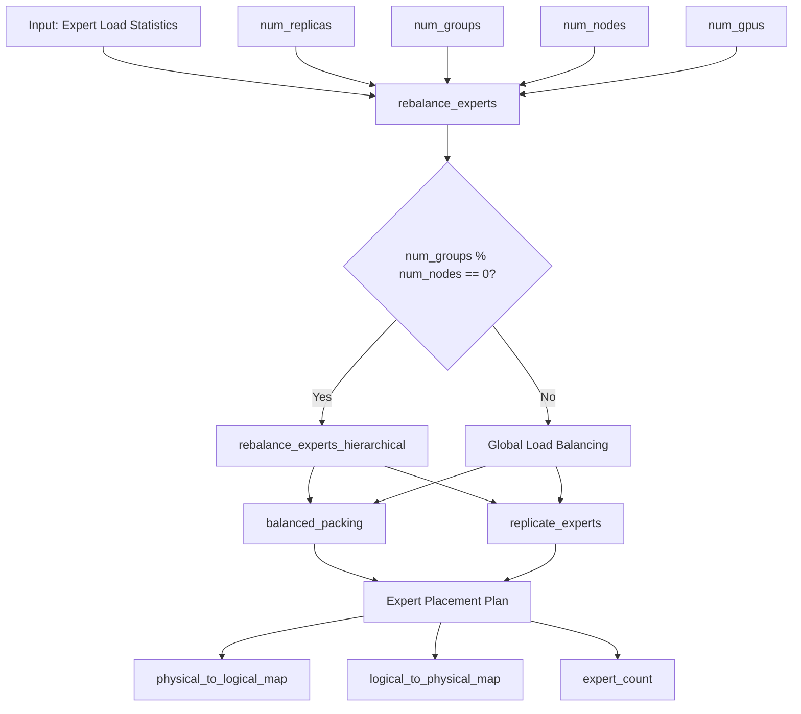
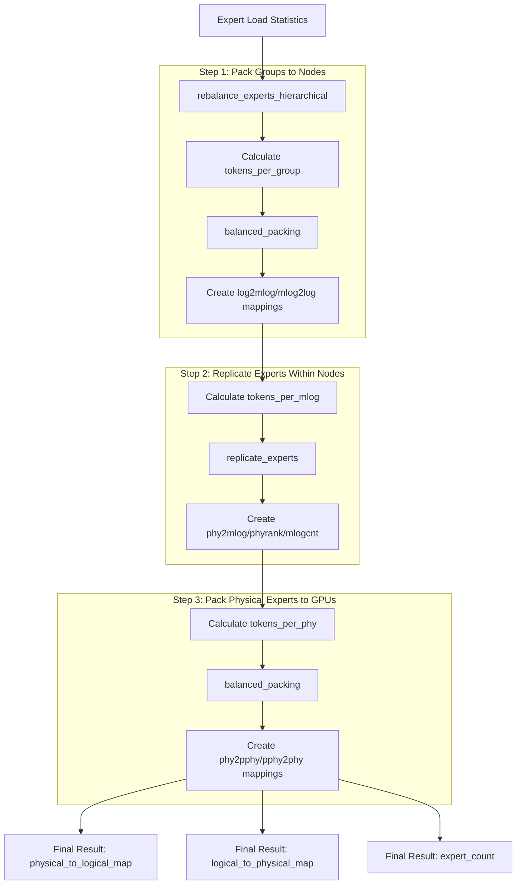
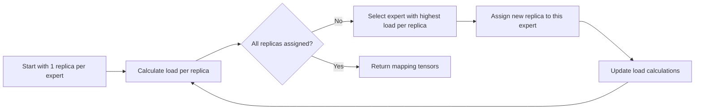
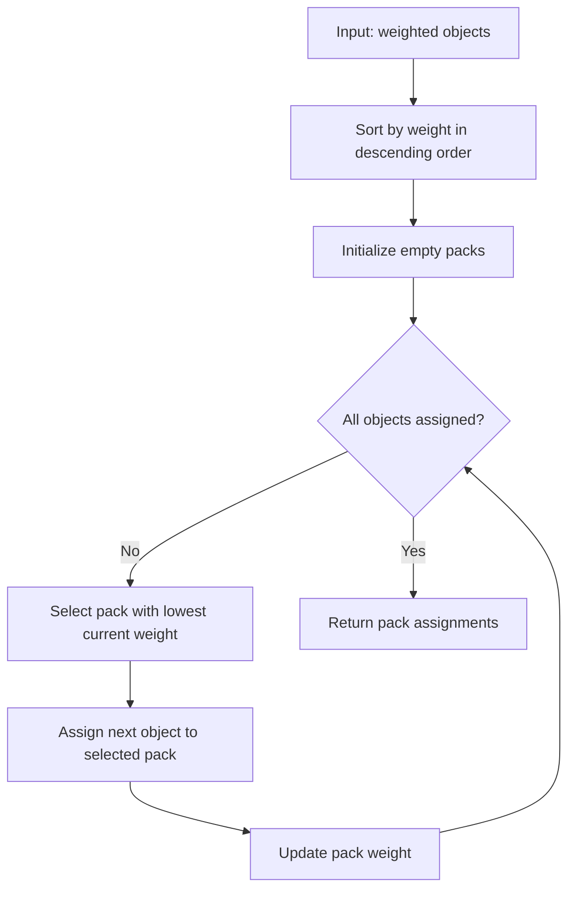
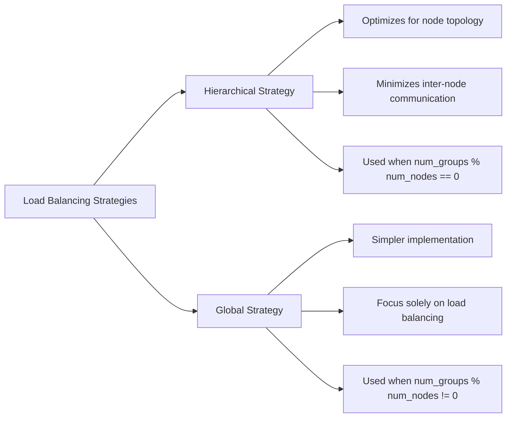

<!-- source: DeepWiki mcp.deepwiki.com · repo deepseek-ai/EPLB · page 1 Overview · fetched 2026-10-30 -->

# Overview

Relevant source files

The following files were used as context for generating this wiki page:

- [README.md](README.md)
- [eplb.py](eplb.py)

The Expert-Parallelism Load Balancer (EPLB) is a specialized system designed to optimize the distribution of experts in machine learning models that employ expert parallelism, specifically for Mixture of Experts (MoE) architectures. EPLB addresses the critical challenge of load imbalance that occurs when different experts experience varying computational demands across GPUs, which can significantly reduce training efficiency.

For detailed information about implementation strategies, see [Architecture and Core Concepts](#2) and [Load Balancing Strategies](#2.1).

Sources: [README.md:1-5](), [eplb.py:131-147]()

## The Problem of Expert Parallelism

When using expert parallelism, different experts are assigned to different GPUs to enable parallel processing. However, the workload of these experts can vary significantly depending on the tokens being processed, leading to a situation where some GPUs are heavily loaded while others remain underutilized. This imbalance reduces the overall efficiency of the training process.

### System Context Diagram

Sources: [README.md:3-5]()

## EPLB Solution Approach

EPLB implements a "redundant experts" strategy that:

1. Analyzes the load statistics of each expert
2. Duplicates heavily-loaded experts to create multiple replicas
3. Optimally places these replicas across available GPUs
4. Ensures balanced load distribution while considering network topology

The system provides two main load balancing strategies:

| Strategy | When Used | Key Characteristics |
|----------|-----------|---------------------|
| Hierarchical Load Balancing | When `num_groups % num_nodes == 0` | Optimizes for both load balance and network communication; Useful for prefilling stage |
| Global Load Balancing | When `num_groups % num_nodes != 0` | Focuses solely on global load balance; Used in decoding stage with larger expert-parallel size |

Sources: [README.md:5-9](), [README.md:17-32](), [eplb.py:150-156]()

## Core Components and Workflow

The main entry point to the system is the `rebalance_experts` function, which orchestrates the load balancing process. It is supported by two key algorithms:

1. `balanced_packing`: A greedy algorithm that packs weighted objects into bins to achieve balanced weight distribution
2. `replicate_experts`: An algorithm that determines how many replicas to create for each expert to minimize the maximum load

### Control Flow Diagram

Sources: [eplb.py:5-41](), [eplb.py:44-71](), [eplb.py:131-162]()

### Hierarchical Load Balancing Workflow

Sources: [eplb.py:74-129]()

### Expert Replication Process

Sources: [eplb.py:44-71]()

### Balanced Packing Algorithm

Sources: [eplb.py:5-41]()

## Integration and Usage

EPLB integrates into existing training pipelines through the `rebalance_experts` function [eplb.py:131-162](). This function serves as the primary interface for the system and takes the following parameters:

- `weight`: Load statistics tensor for all logical experts [layers, num_logical_experts]
- `num_replicas`: Number of physical experts (must be a multiple of `num_gpus`)
- `num_groups`: Number of expert groups
- `num_nodes`: Number of server nodes
- `num_gpus`: Number of GPUs (must be a multiple of `num_nodes`)

It returns three tensors:
- `physical_to_logical_map`: Maps physical experts to logical experts
- `logical_to_physical_map`: Maps logical experts to physical experts
- `expert_count`: Number of replicas for each logical expert

For comprehensive API documentation, see [API Reference](#3) and [rebalance_experts Function](#3.1).

Sources: [eplb.py:131-162](), [README.md:33-57]()

## Hierarchical vs. Global Load Balancing Strategies

Sources: [README.md:17-32](), [eplb.py:150-156]()

## Key Benefits

- **Improved Training Efficiency**: Balanced load distribution across GPUs reduces idle time and maximizes hardware utilization
- **Network Topology Awareness**: The hierarchical strategy reduces inter-node communication by keeping related experts on the same node when possible
- **Flexibility**: Supports different parallel configurations and adapts to various hardware setups
- **Simple Integration**: Straightforward interface that integrates into existing training frameworks

Sources: [README.md:1-9]()

---

