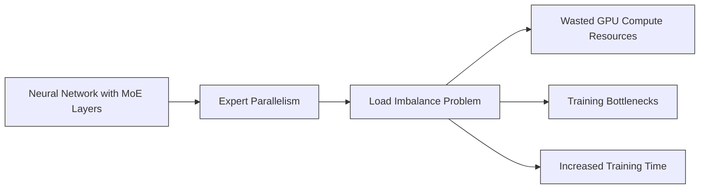
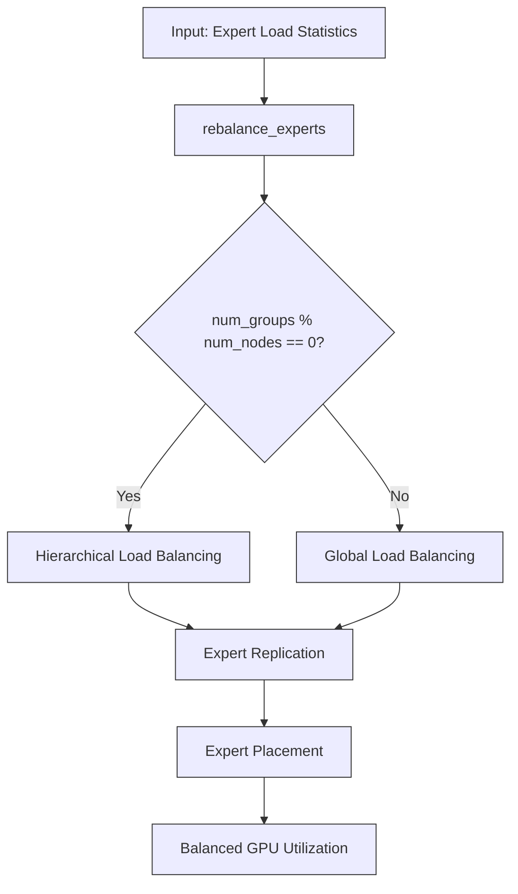
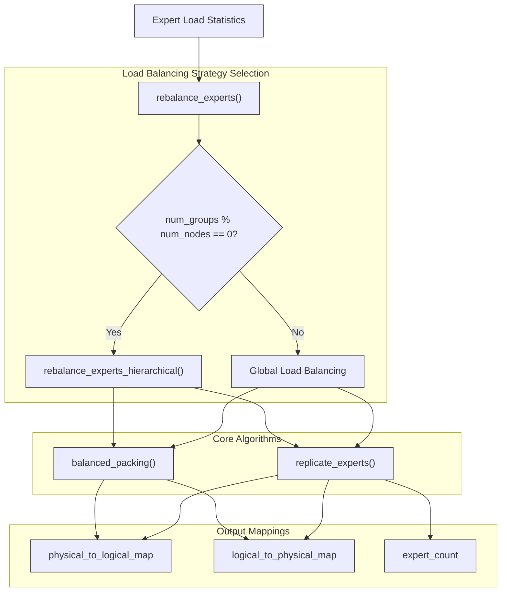
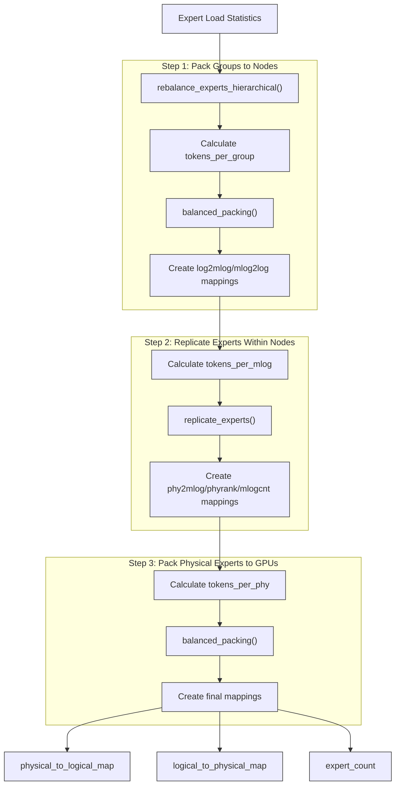
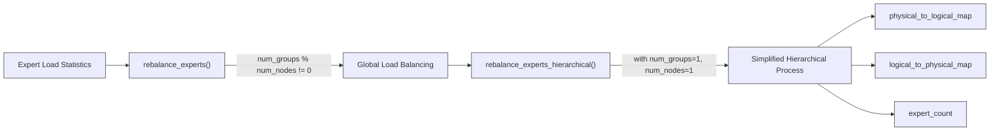
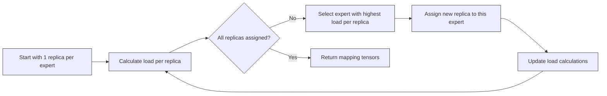
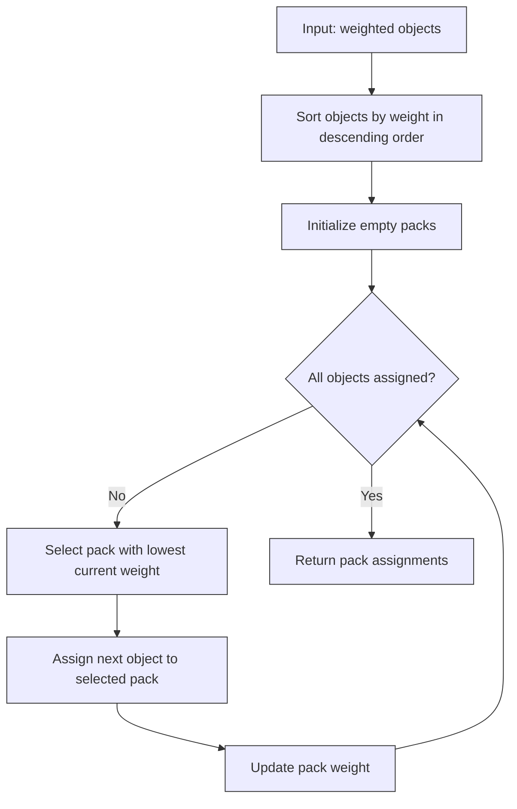

<!-- source: DeepWiki mcp.deepwiki.com · repo deepseek-ai/EPLB · page 2 Architecture and Core Concepts · fetched 2026-10-30 -->

# Architecture and Core Concepts

<details>
<summary>Relevant source files</summary>

The following files were used as context for generating this wiki page:

- [README.md](README.md)
- [eplb.py](eplb.py)

</details>


This page provides a comprehensive overview of the Expert Parallelism Load Balancer (EPLB) architecture and explains the core concepts involved in solving the challenge of load balancing in expert-parallel machine learning systems. For specific details about different load balancing strategies, see [Load Balancing Strategies](#2.1). For information about the expert replication algorithm, see [Expert Replication Algorithm](#2.2).

## Problem Statement

When training large neural networks with Mixture of Experts (MoE) layers using expert parallelism, different experts are assigned to different GPUs. This distribution creates a fundamental challenge: the computational load of different experts varies significantly depending on the current input data, leading to load imbalance across GPUs.



Sources: [eplb.py:131-163](), [README.md:3-8]()

## EPLB Solution Overview

The Expert Parallelism Load Balancer tackles this challenge through a two-pronged approach:

1. **Expert Replication**: Duplicating heavily-loaded experts to distribute their workload
2. **Strategic Placement**: Packing experts onto GPUs to balance computational load

Additionally, when possible, EPLB places experts from the same group on the same physical node to minimize inter-node communication overhead.



Sources: [eplb.py:131-163](), [README.md:10-14]()

## System Architecture

The EPLB system architecture consists of several interconnected components that work together to achieve balanced expert placement. The main components include:



Sources: [eplb.py:131-163](), [eplb.py:74-129]()

### Main Components

1. **Strategy Selector**: Determines whether to use hierarchical or global load balancing based on system configuration.
2. **Balanced Packing Algorithm**: Distributes weighted objects across containers to minimize load imbalance.
3. **Expert Replication Algorithm**: Determines optimal duplication of experts to minimize maximum load per replica.
4. **Mapping Generators**: Creates the mapping from physical experts to logical experts and vice versa.

## Core Data Structures

The EPLB system operates on several key data structures that represent the expert weights, their placement, and their replication count:

| Data Structure | Description | Shape |
|----------------|-------------|-------|
| `weight` | Load statistics for each logical expert | `[num_layers, num_logical_experts]` |
| `physical_to_logical_map` | Maps each physical expert to its logical expert | `[num_layers, num_replicas]` |
| `logical_to_physical_map` | Maps each logical expert to its physical expert replicas | `[num_layers, num_logical_experts, max_replicas]` |
| `expert_count` | Number of replicas for each logical expert | `[num_layers, num_logical_experts]` |

Sources: [eplb.py:131-147]()

## Hierarchical Load Balancing Process

When the number of expert groups is divisible by the number of nodes (`num_groups % num_nodes == 0`), EPLB uses a hierarchical approach that follows a three-step process:



Sources: [eplb.py:74-129](), [README.md:19-25]()

## Global Load Balancing Process

When the hierarchical approach is not suitable (`num_groups % num_nodes != 0`), EPLB uses a global load balancing policy that treats the system as having a single node and a single expert group, focusing solely on load balancing across all GPUs.



Sources: [eplb.py:154-156](), [README.md:27-31]()

## Algorithm Details

### Expert Replication

The expert replication algorithm iteratively assigns additional replicas to the experts with the highest load per replica:



Sources: [eplb.py:44-71]()

### Balanced Packing

The balanced packing algorithm ensures that weighted objects are distributed evenly across packs:



Sources: [eplb.py:5-41]()

## Execution Flow

The complete execution flow of the EPLB system demonstrates how all components interact:

```mermaid
sequenceDiagram
    participant C as "Client Code"
    participant R as "rebalance_experts()"
    participant H as "rebalance_experts_hierarchical()"
    participant B as "balanced_packing()"
    participant E as "replicate_experts()"
    
    C->>R: weight, num_replicas, num_groups, num_nodes, num_gpus
    
    R->>R: Check if num_groups % num_nodes == 0
    
    alt num_groups % num_nodes == 0
        R->>H: Use hierarchical policy
        H->>B: Pack groups to nodes
        B-->>H: group_pack_index, group_rank_in_pack
        H->>E: Replicate experts within nodes
        E-->>H: phy2mlog, phyrank, mlogcnt
        H->>B: Pack physical experts to GPUs
        B-->>H: pack_index, rank_in_pack
        H-->>R: phy2log, phyrank, logcnt
    else num_groups % num_nodes != 0
        R->>H: Use global policy (with num_groups=1, num_nodes=1)
        H->>B: Pack groups to nodes (simplified)
        B-->>H: group_pack_index, group_rank_in_pack
        H->>E: Replicate experts globally
        E-->>H: phy2mlog, phyrank, mlogcnt
        H->>B: Pack physical experts to GPUs
        B-->>H: pack_index, rank_in_pack
        H-->>R: phy2log, phyrank, logcnt
    end
    
    R->>R: Construct final mappings
    R-->>C: physical_to_logical_map, logical_to_physical_map, expert_count

    classDef default stroke:#333,stroke-width:1px
```

Sources: [eplb.py:131-163](), [eplb.py:74-129](), [eplb.py:5-71]()

## System Configuration Parameters

The EPLB system's behavior is controlled by several key configuration parameters:

| Parameter | Description |
|-----------|-------------|
| `weight` | Load statistics for each logical expert across layers |
| `num_replicas` | Total number of physical experts after replication (must be a multiple of `num_gpus`) |
| `num_groups` | Number of expert groups in the model |
| `num_nodes` | Number of server nodes in the system |
| `num_gpus` | Total number of GPUs (must be a multiple of `num_nodes`) |

Sources: [eplb.py:131-147]()

## Benefits and Trade-offs

### Benefits

- Improves training performance by balancing GPU utilization
- Minimizes inter-node communication through strategic expert placement
- Adapts to different hardware configurations through flexible strategy selection

### Trade-offs

- Introduces computational overhead for calculating optimal placements
- Requires accurate load statistics for optimal performance
- May increase memory usage due to expert replication

Sources: [README.md:3-14]()

## Summary

The EPLB architecture provides an efficient solution to the load balancing challenge in expert-parallel machine learning systems. By employing a combination of expert replication and strategic placement, and adapting its strategy based on system configuration, EPLB achieves balanced GPU utilization and improved training performance.

For more detailed information about the specific load balancing strategies, see [Load Balancing Strategies](#2.1). For an in-depth explanation of the expert replication algorithm, see [Expert Replication Algorithm](#2.2). For information about the balanced packing algorithm, see [Balanced Packing Algorithm](#2.3).

---

