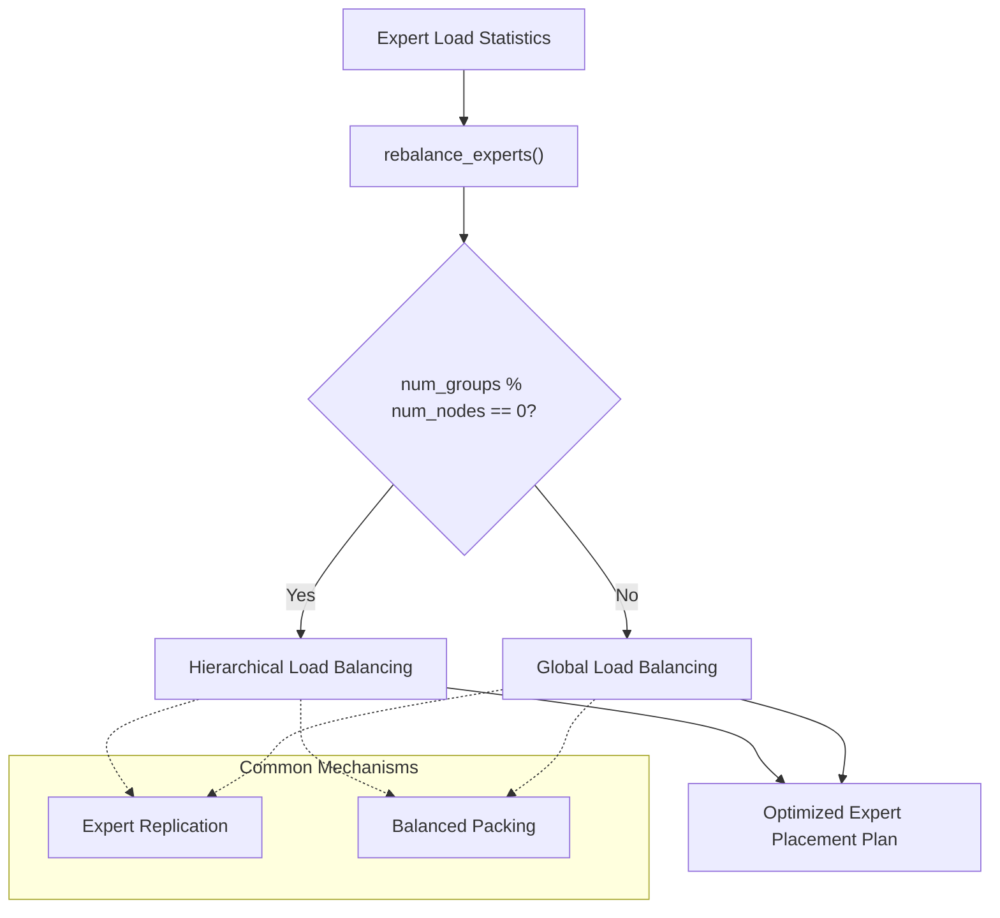
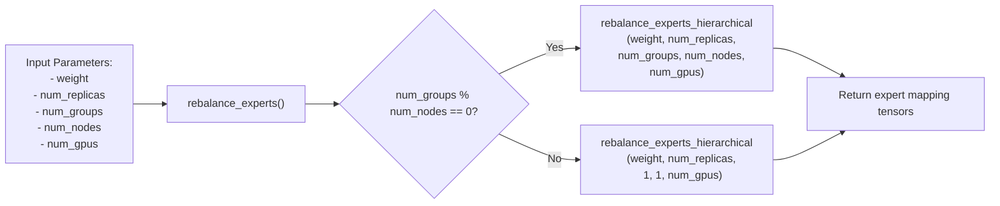
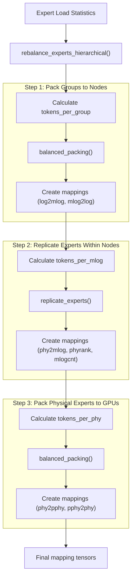
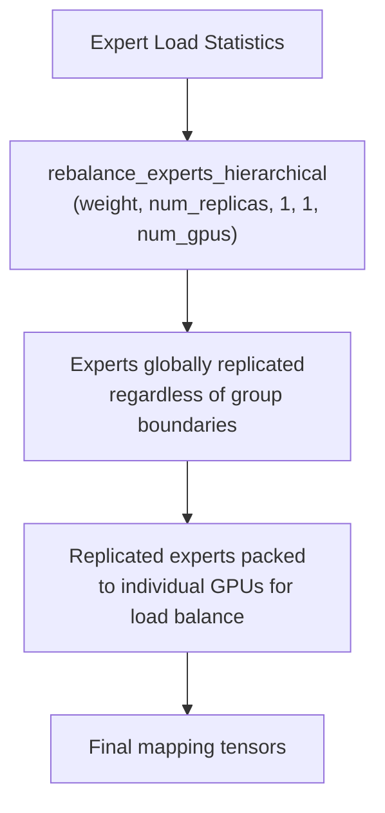
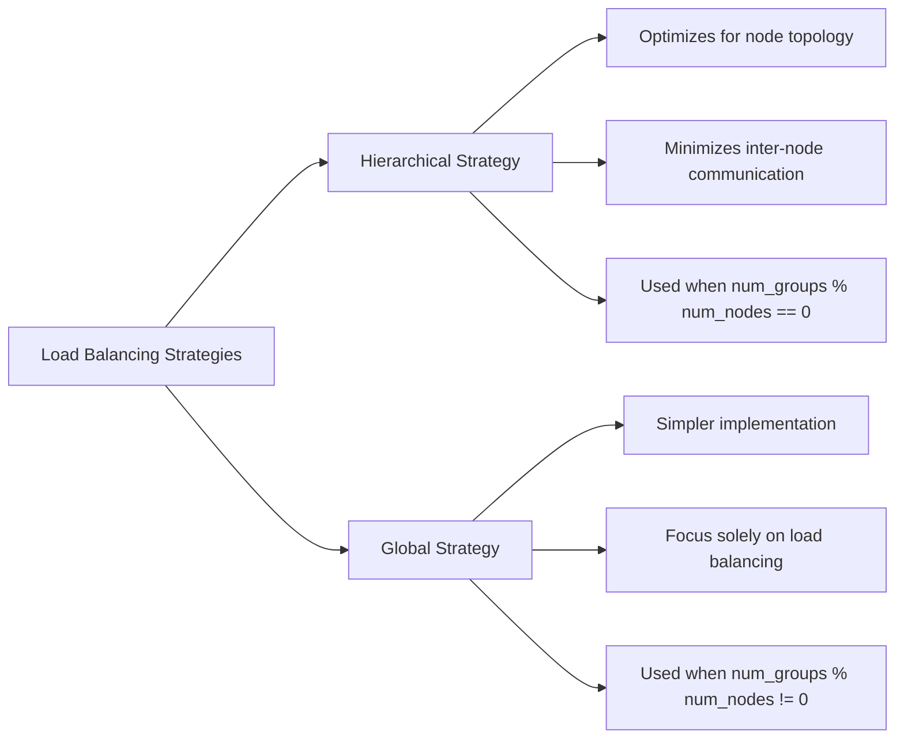
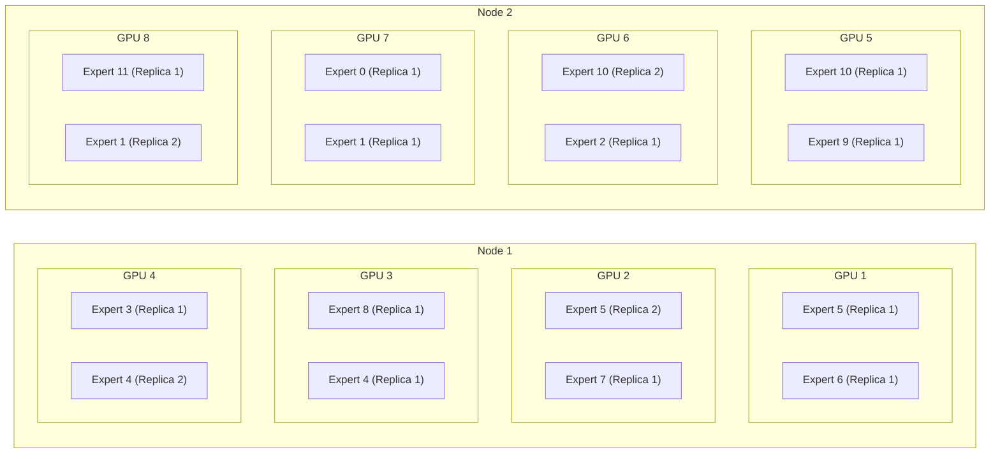

<!-- source: DeepWiki mcp.deepwiki.com · repo deepseek-ai/EPLB · page 2.1 Load Balancing Strategies · fetched 2026-10-30 -->

# Load Balancing Strategies

Relevant source files

The following files were used as context for generating this wiki page:

- [README.md](README.md)
- [eplb.py](eplb.py)

## Purpose and Scope

This document details the load balancing strategies implemented in the Expert Parallelism Load Balancer (EPLB). It explains how EPLB optimizes expert placement across GPUs to balance computational load during training of Mixture of Experts (MoE) models. For information about the expert replication algorithm specifically, see [Expert Replication Algorithm](#2.2). For details on the balanced packing algorithm, see [Balanced Packing Algorithm](#2.3).

Sources: [eplb.py:131-164](), [README.md:15-31]()

## Overview of Load Balancing in Expert Parallelism

Expert Parallelism distributes different experts across multiple GPUs. However, since different experts may experience varied workloads based on token routing patterns, some GPUs can become overloaded while others remain underutilized. EPLB addresses this imbalance through two primary strategies:

1. **Hierarchical Load Balancing**: A topology-aware approach that considers node boundaries
2. **Global Load Balancing**: A simpler approach that focuses solely on overall balance

Both strategies utilize expert replication (duplicating heavy-loaded experts) and balanced packing (distributing experts to minimize load variance) to achieve optimal GPU utilization.

Sources: [eplb.py:131-156](), [README.md:15-31]()

## Strategy Selection Logic

The decision between hierarchical and global load balancing is made in the main `rebalance_experts` function. The selection is based on whether the number of expert groups is divisible by the number of nodes:

When `num_groups` is divisible by `num_nodes`, we use hierarchical load balancing to take advantage of group-limited expert routing. When not divisible, we use global load balancing by calling the hierarchical function with special parameters that effectively ignore node topology (by setting `num_groups=1, num_nodes=1`).

Sources: [eplb.py:131-156](), [README.md:17-31]()

## Hierarchical Load Balancing

The hierarchical load balancing strategy is designed to work with group-limited expert routing, where experts are organized into groups and tokens can only be routed to experts within their assigned group. This strategy optimizes expert placement while considering node boundaries to minimize inter-node communication.

### When It's Used

Hierarchical load balancing is used when `num_groups % num_nodes == 0`. This condition ensures that expert groups can be evenly distributed across nodes.

### Three-Step Process

1. **Pack Groups to Nodes**: Expert groups are packed to server nodes evenly, with load balancing across nodes.
2. **Replicate Experts Within Nodes**: Experts are replicated within each node to handle high load.
3. **Pack Physical Experts to GPUs**: Replicated experts are packed to individual GPUs within each node.

The hierarchical approach attempts to place experts of the same group on the same node whenever possible, which reduces inter-node data traffic.

Sources: [eplb.py:74-129](), [README.md:19-25]()

## Global Load Balancing

The global load balancing strategy provides a simpler approach that focuses solely on load balancing without considering expert group boundaries.

### When It's Used

Global load balancing is used when `num_groups % num_nodes != 0`, meaning expert groups cannot be evenly distributed across nodes. This often occurs during decoding stages with larger expert-parallel sizes.

### Implementation

Global load balancing is implemented by calling the hierarchical function with special parameters:
- `num_groups = 1` (treat all experts as a single group)
- `num_nodes = 1` (treat all GPUs as being in a single node)

In this approach, experts are replicated globally without considering their group assignments, and the replicated experts are packed to individual GPUs to ensure load balancing.

Sources: [eplb.py:155-156](), [README.md:27-31]()

## Strategy Comparison

The following table compares the key aspects of both load balancing strategies:

| Aspect | Hierarchical Load Balancing | Global Load Balancing |
|--------|----------------------------|----------------------|
| **When used** | When `num_groups % num_nodes == 0` | When `num_groups % num_nodes != 0` |
| **Node awareness** | Considers node boundaries | Ignores node topology |
| **Expert groups** | Maintains group locality | Treats all experts as one group |
| **Communication** | Minimizes inter-node traffic | May have higher inter-node traffic |
| **Implementation** | 3-step hierarchical process | Simplified 1-level process |
| **Use case** | Prefilling stage with smaller expert-parallel size | Decoding stage with larger expert-parallel size |

Sources: [eplb.py:131-156](), [README.md:17-31]()

## Output Format and Usage

Both strategies produce the same output format to ensure consistent integration with the rest of the system:

1. `physical_to_logical_map`: Maps each physical expert to its corresponding logical expert
2. `logical_to_physical_map`: Maps each logical expert to its physical replicas
3. `expert_count`: Number of replicas for each logical expert

These outputs allow the MoE model to distribute tokens appropriately across the redundant expert replicas and maintain awareness of the expert placement on physical devices.

Sources: [eplb.py:144-147](), [eplb.py:157-162]()

## Expert Placement Example

This diagram illustrates an example of hierarchical load balancing placement for the first layer of experts from the README example. Notice how experts are replicated based on their load, and experts within the same group tend to be placed on the same node.

Sources: [README.md:39-62]()

---

