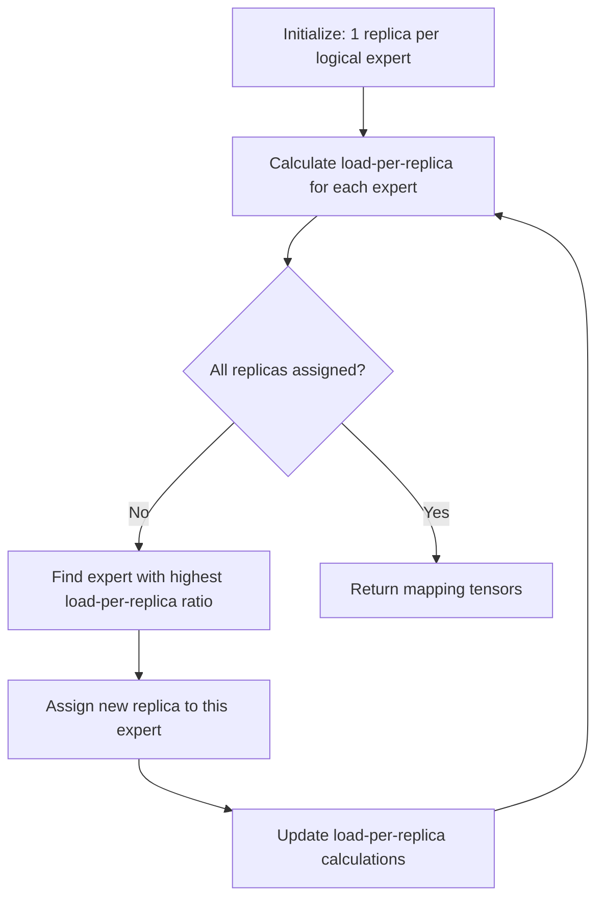
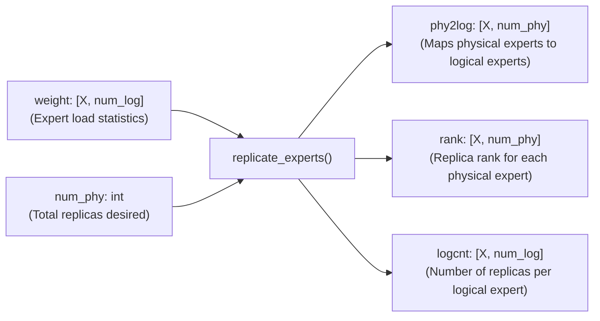
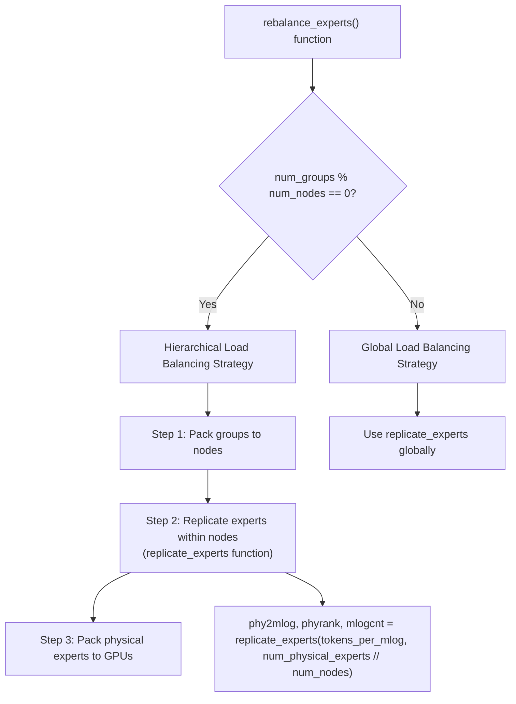

<!-- source: DeepWiki mcp.deepwiki.com · repo deepseek-ai/EPLB · page 2.2 Expert Replication Algorithm · fetched 2026-10-30 -->

# Expert Replication Algorithm

<details>
<summary>Relevant source files</summary>

The following files were used as context for generating this wiki page:

- [eplb.py](eplb.py)

</details>


## Purpose and Scope

The Expert Replication Algorithm is a critical component within the EPLB system that determines how to distribute logical experts across physical devices by creating replicas. Its primary goal is to minimize the maximum load on any single replica, thereby balancing computational workload across GPUs during training of models with Mixture of Experts (MoE) layers. This document focuses specifically on the replication strategy and algorithm implementation, while the subsequent packing of these replicated experts onto physical devices is covered in [Balanced Packing Algorithm](#2.3).

Sources: [eplb.py:44-71]()

## Algorithm Overview

The Expert Replication Algorithm employs a greedy approach to distribute load optimally. It starts with one replica per logical expert and iteratively adds replicas to the expert with the highest load-per-replica ratio until all desired replicas are assigned.

### Core Algorithm Diagram



Sources: [eplb.py:44-71]()

## Function Implementation

The algorithm is implemented in the `replicate_experts` function, which takes the expert load statistics and desired number of physical experts as inputs. It returns three tensors that define how the logical experts map to physical experts:



Sources: [eplb.py:44-71]()

## Algorithm Details

The `replicate_experts` function follows these steps:

1. **Initialization Phase**:
   - Sets up a one-to-one mapping for the first `num_log` physical experts
   - Initializes each logical expert with one replica
   - Initializes the replica ranks to zero

2. **Replication Phase**:
   - For each additional physical expert (beyond `num_log`):
     - Calculates the current load-per-replica ratio for each logical expert
     - Identifies the logical expert with the highest ratio
     - Assigns the new physical expert to replicate this logical expert
     - Updates the mapping, rank, and count tensors

3. **Output Phase**:
   - Returns the completed mapping tensors

This process is iterative and ensures that each new replica is assigned to reduce the maximum load across all experts.

Sources: [eplb.py:44-71]()

## Implementation Details

Let's examine the key parts of the implementation:

```python
# Initialize mapping and counting tensors
phy2log = torch.arange(num_phy, dtype=torch.int64, device=device).repeat(n, 1)
rank = torch.zeros(n, num_phy, dtype=torch.int64, device=device)
logcnt = torch.ones(n, num_log, dtype=torch.int64, device=device)

# Iterative assignment of additional replicas
for i in range(num_log, num_phy):
    redundant_indices = (weight / logcnt).max(dim=-1).indices
    phy2log[:, i] = redundant_indices
    rank[:, i] = logcnt[arangen, redundant_indices]
    logcnt[arangen, redundant_indices] += 1
```

The critical line `redundant_indices = (weight / logcnt).max(dim=-1).indices` identifies which logical expert has the highest load-per-replica ratio. This expert then receives an additional replica, and the corresponding tensors are updated.

Sources: [eplb.py:63-70]()

## Worked Example

To illustrate the algorithm, consider a simple case with 3 logical experts and loads [100, 50, 200], where we want to create 6 physical experts.

| Iteration | Expert Loads | Replicas Count | Load Per Replica | New Replica Assigned To |
|-----------|--------------|----------------|------------------|--------------------------|
| Initial   | [100, 50, 200] | [1, 1, 1]    | [100, 50, 200]   | -                        |
| 1         | [100, 50, 200] | [1, 1, 1]    | [100, 50, 200]   | Expert 2 (load 200)      |
| 2         | [100, 50, 200] | [1, 1, 2]    | [100, 50, 100]   | Expert 0 (load 100)      |
| 3         | [100, 50, 200] | [2, 1, 2]    | [50, 50, 100]    | Expert 2 (load 100)      |

Final distribution: Expert 0 has 2 replicas, Expert 1 has 1 replica, and Expert 2 has 3 replicas.

Sources: [eplb.py:44-71]()

## Integration with EPLB System

The Expert Replication Algorithm is a key component in both hierarchical and global load balancing strategies:



In the hierarchical strategy, the algorithm is applied per node:
1. First, expert groups are packed to nodes
2. Then, `replicate_experts` is called to replicate experts within each node
3. Finally, the physical experts are packed to GPUs within each node

Sources: [eplb.py:74-129](), [eplb.py:113]()

## Performance Characteristics

The algorithm has the following characteristics:

- **Time Complexity**: O(n × (num_phy - num_log)), where n is the number of MoE layers
- **Space Complexity**: O(n × num_phy)
- **Optimality**: The greedy approach does not guarantee a globally optimal solution but provides an effective approximation that works well in practice

Sources: [eplb.py:44-71]()

## Edge Cases and Considerations

Several edge cases are important to understand:

1. **No Replication Needed**: When `num_phy == num_log`, each logical expert gets exactly one physical replica
2. **Maximum Replication**: There's no inherent limit to how many replicas a logical expert can have, but it's bounded by `num_phy - num_log + 1`
3. **Equal Loads**: If multiple experts have identical loads, the algorithm will choose one based on the result of `max()` operation (typically the first one encountered)

The algorithm asserts that `num_phy >= num_log` as we cannot have fewer physical experts than logical experts.

Sources: [eplb.py:58-60]()

## Conclusion

The Expert Replication Algorithm is an elegant solution to the problem of load balancing in expert-parallel systems. By dynamically assigning replicas to experts based on their load-per-replica ratio, it effectively minimizes computational bottlenecks and improves overall training efficiency. This algorithm forms a critical part of the EPLB system, working in conjunction with the [Balanced Packing Algorithm](#2.3) to optimize expert placement.

---

