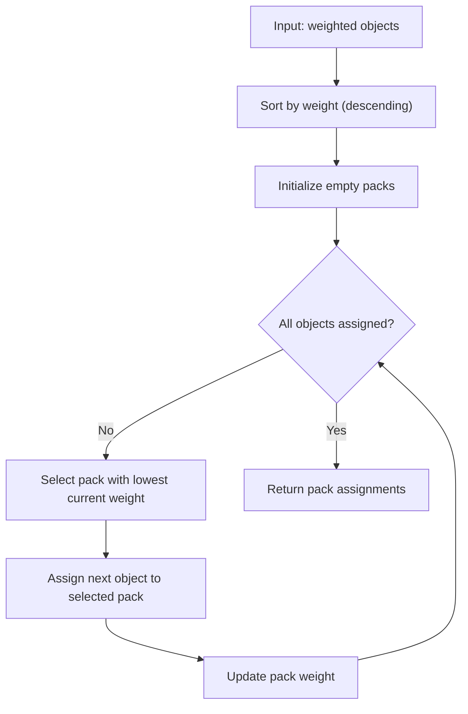
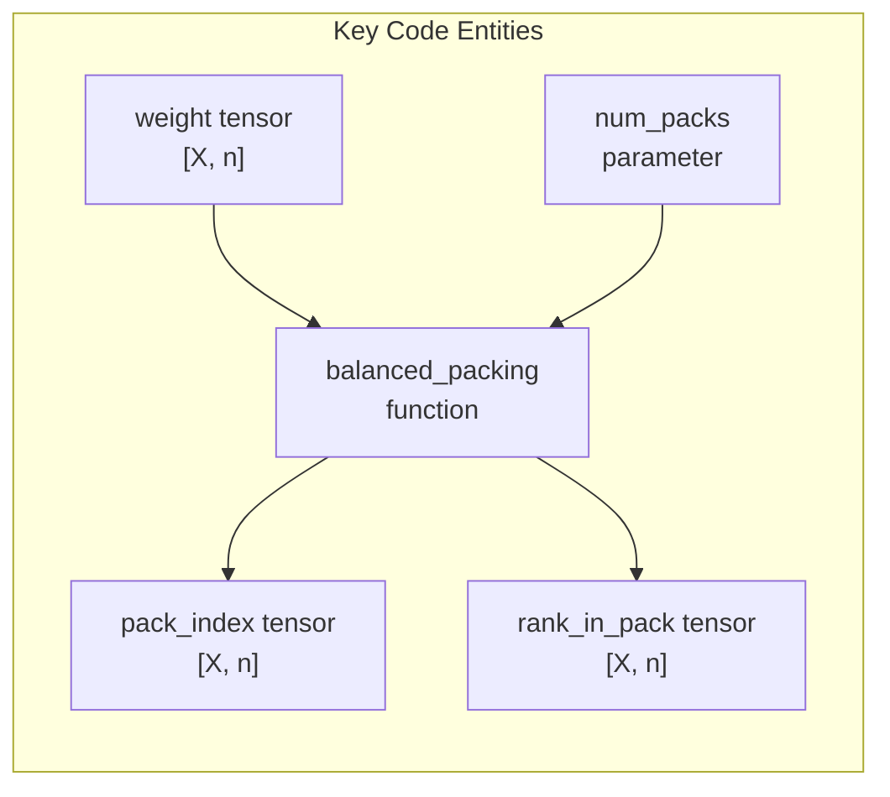
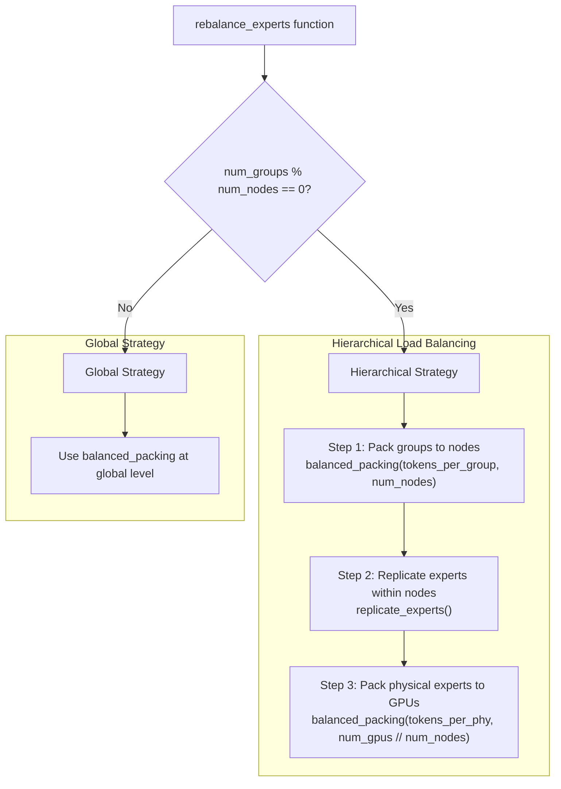
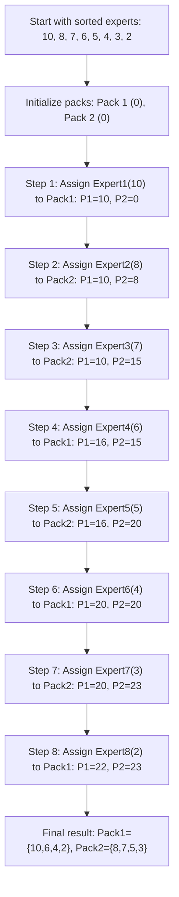
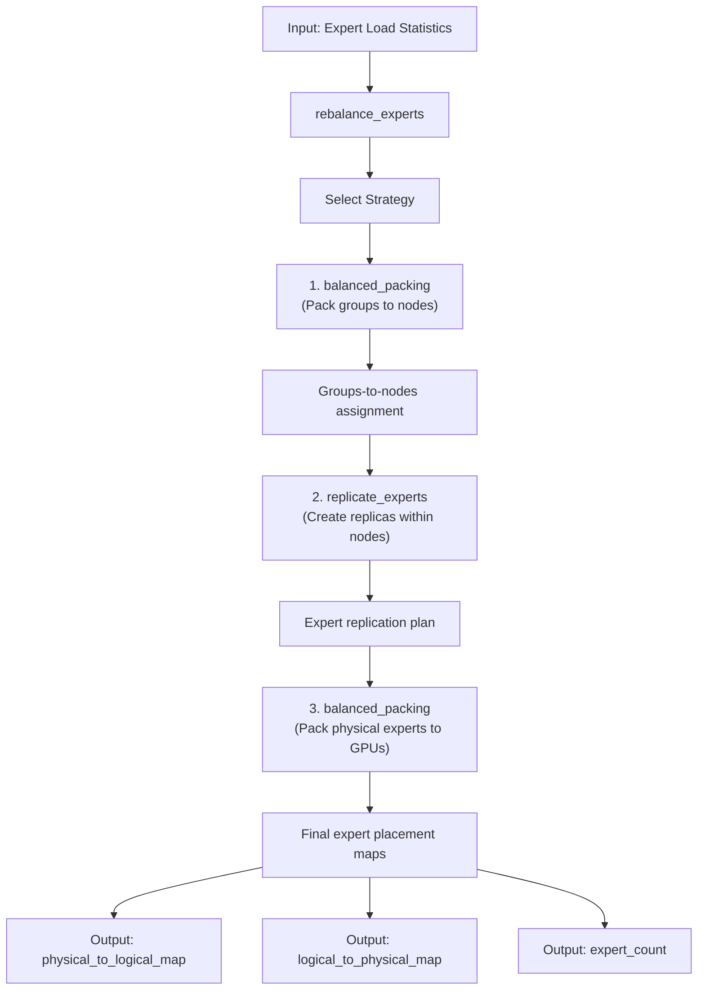

<!-- source: DeepWiki mcp.deepwiki.com · repo deepseek-ai/EPLB · page 2.3 Balanced Packing Algorithm · fetched 2026-10-30 -->

# Balanced Packing Algorithm

<details>
<summary>Relevant source files</summary>

The following files were used as context for generating this wiki page:

- [eplb.py](eplb.py)

</details>


## Purpose and Scope

The Balanced Packing Algorithm is a core component of the EPLB (Expert Parallelism Load Balancer) system that efficiently distributes weighted objects (experts or expert groups) across available resources (nodes or GPUs). This document explains the algorithm's implementation, operation, and role in optimizing expert placement for balanced GPU utilization.

Unlike the [Expert Replication Algorithm](#2.2), which determines how many replicas to create for each expert, the Balanced Packing Algorithm determines where to place those experts or expert groups to ensure balanced computational loads.

Sources: [eplb.py:5-41]()

## Algorithm Overview

The Balanced Packing Algorithm solves a specialized bin packing problem with the following constraints:
- Each bin (pack) must contain exactly the same number of objects
- The weights of all packs should be as balanced as possible

This is crucial for expert parallelism where uneven distribution of computation across GPUs can lead to inefficient resource utilization and slower training times.



Sources: [eplb.py:5-41]()

## Implementation Details

The algorithm is implemented in the `balanced_packing` function in the EPLB codebase:

### Function Signature and Parameters

```python
def balanced_packing(weight: torch.Tensor, num_packs: int) -> Tuple[torch.Tensor, torch.Tensor]:
```

- `weight`: A tensor of shape `[X, n]` representing the weights of `n` objects across `X` different layers
- `num_packs`: The number of packs (bins) to distribute the objects into

### Return Values

- `pack_index`: A tensor of shape `[X, n]` containing the pack index for each object
- `rank_in_pack`: A tensor of shape `[X, n]` containing the rank (position) of each object within its assigned pack

### Key Implementation Components

1. **Precondition Check**: The function asserts that `num_groups % num_packs == 0`, ensuring each pack will contain exactly the same number of objects.

2. **Special Case Handling**: If there's only one object per pack (`groups_per_pack == 1`), the function returns a simple linear assignment without running the balancing algorithm.

3. **Sorting**: Objects are sorted by weight in descending order, ensuring that heavier objects are placed first.

4. **Greedy Assignment**: The algorithm iteratively assigns each object to the pack with the lowest current total weight.



Sources: [eplb.py:5-41]()

## Usage in EPLB System

The Balanced Packing Algorithm is used at multiple levels in the EPLB system, particularly in the hierarchical load balancing strategy:

1. **Step 1: Packing expert groups to nodes** - Balance computational load across server nodes
   ```python
   group_pack_index, group_rank_in_pack = balanced_packing(tokens_per_group, num_nodes)
   ```

2. **Step 3: Packing physical experts to GPUs within nodes** - Balance computational load across GPUs
   ```python
   pack_index, rank_in_pack = balanced_packing(tokens_per_phy, num_gpus // num_nodes)
   ```



Sources: [eplb.py:104-105](), [eplb.py:118-119](), [eplb.py:143-157]()

## Example Scenario

Let's illustrate the algorithm with a concrete example. Assume we have 8 experts with the following weights and need to distribute them across 2 packs:

Initial experts with weights: [10, 8, 7, 6, 5, 4, 3, 2]



This example demonstrates how:
1. Each expert is placed in the pack with the lowest current weight
2. The final distribution achieves a near-optimal balance (difference of only 1 weight unit)
3. Each pack contains exactly 4 experts (8÷2=4)

Sources: [eplb.py:5-41]()

## Algorithm Analysis

### Time Complexity
- Sorting step: O(X * n log n) - where X is the number of layers and n is the number of objects
- Assignment step: O(X * n * m) - where m is the number of packs
- Overall: O(X * n * (log n + m))

### Space Complexity
- O(X * n) for the output tensors

### Performance Considerations
- The algorithm operates on CPU (`indices = weight.float().sort(-1, descending=True).indices.cpu()`)
- While this is a greedy algorithm (not guaranteed to find the global optimum), it performs very well in practice for expert balancing
- The algorithm ensures exactly equal numbers of objects per pack, which simplifies downstream processing

Sources: [eplb.py:27-40]()

## Integration with Overall System

The Balanced Packing Algorithm works in conjunction with the Expert Replication Algorithm to provide a comprehensive load balancing solution:



This diagram shows how the balanced packing algorithm is used twice in the hierarchical load balancing process - first to distribute expert groups to nodes, and then to distribute physical experts to GPUs within each node.

Sources: [eplb.py:74-129](), [eplb.py:131-162]()

---

