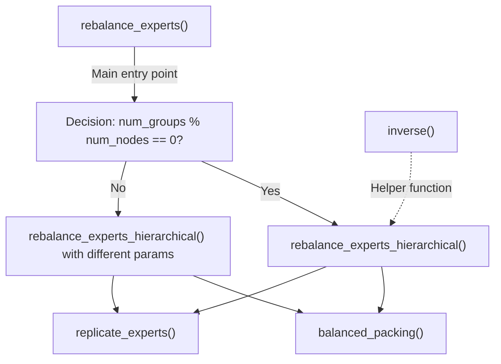
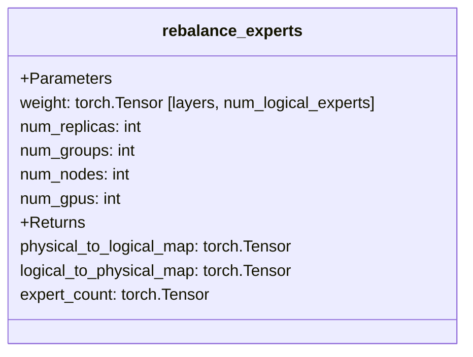
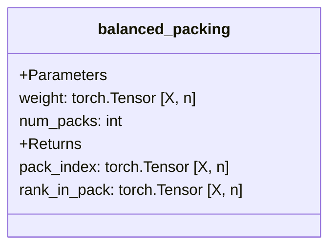
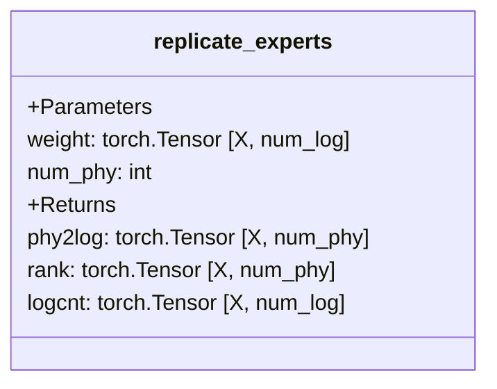
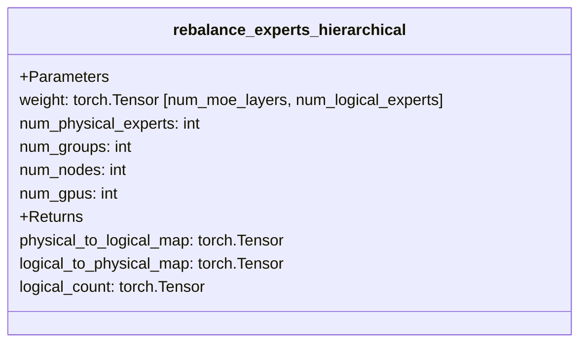
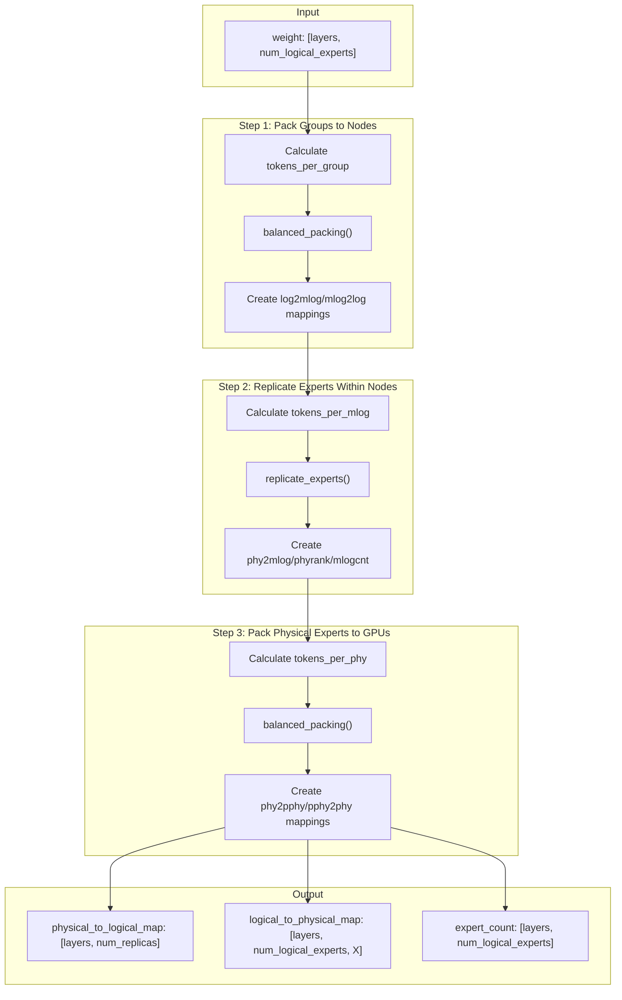
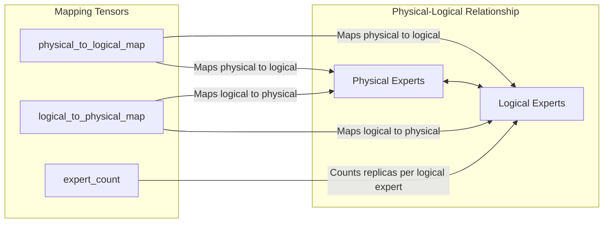

<!-- source: DeepWiki mcp.deepwiki.com · repo deepseek-ai/EPLB · page 3 API Reference · fetched 2026-10-30 -->

# API Reference

Relevant source files

The following files were used as context for generating this wiki page:

- [eplb.py](eplb.py)

This page provides a comprehensive reference for the Expert-Parallelism Load Balancer (EPLB) API, documenting all public functions, their parameters, return values, and usage notes. The EPLB system is designed to optimize expert placement in expert-parallelism machine learning training setups.

For conceptual information about load balancing strategies, see [Load Balancing Strategies](#2.1). For examples of how to use these APIs in practice, see [Usage Examples](#4).

## Function Overview

Sources: [eplb.py:131-164](), [eplb.py:74-129](), [eplb.py:5-41](), [eplb.py:44-71](), [eplb.py:98-101]()

## Main Entry Point

### rebalance_experts

**Function Signature:**
`rebalance_experts(weight, num_replicas, num_groups, num_nodes, num_gpus)`

**Purpose:**  
The main entry point for the expert-parallelism load balancer. This function determines the optimal placement of experts across GPUs to balance computational load.

**Parameters:**
- `weight` (torch.Tensor): A tensor of shape `[layers, num_logical_experts]` containing the load statistics for all logical experts.
- `num_replicas` (int): The number of physical experts after replication. Must be a multiple of `num_gpus`.
- `num_groups` (int): The number of expert groups.
- `num_nodes` (int): The number of server nodes, where intra-node communication (e.g., NVLink) is faster.
- `num_gpus` (int): The number of GPUs. Must be a multiple of `num_nodes`.

**Returns:**
- `physical_to_logical_map` (torch.Tensor): A tensor of shape `[layers, num_replicas]` mapping physical expert indices to logical expert indices.
- `logical_to_physical_map` (torch.Tensor): A tensor of shape `[layers, num_logical_experts, X]` mapping logical expert indices to physical expert indices.
- `expert_count` (torch.Tensor): A tensor of shape `[layers, num_logical_experts]` indicating the number of physical replicas for each logical expert.

**Behavior Notes:**
- The function chooses between hierarchical and global load balancing strategies based on whether `num_groups` is divisible by `num_nodes`.
- When `num_groups % num_nodes == 0`, it uses hierarchical load balancing, which optimizes for node topology.
- Otherwise, it falls back to global load balancing by treating the entire system as a single node.

Sources: [eplb.py:131-164]()

## Core Helper Functions

### balanced_packing

**Function Signature:**
`balanced_packing(weight, num_packs)`

**Purpose:**  
Packs `n` weighted objects into `m` packs, ensuring each pack contains exactly `n/m` objects and the weights of all packs are as balanced as possible.

**Parameters:**
- `weight` (torch.Tensor): A tensor of shape `[X, n]` containing the weight of each item.
- `num_packs` (int): The number of packs.

**Returns:**
- `pack_index` (torch.Tensor): A tensor of shape `[X, n]` containing the pack index of each item.
- `rank_in_pack` (torch.Tensor): A tensor of shape `[X, n]` containing the rank of each item within its pack.

**Constraints:**
- `num_groups % num_packs == 0`: The number of groups must be divisible by the number of packs.

**Algorithm:**
1. Items are sorted by weight in descending order.
2. Each item is assigned to the pack with the lowest current weight.
3. This greedy approach ensures weights are as balanced as possible across packs.

Sources: [eplb.py:5-41]()

### replicate_experts

**Function Signature:**
`replicate_experts(weight, num_phy)`

**Purpose:**  
Replicates `num_log` logical experts to `num_phy` physical replicas, such that the maximum load of all replicas is minimized.

**Parameters:**
- `weight` (torch.Tensor): A tensor of shape `[X, num_log]` containing the weight of each logical expert.
- `num_phy` (int): The total number of physical experts after replication.

**Returns:**
- `phy2log` (torch.Tensor): A tensor of shape `[X, num_phy]` mapping physical expert indices to logical expert indices.
- `rank` (torch.Tensor): A tensor of shape `[X, num_phy]` containing the replica rank for each physical expert.
- `logcnt` (torch.Tensor): A tensor of shape `[X, num_log]` indicating the number of replicas for each logical expert.

**Constraints:**
- `num_phy >= num_log`: The number of physical experts must be greater than or equal to the number of logical experts.

**Algorithm:**
1. Start with one replica per logical expert.
2. Iteratively add replicas to the expert with the highest load per replica.
3. Continue until all `num_phy` replicas are assigned.

Sources: [eplb.py:44-71]()

### rebalance_experts_hierarchical

**Function Signature:**
`rebalance_experts_hierarchical(weight, num_physical_experts, num_groups, num_nodes, num_gpus)`

**Purpose:**  
Implements a hierarchical load balancing strategy that optimizes for node topology and minimizes inter-node communication.

**Parameters:**
- `weight` (torch.Tensor): A tensor of shape `[num_moe_layers, num_logical_experts]` containing the weight of each logical expert.
- `num_physical_experts` (int): The number of physical experts after replication.
- `num_groups` (int): The number of expert groups.
- `num_nodes` (int): The number of server nodes.
- `num_gpus` (int): The number of GPUs.

**Returns:**
- `physical_to_logical_map` (torch.Tensor): A tensor mapping physical expert indices to logical expert indices.
- `logical_to_physical_map` (torch.Tensor): A tensor mapping logical expert indices to physical expert indices.
- `logical_count` (torch.Tensor): A tensor indicating the number of physical replicas for each logical expert.

**Constraints:**
- `num_logical_experts % num_groups == 0`: The number of logical experts must be divisible by the number of groups.
- `num_groups % num_nodes == 0`: The number of groups must be divisible by the number of nodes.
- `num_gpus % num_nodes == 0`: The number of GPUs must be divisible by the number of nodes.
- `num_physical_experts % num_gpus == 0`: The number of physical experts must be divisible by the number of GPUs.

Sources: [eplb.py:74-129]()

## Data Flow

### Hierarchical Load Balancing Flow

Sources: [eplb.py:74-129]()

### Mapping Relationships

Sources: [eplb.py:131-164]()

## Parameter Constraints

The following table summarizes the constraints on input parameters for the main API functions:

| Function | Parameter Constraints |
|----------|------------------------|
| `rebalance_experts` | • `num_replicas` must be a multiple of `num_gpus` • `num_gpus` must be a multiple of `num_nodes` |
| `rebalance_experts_hierarchical` | • `num_logical_experts % num_groups == 0` • `num_groups % num_nodes == 0` • `num_gpus % num_nodes == 0` • `num_physical_experts % num_gpus == 0` |
| `balanced_packing` | • `num_groups % num_packs == 0` |
| `replicate_experts` | • `num_phy >= num_log` |

Sources: [eplb.py:5-164]()

## Return Value Formats

All functions return tensors with specific shapes and meanings:

| Function | Return Values | Shapes | Descriptions |
|----------|--------------|--------|--------------|
| `rebalance_experts` | `physical_to_logical_map` `logical_to_physical_map` `expert_count` | `[layers, num_replicas]` `[layers, num_logical_experts, X]` `[layers, num_logical_experts]` | Maps physical experts to logical experts Maps logical experts to physical experts Number of replicas per logical expert |
| `balanced_packing` | `pack_index` `rank_in_pack` | `[X, n]` `[X, n]` | Pack index for each item Rank within pack for each item |
| `replicate_experts` | `phy2log` `rank` `logcnt` | `[X, num_phy]` `[X, num_phy]` `[X, num_log]` | Logical expert ID for each physical expert Replica rank for each physical expert Number of replicas for each logical expert |

Sources: [eplb.py:5-164]()

---

