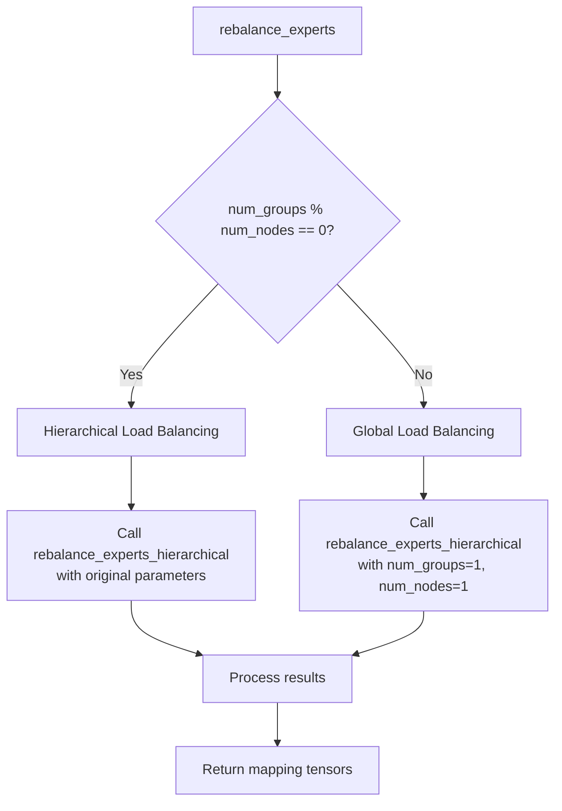
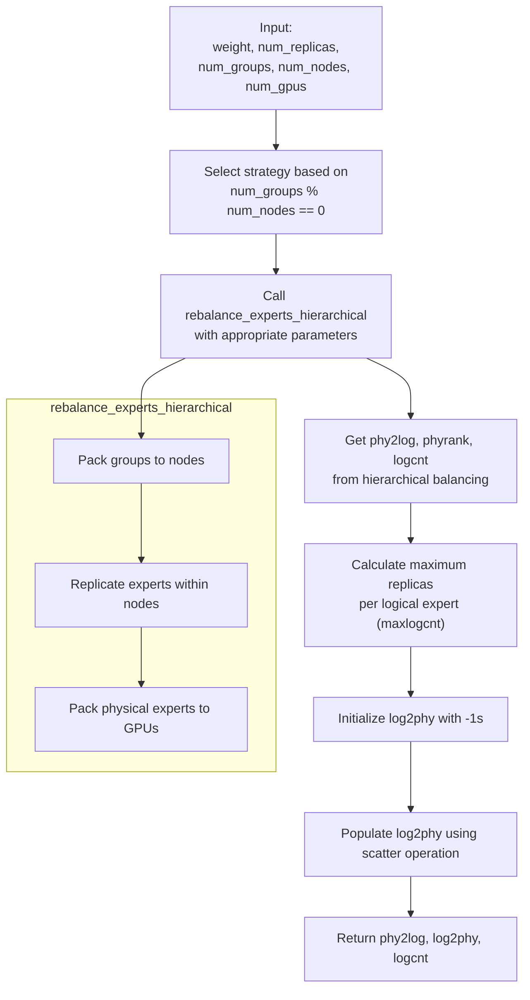
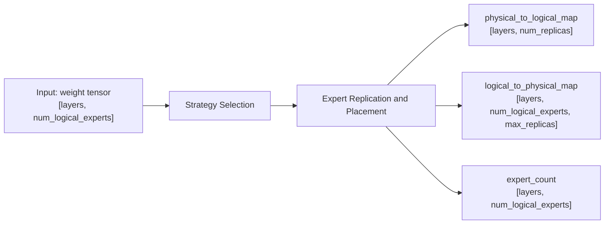
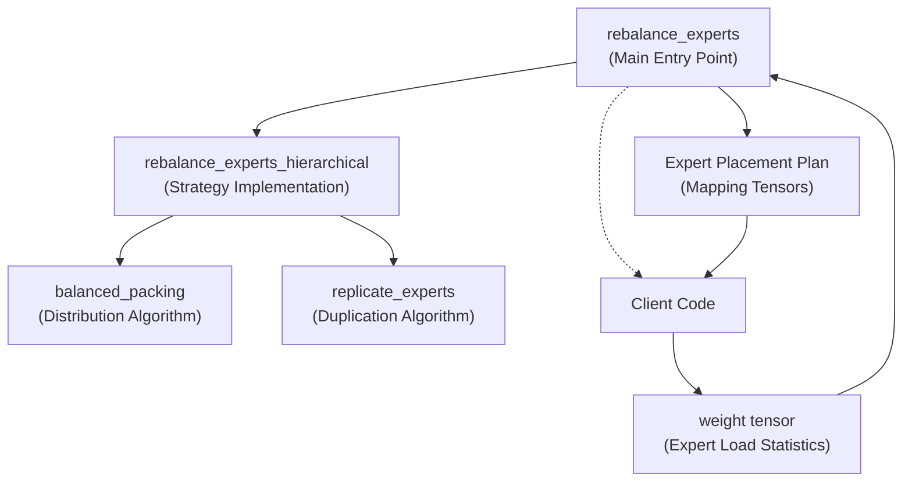

<!-- source: DeepWiki mcp.deepwiki.com · repo deepseek-ai/EPLB · page 3.1 rebalance_experts Function · fetched 2026-10-30 -->

# rebalance_experts Function

<details>
<summary>Relevant source files</summary>

The following files were used as context for generating this wiki page:

- [README.md](README.md)
- [eplb.py](eplb.py)

</details>


## Purpose and Scope

The `rebalance_experts` function serves as the main entry point for the Expert Parallelism Load Balancer (EPLB) system. It computes an optimized expert replication and placement plan based on the estimated load of each expert, balancing workloads across GPUs while considering network topology. This documentation covers the function's parameters, return values, internal decision logic, and usage patterns.

For information about the supporting algorithms used by this function, see [Helper Functions](#3.2).
For general information about load balancing strategies, see [Load Balancing Strategies](#2.1).

Sources: [eplb.py:131-162]()

## Function Signature

```python
def rebalance_experts(weight: torch.Tensor, 
                     num_replicas: int, 
                     num_groups: int,
                     num_nodes: int, 
                     num_gpus: int) -> Tuple[torch.Tensor, torch.Tensor, torch.Tensor]:
```

Sources: [eplb.py:131-132]()

## Parameters

| Parameter | Type | Description |
|-----------|------|-------------|
| `weight` | `torch.Tensor` | Load statistics for all logical experts, with shape `[num_moe_layers, num_logical_experts]`. Higher values indicate experts that receive more tokens/workload. |
| `num_replicas` | `int` | Total number of physical experts after replication. Must be a multiple of `num_gpus`. |
| `num_groups` | `int` | Number of expert groups in the model. In group-limited routing, experts within each group might be co-routed. |
| `num_nodes` | `int` | Number of server nodes in the cluster. Intra-node communication (e.g., via NVLink) is faster than inter-node communication. |
| `num_gpus` | `int` | Total number of GPUs across all nodes. Must be a multiple of `num_nodes`. |

Sources: [eplb.py:136-141](), [README.md:3-8]()

## Return Values

| Return Value | Type | Description |
|--------------|------|-------------|
| `physical_to_logical_map` | `torch.Tensor` | Tensor of shape `[num_moe_layers, num_replicas]` mapping each physical expert replica to its corresponding logical expert index. |
| `logical_to_physical_map` | `torch.Tensor` | Tensor of shape `[num_moe_layers, num_logical_experts, X]` mapping each logical expert to all its physical replica indices. X is the maximum number of replicas for any logical expert. |
| `expert_count` | `torch.Tensor` | Tensor of shape `[num_moe_layers, num_logical_experts]` indicating the number of physical replicas allocated to each logical expert. |

Sources: [eplb.py:143-146]()

## Decision Logic for Load Balancing Strategies

The `rebalance_experts` function selects between two load balancing strategies based on the divisibility of the number of expert groups by the number of nodes:



Sources: [eplb.py:149-156](), [README.md:17-31]()

## Strategy Selection and Rationale

### Hierarchical Load Balancing
Used when `num_groups % num_nodes == 0`. This strategy:
- Packs expert groups to nodes evenly
- Keeps experts from the same group on the same node when possible
- Minimizes inter-node communication
- Is optimal for the prefilling stage with smaller expert-parallel size

### Global Load Balancing
Used when `num_groups % num_nodes != 0`. This strategy:
- Treats the entire system as a flat structure
- Replicates experts globally without considering group locality
- Focuses solely on load balancing across GPUs
- Is better for the decoding stage with larger expert-parallel size

Sources: [eplb.py:149-156](), [README.md:19-31]()

## Function Workflow



Sources: [eplb.py:149-162](), [eplb.py:74-129]()

## Data Transformation Process



Sources: [eplb.py:131-162]()

## Implementation Details

The key steps in the implementation are:

1. Convert weights to float and move to CPU for computation
2. Select the appropriate load balancing strategy
3. Call `rebalance_experts_hierarchical` with either:
   - The original parameters (for hierarchical balancing)
   - Modified parameters: `num_groups=1, num_nodes=1` (for global balancing)
4. Determine the maximum replicas per logical expert
5. Create the logical-to-physical mapping tensor
6. Populate this tensor using a scatter operation to map each logical expert to its physical replicas

Sources: [eplb.py:149-162]()

## Usage Example

Here's a concrete example of using the `rebalance_experts` function for a 2-layer MoE model with 12 experts per layer:

```python
import torch
import eplb

# Expert load statistics for two MoE layers, each with 12 experts
weight = torch.tensor([
    [90, 132, 40, 61, 104, 165, 39, 4, 73, 56,.183, 86],
    [20, 107, 104, 64, 19, 197, 187, 157, 172, 86, 16, 27]
])

# Configuration parameters
num_replicas = 16  # Total physical experts (including 4 redundant experts)
num_groups = 4     # Number of expert groups
num_nodes = 2      # Number of server nodes
num_gpus = 8       # Total number of GPUs (4 per node)

# Call the EPLB entry point function
phy2log, log2phy, logcnt = eplb.rebalance_experts(
    weight, num_replicas, num_groups, num_nodes, num_gpus
)

print(phy2log)
# Output:
# tensor([[ 5,  6,  5,  7,  8,  4,  3,  4, 10,  9, 10,  2,  0,  1, 11,  1],
#         [ 7, 10,  6,  8,  6, 11,  8,  9,  2,  4,  5,  1,  5,  0,  3,  1]])
```

This example demonstrates how the function replicates heavy-loaded experts and distributes them across GPUs. In the output, each column represents a physical expert location, and the value indicates which logical expert is placed there. For instance, expert 5 is replicated twice in layer 0, and expert 6 is replicated twice in layer 1.

Sources: [README.md:36-57]()

## Relationship to Other Components



Sources: [eplb.py:5-72](), [eplb.py:131-162]()

## Notes and Constraints

- The `num_replicas` parameter must be a multiple of `num_gpus`
- The `num_gpus` parameter must be a multiple of `num_nodes`
- For hierarchical load balancing, `num_groups` must be a multiple of `num_nodes`
- The function performs computations on CPU, even if the input tensor is on GPU
- The output tensors will be on the same device as the input weight tensor

Sources: [eplb.py:149-157]()

---

