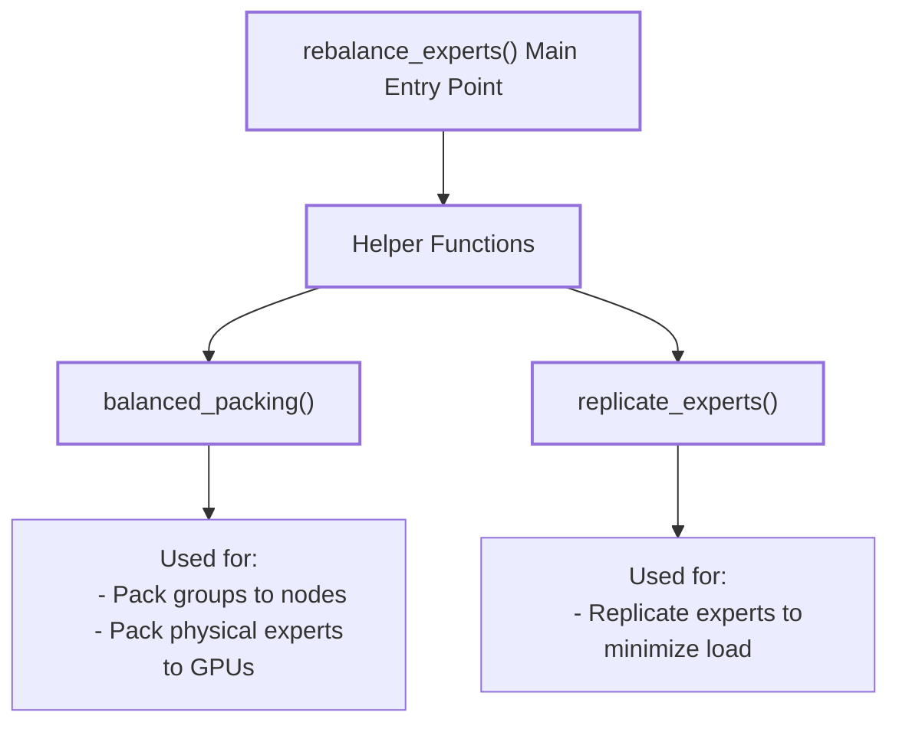
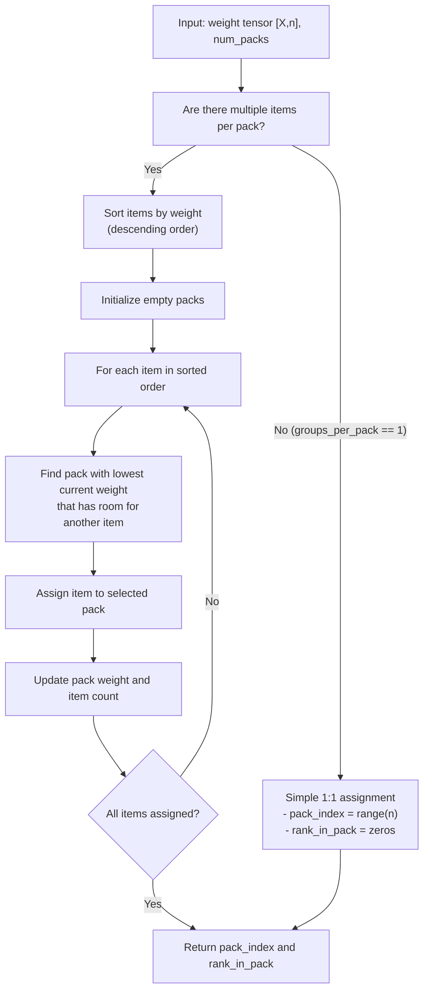
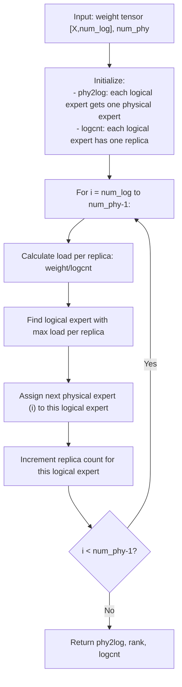
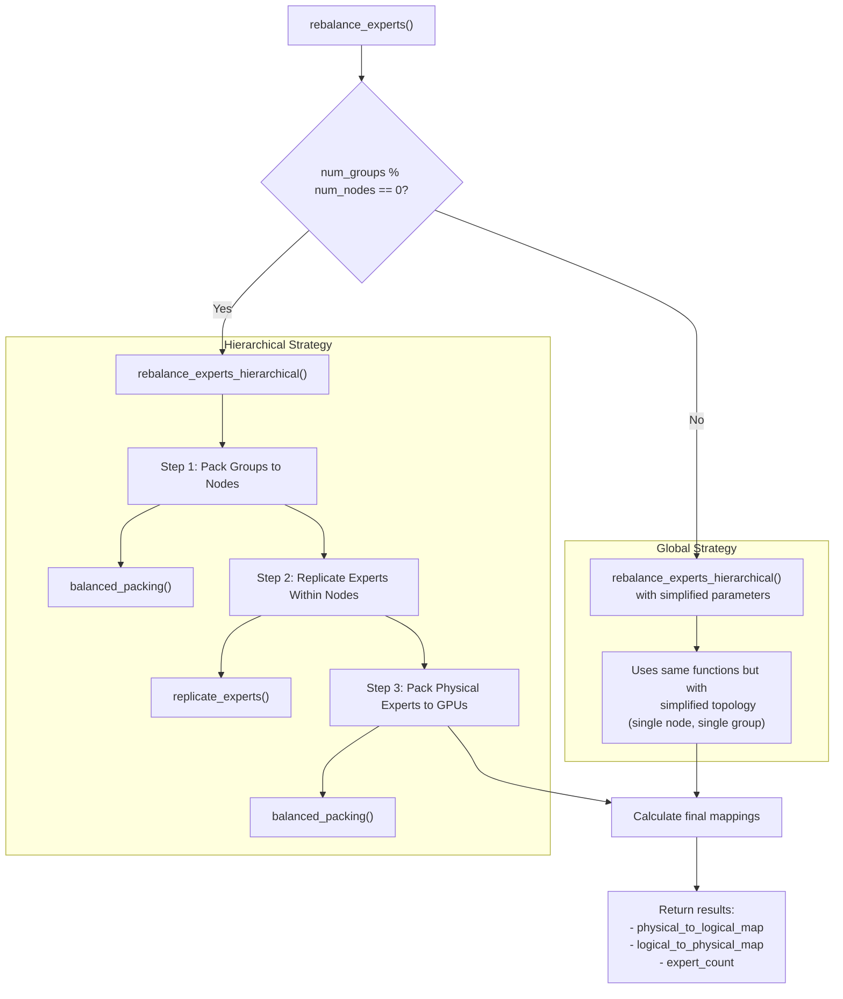

<!-- source: DeepWiki mcp.deepwiki.com · repo deepseek-ai/EPLB · page 3.2 Helper Functions · fetched 2026-10-30 -->

# Helper Functions

<details>
<summary>Relevant source files</summary>

The following files were used as context for generating this wiki page:

- [eplb.py](eplb.py)

</details>


This page documents the core supporting functions that power the Expert-Parallelism Load Balancer (EPLB). These helper functions are the algorithmic building blocks that enable efficient expert placement and load balancing in mixture-of-experts (MoE) neural networks. For information about the main entry point function, see [rebalance_experts Function](#3.1).

## Overview of Helper Functions

The EPLB system relies on two primary helper functions to perform its load balancing operations:

1. `balanced_packing`: Distributes weighted items across a specified number of packs to achieve balanced load
2. `replicate_experts`: Replicates logical experts to physical experts in a way that minimizes maximum load

These functions work together to optimize expert placement across GPUs and nodes, reducing communication overhead and balancing computational load.



Sources: [eplb.py:5-71](), [eplb.py:131-162]()

## The Balanced Packing Function

### Purpose and Signature

The `balanced_packing` function is designed to distribute a set of weighted objects across a specified number of packs in a way that balances the total weight in each pack as evenly as possible.

```
def balanced_packing(weight: torch.Tensor, num_packs: int) -> Tuple[torch.Tensor, torch.Tensor]
```

**Parameters:**
- `weight`: [X, n] tensor representing the weight of each item
- `num_packs`: Number of packs to distribute items across

**Returns:**
- `pack_index`: [X, n] tensor indicating the pack index for each item
- `rank_in_pack`: [X, n] tensor indicating the rank of each item within its assigned pack

**Constraints:**
- The total number of items must be evenly divisible by the number of packs

Sources: [eplb.py:5-17]()

### Algorithm Description

The balanced packing algorithm employs a greedy approach to distribute weighted items:

1. Sort items by weight in descending order
2. Assign each item to the pack with the lowest current total weight
3. Ensure each pack contains exactly the same number of items

This approach minimizes the maximum load across all packs, leading to better load balancing.



Sources: [eplb.py:18-41]()

### Example Usage in EPLB

The `balanced_packing` function is used in two critical places within the hierarchical load balancing strategy:

1. **Packing Expert Groups to Nodes** (Step 1 of hierarchical load balancing):
   ```python
   # Step 1: pack groups to nodes
   tokens_per_group = weight.unflatten(-1, (num_groups, group_size)).sum(-1)
   group_pack_index, group_rank_in_pack = balanced_packing(tokens_per_group, num_nodes) 
   ```

2. **Packing Physical Experts to GPUs** (Step 3 of hierarchical load balancing):
   ```python
   # Step 3: pack physical_experts to GPUs
   tokens_per_phy = (tokens_per_mlog / mlogcnt).gather(-1, phy2mlog)
   pack_index, rank_in_pack = balanced_packing(tokens_per_phy, num_gpus // num_nodes)
   ```

Sources: [eplb.py:104-105](), [eplb.py:118-119]()

## The Expert Replication Function

### Purpose and Signature

The `replicate_experts` function replicates a set of logical experts to a larger number of physical experts in a way that minimizes the maximum load on any replica.

```
def replicate_experts(weight: torch.Tensor, num_phy: int) -> Tuple[torch.Tensor, torch.Tensor, torch.Tensor]
```

**Parameters:**
- `weight`: [X, num_log] tensor representing the load of each logical expert
- `num_phy`: Total number of physical experts after replication

**Returns:**
- `phy2log`: [X, num_phy] tensor mapping physical experts to their logical expert IDs
- `rank`: [X, num_phy] tensor indicating the replica rank for each physical expert
- `logcnt`: [X, num_log] tensor indicating the number of replicas for each logical expert

**Constraints:**
- `num_phy` must be greater than or equal to the number of logical experts

Sources: [eplb.py:44-57]()

### Algorithm Description

The algorithm starts by assigning each logical expert to one physical expert, then iteratively adds replicas where they would provide the most benefit:

1. Initialize with each logical expert having exactly one physical expert
2. Calculate the load per replica for each logical expert
3. Identify the logical expert with the highest load per replica
4. Assign a new physical expert to that logical expert
5. Update load calculations and repeat until all physical experts are assigned

This greedy approach ensures that the maximum load on any physical expert is minimized.



Sources: [eplb.py:58-71]()

### Example Usage in EPLB

In the hierarchical load balancing strategy, `replicate_experts` is used in Step 2 to optimally replicate experts within nodes:

```python
# Step 2: construct redundant experts within nodes
tokens_per_mlog = weight.gather(-1, mlog2log).view(-1, num_logical_experts // num_nodes)
phy2mlog, phyrank, mlogcnt = replicate_experts(tokens_per_mlog, num_physical_experts // num_nodes)
```

This step determines how many replicas each logical expert should have and where those replicas should be placed.

Sources: [eplb.py:112-113]()

## Utility Functions

### The Inverse Function

The `inverse` function is a utility used within the hierarchical load balancing algorithm. It computes the inverse of a permutation tensor.

```python
def inverse(perm: torch.Tensor) -> torch.Tensor:
    inv = torch.empty_like(perm)
    inv.scatter_(1, perm, torch.arange(perm.size(1), dtype=torch.int64, device=perm.device).expand(perm.shape))
    return inv
```

**Purpose:** Given a tensor that maps from index A to index B, the inverse function creates a tensor that maps from index B back to index A.

**Used in:**
- Creating mappings between logical experts and their middle-level representations
- Creating mappings between physical experts and their packed representations

Sources: [eplb.py:98-101]()

## Integration of Helper Functions

The following diagram illustrates how these helper functions integrate within the overall EPLB system:



Sources: [eplb.py:131-162](), [eplb.py:74-129]()

## Implementation Details

### Balanced Packing Implementation

The `balanced_packing` function has a special case for when there's only one item per pack, which allows for a fast-path optimization:

```python
if groups_per_pack == 1:
    pack_index = torch.arange(weight.size(-1), dtype=torch.int64, device=weight.device).expand(weight.shape)
    rank_in_pack = torch.zeros_like(weight, dtype=torch.int64)
    return pack_index, rank_in_pack
```

For the general case, it uses a greedy algorithm that sorts items by weight and places them into the least-loaded pack:

```python
indices = weight.float().sort(-1, descending=True).indices.cpu()
pack_index = torch.full_like(weight, fill_value=-1, dtype=torch.int64, device='cpu')
rank_in_pack = torch.full_like(pack_index, fill_value=-1)
for i in range(num_layers):
    pack_weights = [0] * num_packs
    pack_items = [0] * num_packs
    for group in indices[i]:
        pack = min((i for i in range(num_packs) if pack_items[i] < groups_per_pack), 
                   key=pack_weights.__getitem__)
        assert pack_items[pack] < groups_per_pack
        pack_index[i, group] = pack
        rank_in_pack[i, group] = pack_items[pack]
        pack_weights[pack] += weight[i, group]
        pack_items[pack] += 1
```

Sources: [eplb.py:22-41]()

### Expert Replication Implementation

The `replicate_experts` function initializes with a one-to-one mapping of logical to physical experts, then iteratively adds replicas to the experts with the highest load per replica:

```python
phy2log = torch.arange(num_phy, dtype=torch.int64, device=device).repeat(n, 1)
rank = torch.zeros(n, num_phy, dtype=torch.int64, device=device)
logcnt = torch.ones(n, num_log, dtype=torch.int64, device=device)
arangen = torch.arange(n, dtype=torch.int64, device=device)
for i in range(num_log, num_phy):
    redundant_indices = (weight / logcnt).max(dim=-1).indices
    phy2log[:, i] = redundant_indices
    rank[:, i] = logcnt[arangen, redundant_indices]
    logcnt[arangen, redundant_indices] += 1
```

Sources: [eplb.py:62-71]()

## Performance Considerations

Both helper functions are designed with performance in mind:

1. **Balanced Packing:**
   - Uses a greedy algorithm with O(n log n) time complexity due to sorting
   - Has a fast path for the common case of one item per pack
   - Operations are performed on CPU for better handling of complex logic

2. **Expert Replication:**
   - Uses a greedy algorithm with O(n * r) time complexity, where r is the number of replicas to add
   - Leverages tensor operations for efficiency
   - Calculates optimal replica distribution in a single pass

These optimizations ensure that the EPLB system can quickly compute optimal expert placements for large models with many experts.

Sources: [eplb.py:5-71]()

---

