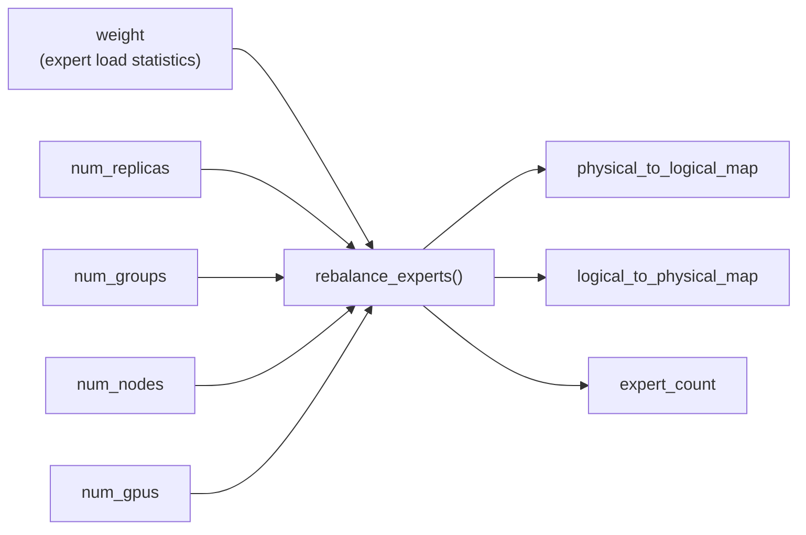
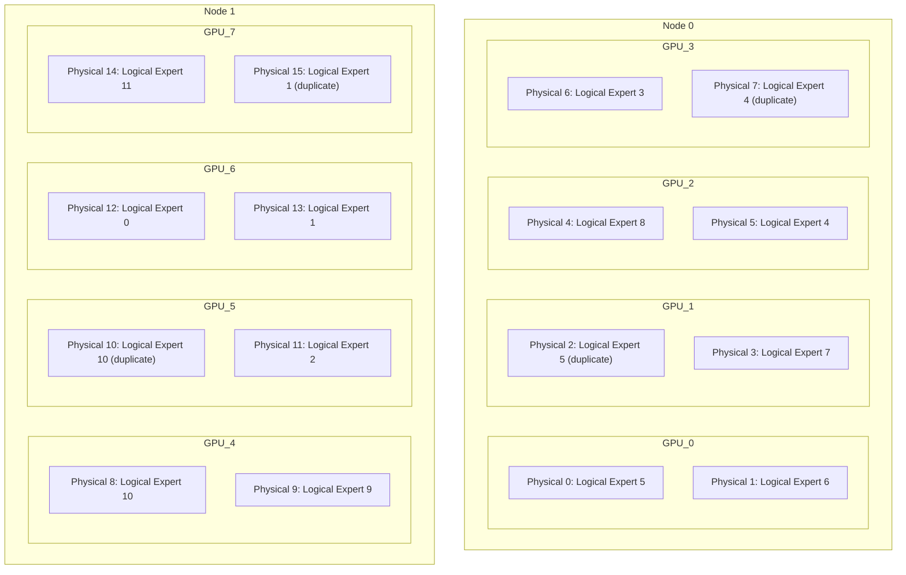
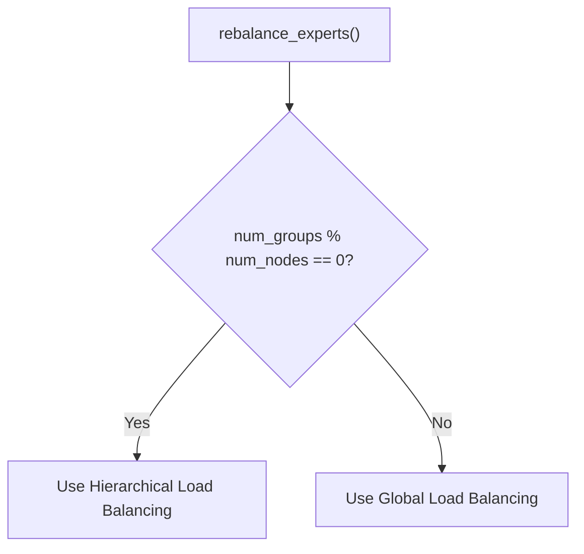
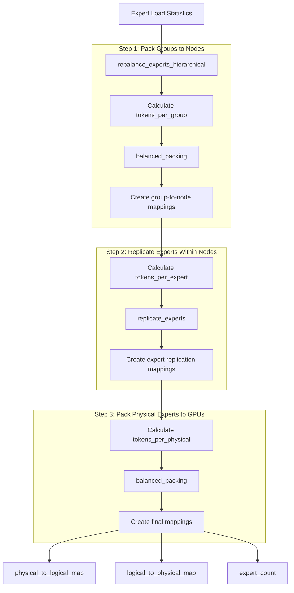
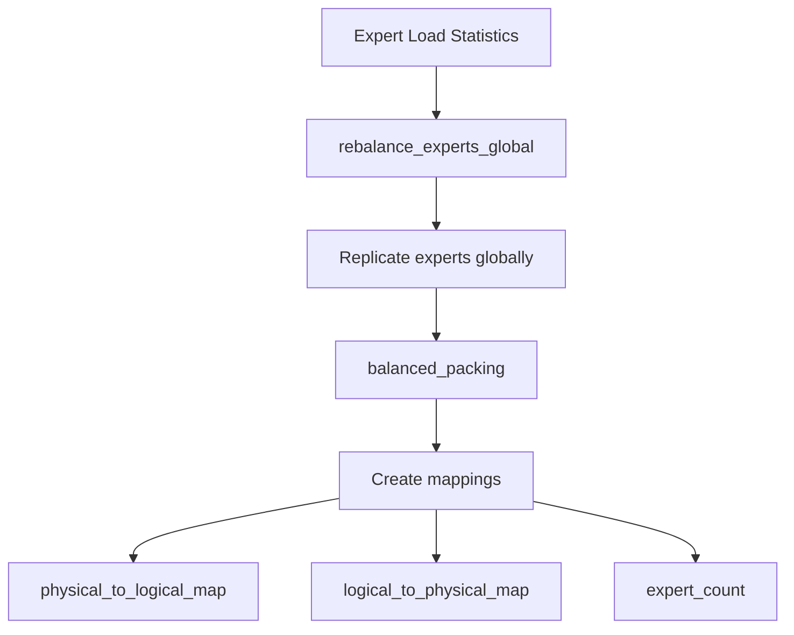
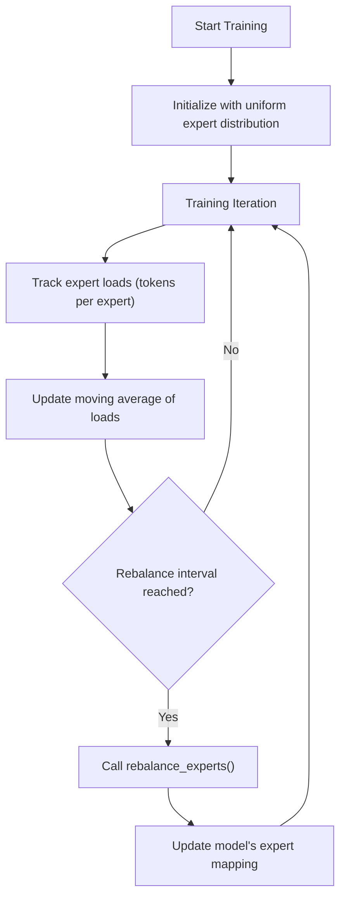

<!-- source: DeepWiki mcp.deepwiki.com · repo deepseek-ai/EPLB · page 4 Usage Examples · fetched 2026-10-30 -->

# Usage Examples

<details>
<summary>Relevant source files</summary>

The following files were used as context for generating this wiki page:

- [README.md](README.md)
- [example.png](example.png)

</details>


This page provides practical examples of how to use the Expert Parallelism Load Balancer (EPLB) system in various scenarios. It covers basic usage, interpreting outputs, and integration into training workflows. For information about the architecture and core concepts, see [Architecture and Core Concepts](#2), and for detailed API documentation, see [API Reference](#3).

## Basic Usage Pattern

The main function in EPLB is `rebalance_experts`, which computes a balanced expert replication and placement plan based on estimated expert loads.

### Function Signature and Data Flow

Here's a diagram showing the function parameters and return values:



Sources: [README.md:35-57]()

## Example from the README

The README provides a concrete example that demonstrates how to use EPLB:

```
weight = torch.tensor([[ 90, 132,  40,  61, 104, 165,  39,   4,  73,  56, 183,  86],
                       [ 20, 107, 104,  64,  19, 197, 187, 157, 172,  86,  16,  27]])

num_replicas = 16
num_groups = 4
num_nodes = 2
num_gpus = 8

phy2log, log2phy, logcnt = eplb.rebalance_experts(weight, num_replicas, num_groups, num_nodes, num_gpus)
print(phy2log)

# Output:
# tensor([[ 5,  6,  5,  7,  8,  4,  3,  4, 10,  9, 10,  2,  0,  1, 11,  1],
#         [ 7, 10,  6,  8,  6, 11,  8,  9,  2,  4,  5,  1,  5,  0,  3,  1]])
```

In this example:

1. `weight` is a 2D tensor representing the load of experts in two MoE layers:
   - Each row represents a layer (2 layers total)
   - Each column represents an expert (12 experts per layer)
   - Values represent the load (e.g., number of tokens processed)

2. Parameters:
   - `num_replicas = 16`: We want 16 total physical experts
   - `num_groups = 4`: Experts are organized into 4 groups
   - `num_nodes = 2`: We have 2 physical nodes
   - `num_gpus = 8`: We have 8 GPUs (4 per node)

Sources: [README.md:35-57]()

### Understanding the Input Parameters

| Parameter | Description |
|-----------|-------------|
| `weight` | A 2D tensor of shape [num_layers, num_experts] representing the load of each expert |
| `num_replicas` | Total number of expert replicas to create across all GPUs |
| `num_groups` | Number of expert groups (used for routing tokens to experts) |
| `num_nodes` | Number of physical nodes in the system |
| `num_gpus` | Total number of GPUs across all nodes |

Sources: [README.md:35-57]()

### Understanding the Output

The function returns three values:

| Return Value | Description |
|--------------|-------------|
| `physical_to_logical_map` | Tensor mapping physical experts to their corresponding logical experts |
| `logical_to_physical_map` | List of tensors mapping logical experts to their physical implementations |
| `expert_count` | Tensor containing the count of physical experts for each logical expert |

Let's focus on the first layer's mapping from the example:
```
[ 5, 6, 5, 7, 8, 4, 3, 4, 10, 9, 10, 2, 0, 1, 11, 1]
```

This means:
- Physical expert 0 implements logical expert 5
- Physical expert 1 implements logical expert 6
- Physical expert 2 implements logical expert 5 (again - it's duplicated)
- And so on...

Sources: [README.md:35-57]()

## Visualization of Expert Placement

The physical experts are arranged in order across the GPUs:
- Physical experts 0-1 are on GPU 0
- Physical experts 2-3 are on GPU 1
- And so on...

Let's visualize this expert placement for the first layer:



Here we can see:
1. Each physical expert implements one logical expert
2. Some logical experts (5, 4, 10, 1) are implemented by multiple physical experts
3. Each GPU has 2 physical experts, for a total of 16 physical experts

Sources: [README.md:58-62](), [example.png]()

## Load Balancing Strategies

EPLB automatically chooses between two load balancing strategies based on your parameters:



Sources: [README.md:15-31]()

### Hierarchical Load Balancing

Hierarchical load balancing is used when the number of expert groups is divisible by the number of nodes (`num_groups % num_nodes == 0`). In our example, since 4 groups ÷ 2 nodes = 2 (divisible), hierarchical load balancing is selected.

This strategy works in three steps:



Advantages:
- Places experts from the same group on the same node
- Reduces inter-node communication
- Suitable for prefilling stage with smaller expert-parallel size

Sources: [README.md:19-25]()

### Global Load Balancing

Global load balancing is used when the number of expert groups is not divisible by the number of nodes (`num_groups % num_nodes != 0`).

This strategy is simpler:



Advantages:
- Simpler approach focused solely on load balancing
- Suitable for decoding stage with larger expert-parallel size
- No constraint on group placement

To use global load balancing, you would need to set parameters so that `num_groups % num_nodes != 0`, for example by setting `num_groups = 3` and `num_nodes = 2`.

Sources: [README.md:27-31]()

## Integration in Training Workflows

In a real training scenario, you would typically follow this pattern:



As mentioned in the README, you would typically use a moving average of historical statistics to predict expert loads:

```
moving_avg = alpha * moving_avg + (1 - alpha) * current_loads
```

Then use this moving average as the `weight` parameter for `rebalance_experts`.

Sources: [README.md:11-13]()

## Using Different Configurations

You can adjust the parameters to `rebalance_experts` to suit different scenarios:

| Scenario | Recommendation |
|----------|---------------|
| Prefilling stage | Use hierarchical load balancing with smaller expert-parallel size |
| Decoding stage | Use global load balancing with larger expert-parallel size |
| High communication cost | Increase the number of replicas per expert to reduce communication |
| Highly skewed loads | Use more replicas for better load balancing |

By adjusting these parameters, you can optimize expert placement for your specific workload and hardware configuration.

Sources: [README.md:19-31]()

## Relationship Between Expert Replication and Load

Let's examine how the algorithm chooses which experts to replicate. Looking at our example:

1. First layer weight tensor: `[90, 132, 40, 61, 104, 165, 39, 4, 73, 56, 183, 86]`
2. First layer output mapping: `[5, 6, 5, 7, 8, 4, 3, 4, 10, 9, 10, 2, 0, 1, 11, 1]`

Notice that the experts with the highest loads get replicated:
- Expert 5 (load 165) appears twice
- Expert 4 (load 104) appears twice  
- Expert 10 (load 183) appears twice
- Expert 1 (load 132) appears twice

This demonstrates how EPLB identifies heavily loaded experts and creates duplicates to distribute their load across multiple GPUs.

Sources: [README.md:3-8]()

These examples illustrate the practical use of EPLB in various scenarios. By understanding how to interpret the output and adjust parameters, you can effectively balance expert loads in your MoE models and improve training efficiency.

---

