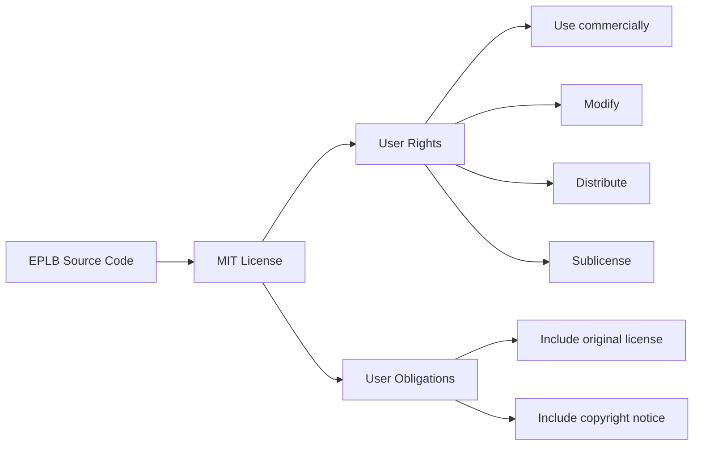
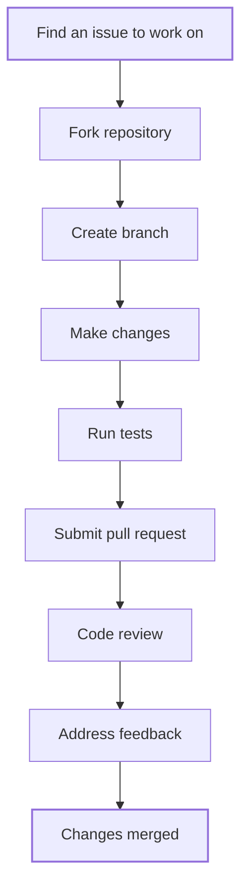
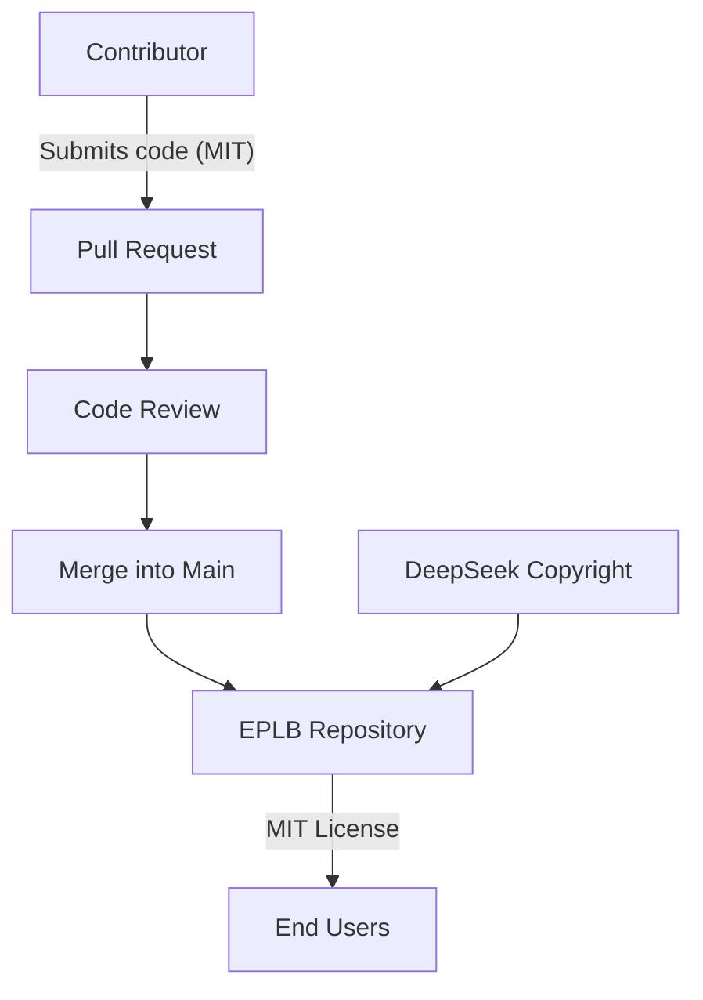

<!-- source: DeepWiki mcp.deepwiki.com · repo deepseek-ai/EPLB · page 5 License and Contributing · fetched 2026-10-30 -->

# License and Contributing

<details>
<summary>Relevant source files</summary>

The following files were used as context for generating this wiki page:

- [.gitignore](.gitignore)
- [LICENSE](LICENSE)

</details>


This document provides essential information about the license under which EPLB is distributed and guidelines for contributing to the project. For technical details about how the system works, please refer to the [Architecture and Core Concepts](#2) page.

## License Information

EPLB is licensed under the MIT License, a permissive free software license that places minimal restrictions on reuse and distribution.



Sources: [LICENSE:1-21]()

### License Terms

The MIT License grants the following permissions:

| Permission | Description |
|------------|-------------|
| Use | Use the software for any purpose |
| Modify | Modify the source code |
| Distribute | Distribute original or modified versions |
| Sublicense | Incorporate into other software and apply different license terms |
| Commercial use | Use in commercial products and applications |

The only obligations are:

1. Include the original copyright notice (© 2025 DeepSeek)
2. Include the full license text in all copies or substantial portions of the software

The license explicitly disclaims any warranty and limits liability, providing the software "as is" without any guarantees.

Sources: [LICENSE:5-21]()

## Contributing to EPLB

We welcome contributions from the community to improve and extend EPLB. This section outlines the process for contributing to the project.



Sources: Based on standard GitHub workflow

### Development Environment Setup

To set up your development environment for EPLB:

1. Fork the repository from [https://github.com/deepseek-ai/EPLB](https://github.com/deepseek-ai/EPLB)
2. Clone your fork locally
3. Create a virtual environment:
   ```bash
   python -m venv venv
   source venv/bin/activate  # On Windows: venv\Scripts\activate
   ```
4. Install development dependencies:
   ```bash
   pip install -e ".[dev]"
   ```

Sources: [.gitignore:38-138]()

### Coding Standards

When contributing to EPLB, please adhere to the following coding standards:

1. **Code formatting**: Code should be formatted using Ruff, as indicated by the `.ruff_cache/` entry in the `.gitignore` file.
2. **Type hints**: Use type hints for function parameters and return values to improve code clarity and facilitate static type checking.
3. **Documentation**: Add docstrings to new functions, classes, and modules following the existing documentation style.
4. **Tests**: Include unit tests for new functionality.

Sources: [.gitignore:170-171]()

### Issue Reporting

Before submitting a pull request, it's recommended to:

1. Check existing issues to see if your concern has already been reported
2. For new features or bugs, create an issue describing the feature or bug in detail
3. Reference the issue in your pull request

### Pull Request Process


When submitting a pull request:

1. Create a descriptive branch name related to the change
2. Make small, focused commits with clear commit messages
3. Ensure all tests pass
4. Update documentation if necessary
5. Submit the pull request with a clear description of the changes and their purpose
6. Be responsive to feedback and requested changes

Sources: Based on standard GitHub workflow

### Code Review Expectations

Contributors can expect the following during code review:

1. Technical feedback on implementation
2. Suggestions for improvements
3. Verification that the code meets project standards
4. Checks for test coverage
5. Documentation completeness review

### License Compliance for Contributions

All contributions to EPLB are subject to the same MIT License as the project itself. By submitting a pull request, you agree that your contributions will be licensed under the project's MIT License.

The diagram below illustrates how contributions are integrated into the project while maintaining license compliance:



Sources: [LICENSE:3-10]()

## Community Guidelines

When participating in the EPLB community:

1. Be respectful and inclusive of others
2. Focus on constructive feedback
3. Follow the project's code of conduct (if available)
4. Help others learn and grow

By following these guidelines, you'll help maintain a positive environment for all contributors and users of EPLB.