# Page: Overview

# Overview

<details>
<summary>Relevant source files</summary>

The following files were used as context for generating this wiki page:

- [README.md](README.md)
- [eplb.py](eplb.py)

</details>


The Expert-Parallelism Load Balancer (EPLB) is a specialized system designed to optimize the distribution of experts in machine learning models that employ expert parallelism, specifically for Mixture of Experts (MoE) architectures. EPLB addresses the critical challenge of load imbalance that occurs when different experts experience varying computational demands across GPUs, which can significantly reduce training efficiency.

For detailed information about implementation strategies, see [Architecture and Core Concepts](#2) and [Load Balancing Strategies](#2.1).

Sources: [README.md:1-5](), [eplb.py:131-147]()

## The Problem of Expert Parallelism

When using expert parallelism, different experts are assigned to different GPUs to enable parallel processing. However, the workload of these experts can vary significantly depending on the tokens being processed, leading to a situation where some GPUs are heavily loaded while others remain underutilized. This imbalance reduces the overall efficiency of the training process.

### System Context Diagram


Sources: [README.md:3-5]()

## EPLB Solution Approach

EPLB implements a "redundant experts" strategy that:

1. Analyzes the load statistics of each expert
2. Duplicates heavily-loaded experts to create multiple replicas
3. Optimally places these replicas across available GPUs
4. Ensures balanced load distribution while considering network topology

The system provides two main load balancing strategies:

| Strategy | When Used | Key Characteristics |
|----------|-----------|---------------------|
| Hierarchical Load Balancing | When `num_groups % num_nodes == 0` | Optimizes for both load balance and network communication; Useful for prefilling stage |
| Global Load Balancing | When `num_groups % num_nodes != 0` | Focuses solely on global load balance; Used in decoding stage with larger expert-parallel size |

Sources: [README.md:5-9](), [README.md:17-32](), [eplb.py:150-156]()

## Core Components and Workflow

The main entry point to the system is the `rebalance_experts` function, which orchestrates the load balancing process. It is supported by two key algorithms:

1. `balanced_packing`: A greedy algorithm that packs weighted objects into bins to achieve balanced weight distribution
2. `replicate_experts`: An algorithm that determines how many replicas to create for each expert to minimize the maximum load

### Control Flow Diagram

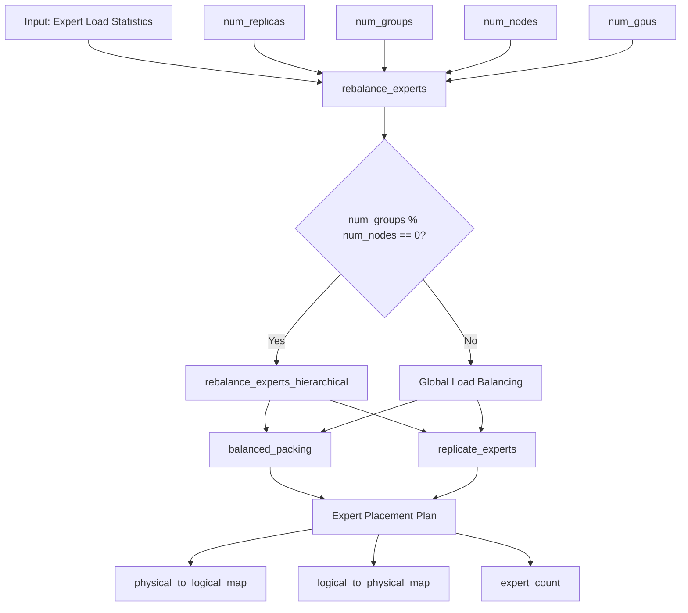

Sources: [eplb.py:5-41](), [eplb.py:44-71](), [eplb.py:131-162]()

### Hierarchical Load Balancing Workflow

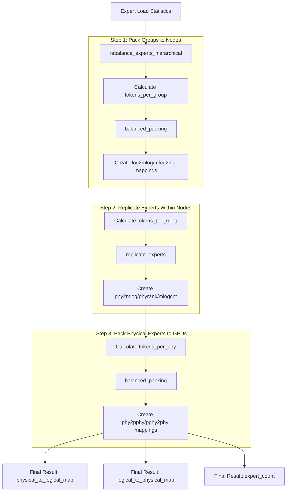

Sources: [eplb.py:74-129]()

### Expert Replication Process

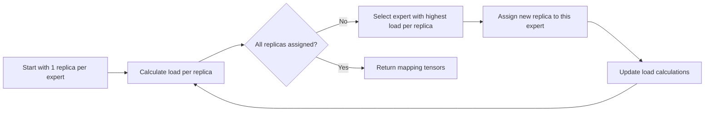

Sources: [eplb.py:44-71]()

### Balanced Packing Algorithm

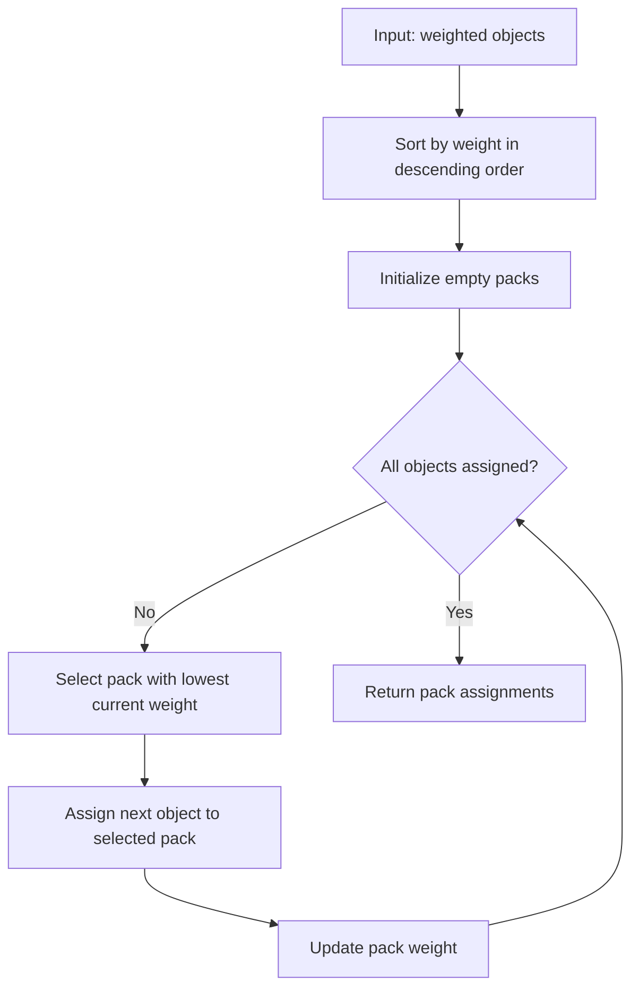

Sources: [eplb.py:5-41]()

## Integration and Usage

EPLB integrates into existing training pipelines through the `rebalance_experts` function [eplb.py:131-162](). This function serves as the primary interface for the system and takes the following parameters:

- `weight`: Load statistics tensor for all logical experts [layers, num_logical_experts]
- `num_replicas`: Number of physical experts (must be a multiple of `num_gpus`)
- `num_groups`: Number of expert groups
- `num_nodes`: Number of server nodes
- `num_gpus`: Number of GPUs (must be a multiple of `num_nodes`)

It returns three tensors:
- `physical_to_logical_map`: Maps physical experts to logical experts
- `logical_to_physical_map`: Maps logical experts to physical experts
- `expert_count`: Number of replicas for each logical expert

For comprehensive API documentation, see [API Reference](#3) and [rebalance_experts Function](#3.1).

Sources: [eplb.py:131-162](), [README.md:33-57]()

## Hierarchical vs. Global Load Balancing Strategies

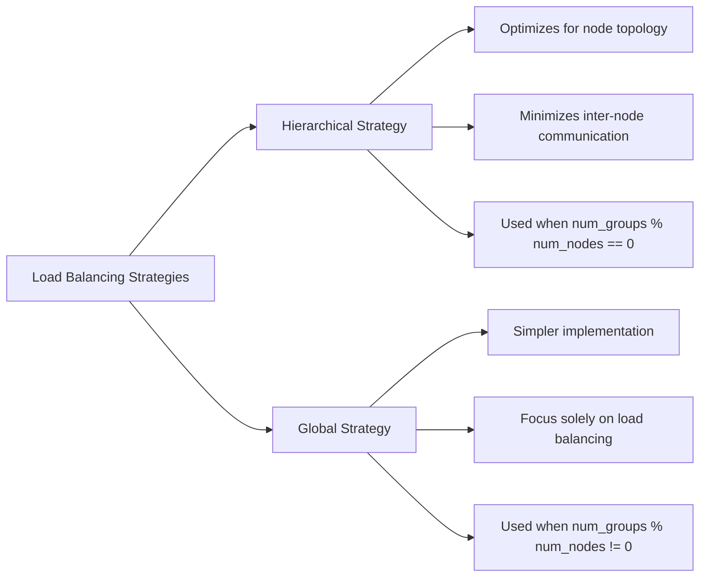

Sources: [README.md:17-32](), [eplb.py:150-156]()

## Key Benefits

- **Improved Training Efficiency**: Balanced load distribution across GPUs reduces idle time and maximizes hardware utilization
- **Network Topology Awareness**: The hierarchical strategy reduces inter-node communication by keeping related experts on the same node when possible
- **Flexibility**: Supports different parallel configurations and adapts to various hardware setups
- **Simple Integration**: Straightforward interface that integrates into existing training frameworks

Sources: [README.md:1-9]()

---

# Page: Architecture and Core Concepts

# Architecture and Core Concepts

<details>
<summary>Relevant source files</summary>

The following files were used as context for generating this wiki page:

- [README.md](README.md)
- [eplb.py](eplb.py)

</details>


This page provides a comprehensive overview of the Expert Parallelism Load Balancer (EPLB) architecture and explains the core concepts involved in solving the challenge of load balancing in expert-parallel machine learning systems. For specific details about different load balancing strategies, see [Load Balancing Strategies](#2.1). For information about the expert replication algorithm, see [Expert Replication Algorithm](#2.2).

## Problem Statement

When training large neural networks with Mixture of Experts (MoE) layers using expert parallelism, different experts are assigned to different GPUs. This distribution creates a fundamental challenge: the computational load of different experts varies significantly depending on the current input data, leading to load imbalance across GPUs.

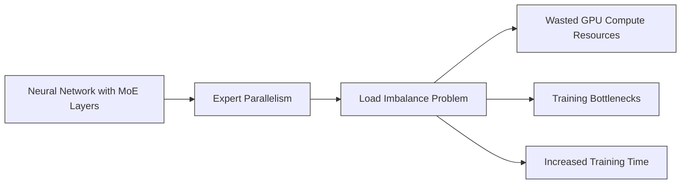

Sources: [eplb.py:131-163](), [README.md:3-8]()

## EPLB Solution Overview

The Expert Parallelism Load Balancer tackles this challenge through a two-pronged approach:

1. **Expert Replication**: Duplicating heavily-loaded experts to distribute their workload
2. **Strategic Placement**: Packing experts onto GPUs to balance computational load

Additionally, when possible, EPLB places experts from the same group on the same physical node to minimize inter-node communication overhead.

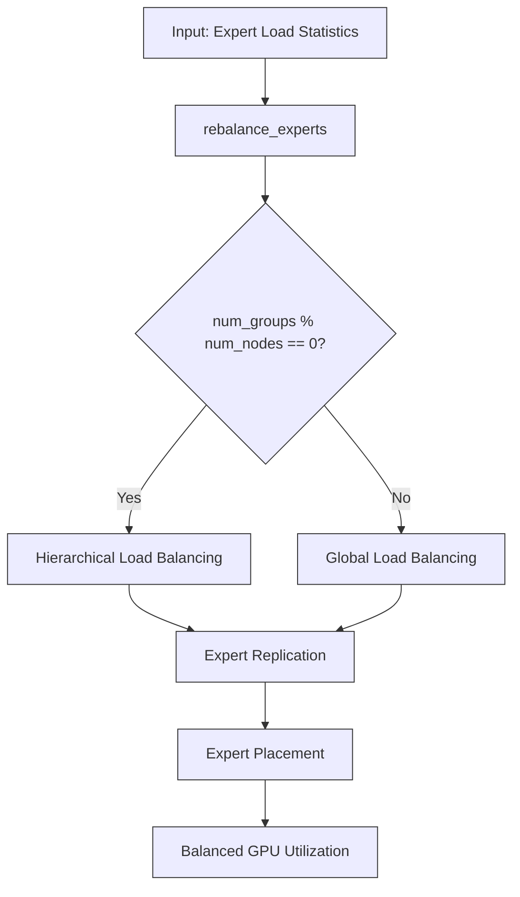

Sources: [eplb.py:131-163](), [README.md:10-14]()

## System Architecture

The EPLB system architecture consists of several interconnected components that work together to achieve balanced expert placement. The main components include:

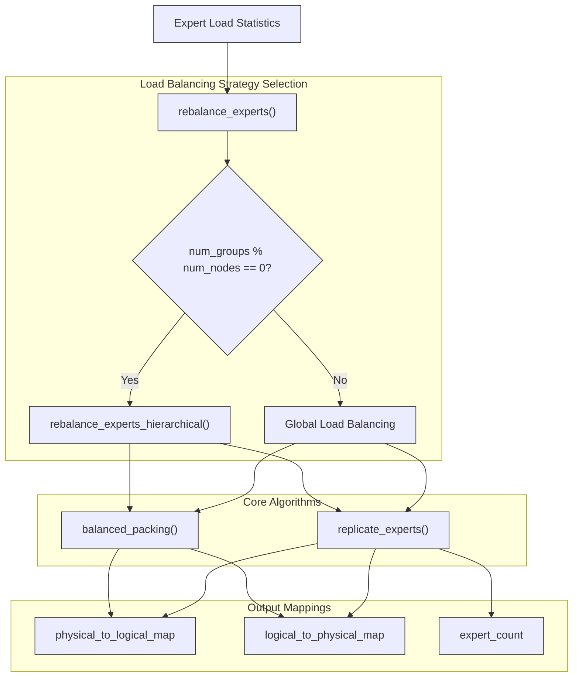

Sources: [eplb.py:131-163](), [eplb.py:74-129]()

### Main Components

1. **Strategy Selector**: Determines whether to use hierarchical or global load balancing based on system configuration.
2. **Balanced Packing Algorithm**: Distributes weighted objects across containers to minimize load imbalance.
3. **Expert Replication Algorithm**: Determines optimal duplication of experts to minimize maximum load per replica.
4. **Mapping Generators**: Creates the mapping from physical experts to logical experts and vice versa.

## Core Data Structures

The EPLB system operates on several key data structures that represent the expert weights, their placement, and their replication count:

| Data Structure | Description | Shape |
|----------------|-------------|-------|
| `weight` | Load statistics for each logical expert | `[num_layers, num_logical_experts]` |
| `physical_to_logical_map` | Maps each physical expert to its logical expert | `[num_layers, num_replicas]` |
| `logical_to_physical_map` | Maps each logical expert to its physical expert replicas | `[num_layers, num_logical_experts, max_replicas]` |
| `expert_count` | Number of replicas for each logical expert | `[num_layers, num_logical_experts]` |

Sources: [eplb.py:131-147]()

## Hierarchical Load Balancing Process

When the number of expert groups is divisible by the number of nodes (`num_groups % num_nodes == 0`), EPLB uses a hierarchical approach that follows a three-step process:

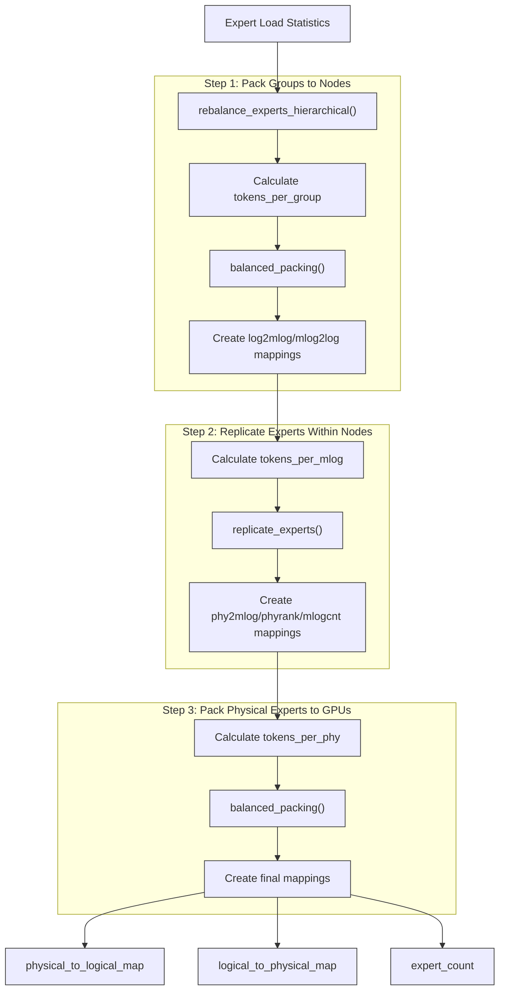

Sources: [eplb.py:74-129](), [README.md:19-25]()

## Global Load Balancing Process

When the hierarchical approach is not suitable (`num_groups % num_nodes != 0`), EPLB uses a global load balancing policy that treats the system as having a single node and a single expert group, focusing solely on load balancing across all GPUs.

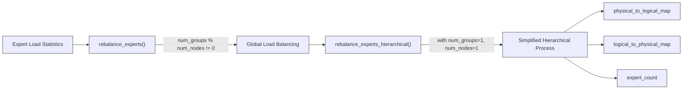

Sources: [eplb.py:154-156](), [README.md:27-31]()

## Algorithm Details

### Expert Replication

The expert replication algorithm iteratively assigns additional replicas to the experts with the highest load per replica:

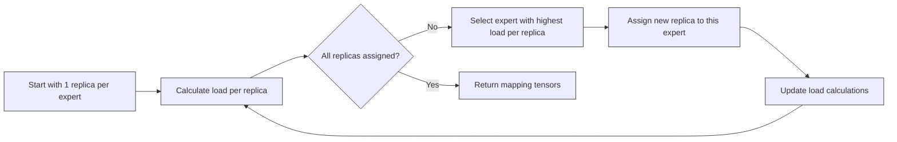

Sources: [eplb.py:44-71]()

### Balanced Packing

The balanced packing algorithm ensures that weighted objects are distributed evenly across packs:

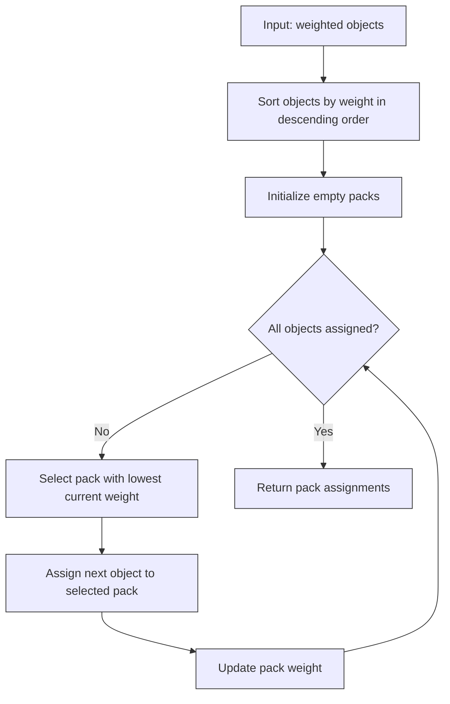

Sources: [eplb.py:5-41]()

## Execution Flow

The complete execution flow of the EPLB system demonstrates how all components interact:

```mermaid
sequenceDiagram
    participant C as "Client Code"
    participant R as "rebalance_experts()"
    participant H as "rebalance_experts_hierarchical()"
    participant B as "balanced_packing()"
    participant E as "replicate_experts()"
    
    C->>R: weight, num_replicas, num_groups, num_nodes, num_gpus
    
    R->>R: Check if num_groups % num_nodes == 0
    
    alt num_groups % num_nodes == 0
        R->>H: Use hierarchical policy
        H->>B: Pack groups to nodes
        B-->>H: group_pack_index, group_rank_in_pack
        H->>E: Replicate experts within nodes
        E-->>H: phy2mlog, phyrank, mlogcnt
        H->>B: Pack physical experts to GPUs
        B-->>H: pack_index, rank_in_pack
        H-->>R: phy2log, phyrank, logcnt
    else num_groups % num_nodes != 0
        R->>H: Use global policy (with num_groups=1, num_nodes=1)
        H->>B: Pack groups to nodes (simplified)
        B-->>H: group_pack_index, group_rank_in_pack
        H->>E: Replicate experts globally
        E-->>H: phy2mlog, phyrank, mlogcnt
        H->>B: Pack physical experts to GPUs
        B-->>H: pack_index, rank_in_pack
        H-->>R: phy2log, phyrank, logcnt
    end
    
    R->>R: Construct final mappings
    R-->>C: physical_to_logical_map, logical_to_physical_map, expert_count

    classDef default stroke:#333,stroke-width:1px
```

Sources: [eplb.py:131-163](), [eplb.py:74-129](), [eplb.py:5-71]()

## System Configuration Parameters

The EPLB system's behavior is controlled by several key configuration parameters:

| Parameter | Description |
|-----------|-------------|
| `weight` | Load statistics for each logical expert across layers |
| `num_replicas` | Total number of physical experts after replication (must be a multiple of `num_gpus`) |
| `num_groups` | Number of expert groups in the model |
| `num_nodes` | Number of server nodes in the system |
| `num_gpus` | Total number of GPUs (must be a multiple of `num_nodes`) |

Sources: [eplb.py:131-147]()

## Benefits and Trade-offs

### Benefits

- Improves training performance by balancing GPU utilization
- Minimizes inter-node communication through strategic expert placement
- Adapts to different hardware configurations through flexible strategy selection

### Trade-offs

- Introduces computational overhead for calculating optimal placements
- Requires accurate load statistics for optimal performance
- May increase memory usage due to expert replication

Sources: [README.md:3-14]()

## Summary

The EPLB architecture provides an efficient solution to the load balancing challenge in expert-parallel machine learning systems. By employing a combination of expert replication and strategic placement, and adapting its strategy based on system configuration, EPLB achieves balanced GPU utilization and improved training performance.

For more detailed information about the specific load balancing strategies, see [Load Balancing Strategies](#2.1). For an in-depth explanation of the expert replication algorithm, see [Expert Replication Algorithm](#2.2). For information about the balanced packing algorithm, see [Balanced Packing Algorithm](#2.3).

---

# Page: Load Balancing Strategies

# Load Balancing Strategies

<details>
<summary>Relevant source files</summary>

The following files were used as context for generating this wiki page:

- [README.md](README.md)
- [eplb.py](eplb.py)

</details>


## Purpose and Scope

This document details the load balancing strategies implemented in the Expert Parallelism Load Balancer (EPLB). It explains how EPLB optimizes expert placement across GPUs to balance computational load during training of Mixture of Experts (MoE) models. For information about the expert replication algorithm specifically, see [Expert Replication Algorithm](#2.2). For details on the balanced packing algorithm, see [Balanced Packing Algorithm](#2.3).

Sources: [eplb.py:131-164](), [README.md:15-31]()

## Overview of Load Balancing in Expert Parallelism

Expert Parallelism distributes different experts across multiple GPUs. However, since different experts may experience varied workloads based on token routing patterns, some GPUs can become overloaded while others remain underutilized. EPLB addresses this imbalance through two primary strategies:

1. **Hierarchical Load Balancing**: A topology-aware approach that considers node boundaries
2. **Global Load Balancing**: A simpler approach that focuses solely on overall balance

Both strategies utilize expert replication (duplicating heavy-loaded experts) and balanced packing (distributing experts to minimize load variance) to achieve optimal GPU utilization.

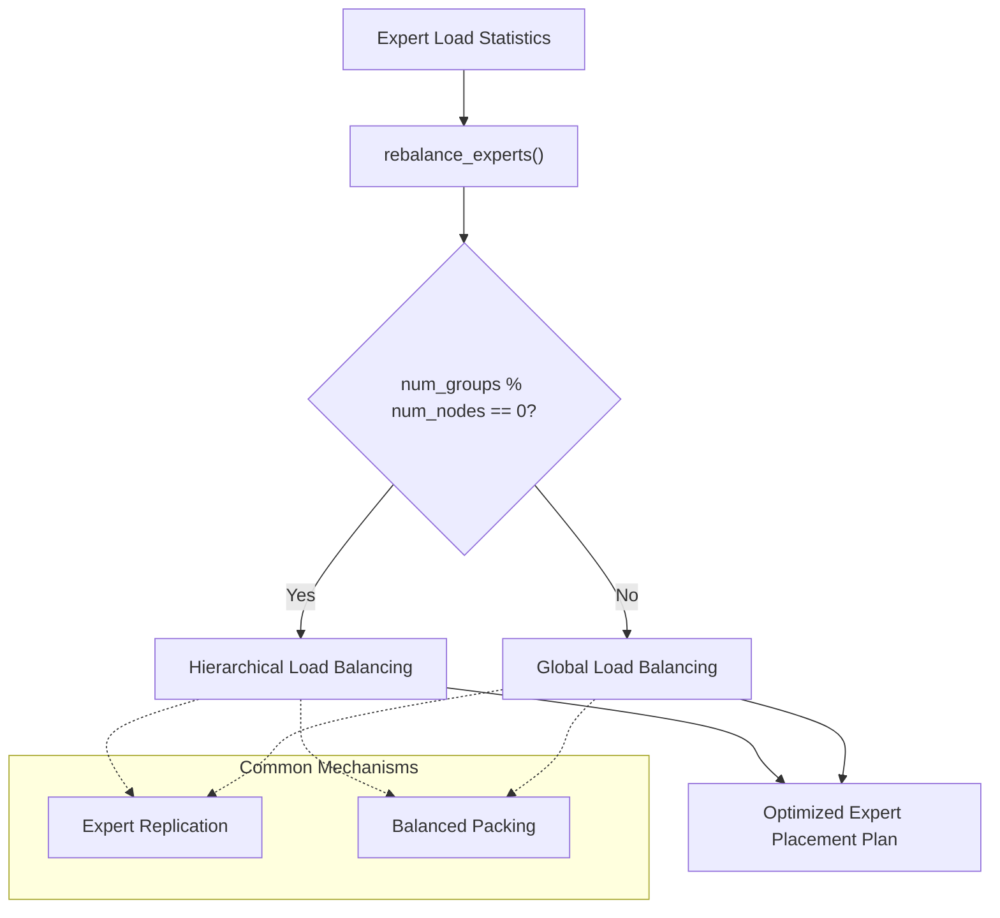

Sources: [eplb.py:131-156](), [README.md:15-31]()

## Strategy Selection Logic

The decision between hierarchical and global load balancing is made in the main `rebalance_experts` function. The selection is based on whether the number of expert groups is divisible by the number of nodes:

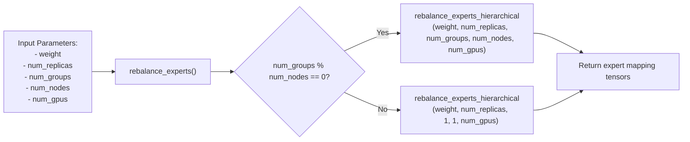

When `num_groups` is divisible by `num_nodes`, we use hierarchical load balancing to take advantage of group-limited expert routing. When not divisible, we use global load balancing by calling the hierarchical function with special parameters that effectively ignore node topology (by setting `num_groups=1, num_nodes=1`).

Sources: [eplb.py:131-156](), [README.md:17-31]()

## Hierarchical Load Balancing

The hierarchical load balancing strategy is designed to work with group-limited expert routing, where experts are organized into groups and tokens can only be routed to experts within their assigned group. This strategy optimizes expert placement while considering node boundaries to minimize inter-node communication.

### When It's Used

Hierarchical load balancing is used when `num_groups % num_nodes == 0`. This condition ensures that expert groups can be evenly distributed across nodes.

### Three-Step Process

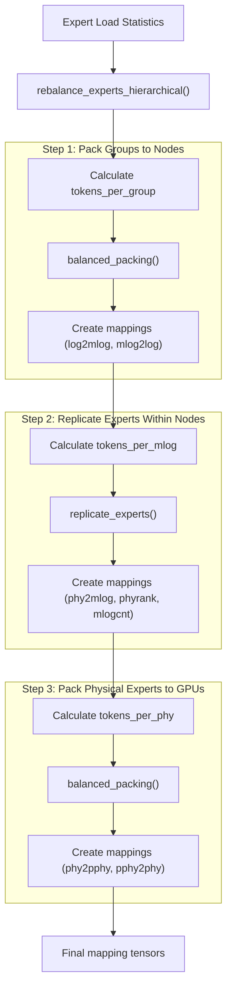

1. **Pack Groups to Nodes**: Expert groups are packed to server nodes evenly, with load balancing across nodes.
2. **Replicate Experts Within Nodes**: Experts are replicated within each node to handle high load.
3. **Pack Physical Experts to GPUs**: Replicated experts are packed to individual GPUs within each node.

The hierarchical approach attempts to place experts of the same group on the same node whenever possible, which reduces inter-node data traffic.

Sources: [eplb.py:74-129](), [README.md:19-25]()

## Global Load Balancing

The global load balancing strategy provides a simpler approach that focuses solely on load balancing without considering expert group boundaries.

### When It's Used

Global load balancing is used when `num_groups % num_nodes != 0`, meaning expert groups cannot be evenly distributed across nodes. This often occurs during decoding stages with larger expert-parallel sizes.

### Implementation

Global load balancing is implemented by calling the hierarchical function with special parameters:
- `num_groups = 1` (treat all experts as a single group)
- `num_nodes = 1` (treat all GPUs as being in a single node)

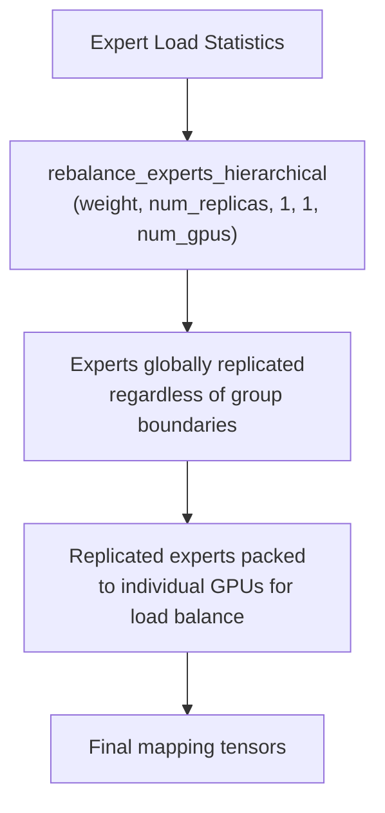

In this approach, experts are replicated globally without considering their group assignments, and the replicated experts are packed to individual GPUs to ensure load balancing.

Sources: [eplb.py:155-156](), [README.md:27-31]()

## Strategy Comparison

The following table compares the key aspects of both load balancing strategies:

| Aspect | Hierarchical Load Balancing | Global Load Balancing |
|--------|----------------------------|----------------------|
| **When used** | When `num_groups % num_nodes == 0` | When `num_groups % num_nodes != 0` |
| **Node awareness** | Considers node boundaries | Ignores node topology |
| **Expert groups** | Maintains group locality | Treats all experts as one group |
| **Communication** | Minimizes inter-node traffic | May have higher inter-node traffic |
| **Implementation** | 3-step hierarchical process | Simplified 1-level process |
| **Use case** | Prefilling stage with smaller expert-parallel size | Decoding stage with larger expert-parallel size |


Sources: [eplb.py:131-156](), [README.md:17-31]()

## Output Format and Usage

Both strategies produce the same output format to ensure consistent integration with the rest of the system:

1. `physical_to_logical_map`: Maps each physical expert to its corresponding logical expert
2. `logical_to_physical_map`: Maps each logical expert to its physical replicas
3. `expert_count`: Number of replicas for each logical expert

These outputs allow the MoE model to distribute tokens appropriately across the redundant expert replicas and maintain awareness of the expert placement on physical devices.

Sources: [eplb.py:144-147](), [eplb.py:157-162]()

## Expert Placement Example

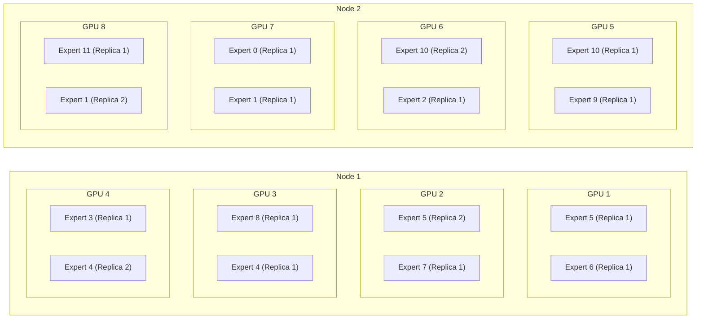

This diagram illustrates an example of hierarchical load balancing placement for the first layer of experts from the README example. Notice how experts are replicated based on their load, and experts within the same group tend to be placed on the same node.

Sources: [README.md:39-62]()

---

# Page: Expert Replication Algorithm

# Expert Replication Algorithm

<details>
<summary>Relevant source files</summary>

The following files were used as context for generating this wiki page:

- [eplb.py](eplb.py)

</details>


## Purpose and Scope

The Expert Replication Algorithm is a critical component within the EPLB system that determines how to distribute logical experts across physical devices by creating replicas. Its primary goal is to minimize the maximum load on any single replica, thereby balancing computational workload across GPUs during training of models with Mixture of Experts (MoE) layers. This document focuses specifically on the replication strategy and algorithm implementation, while the subsequent packing of these replicated experts onto physical devices is covered in [Balanced Packing Algorithm](#2.3).

Sources: [eplb.py:44-71]()

## Algorithm Overview

The Expert Replication Algorithm employs a greedy approach to distribute load optimally. It starts with one replica per logical expert and iteratively adds replicas to the expert with the highest load-per-replica ratio until all desired replicas are assigned.

### Core Algorithm Diagram

```mermaid
flowchart TD
    A["Initialize: 1 replica per logical expert"] --> B["Calculate load-per-replica for each expert"]
    B --> C{"All replicas assigned?"}
    C -->|"No"| D["Find expert with highest load-per-replica ratio"]
    D --> E["Assign new replica to this expert"]
    E --> F["Update load-per-replica calculations"]
    F --> B
    C -->|"Yes"| G["Return mapping tensors"]
```

Sources: [eplb.py:44-71]()

## Function Implementation

The algorithm is implemented in the `replicate_experts` function, which takes the expert load statistics and desired number of physical experts as inputs. It returns three tensors that define how the logical experts map to physical experts:

```mermaid
flowchart LR
    A["weight: [X, num_log]\n(Expert load statistics)"] --> C["replicate_experts()"]
    B["num_phy: int\n(Total replicas desired)"] --> C
    C --> D["phy2log: [X, num_phy]\n(Maps physical experts to logical experts)"]
    C --> E["rank: [X, num_phy]\n(Replica rank for each physical expert)"]
    C --> F["logcnt: [X, num_log]\n(Number of replicas per logical expert)"]
```

Sources: [eplb.py:44-71]()

## Algorithm Details

The `replicate_experts` function follows these steps:

1. **Initialization Phase**:
   - Sets up a one-to-one mapping for the first `num_log` physical experts
   - Initializes each logical expert with one replica
   - Initializes the replica ranks to zero

2. **Replication Phase**:
   - For each additional physical expert (beyond `num_log`):
     - Calculates the current load-per-replica ratio for each logical expert
     - Identifies the logical expert with the highest ratio
     - Assigns the new physical expert to replicate this logical expert
     - Updates the mapping, rank, and count tensors

3. **Output Phase**:
   - Returns the completed mapping tensors

This process is iterative and ensures that each new replica is assigned to reduce the maximum load across all experts.

Sources: [eplb.py:44-71]()

## Implementation Details

Let's examine the key parts of the implementation:

```python
# Initialize mapping and counting tensors
phy2log = torch.arange(num_phy, dtype=torch.int64, device=device).repeat(n, 1)
rank = torch.zeros(n, num_phy, dtype=torch.int64, device=device)
logcnt = torch.ones(n, num_log, dtype=torch.int64, device=device)

# Iterative assignment of additional replicas
for i in range(num_log, num_phy):
    redundant_indices = (weight / logcnt).max(dim=-1).indices
    phy2log[:, i] = redundant_indices
    rank[:, i] = logcnt[arangen, redundant_indices]
    logcnt[arangen, redundant_indices] += 1
```

The critical line `redundant_indices = (weight / logcnt).max(dim=-1).indices` identifies which logical expert has the highest load-per-replica ratio. This expert then receives an additional replica, and the corresponding tensors are updated.

Sources: [eplb.py:63-70]()

## Worked Example

To illustrate the algorithm, consider a simple case with 3 logical experts and loads [100, 50, 200], where we want to create 6 physical experts.

| Iteration | Expert Loads | Replicas Count | Load Per Replica | New Replica Assigned To |
|-----------|--------------|----------------|------------------|--------------------------|
| Initial   | [100, 50, 200] | [1, 1, 1]    | [100, 50, 200]   | -                        |
| 1         | [100, 50, 200] | [1, 1, 1]    | [100, 50, 200]   | Expert 2 (load 200)      |
| 2         | [100, 50, 200] | [1, 1, 2]    | [100, 50, 100]   | Expert 0 (load 100)      |
| 3         | [100, 50, 200] | [2, 1, 2]    | [50, 50, 100]    | Expert 2 (load 100)      |

Final distribution: Expert 0 has 2 replicas, Expert 1 has 1 replica, and Expert 2 has 3 replicas.

Sources: [eplb.py:44-71]()

## Integration with EPLB System

The Expert Replication Algorithm is a key component in both hierarchical and global load balancing strategies:

```mermaid
flowchart TD
    A["rebalance_experts() function"] --> B{"num_groups % num_nodes == 0?"}
    B -->|"Yes"| C["Hierarchical Load Balancing Strategy"]
    B -->|"No"| D["Global Load Balancing Strategy"]
    
    C --> E["Step 1: Pack groups to nodes"]
    E --> F["Step 2: Replicate experts within nodes\n(replicate_experts function)"]
    F --> G["Step 3: Pack physical experts to GPUs"]
    
    D --> H["Use replicate_experts globally"]
    
    F --> I["phy2mlog, phyrank, mlogcnt = replicate_experts(tokens_per_mlog, num_physical_experts // num_nodes)"]
```

In the hierarchical strategy, the algorithm is applied per node:
1. First, expert groups are packed to nodes
2. Then, `replicate_experts` is called to replicate experts within each node
3. Finally, the physical experts are packed to GPUs within each node

Sources: [eplb.py:74-129](), [eplb.py:113]()

## Performance Characteristics

The algorithm has the following characteristics:

- **Time Complexity**: O(n × (num_phy - num_log)), where n is the number of MoE layers
- **Space Complexity**: O(n × num_phy)
- **Optimality**: The greedy approach does not guarantee a globally optimal solution but provides an effective approximation that works well in practice

Sources: [eplb.py:44-71]()

## Edge Cases and Considerations

Several edge cases are important to understand:

1. **No Replication Needed**: When `num_phy == num_log`, each logical expert gets exactly one physical replica
2. **Maximum Replication**: There's no inherent limit to how many replicas a logical expert can have, but it's bounded by `num_phy - num_log + 1`
3. **Equal Loads**: If multiple experts have identical loads, the algorithm will choose one based on the result of `max()` operation (typically the first one encountered)

The algorithm asserts that `num_phy >= num_log` as we cannot have fewer physical experts than logical experts.

Sources: [eplb.py:58-60]()

## Conclusion

The Expert Replication Algorithm is an elegant solution to the problem of load balancing in expert-parallel systems. By dynamically assigning replicas to experts based on their load-per-replica ratio, it effectively minimizes computational bottlenecks and improves overall training efficiency. This algorithm forms a critical part of the EPLB system, working in conjunction with the [Balanced Packing Algorithm](#2.3) to optimize expert placement.

---

# Page: Balanced Packing Algorithm

# Balanced Packing Algorithm

<details>
<summary>Relevant source files</summary>

The following files were used as context for generating this wiki page:

- [eplb.py](eplb.py)

</details>


## Purpose and Scope

The Balanced Packing Algorithm is a core component of the EPLB (Expert Parallelism Load Balancer) system that efficiently distributes weighted objects (experts or expert groups) across available resources (nodes or GPUs). This document explains the algorithm's implementation, operation, and role in optimizing expert placement for balanced GPU utilization.

Unlike the [Expert Replication Algorithm](#2.2), which determines how many replicas to create for each expert, the Balanced Packing Algorithm determines where to place those experts or expert groups to ensure balanced computational loads.

Sources: [eplb.py:5-41]()

## Algorithm Overview

The Balanced Packing Algorithm solves a specialized bin packing problem with the following constraints:
- Each bin (pack) must contain exactly the same number of objects
- The weights of all packs should be as balanced as possible

This is crucial for expert parallelism where uneven distribution of computation across GPUs can lead to inefficient resource utilization and slower training times.

```mermaid
flowchart TD
    A["Input: weighted objects"] --> B["Sort by weight (descending)"]
    B --> C["Initialize empty packs"]
    C --> D{"All objects assigned?"}
    D -->|"No"| E["Select pack with lowest current weight"]
    E --> F["Assign next object to selected pack"]
    F --> G["Update pack weight"]
    G --> D
    D -->|"Yes"| H["Return pack assignments"]
```

Sources: [eplb.py:5-41]()

## Implementation Details

The algorithm is implemented in the `balanced_packing` function in the EPLB codebase:

### Function Signature and Parameters

```python
def balanced_packing(weight: torch.Tensor, num_packs: int) -> Tuple[torch.Tensor, torch.Tensor]:
```

- `weight`: A tensor of shape `[X, n]` representing the weights of `n` objects across `X` different layers
- `num_packs`: The number of packs (bins) to distribute the objects into

### Return Values

- `pack_index`: A tensor of shape `[X, n]` containing the pack index for each object
- `rank_in_pack`: A tensor of shape `[X, n]` containing the rank (position) of each object within its assigned pack

### Key Implementation Components

1. **Precondition Check**: The function asserts that `num_groups % num_packs == 0`, ensuring each pack will contain exactly the same number of objects.

2. **Special Case Handling**: If there's only one object per pack (`groups_per_pack == 1`), the function returns a simple linear assignment without running the balancing algorithm.

3. **Sorting**: Objects are sorted by weight in descending order, ensuring that heavier objects are placed first.

4. **Greedy Assignment**: The algorithm iteratively assigns each object to the pack with the lowest current total weight.

```mermaid
flowchart LR
    subgraph "Key Code Entities"
        A["weight tensor\n[X, n]"] --> B["balanced_packing\nfunction"]
        C["num_packs\nparameter"] --> B
        
        B --> D["pack_index tensor\n[X, n]"]
        B --> E["rank_in_pack tensor\n[X, n]"]
    end
```

Sources: [eplb.py:5-41]()

## Usage in EPLB System

The Balanced Packing Algorithm is used at multiple levels in the EPLB system, particularly in the hierarchical load balancing strategy:

1. **Step 1: Packing expert groups to nodes** - Balance computational load across server nodes
   ```python
   group_pack_index, group_rank_in_pack = balanced_packing(tokens_per_group, num_nodes)
   ```

2. **Step 3: Packing physical experts to GPUs within nodes** - Balance computational load across GPUs
   ```python
   pack_index, rank_in_pack = balanced_packing(tokens_per_phy, num_gpus // num_nodes)
   ```

```mermaid
flowchart TD
    A["rebalance_experts function"] --> B{"num_groups % num_nodes == 0?"}
    B -->|"Yes"| C["Hierarchical Strategy"]
    B -->|"No"| D["Global Strategy"]
    
    subgraph "Hierarchical Load Balancing"
        C --> E["Step 1: Pack groups to nodes\nbalanced_packing(tokens_per_group, num_nodes)"]
        E --> F["Step 2: Replicate experts within nodes\nreplicate_experts()"]
        F --> G["Step 3: Pack physical experts to GPUs\nbalanced_packing(tokens_per_phy, num_gpus // num_nodes)"]
    end
    
    subgraph "Global Strategy"
        D --> H["Use balanced_packing at global level"]
    end
```

Sources: [eplb.py:104-105](), [eplb.py:118-119](), [eplb.py:143-157]()

## Example Scenario

Let's illustrate the algorithm with a concrete example. Assume we have 8 experts with the following weights and need to distribute them across 2 packs:

Initial experts with weights: [10, 8, 7, 6, 5, 4, 3, 2]

```mermaid
flowchart TD
    A["Start with sorted experts: 10, 8, 7, 6, 5, 4, 3, 2"] --> B["Initialize packs: Pack 1 (0), Pack 2 (0)"]
    
    B --> C["Step 1: Assign Expert1(10) to Pack1: P1=10, P2=0"]
    C --> D["Step 2: Assign Expert2(8) to Pack2: P1=10, P2=8"]
    D --> E["Step 3: Assign Expert3(7) to Pack2: P1=10, P2=15"]
    E --> F["Step 4: Assign Expert4(6) to Pack1: P1=16, P2=15"]
    F --> G["Step 5: Assign Expert5(5) to Pack2: P1=16, P2=20"]
    G --> H["Step 6: Assign Expert6(4) to Pack1: P1=20, P2=20"]
    H --> I["Step 7: Assign Expert7(3) to Pack2: P1=20, P2=23"]
    I --> J["Step 8: Assign Expert8(2) to Pack1: P1=22, P2=23"]
    
    J --> K["Final result: Pack1={10,6,4,2}, Pack2={8,7,5,3}"]
```

This example demonstrates how:
1. Each expert is placed in the pack with the lowest current weight
2. The final distribution achieves a near-optimal balance (difference of only 1 weight unit)
3. Each pack contains exactly 4 experts (8÷2=4)

Sources: [eplb.py:5-41]()

## Algorithm Analysis

### Time Complexity
- Sorting step: O(X * n log n) - where X is the number of layers and n is the number of objects
- Assignment step: O(X * n * m) - where m is the number of packs
- Overall: O(X * n * (log n + m))

### Space Complexity
- O(X * n) for the output tensors

### Performance Considerations
- The algorithm operates on CPU (`indices = weight.float().sort(-1, descending=True).indices.cpu()`)
- While this is a greedy algorithm (not guaranteed to find the global optimum), it performs very well in practice for expert balancing
- The algorithm ensures exactly equal numbers of objects per pack, which simplifies downstream processing

Sources: [eplb.py:27-40]()

## Integration with Overall System

The Balanced Packing Algorithm works in conjunction with the Expert Replication Algorithm to provide a comprehensive load balancing solution:

```mermaid
flowchart TD
    A["Input: Expert Load Statistics"] --> B["rebalance_experts"]
    B --> C["Select Strategy"]
    
    C --> D["1. balanced_packing\n(Pack groups to nodes)"]
    D --> E["Groups-to-nodes assignment"]
    
    E --> F["2. replicate_experts\n(Create replicas within nodes)"]
    F --> G["Expert replication plan"]
    
    G --> H["3. balanced_packing\n(Pack physical experts to GPUs)"]
    H --> I["Final expert placement maps"]
    
    I --> J["Output: physical_to_logical_map"]
    I --> K["Output: logical_to_physical_map"]
    I --> L["Output: expert_count"]
```

This diagram shows how the balanced packing algorithm is used twice in the hierarchical load balancing process - first to distribute expert groups to nodes, and then to distribute physical experts to GPUs within each node.

Sources: [eplb.py:74-129](), [eplb.py:131-162]()

---

# Page: API Reference

# API Reference

<details>
<summary>Relevant source files</summary>

The following files were used as context for generating this wiki page:

- [eplb.py](eplb.py)

</details>


This page provides a comprehensive reference for the Expert-Parallelism Load Balancer (EPLB) API, documenting all public functions, their parameters, return values, and usage notes. The EPLB system is designed to optimize expert placement in expert-parallelism machine learning training setups.

For conceptual information about load balancing strategies, see [Load Balancing Strategies](#2.1). For examples of how to use these APIs in practice, see [Usage Examples](#4).

## Function Overview

```mermaid
flowchart TD
    A["rebalance_experts()"] --> |"Main entry point"| B["Decision: num_groups % num_nodes == 0?"]
    B -->|"Yes"| C["rebalance_experts_hierarchical()"]
    B -->|"No"| D["rebalance_experts_hierarchical() with different params"]
    
    C --> E["balanced_packing()"]
    C --> F["replicate_experts()"]
    D --> E
    D --> F
    
    G["inverse()"] -.-> |"Helper function"| C
```

Sources: [eplb.py:131-164](), [eplb.py:74-129](), [eplb.py:5-41](), [eplb.py:44-71](), [eplb.py:98-101]()

## Main Entry Point

### rebalance_experts

```mermaid
classDiagram
    class rebalance_experts {
        +Parameters
        weight: torch.Tensor [layers, num_logical_experts]
        num_replicas: int
        num_groups: int
        num_nodes: int
        num_gpus: int
        +Returns
        physical_to_logical_map: torch.Tensor
        logical_to_physical_map: torch.Tensor
        expert_count: torch.Tensor
    }
```

**Function Signature:**
`rebalance_experts(weight, num_replicas, num_groups, num_nodes, num_gpus)`

**Purpose:**  
The main entry point for the expert-parallelism load balancer. This function determines the optimal placement of experts across GPUs to balance computational load.

**Parameters:**
- `weight` (torch.Tensor): A tensor of shape `[layers, num_logical_experts]` containing the load statistics for all logical experts.
- `num_replicas` (int): The number of physical experts after replication. Must be a multiple of `num_gpus`.
- `num_groups` (int): The number of expert groups.
- `num_nodes` (int): The number of server nodes, where intra-node communication (e.g., NVLink) is faster.
- `num_gpus` (int): The number of GPUs. Must be a multiple of `num_nodes`.

**Returns:**
- `physical_to_logical_map` (torch.Tensor): A tensor of shape `[layers, num_replicas]` mapping physical expert indices to logical expert indices.
- `logical_to_physical_map` (torch.Tensor): A tensor of shape `[layers, num_logical_experts, X]` mapping logical expert indices to physical expert indices.
- `expert_count` (torch.Tensor): A tensor of shape `[layers, num_logical_experts]` indicating the number of physical replicas for each logical expert.

**Behavior Notes:**
- The function chooses between hierarchical and global load balancing strategies based on whether `num_groups` is divisible by `num_nodes`.
- When `num_groups % num_nodes == 0`, it uses hierarchical load balancing, which optimizes for node topology.
- Otherwise, it falls back to global load balancing by treating the entire system as a single node.

Sources: [eplb.py:131-164]()

## Core Helper Functions

### balanced_packing

```mermaid
classDiagram
    class balanced_packing {
        +Parameters
        weight: torch.Tensor [X, n]
        num_packs: int
        +Returns
        pack_index: torch.Tensor [X, n]
        rank_in_pack: torch.Tensor [X, n]
    }
```

**Function Signature:**
`balanced_packing(weight, num_packs)`

**Purpose:**  
Packs `n` weighted objects into `m` packs, ensuring each pack contains exactly `n/m` objects and the weights of all packs are as balanced as possible.

**Parameters:**
- `weight` (torch.Tensor): A tensor of shape `[X, n]` containing the weight of each item.
- `num_packs` (int): The number of packs.

**Returns:**
- `pack_index` (torch.Tensor): A tensor of shape `[X, n]` containing the pack index of each item.
- `rank_in_pack` (torch.Tensor): A tensor of shape `[X, n]` containing the rank of each item within its pack.

**Constraints:**
- `num_groups % num_packs == 0`: The number of groups must be divisible by the number of packs.

**Algorithm:**
1. Items are sorted by weight in descending order.
2. Each item is assigned to the pack with the lowest current weight.
3. This greedy approach ensures weights are as balanced as possible across packs.

Sources: [eplb.py:5-41]()

### replicate_experts

```mermaid
classDiagram
    class replicate_experts {
        +Parameters
        weight: torch.Tensor [X, num_log]
        num_phy: int
        +Returns
        phy2log: torch.Tensor [X, num_phy]
        rank: torch.Tensor [X, num_phy]
        logcnt: torch.Tensor [X, num_log]
    }
```

**Function Signature:**
`replicate_experts(weight, num_phy)`

**Purpose:**  
Replicates `num_log` logical experts to `num_phy` physical replicas, such that the maximum load of all replicas is minimized.

**Parameters:**
- `weight` (torch.Tensor): A tensor of shape `[X, num_log]` containing the weight of each logical expert.
- `num_phy` (int): The total number of physical experts after replication.

**Returns:**
- `phy2log` (torch.Tensor): A tensor of shape `[X, num_phy]` mapping physical expert indices to logical expert indices.
- `rank` (torch.Tensor): A tensor of shape `[X, num_phy]` containing the replica rank for each physical expert.
- `logcnt` (torch.Tensor): A tensor of shape `[X, num_log]` indicating the number of replicas for each logical expert.

**Constraints:**
- `num_phy >= num_log`: The number of physical experts must be greater than or equal to the number of logical experts.

**Algorithm:**
1. Start with one replica per logical expert.
2. Iteratively add replicas to the expert with the highest load per replica.
3. Continue until all `num_phy` replicas are assigned.

Sources: [eplb.py:44-71]()

### rebalance_experts_hierarchical

```mermaid
classDiagram
    class rebalance_experts_hierarchical {
        +Parameters
        weight: torch.Tensor [num_moe_layers, num_logical_experts]
        num_physical_experts: int
        num_groups: int
        num_nodes: int
        num_gpus: int
        +Returns
        physical_to_logical_map: torch.Tensor
        logical_to_physical_map: torch.Tensor
        logical_count: torch.Tensor
    }
```

**Function Signature:**
`rebalance_experts_hierarchical(weight, num_physical_experts, num_groups, num_nodes, num_gpus)`

**Purpose:**  
Implements a hierarchical load balancing strategy that optimizes for node topology and minimizes inter-node communication.

**Parameters:**
- `weight` (torch.Tensor): A tensor of shape `[num_moe_layers, num_logical_experts]` containing the weight of each logical expert.
- `num_physical_experts` (int): The number of physical experts after replication.
- `num_groups` (int): The number of expert groups.
- `num_nodes` (int): The number of server nodes.
- `num_gpus` (int): The number of GPUs.

**Returns:**
- `physical_to_logical_map` (torch.Tensor): A tensor mapping physical expert indices to logical expert indices.
- `logical_to_physical_map` (torch.Tensor): A tensor mapping logical expert indices to physical expert indices.
- `logical_count` (torch.Tensor): A tensor indicating the number of physical replicas for each logical expert.

**Constraints:**
- `num_logical_experts % num_groups == 0`: The number of logical experts must be divisible by the number of groups.
- `num_groups % num_nodes == 0`: The number of groups must be divisible by the number of nodes.
- `num_gpus % num_nodes == 0`: The number of GPUs must be divisible by the number of nodes.
- `num_physical_experts % num_gpus == 0`: The number of physical experts must be divisible by the number of GPUs.

Sources: [eplb.py:74-129]()

## Data Flow

### Hierarchical Load Balancing Flow

```mermaid
flowchart TB
    subgraph "Input"
        A["weight: [layers, num_logical_experts]"]
    end
    
    subgraph "Step 1: Pack Groups to Nodes"
        B["Calculate tokens_per_group"]
        C["balanced_packing()"]
        D["Create log2mlog/mlog2log mappings"]
    end
    
    subgraph "Step 2: Replicate Experts Within Nodes"
        E["Calculate tokens_per_mlog"]
        F["replicate_experts()"]
        G["Create phy2mlog/phyrank/mlogcnt"]
    end
    
    subgraph "Step 3: Pack Physical Experts to GPUs"
        H["Calculate tokens_per_phy"]
        I["balanced_packing()"]
        J["Create phy2pphy/pphy2phy mappings"]
    end
    
    subgraph "Output"
        K["physical_to_logical_map: [layers, num_replicas]"]
        L["logical_to_physical_map: [layers, num_logical_experts, X]"]
        M["expert_count: [layers, num_logical_experts]"]
    end
    
    A --> B
    B --> C
    C --> D
    D --> E
    E --> F
    F --> G
    G --> H
    H --> I
    I --> J
    J --> K
    J --> L
    J --> M
```

Sources: [eplb.py:74-129]()

### Mapping Relationships

```mermaid
flowchart LR
    subgraph "Mapping Tensors"
        A["physical_to_logical_map"]
        B["logical_to_physical_map"]
        C["expert_count"]
    end
    
    subgraph "Physical-Logical Relationship"
        D["Physical Experts"] <--> E["Logical Experts"]
    end
    
    A --> |"Maps physical to logical"| D
    A --> |"Maps physical to logical"| E
    B --> |"Maps logical to physical"| E
    B --> |"Maps logical to physical"| D
    C --> |"Counts replicas per logical expert"| E
```

Sources: [eplb.py:131-164]()

## Parameter Constraints

The following table summarizes the constraints on input parameters for the main API functions:

| Function | Parameter Constraints |
|----------|------------------------|
| `rebalance_experts` | • `num_replicas` must be a multiple of `num_gpus`<br>• `num_gpus` must be a multiple of `num_nodes` |
| `rebalance_experts_hierarchical` | • `num_logical_experts % num_groups == 0`<br>• `num_groups % num_nodes == 0`<br>• `num_gpus % num_nodes == 0`<br>• `num_physical_experts % num_gpus == 0` |
| `balanced_packing` | • `num_groups % num_packs == 0` |
| `replicate_experts` | • `num_phy >= num_log` |

Sources: [eplb.py:5-164]()

## Return Value Formats

All functions return tensors with specific shapes and meanings:

| Function | Return Values | Shapes | Descriptions |
|----------|--------------|--------|--------------|
| `rebalance_experts` | `physical_to_logical_map`<br>`logical_to_physical_map`<br>`expert_count` | `[layers, num_replicas]`<br>`[layers, num_logical_experts, X]`<br>`[layers, num_logical_experts]` | Maps physical experts to logical experts<br>Maps logical experts to physical experts<br>Number of replicas per logical expert |
| `balanced_packing` | `pack_index`<br>`rank_in_pack` | `[X, n]`<br>`[X, n]` | Pack index for each item<br>Rank within pack for each item |
| `replicate_experts` | `phy2log`<br>`rank`<br>`logcnt` | `[X, num_phy]`<br>`[X, num_phy]`<br>`[X, num_log]` | Logical expert ID for each physical expert<br>Replica rank for each physical expert<br>Number of replicas for each logical expert |

Sources: [eplb.py:5-164]()

---

# Page: rebalance_experts Function

# rebalance_experts Function

<details>
<summary>Relevant source files</summary>

The following files were used as context for generating this wiki page:

- [README.md](README.md)
- [eplb.py](eplb.py)

</details>


## Purpose and Scope

The `rebalance_experts` function serves as the main entry point for the Expert Parallelism Load Balancer (EPLB) system. It computes an optimized expert replication and placement plan based on the estimated load of each expert, balancing workloads across GPUs while considering network topology. This documentation covers the function's parameters, return values, internal decision logic, and usage patterns.

For information about the supporting algorithms used by this function, see [Helper Functions](#3.2).
For general information about load balancing strategies, see [Load Balancing Strategies](#2.1).

Sources: [eplb.py:131-162]()

## Function Signature

```python
def rebalance_experts(weight: torch.Tensor, 
                     num_replicas: int, 
                     num_groups: int,
                     num_nodes: int, 
                     num_gpus: int) -> Tuple[torch.Tensor, torch.Tensor, torch.Tensor]:
```

Sources: [eplb.py:131-132]()

## Parameters

| Parameter | Type | Description |
|-----------|------|-------------|
| `weight` | `torch.Tensor` | Load statistics for all logical experts, with shape `[num_moe_layers, num_logical_experts]`. Higher values indicate experts that receive more tokens/workload. |
| `num_replicas` | `int` | Total number of physical experts after replication. Must be a multiple of `num_gpus`. |
| `num_groups` | `int` | Number of expert groups in the model. In group-limited routing, experts within each group might be co-routed. |
| `num_nodes` | `int` | Number of server nodes in the cluster. Intra-node communication (e.g., via NVLink) is faster than inter-node communication. |
| `num_gpus` | `int` | Total number of GPUs across all nodes. Must be a multiple of `num_nodes`. |

Sources: [eplb.py:136-141](), [README.md:3-8]()

## Return Values

| Return Value | Type | Description |
|--------------|------|-------------|
| `physical_to_logical_map` | `torch.Tensor` | Tensor of shape `[num_moe_layers, num_replicas]` mapping each physical expert replica to its corresponding logical expert index. |
| `logical_to_physical_map` | `torch.Tensor` | Tensor of shape `[num_moe_layers, num_logical_experts, X]` mapping each logical expert to all its physical replica indices. X is the maximum number of replicas for any logical expert. |
| `expert_count` | `torch.Tensor` | Tensor of shape `[num_moe_layers, num_logical_experts]` indicating the number of physical replicas allocated to each logical expert. |

Sources: [eplb.py:143-146]()

## Decision Logic for Load Balancing Strategies

The `rebalance_experts` function selects between two load balancing strategies based on the divisibility of the number of expert groups by the number of nodes:

```mermaid
flowchart TD
    A["rebalance_experts"] --> B{"num_groups % num_nodes == 0?"}
    B -->|Yes| C["Hierarchical Load Balancing"]
    B -->|No| D["Global Load Balancing"]
    C --> E["Call rebalance_experts_hierarchical\nwith original parameters"]
    D --> F["Call rebalance_experts_hierarchical\nwith num_groups=1, num_nodes=1"]
    E --> G["Process results"]
    F --> G
    G --> H["Return mapping tensors"]
```

Sources: [eplb.py:149-156](), [README.md:17-31]()

## Strategy Selection and Rationale

### Hierarchical Load Balancing
Used when `num_groups % num_nodes == 0`. This strategy:
- Packs expert groups to nodes evenly
- Keeps experts from the same group on the same node when possible
- Minimizes inter-node communication
- Is optimal for the prefilling stage with smaller expert-parallel size

### Global Load Balancing
Used when `num_groups % num_nodes != 0`. This strategy:
- Treats the entire system as a flat structure
- Replicates experts globally without considering group locality
- Focuses solely on load balancing across GPUs
- Is better for the decoding stage with larger expert-parallel size

Sources: [eplb.py:149-156](), [README.md:19-31]()

## Function Workflow

```mermaid
flowchart TD
    A["Input:\nweight, num_replicas,\nnum_groups, num_nodes, num_gpus"] --> B["Select strategy based on\nnum_groups % num_nodes == 0"]
    B --> C["Call rebalance_experts_hierarchical\nwith appropriate parameters"]
    C --> D["Get phy2log, phyrank, logcnt\nfrom hierarchical balancing"]
    D --> E["Calculate maximum replicas\nper logical expert (maxlogcnt)"]
    E --> F["Initialize log2phy with -1s"]
    F --> G["Populate log2phy using scatter operation"]
    G --> H["Return phy2log, log2phy, logcnt"]
    
    subgraph "rebalance_experts_hierarchical"
        C1["Pack groups to nodes"] --> C2["Replicate experts within nodes"]
        C2 --> C3["Pack physical experts to GPUs"]
    end
    C --> C1
```

Sources: [eplb.py:149-162](), [eplb.py:74-129]()

## Data Transformation Process

```mermaid
flowchart LR
    A["Input: weight tensor\n[layers, num_logical_experts]"] --> B["Strategy Selection"]
    B --> C["Expert Replication and Placement"]
    C --> D1["physical_to_logical_map\n[layers, num_replicas]"]
    C --> D2["logical_to_physical_map\n[layers, num_logical_experts, max_replicas]"]
    C --> D3["expert_count\n[layers, num_logical_experts]"]
```

Sources: [eplb.py:131-162]()

## Implementation Details

The key steps in the implementation are:

1. Convert weights to float and move to CPU for computation
2. Select the appropriate load balancing strategy
3. Call `rebalance_experts_hierarchical` with either:
   - The original parameters (for hierarchical balancing)
   - Modified parameters: `num_groups=1, num_nodes=1` (for global balancing)
4. Determine the maximum replicas per logical expert
5. Create the logical-to-physical mapping tensor
6. Populate this tensor using a scatter operation to map each logical expert to its physical replicas

Sources: [eplb.py:149-162]()

## Usage Example

Here's a concrete example of using the `rebalance_experts` function for a 2-layer MoE model with 12 experts per layer:

```python
import torch
import eplb

# Expert load statistics for two MoE layers, each with 12 experts
weight = torch.tensor([
    [90, 132, 40, 61, 104, 165, 39, 4, 73, 56,.183, 86],
    [20, 107, 104, 64, 19, 197, 187, 157, 172, 86, 16, 27]
])

# Configuration parameters
num_replicas = 16  # Total physical experts (including 4 redundant experts)
num_groups = 4     # Number of expert groups
num_nodes = 2      # Number of server nodes
num_gpus = 8       # Total number of GPUs (4 per node)

# Call the EPLB entry point function
phy2log, log2phy, logcnt = eplb.rebalance_experts(
    weight, num_replicas, num_groups, num_nodes, num_gpus
)

print(phy2log)
# Output:
# tensor([[ 5,  6,  5,  7,  8,  4,  3,  4, 10,  9, 10,  2,  0,  1, 11,  1],
#         [ 7, 10,  6,  8,  6, 11,  8,  9,  2,  4,  5,  1,  5,  0,  3,  1]])
```

This example demonstrates how the function replicates heavy-loaded experts and distributes them across GPUs. In the output, each column represents a physical expert location, and the value indicates which logical expert is placed there. For instance, expert 5 is replicated twice in layer 0, and expert 6 is replicated twice in layer 1.

Sources: [README.md:36-57]()

## Relationship to Other Components

```mermaid
flowchart TD
    A["rebalance_experts\n(Main Entry Point)"] --> B["rebalance_experts_hierarchical\n(Strategy Implementation)"]
    B --> C["balanced_packing\n(Distribution Algorithm)"]
    B --> D["replicate_experts\n(Duplication Algorithm)"]
    
    A -.-> E["Client Code"]
    E --> F["weight tensor\n(Expert Load Statistics)"]
    F --> A
    A --> G["Expert Placement Plan\n(Mapping Tensors)"]
    G --> E
```

Sources: [eplb.py:5-72](), [eplb.py:131-162]()

## Notes and Constraints

- The `num_replicas` parameter must be a multiple of `num_gpus`
- The `num_gpus` parameter must be a multiple of `num_nodes`
- For hierarchical load balancing, `num_groups` must be a multiple of `num_nodes`
- The function performs computations on CPU, even if the input tensor is on GPU
- The output tensors will be on the same device as the input weight tensor

Sources: [eplb.py:149-157]()

---

# Page: Helper Functions

# Helper Functions

<details>
<summary>Relevant source files</summary>

The following files were used as context for generating this wiki page:

- [eplb.py](eplb.py)

</details>


This page documents the core supporting functions that power the Expert-Parallelism Load Balancer (EPLB). These helper functions are the algorithmic building blocks that enable efficient expert placement and load balancing in mixture-of-experts (MoE) neural networks. For information about the main entry point function, see [rebalance_experts Function](#3.1).

## Overview of Helper Functions

The EPLB system relies on two primary helper functions to perform its load balancing operations:

1. `balanced_packing`: Distributes weighted items across a specified number of packs to achieve balanced load
2. `replicate_experts`: Replicates logical experts to physical experts in a way that minimizes maximum load

These functions work together to optimize expert placement across GPUs and nodes, reducing communication overhead and balancing computational load.

```mermaid
flowchart TD
    A["rebalance_experts() Main Entry Point"] --> B["Helper Functions"]
    B --> C["balanced_packing()"]
    B --> D["replicate_experts()"]
    
    C --> E["Used for:
    - Pack groups to nodes
    - Pack physical experts to GPUs"]
    
    D --> F["Used for:
    - Replicate experts to minimize load"]
    
    style A stroke-width:2px
    style B stroke-width:2px
    style C stroke-width:2px
    style D stroke-width:2px
```

Sources: [eplb.py:5-71](), [eplb.py:131-162]()

## The Balanced Packing Function

### Purpose and Signature

The `balanced_packing` function is designed to distribute a set of weighted objects across a specified number of packs in a way that balances the total weight in each pack as evenly as possible.

```
def balanced_packing(weight: torch.Tensor, num_packs: int) -> Tuple[torch.Tensor, torch.Tensor]
```

**Parameters:**
- `weight`: [X, n] tensor representing the weight of each item
- `num_packs`: Number of packs to distribute items across

**Returns:**
- `pack_index`: [X, n] tensor indicating the pack index for each item
- `rank_in_pack`: [X, n] tensor indicating the rank of each item within its assigned pack

**Constraints:**
- The total number of items must be evenly divisible by the number of packs

Sources: [eplb.py:5-17]()

### Algorithm Description

The balanced packing algorithm employs a greedy approach to distribute weighted items:

1. Sort items by weight in descending order
2. Assign each item to the pack with the lowest current total weight
3. Ensure each pack contains exactly the same number of items

This approach minimizes the maximum load across all packs, leading to better load balancing.

```mermaid
flowchart TD
    A["Input: weight tensor [X,n], num_packs"] --> B["Are there multiple items per pack?"]
    B -->|"No (groups_per_pack == 1)"| C["Simple 1:1 assignment
    - pack_index = range(n)
    - rank_in_pack = zeros"]
    
    B -->|"Yes"| D["Sort items by weight
    (descending order)"]
    D --> E["Initialize empty packs"]
    E --> F["For each item in sorted order"]
    F --> G["Find pack with lowest current weight
    that has room for another item"]
    G --> H["Assign item to selected pack"]
    H --> I["Update pack weight and item count"]
    I --> J{"All items assigned?"}
    J -->|"No"| F
    J -->|"Yes"| K["Return pack_index and rank_in_pack"]
    
    C --> K
```

Sources: [eplb.py:18-41]()

### Example Usage in EPLB

The `balanced_packing` function is used in two critical places within the hierarchical load balancing strategy:

1. **Packing Expert Groups to Nodes** (Step 1 of hierarchical load balancing):
   ```python
   # Step 1: pack groups to nodes
   tokens_per_group = weight.unflatten(-1, (num_groups, group_size)).sum(-1)
   group_pack_index, group_rank_in_pack = balanced_packing(tokens_per_group, num_nodes) 
   ```

2. **Packing Physical Experts to GPUs** (Step 3 of hierarchical load balancing):
   ```python
   # Step 3: pack physical_experts to GPUs
   tokens_per_phy = (tokens_per_mlog / mlogcnt).gather(-1, phy2mlog)
   pack_index, rank_in_pack = balanced_packing(tokens_per_phy, num_gpus // num_nodes)
   ```

Sources: [eplb.py:104-105](), [eplb.py:118-119]()

## The Expert Replication Function

### Purpose and Signature

The `replicate_experts` function replicates a set of logical experts to a larger number of physical experts in a way that minimizes the maximum load on any replica.

```
def replicate_experts(weight: torch.Tensor, num_phy: int) -> Tuple[torch.Tensor, torch.Tensor, torch.Tensor]
```

**Parameters:**
- `weight`: [X, num_log] tensor representing the load of each logical expert
- `num_phy`: Total number of physical experts after replication

**Returns:**
- `phy2log`: [X, num_phy] tensor mapping physical experts to their logical expert IDs
- `rank`: [X, num_phy] tensor indicating the replica rank for each physical expert
- `logcnt`: [X, num_log] tensor indicating the number of replicas for each logical expert

**Constraints:**
- `num_phy` must be greater than or equal to the number of logical experts

Sources: [eplb.py:44-57]()

### Algorithm Description

The algorithm starts by assigning each logical expert to one physical expert, then iteratively adds replicas where they would provide the most benefit:

1. Initialize with each logical expert having exactly one physical expert
2. Calculate the load per replica for each logical expert
3. Identify the logical expert with the highest load per replica
4. Assign a new physical expert to that logical expert
5. Update load calculations and repeat until all physical experts are assigned

This greedy approach ensures that the maximum load on any physical expert is minimized.

```mermaid
flowchart TD
    A["Input: weight tensor [X,num_log], num_phy"] --> B["Initialize:
    - phy2log: each logical expert gets one physical expert
    - logcnt: each logical expert has one replica"]
    
    B --> C["For i = num_log to num_phy-1:"]
    C --> D["Calculate load per replica: weight/logcnt"]
    D --> E["Find logical expert with max load per replica"]
    E --> F["Assign next physical expert (i) to this logical expert"]
    F --> G["Increment replica count for this logical expert"]
    G --> H{"i < num_phy-1?"}
    H -->|"Yes"| C
    H -->|"No"| I["Return phy2log, rank, logcnt"]
```

Sources: [eplb.py:58-71]()

### Example Usage in EPLB

In the hierarchical load balancing strategy, `replicate_experts` is used in Step 2 to optimally replicate experts within nodes:

```python
# Step 2: construct redundant experts within nodes
tokens_per_mlog = weight.gather(-1, mlog2log).view(-1, num_logical_experts // num_nodes)
phy2mlog, phyrank, mlogcnt = replicate_experts(tokens_per_mlog, num_physical_experts // num_nodes)
```

This step determines how many replicas each logical expert should have and where those replicas should be placed.

Sources: [eplb.py:112-113]()

## Utility Functions

### The Inverse Function

The `inverse` function is a utility used within the hierarchical load balancing algorithm. It computes the inverse of a permutation tensor.

```python
def inverse(perm: torch.Tensor) -> torch.Tensor:
    inv = torch.empty_like(perm)
    inv.scatter_(1, perm, torch.arange(perm.size(1), dtype=torch.int64, device=perm.device).expand(perm.shape))
    return inv
```

**Purpose:** Given a tensor that maps from index A to index B, the inverse function creates a tensor that maps from index B back to index A.

**Used in:**
- Creating mappings between logical experts and their middle-level representations
- Creating mappings between physical experts and their packed representations

Sources: [eplb.py:98-101]()

## Integration of Helper Functions

The following diagram illustrates how these helper functions integrate within the overall EPLB system:

```mermaid
flowchart TD
    A["rebalance_experts()"] --> B{"num_groups % num_nodes == 0?"}
    
    B -->|"Yes"| C["rebalance_experts_hierarchical()"]
    B -->|"No"| D["rebalance_experts_hierarchical()
    with simplified parameters"]
    
    subgraph "Hierarchical Strategy"
        C --> C1["Step 1: Pack Groups to Nodes"]
        C1 --> C1_1["balanced_packing()"]
        
        C1 --> C2["Step 2: Replicate Experts Within Nodes"]
        C2 --> C2_1["replicate_experts()"]
        
        C2 --> C3["Step 3: Pack Physical Experts to GPUs"]
        C3 --> C3_1["balanced_packing()"]
    end
    
    subgraph "Global Strategy"
        D --> D1["Uses same functions but with
        simplified topology (single node, single group)"]
    end
    
    C3 --> E["Calculate final mappings"]
    D1 --> E
    
    E --> F["Return results:
    - physical_to_logical_map
    - logical_to_physical_map
    - expert_count"]
```

Sources: [eplb.py:131-162](), [eplb.py:74-129]()

## Implementation Details

### Balanced Packing Implementation

The `balanced_packing` function has a special case for when there's only one item per pack, which allows for a fast-path optimization:

```python
if groups_per_pack == 1:
    pack_index = torch.arange(weight.size(-1), dtype=torch.int64, device=weight.device).expand(weight.shape)
    rank_in_pack = torch.zeros_like(weight, dtype=torch.int64)
    return pack_index, rank_in_pack
```

For the general case, it uses a greedy algorithm that sorts items by weight and places them into the least-loaded pack:

```python
indices = weight.float().sort(-1, descending=True).indices.cpu()
pack_index = torch.full_like(weight, fill_value=-1, dtype=torch.int64, device='cpu')
rank_in_pack = torch.full_like(pack_index, fill_value=-1)
for i in range(num_layers):
    pack_weights = [0] * num_packs
    pack_items = [0] * num_packs
    for group in indices[i]:
        pack = min((i for i in range(num_packs) if pack_items[i] < groups_per_pack), 
                   key=pack_weights.__getitem__)
        assert pack_items[pack] < groups_per_pack
        pack_index[i, group] = pack
        rank_in_pack[i, group] = pack_items[pack]
        pack_weights[pack] += weight[i, group]
        pack_items[pack] += 1
```

Sources: [eplb.py:22-41]()

### Expert Replication Implementation

The `replicate_experts` function initializes with a one-to-one mapping of logical to physical experts, then iteratively adds replicas to the experts with the highest load per replica:

```python
phy2log = torch.arange(num_phy, dtype=torch.int64, device=device).repeat(n, 1)
rank = torch.zeros(n, num_phy, dtype=torch.int64, device=device)
logcnt = torch.ones(n, num_log, dtype=torch.int64, device=device)
arangen = torch.arange(n, dtype=torch.int64, device=device)
for i in range(num_log, num_phy):
    redundant_indices = (weight / logcnt).max(dim=-1).indices
    phy2log[:, i] = redundant_indices
    rank[:, i] = logcnt[arangen, redundant_indices]
    logcnt[arangen, redundant_indices] += 1
```

Sources: [eplb.py:62-71]()

## Performance Considerations

Both helper functions are designed with performance in mind:

1. **Balanced Packing:**
   - Uses a greedy algorithm with O(n log n) time complexity due to sorting
   - Has a fast path for the common case of one item per pack
   - Operations are performed on CPU for better handling of complex logic

2. **Expert Replication:**
   - Uses a greedy algorithm with O(n * r) time complexity, where r is the number of replicas to add
   - Leverages tensor operations for efficiency
   - Calculates optimal replica distribution in a single pass

These optimizations ensure that the EPLB system can quickly compute optimal expert placements for large models with many experts.

Sources: [eplb.py:5-71]()

---

# Page: Usage Examples

# Usage Examples

<details>
<summary>Relevant source files</summary>

The following files were used as context for generating this wiki page:

- [README.md](README.md)
- [example.png](example.png)

</details>


This page provides practical examples of how to use the Expert Parallelism Load Balancer (EPLB) system in various scenarios. It covers basic usage, interpreting outputs, and integration into training workflows. For information about the architecture and core concepts, see [Architecture and Core Concepts](#2), and for detailed API documentation, see [API Reference](#3).

## Basic Usage Pattern

The main function in EPLB is `rebalance_experts`, which computes a balanced expert replication and placement plan based on estimated expert loads.

### Function Signature and Data Flow

Here's a diagram showing the function parameters and return values:

```mermaid
flowchart LR
    A["weight <br>(expert load statistics)"] --> R["rebalance_experts()"]
    B["num_replicas"] --> R
    C["num_groups"] --> R
    D["num_nodes"] --> R
    E["num_gpus"] --> R
    R --> X["physical_to_logical_map"]
    R --> Y["logical_to_physical_map"]
    R --> Z["expert_count"]
```

Sources: [README.md:35-57]()

## Example from the README

The README provides a concrete example that demonstrates how to use EPLB:

```
weight = torch.tensor([[ 90, 132,  40,  61, 104, 165,  39,   4,  73,  56, 183,  86],
                       [ 20, 107, 104,  64,  19, 197, 187, 157, 172,  86,  16,  27]])

num_replicas = 16
num_groups = 4
num_nodes = 2
num_gpus = 8

phy2log, log2phy, logcnt = eplb.rebalance_experts(weight, num_replicas, num_groups, num_nodes, num_gpus)
print(phy2log)

# Output:
# tensor([[ 5,  6,  5,  7,  8,  4,  3,  4, 10,  9, 10,  2,  0,  1, 11,  1],
#         [ 7, 10,  6,  8,  6, 11,  8,  9,  2,  4,  5,  1,  5,  0,  3,  1]])
```

In this example:

1. `weight` is a 2D tensor representing the load of experts in two MoE layers:
   - Each row represents a layer (2 layers total)
   - Each column represents an expert (12 experts per layer)
   - Values represent the load (e.g., number of tokens processed)

2. Parameters:
   - `num_replicas = 16`: We want 16 total physical experts
   - `num_groups = 4`: Experts are organized into 4 groups
   - `num_nodes = 2`: We have 2 physical nodes
   - `num_gpus = 8`: We have 8 GPUs (4 per node)

Sources: [README.md:35-57]()

### Understanding the Input Parameters

| Parameter | Description |
|-----------|-------------|
| `weight` | A 2D tensor of shape [num_layers, num_experts] representing the load of each expert |
| `num_replicas` | Total number of expert replicas to create across all GPUs |
| `num_groups` | Number of expert groups (used for routing tokens to experts) |
| `num_nodes` | Number of physical nodes in the system |
| `num_gpus` | Total number of GPUs across all nodes |

Sources: [README.md:35-57]()

### Understanding the Output

The function returns three values:

| Return Value | Description |
|--------------|-------------|
| `physical_to_logical_map` | Tensor mapping physical experts to their corresponding logical experts |
| `logical_to_physical_map` | List of tensors mapping logical experts to their physical implementations |
| `expert_count` | Tensor containing the count of physical experts for each logical expert |

Let's focus on the first layer's mapping from the example:
```
[ 5, 6, 5, 7, 8, 4, 3, 4, 10, 9, 10, 2, 0, 1, 11, 1]
```

This means:
- Physical expert 0 implements logical expert 5
- Physical expert 1 implements logical expert 6
- Physical expert 2 implements logical expert 5 (again - it's duplicated)
- And so on...

Sources: [README.md:35-57]()

## Visualization of Expert Placement

The physical experts are arranged in order across the GPUs:
- Physical experts 0-1 are on GPU 0
- Physical experts 2-3 are on GPU 1
- And so on...

Let's visualize this expert placement for the first layer:

```mermaid
graph TB
    subgraph "Node 0"
        subgraph "GPU_0"
            A1["Physical 0: Logical Expert 5"]
            A2["Physical 1: Logical Expert 6"]
        end
        subgraph "GPU_1"
            B1["Physical 2: Logical Expert 5 (duplicate)"]
            B2["Physical 3: Logical Expert 7"]
        end
        subgraph "GPU_2"
            C1["Physical 4: Logical Expert 8"]
            C2["Physical 5: Logical Expert 4"]
        end
        subgraph "GPU_3"
            D1["Physical 6: Logical Expert 3"]
            D2["Physical 7: Logical Expert 4 (duplicate)"]
        end
    end
    subgraph "Node 1"
        subgraph "GPU_4"
            E1["Physical 8: Logical Expert 10"]
            E2["Physical 9: Logical Expert 9"]
        end
        subgraph "GPU_5"
            F1["Physical 10: Logical Expert 10 (duplicate)"]
            F2["Physical 11: Logical Expert 2"]
        end
        subgraph "GPU_6"
            G1["Physical 12: Logical Expert 0"]
            G2["Physical 13: Logical Expert 1"]
        end
        subgraph "GPU_7"
            H1["Physical 14: Logical Expert 11"]
            H2["Physical 15: Logical Expert 1 (duplicate)"]
        end
    end
```

Here we can see:
1. Each physical expert implements one logical expert
2. Some logical experts (5, 4, 10, 1) are implemented by multiple physical experts
3. Each GPU has 2 physical experts, for a total of 16 physical experts

Sources: [README.md:58-62](), [example.png]()

## Load Balancing Strategies

EPLB automatically chooses between two load balancing strategies based on your parameters:

```mermaid
flowchart TD
    A["rebalance_experts()"] --> B{"num_groups % num_nodes == 0?"}
    B -- "Yes" --> C["Use Hierarchical Load Balancing"]
    B -- "No" --> D["Use Global Load Balancing"]
```

Sources: [README.md:15-31]()

### Hierarchical Load Balancing

Hierarchical load balancing is used when the number of expert groups is divisible by the number of nodes (`num_groups % num_nodes == 0`). In our example, since 4 groups ÷ 2 nodes = 2 (divisible), hierarchical load balancing is selected.

This strategy works in three steps:

```mermaid
flowchart TD
    A["Expert Load Statistics"] --> B["rebalance_experts_hierarchical"]
    
    subgraph "Step 1: Pack Groups to Nodes"
        B --> C["Calculate tokens_per_group"]
        C --> D["balanced_packing"]
        D --> E["Create group-to-node mappings"]
    end
    
    subgraph "Step 2: Replicate Experts Within Nodes"
        E --> F["Calculate tokens_per_expert"]
        F --> G["replicate_experts"]
        G --> H["Create expert replication mappings"]
    end
    
    subgraph "Step 3: Pack Physical Experts to GPUs"
        H --> I["Calculate tokens_per_physical"]
        I --> J["balanced_packing"]
        J --> K["Create final mappings"]
    end
    
    K --> L["physical_to_logical_map"]
    K --> M["logical_to_physical_map"]
    K --> N["expert_count"]
```

Advantages:
- Places experts from the same group on the same node
- Reduces inter-node communication
- Suitable for prefilling stage with smaller expert-parallel size

Sources: [README.md:19-25]()

### Global Load Balancing

Global load balancing is used when the number of expert groups is not divisible by the number of nodes (`num_groups % num_nodes != 0`).

This strategy is simpler:

```mermaid
flowchart TD
    A["Expert Load Statistics"] --> B["rebalance_experts_global"]
    
    B --> C["Replicate experts globally"]
    C --> D["balanced_packing"]
    D --> E["Create mappings"]
    
    E --> F["physical_to_logical_map"]
    E --> G["logical_to_physical_map"]
    E --> H["expert_count"]
```

Advantages:
- Simpler approach focused solely on load balancing
- Suitable for decoding stage with larger expert-parallel size
- No constraint on group placement

To use global load balancing, you would need to set parameters so that `num_groups % num_nodes != 0`, for example by setting `num_groups = 3` and `num_nodes = 2`.

Sources: [README.md:27-31]()

## Integration in Training Workflows

In a real training scenario, you would typically follow this pattern:

```mermaid
flowchart TB
    A["Start Training"] --> B["Initialize with uniform expert distribution"]
    B --> C["Training Iteration"]
    C --> D["Track expert loads (tokens per expert)"]
    D --> E["Update moving average of loads"]
    E --> F{"Rebalance interval reached?"}
    F -- "Yes" --> G["Call rebalance_experts()"]
    G --> H["Update model's expert mapping"]
    H --> C
    F -- "No" --> C
```

As mentioned in the README, you would typically use a moving average of historical statistics to predict expert loads:

```
moving_avg = alpha * moving_avg + (1 - alpha) * current_loads
```

Then use this moving average as the `weight` parameter for `rebalance_experts`.

Sources: [README.md:11-13]()

## Using Different Configurations

You can adjust the parameters to `rebalance_experts` to suit different scenarios:

| Scenario | Recommendation |
|----------|---------------|
| Prefilling stage | Use hierarchical load balancing with smaller expert-parallel size |
| Decoding stage | Use global load balancing with larger expert-parallel size |
| High communication cost | Increase the number of replicas per expert to reduce communication |
| Highly skewed loads | Use more replicas for better load balancing |

By adjusting these parameters, you can optimize expert placement for your specific workload and hardware configuration.

Sources: [README.md:19-31]()

## Relationship Between Expert Replication and Load

Let's examine how the algorithm chooses which experts to replicate. Looking at our example:

1. First layer weight tensor: `[90, 132, 40, 61, 104, 165, 39, 4, 73, 56, 183, 86]`
2. First layer output mapping: `[5, 6, 5, 7, 8, 4, 3, 4, 10, 9, 10, 2, 0, 1, 11, 1]`

Notice that the experts with the highest loads get replicated:
- Expert 5 (load 165) appears twice
- Expert 4 (load 104) appears twice  
- Expert 10 (load 183) appears twice
- Expert 1 (load 132) appears twice

This demonstrates how EPLB identifies heavily loaded experts and creates duplicates to distribute their load across multiple GPUs.

Sources: [README.md:3-8]()

These examples illustrate the practical use of EPLB in various scenarios. By understanding how to interpret the output and adjust parameters, you can effectively balance expert loads in your MoE models and improve training efficiency.

---

# Page: License and Contributing

# License and Contributing

<details>
<summary>Relevant source files</summary>

The following files were used as context for generating this wiki page:

- [.gitignore](.gitignore)
- [LICENSE](LICENSE)

</details>


This document provides essential information about the license under which EPLB is distributed and guidelines for contributing to the project. For technical details about how the system works, please refer to the [Architecture and Core Concepts](#2) page.

## License Information

EPLB is licensed under the MIT License, a permissive free software license that places minimal restrictions on reuse and distribution.

```mermaid
flowchart LR
    A["EPLB Source Code"] --> B["MIT License"]
    B --> C["User Rights"]
    B --> D["User Obligations"]
    
    C --> C1["Use commercially"]
    C --> C2["Modify"]
    C --> C3["Distribute"]
    C --> C4["Sublicense"]
    
    D --> D1["Include original license"]
    D --> D2["Include copyright notice"]
```

Sources: [LICENSE:1-21]()

### License Terms

The MIT License grants the following permissions:

| Permission | Description |
|------------|-------------|
| Use | Use the software for any purpose |
| Modify | Modify the source code |
| Distribute | Distribute original or modified versions |
| Sublicense | Incorporate into other software and apply different license terms |
| Commercial use | Use in commercial products and applications |

The only obligations are:

1. Include the original copyright notice (© 2025 DeepSeek)
2. Include the full license text in all copies or substantial portions of the software

The license explicitly disclaims any warranty and limits liability, providing the software "as is" without any guarantees.

Sources: [LICENSE:5-21]()

## Contributing to EPLB

We welcome contributions from the community to improve and extend EPLB. This section outlines the process for contributing to the project.

```mermaid
flowchart TD
    A["Find an issue to work on"] --> B["Fork repository"]
    B --> C["Create branch"]
    C --> D["Make changes"]
    D --> E["Run tests"]
    E --> F["Submit pull request"]
    F --> G["Code review"]
    G --> H["Address feedback"]
    H --> I["Changes merged"]
    
    style A stroke-width:2px
    style I stroke-width:2px
```

Sources: Based on standard GitHub workflow

### Development Environment Setup

To set up your development environment for EPLB:

1. Fork the repository from [https://github.com/deepseek-ai/EPLB](https://github.com/deepseek-ai/EPLB)
2. Clone your fork locally
3. Create a virtual environment:
   ```bash
   python -m venv venv
   source venv/bin/activate  # On Windows: venv\Scripts\activate
   ```
4. Install development dependencies:
   ```bash
   pip install -e ".[dev]"
   ```

Sources: [.gitignore:38-138]()

### Coding Standards

When contributing to EPLB, please adhere to the following coding standards:

1. **Code formatting**: Code should be formatted using Ruff, as indicated by the `.ruff_cache/` entry in the `.gitignore` file.
2. **Type hints**: Use type hints for function parameters and return values to improve code clarity and facilitate static type checking.
3. **Documentation**: Add docstrings to new functions, classes, and modules following the existing documentation style.
4. **Tests**: Include unit tests for new functionality.

Sources: [.gitignore:170-171]()

### Issue Reporting

Before submitting a pull request, it's recommended to:

1. Check existing issues to see if your concern has already been reported
2. For new features or bugs, create an issue describing the feature or bug in detail
3. Reference the issue in your pull request

### Pull Request Process

```mermaid
flowchart LR
    A["Create branch"] --> B["Make changes"]
    B --> C["Run tests"]
    C --> D["Commit changes"]
    D --> E["Push to fork"]
    E --> F["Create PR"]
    F --> G["CI checks run"]
    G --> H["Code review"]
    H --> I["Address feedback"]
    I --> J["Approval"]
    J --> K["Merge"]
```

When submitting a pull request:

1. Create a descriptive branch name related to the change
2. Make small, focused commits with clear commit messages
3. Ensure all tests pass
4. Update documentation if necessary
5. Submit the pull request with a clear description of the changes and their purpose
6. Be responsive to feedback and requested changes

Sources: Based on standard GitHub workflow

### Code Review Expectations

Contributors can expect the following during code review:

1. Technical feedback on implementation
2. Suggestions for improvements
3. Verification that the code meets project standards
4. Checks for test coverage
5. Documentation completeness review

### License Compliance for Contributions

All contributions to EPLB are subject to the same MIT License as the project itself. By submitting a pull request, you agree that your contributions will be licensed under the project's MIT License.

The diagram below illustrates how contributions are integrated into the project while maintaining license compliance:

```mermaid
flowchart TD
    A["Contributor"] -->|"Submits code (MIT)"| B["Pull Request"]
    B --> C["Code Review"]
    C --> D["Merge into Main"]
    D --> E["EPLB Repository"]
    E -->|"MIT License"| F["End Users"]
    
    G["DeepSeek Copyright"] --> E
```

Sources: [LICENSE:3-10]()

## Community Guidelines

When participating in the EPLB community:

1. Be respectful and inclusive of others
2. Focus on constructive feedback
3. Follow the project's code of conduct (if available)
4. Help others learn and grow

By following these guidelines, you'll help maintain a positive environment for all contributors and users of EPLB.