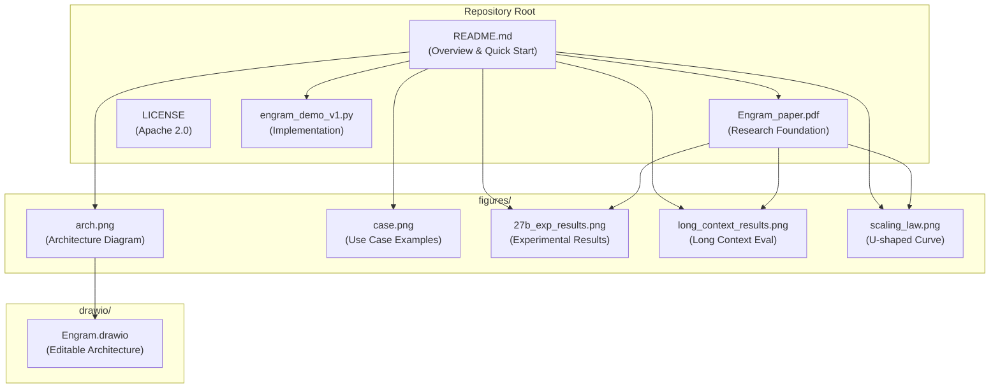
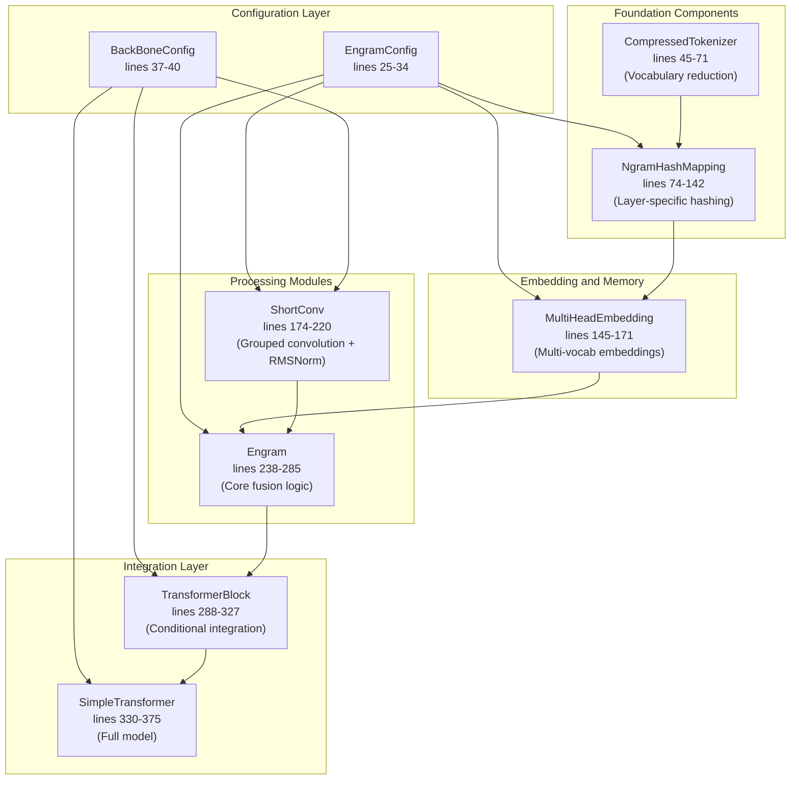
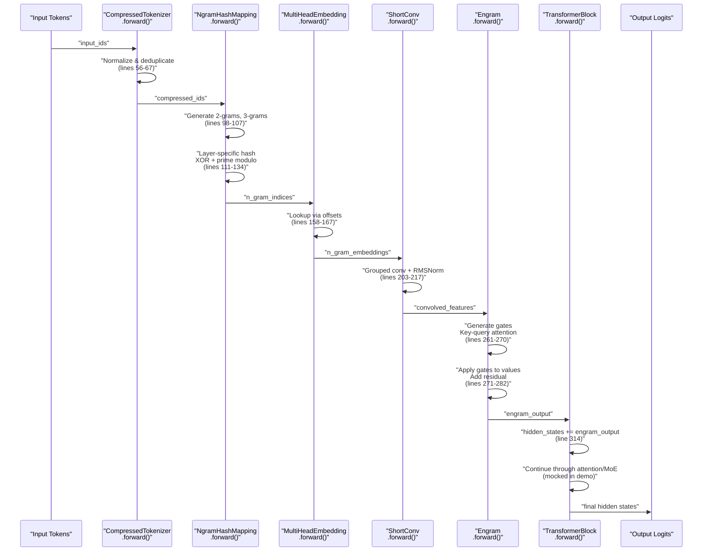

<!-- source: DeepWiki mcp.deepwiki.com · repo deepseek-ai/Engram · page 1 Home · fetched 2026-10-30 -->

# Home

<details>
<summary>Relevant source files</summary>

The following files were used as context for generating this wiki page:

- [Engram_paper.pdf](Engram_paper.pdf)
- [README.md](README.md)

</details>


## Purpose and Scope

This wiki documents the **Engram** system: an architectural innovation that augments Large Language Models (LLMs) with conditional memory through scalable N-gram embeddings. This repository contains the research implementation for the paper "[Conditional Memory via Scalable Lookup: A New Axis of Sparsity for Large Language Models](Engram_paper.pdf)".

The Engram system introduces **conditional memory** as a complementary sparsity axis to Mixture-of-Experts (MoE), enabling LLMs to perform O(1) lookups against massive static knowledge stores while maintaining computational efficiency. This wiki covers the theoretical foundations, architectural design, implementation details, and experimental validation of the Engram system.

**Scope of this page:** This Home page provides an overview of the repository structure, core concepts at a glance, and navigation guidance. For detailed explanations of specific subsystems, refer to the dedicated pages linked throughout this document.

**Sources:** [README.md:1-97]()

---

## What is Engram?

Engram addresses a fundamental limitation in transformer-based LLMs: while MoE provides conditional computation (sparsity in neural parameters), transformers lack a native primitive for conditional memory (sparsity in knowledge lookup). Engram fills this gap by:

1. **Storing static knowledge** in multi-scale N-gram embeddings (2-grams, 3-grams, etc.)
2. **Enabling O(1) retrieval** via deterministic hash-based addressing
3. **Offloading massive embedding tables** to host memory with minimal inference overhead
4. **Integrating selectively** into specific transformer layers to augment dynamic representations

The system demonstrates a **U-shaped scaling law** that governs optimal capacity allocation between neural computation (MoE) and static memory (Engram), with empirical validation showing consistent improvements across knowledge, reasoning, code, and mathematics domains.

For detailed conceptual explanations, see:
- [Conditional Memory vs Conditional Computation](#2.1)
- [N-gram Embeddings and Scalable Lookup](#2.2)
- [Sparsity Allocation and U-shaped Scaling Law](#2.3)

**Sources:** [README.md:32-41]()

---

## Repository Structure



**Diagram: Repository File Structure**

### File Descriptions

| File | Purpose | Wiki Reference |
|------|---------|----------------|
| `README.md` | High-level introduction, quick start instructions | [Getting Started](#6) |
| `Engram_paper.pdf` | Full research paper with theoretical foundations | [Research Foundation](#7) |
| `engram_demo_v1.py` | Standalone implementation demonstrating core logic | [Implementation Guide](#4) |
| `LICENSE` | Apache 2.0 license terms | [License and Contributing](#8) |
| `figures/arch.png` | System architecture overview | [Architecture](#3) |
| `figures/27b_exp_results.png` | Large-scale pre-training results | [Engram-27B Model Results](#5.1) |
| `figures/long_context_results.png` | Long context (16K+ tokens) evaluation | [Long Context Evaluation](#5.2) |
| `figures/scaling_law.png` | U-shaped capacity allocation curve | [Scaling Laws and Optimal Allocation](#5.3) |
| `figures/case.png` | Practical use case examples | [Use Cases and Examples](#6.3) |
| `drawio/Engram.drawio` | Editable architecture diagrams | [System Overview](#3.1) |

**Sources:** [README.md:1-97]()

---

## Core Components and Code Architecture

The implementation in `engram_demo_v1.py` is organized into modular components that correspond to specific architectural responsibilities. This diagram maps system concepts to concrete code entities.



**Diagram: Code Component Architecture**

### Component Responsibilities

| Component | Lines | Responsibility | Wiki Page |
|-----------|-------|----------------|-----------|
| `EngramConfig` | 25-34 | Configure N-gram vocabulary sizes, layer IDs, embedding dimensions | [Configuration Reference](#4.6) |
| `BackBoneConfig` | 37-40 | Configure transformer backbone parameters (hidden size, layers, etc.) | [Configuration Reference](#4.6) |
| `CompressedTokenizer` | 45-71 | Reduce vocabulary via normalization and deduplication | [Compressed Tokenizer](#4.3) |
| `NgramHashMapping` | 74-142 | Generate layer-specific N-gram hashes with collision reduction | [N-gram Hash Mapping](#4.2) |
| `MultiHeadEmbedding` | 145-171 | Handle multiple vocabulary sizes with unified embedding interface | [Multi-Head Embedding and ShortConv](#4.4) |
| `ShortConv` | 174-220 | Apply grouped 1D convolution for local context modeling | [Multi-Head Embedding and ShortConv](#4.4) |
| `Engram` | 238-285 | Core module: gating, fusion, residual output | [Engram Module Deep Dive](#3.2) |
| `TransformerBlock` | 288-327 | Selectively integrate Engram into transformer layers | [Transformer Block Integration](#4.5) |
| `SimpleTransformer` | 330-375 | Complete LLM with conditional Engram insertion | [System Overview](#3.1) |

**Sources:** [engram_demo_v1.py:1-378]()

---

## Data Flow Through the System

This sequence diagram shows how input tokens flow through the Engram system, highlighting the key code methods involved at each stage.



**Diagram: End-to-End Data Flow with Code References**

For detailed explanations of each processing stage:
- Vocabulary compression: [Compressed Tokenizer](#4.3)
- N-gram hashing: [N-gram Hash Mapping](#4.2)
- Embedding lookup: [Multi-Head Embedding and ShortConv](#4.4)
- Gating and fusion: [Engram Module Deep Dive](#3.2)
- Layer integration: [Transformer Block Integration](#4.5)

**Sources:** [engram_demo_v1.py:45-327]()

---

## Key Features and Innovations

### Conditional Memory as a Sparsity Axis

| Feature | MoE (Conditional Computation) | Engram (Conditional Memory) |
|---------|-------------------------------|------------------------------|
| **Sparsity Type** | Neural parameters (expert selection) | Static knowledge (N-gram lookup) |
| **Access Pattern** | Learned routing | Deterministic addressing |
| **Scaling Dimension** | Computational capacity | Memory capacity |
| **Complementarity** | Yes - U-shaped scaling law indicates optimal allocation |

### Technical Innovations

1. **O(1) Deterministic Lookup** ([NgramHashMapping:111-134]()): Layer-specific hashing with XOR mixing and prime modulo operations eliminates the need for learned addressing mechanisms.

2. **Host Memory Offloading** ([README.md:40-41]()): Massive embedding tables (billions of N-grams) are offloaded to CPU RAM, reducing GPU memory requirements by orders of magnitude.

3. **Multi-Scale N-gram Representations** ([NgramHashMapping:98-107]()): Simultaneous use of 2-grams, 3-grams, and higher-order N-grams captures patterns at multiple granularities.

4. **Selective Layer Integration** ([EngramConfig:25-34]()): Strategic placement at specific transformer layers (e.g., layers 1 and 15) balances performance gains with computational overhead.

5. **Vocabulary Compression** ([CompressedTokenizer:56-67]()): Normalization and deduplication reduce the effective vocabulary size, improving hash collision rates.

For mechanistic analysis of how these features improve model behavior, see [Mechanistic Analysis](#7.2).

**Sources:** [engram_demo_v1.py:45-142](), [README.md:36-41]()

---

## Quick Start

### Installation

Requires Python 3.8+ and PyTorch:

```bash
pip install torch numpy transformers sympy
```

### Running the Demo

```bash
python engram_demo_v1.py
```

**Expected Output:**
- Configuration printout showing Engram and backbone parameters
- Example forward pass demonstrating data flow through all components
- Shape information for intermediate tensors

**⚠️ Important:** The demo code ([engram_demo_v1.py:1-378]()) is a simplified demonstration. Standard components like attention, MoE, and multi-head connections are mocked to focus on Engram-specific logic. For production deployment considerations, see [Implementation Guide](#4).

For detailed setup and usage instructions, see [Getting Started](#6).

**Sources:** [README.md:78-90]()

---

## Experimental Validation Overview

The Engram system has been validated through comprehensive experiments documented in the research paper and visualized in the `figures/` directory.

### Key Results Summary

| Evaluation Dimension | Result | Figure Reference | Wiki Page |
|---------------------|--------|------------------|-----------|
| **Engram-27B Model** | Consistent improvements over MoE baselines across knowledge, reasoning, code, and math domains | `27b_exp_results.png` | [Engram-27B Model Results](#5.1) |
| **Long Context** | Successfully scales to 16K+ tokens without performance degradation | `long_context_results.png` | [Long Context Evaluation](#5.2) |
| **Scaling Law** | U-shaped capacity allocation curve validates optimal MoE-Engram balance | `scaling_law.png` | [Scaling Laws and Optimal Allocation](#5.3) |

### Evaluation Methodology

All experiments employ **iso-parameter** and **iso-FLOPs** constraints to ensure fair comparisons with MoE-only baselines. This means:
- Models have equivalent total parameter counts (accounting for both neural parameters and N-gram embeddings)
- Computational budgets (FLOPs) are matched during training

For detailed methodology, see [Baseline Comparisons](#5.4).

**Sources:** [README.md:36-41](), [README.md:51-71]()

---

## Wiki Navigation Guide

### For New Users

1. Start with [Core Concepts](#2) to understand conditional memory and dual sparsity
2. Review [Architecture](#3) for system design and component interactions
3. Follow [Getting Started](#6) for hands-on experience with the demo

### For Implementation Details

1. [Implementation Guide](#4) - Complete walkthrough of `engram_demo_v1.py`
2. [N-gram Hash Mapping](#4.2) - Deterministic addressing implementation
3. [Engram Module Deep Dive](#3.2) - Core fusion logic
4. [Configuration Reference](#4.6) - Parameter tuning guide

### For Research and Theory

1. [Research Foundation](#7) - Paper summary and contributions
2. [Mechanistic Analysis](#7.2) - Why Engram improves model behavior
3. [Experimental Validation](#5) - Comprehensive results analysis
4. [Sparsity Allocation and U-shaped Scaling Law](#2.3) - Optimal capacity allocation

### For Specific Use Cases

1. [Use Cases and Examples](#6.3) - Practical application scenarios
2. [Training vs Inference Architecture](#3.3) - Deployment considerations
3. [Memory Hierarchy and Offloading](#3.4) - Scaling to massive embedding tables

### Architecture Deep Dives

| Topic | Wiki Page |
|-------|-----------|
| High-level system overview | [System Overview](#3.1) |
| Engram module internals | [Engram Module Deep Dive](#3.2) |
| Training vs inference differences | [Training vs Inference Architecture](#3.3) |
| Memory offloading strategy | [Memory Hierarchy and Offloading](#3.4) |
| Component dependencies | [Implementation Guide](#4) |

**Sources:** Wiki table of contents structure

---

## Citing Engram

If you use Engram in your research, please cite the paper:

```
@article{engram2024,
  title={Conditional Memory via Scalable Lookup: A New Axis of Sparsity for Large Language Models},
  author={DeepSeek-AI},
  journal={arXiv preprint},
  year={2024}
}
```

For detailed citation information and contribution guidelines, see [License and Contributing](#8).

**Sources:** [README.md:92-97]()

---

## Additional Resources

- **Repository:** https://github.com/deepseek-ai/Engram
- **Paper:** [Engram_paper.pdf](Engram_paper.pdf) (included in repository)
- **Architecture Diagrams:** [drawio/Engram.drawio]() (editable)
- **Community:** Discord, WeChat, Twitter links available in [README.md:1-28]()

For questions or issues, contact [service@deepseek.com](mailto:service@deepseek.com) or open an issue on GitHub.

**Sources:** [README.md:95-97]()

---

