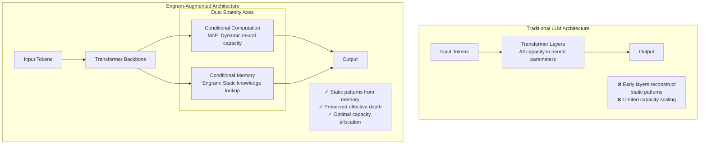
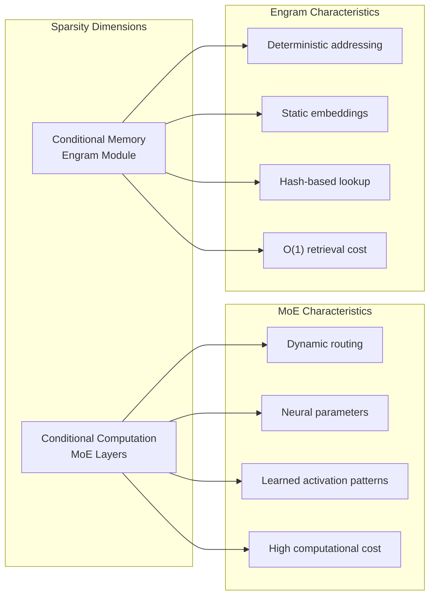
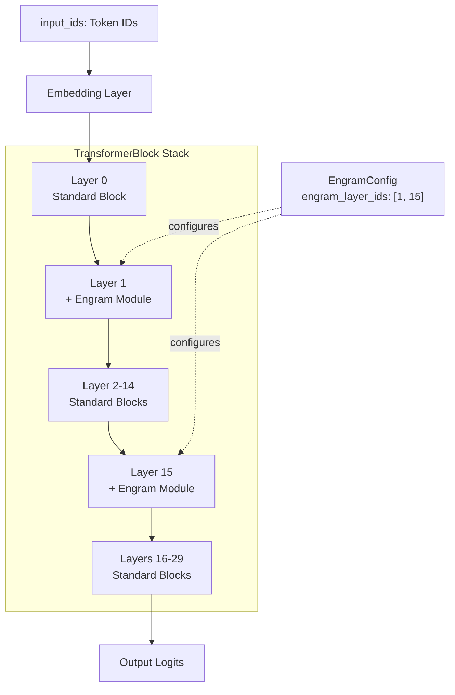
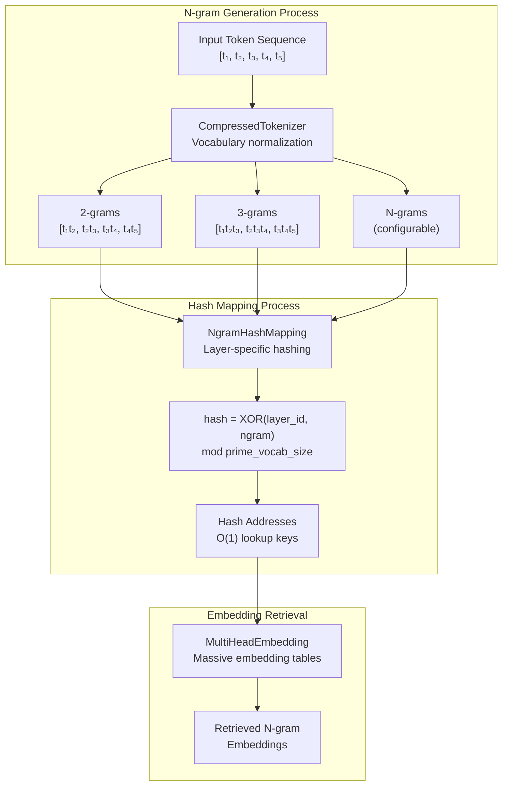
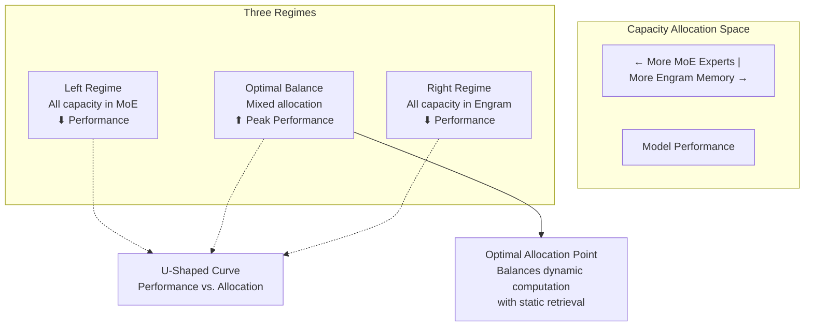
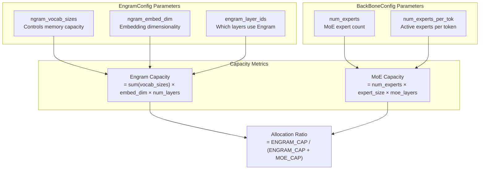
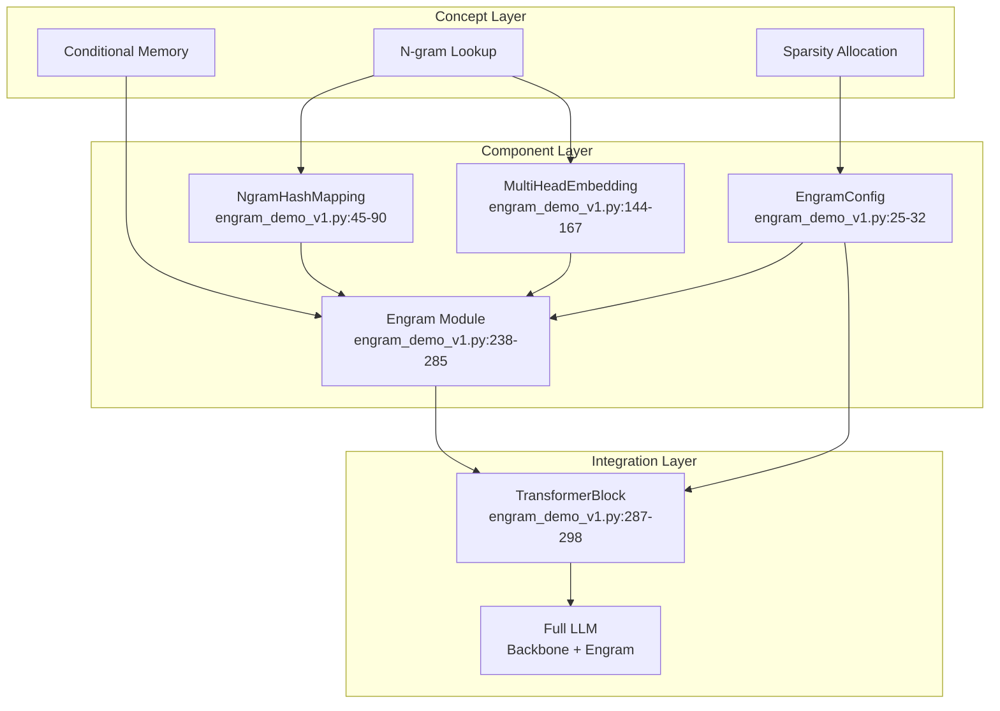

<!-- source: DeepWiki mcp.deepwiki.com · repo deepseek-ai/Engram · page 2 Core Concepts · fetched 2026-10-30 -->

# Core Concepts

Relevant source files

The following files were used as context for generating this wiki page:

- [Engram_paper.pdf](Engram_paper.pdf)
- [README.md](README.md)
- [figures/arch.png](figures/arch.png)

## Purpose and Scope

This document explains the fundamental architectural concepts that underpin the Engram system: how it introduces **conditional memory** as a new sparsity axis for Large Language Models, how it achieves efficient knowledge lookup through N-gram embeddings, and how to optimally allocate model capacity between neural computation and static memory.

For implementation details of these concepts, see [Implementation Guide](#4). For architectural integration patterns, see [Architecture](#3). For experimental validation of these concepts, see [Experimental Validation](#5).

---

## Overview: The Dual Sparsity Paradigm

Engram introduces a fundamental shift in how Large Language Models allocate computational resources. While traditional Mixture-of-Experts (MoE) architectures provide **conditional computation** (activating different neural pathways based on input), they lack a native mechanism for efficient **conditional memory** (retrieving static knowledge patterns). Engram addresses this gap by treating memory as a complementary sparsity axis.

**Figure 1: Traditional vs. Engram-Augmented LLM Architecture**

The core insight is that these two sparsity axes—conditional computation and conditional memory—are complementary and have an optimal allocation point. Engram enables models to offload static pattern matching to deterministic memory lookup, preserving neural capacity for dynamic reasoning tasks.

**Sources:** [README.md:32-40](), [Engram_paper.pdf:1-300]()

---

## Conditional Memory vs Conditional Computation

### The Complementary Sparsity Axes

Modern LLMs face a fundamental capacity bottleneck: all knowledge must be encoded in neural parameters. MoE addresses this by conditionally activating subsets of parameters, but this remains purely computational—no mechanism exists for direct knowledge retrieval. Engram introduces conditional memory as a second, orthogonal axis of sparsity.

**Figure 2: Characteristics of Dual Sparsity Axes**

### Code Implementation Mapping

The dual sparsity architecture manifests in the codebase through distinct component hierarchies:

| Sparsity Axis | Core Components | Key Characteristics | Code Reference |
|--------------|-----------------|---------------------|----------------|
| **Conditional Computation** (MoE) | `TransformerBlock` with MoE layers | Dynamically routes inputs to expert subnetworks | Mock implementation in demo |
| **Conditional Memory** (Engram) | `Engram`, `NgramHashMapping`, `MultiHeadEmbedding` | Deterministically retrieves N-gram embeddings | [engram_demo_v1.py:238-285]() |

The integration point occurs within `TransformerBlock`, where specific layers conditionally apply the Engram module:

**Figure 3: Selective Layer Integration in TransformerBlock**

The selective integration is controlled by `EngramConfig.engram_layer_ids`, which specifies which transformer layers receive Engram augmentation. This design preserves most layers as standard transformers while strategically inserting memory lookup at specific depths.

**Sources:** [README.md:34-35](), [engram_demo_v1.py:25-40](), [engram_demo_v1.py:287-298]()

---

## N-gram Embeddings and Scalable Lookup

### Static Knowledge Representation

Engram stores static knowledge as multi-scale N-gram embeddings—dense vector representations of token sequences. Unlike traditional N-gram models that store discrete counts, Engram uses learnable embeddings that can be updated during training and efficiently retrieved during inference.

**Figure 4: N-gram Embedding Pipeline**

### Deterministic Addressing via Hashing

The efficiency of Engram's lookup mechanism relies on `NgramHashMapping`, which converts token sequences into deterministic hash addresses. This enables O(1) retrieval complexity regardless of vocabulary size.

**Hash Function Implementation:**

The core hashing logic in [engram_demo_v1.py:45-90]() implements:

1. **Vocabulary Compression:** `CompressedTokenizer` reduces the effective vocabulary through normalization and deduplication
2. **N-gram Construction:** Generates multi-scale N-gram sequences from compressed tokens
3. **Layer-Specific Hashing:** Applies XOR mixing with layer ID to create unique hash spaces per transformer layer
4. **Prime Modulo:** Uses prime number vocabulary sizes to minimize hash collisions

```mermaid
graph LR
    subgraph "CompressedTokenizer"
        VOCAB["Original Vocabulary<br/>~256K tokens"]
        NORM["Normalization Rules<br/>Case folding, Unicode"]
        DEDUP["Deduplication Map"]
        
        VOCAB --> NORM
        NORM --> DEDUP
        DEDUP --> COMPRESSED["Compressed Vocabulary<br/>~128K tokens"]
    end
    
    subgraph "NgramHashMapping"
        INPUT_IDS["Compressed Token IDs"]
        NGRAM_GEN["N-gram Generation<br/>Sliding windows"]
        
        INPUT_IDS --> NGRAM_GEN
        
        NGRAM_GEN --> HASH_COMPUTE["Hash Computation<br/>hash_val = hash_fn(ngram, layer_id)"]
        
        HASH_COMPUTE --> MODULO["Prime Modulo<br/>index = hash_val % vocab_size"]
        
        MODULO --> FINAL_ADDR["Final Hash Address"]
    end
    
    COMPRESSED --> INPUT_IDS
```

**Figure 5: Hash Addressing Components**

### Multi-Head Embedding Architecture

The `MultiHeadEmbedding` class [engram_demo_v1.py:144-167]() manages multiple vocabulary sizes efficiently using a single `nn.Embedding` layer with offset management:

| Component | Purpose | Configuration Parameter |
|-----------|---------|------------------------|
| `CompressedTokenizer` | Reduces vocabulary size | `EngramConfig.compressed_vocab_size` |
| `NgramHashMapping` | Generates hash addresses | `EngramConfig.ngram_vocab_sizes` (list of sizes for different N-grams) |
| `MultiHeadEmbedding` | Stores embedding tables | `EngramConfig.ngram_embed_dim` |

The offset-based design allows a single embedding matrix to serve multiple N-gram vocabularies by partitioning address spaces.

**Sources:** [README.md:34](), [engram_demo_v1.py:45-90](), [engram_demo_v1.py:144-167]()

---

## Sparsity Allocation and U-Shaped Scaling Law

### The Capacity Trade-off

A fundamental question in Engram's design is: **How should model capacity be allocated between neural computation (MoE) and static memory (Engram)?** Empirical investigation reveals a U-shaped scaling law governing this trade-off.

**Figure 6: U-Shaped Scaling Law Conceptual Framework**

### Experimental Validation

The U-shaped relationship is validated through systematic capacity sweeps under iso-parameter constraints, as shown in [figures/scaling_law.png](). The experimental setup varies:

- **X-axis:** Ratio of capacity allocated to Engram vs. MoE
- **Y-axis:** Model performance across evaluation benchmarks
- **Controls:** Total parameter count and FLOPs held constant

**Key Finding:** Pure MoE (left extreme) and pure Engram (right extreme) both underperform relative to balanced allocations. The optimal point typically occurs when ~20-30% of additional capacity is allocated to Engram, with the remainder in MoE experts.

### Configuration Parameters for Allocation

The capacity allocation is controlled through configuration parameters:

**Figure 7: Configuration Parameters Controlling Capacity Allocation**

### Mechanistic Interpretation

The U-shaped curve reflects a fundamental trade-off:

- **Too much MoE (left side):** Model wastes neural capacity reconstructing static patterns that could be directly retrieved
- **Too much Engram (right side):** Model lacks sufficient dynamic computational capacity for complex reasoning and context-dependent tasks
- **Optimal balance (center):** Static patterns handled by memory retrieval, preserving neural capacity for dynamic reasoning

This mechanistic interpretation is further explored in [Research Foundation](#7), which analyzes how Engram relieves early layers from static pattern reconstruction, preserving effective network depth.

**Sources:** [README.md:36-39](), [figures/scaling_law.png](), [engram_demo_v1.py:25-40]()

---

## Implementation Architecture Overview

The following diagram maps the core concepts to their concrete implementations in the codebase:

**Figure 8: Concept-to-Code Mapping**

This architecture enables the dual sparsity paradigm while maintaining clean separation of concerns. The `Engram` module encapsulates all memory lookup logic, the `NgramHashMapping` handles addressing, and configuration parameters control the allocation between conditional computation and conditional memory.

**Sources:** [engram_demo_v1.py:1-300](), [README.md:43-50]()

---

## Summary

The core concepts of Engram establish a new architectural paradigm for LLMs:

1. **Dual Sparsity:** Conditional memory (Engram) complements conditional computation (MoE) as orthogonal scaling axes
2. **Efficient Lookup:** N-gram embeddings with deterministic hashing enable O(1) memory retrieval without learned routing
3. **Optimal Allocation:** A U-shaped scaling law guides capacity distribution between neural parameters and static memory

These concepts are realized through a modular implementation that integrates seamlessly with standard transformer architectures while maintaining clear separation between dynamic computation and static knowledge retrieval.

For deeper understanding of the implementation details, see [Implementation Guide](#4). For architectural patterns and data flow, see [Architecture](#3). For empirical validation across benchmarks, see [Experimental Validation](#5).

---

