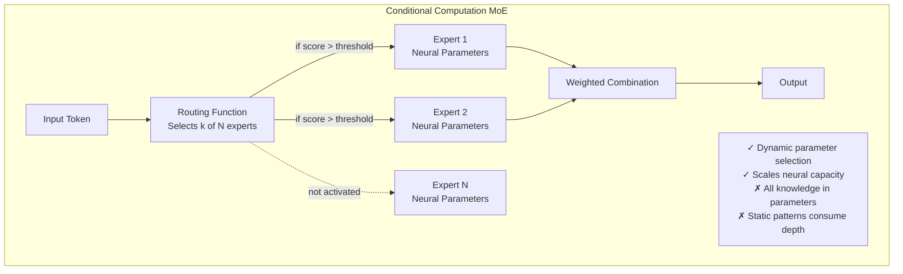
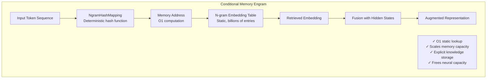
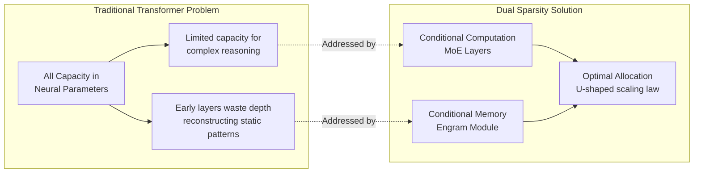
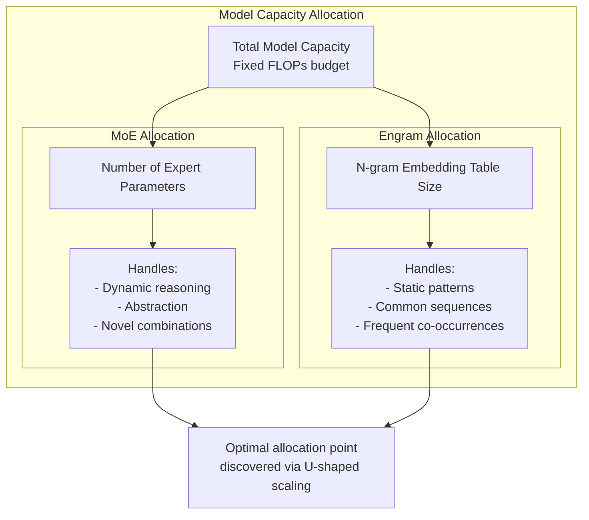
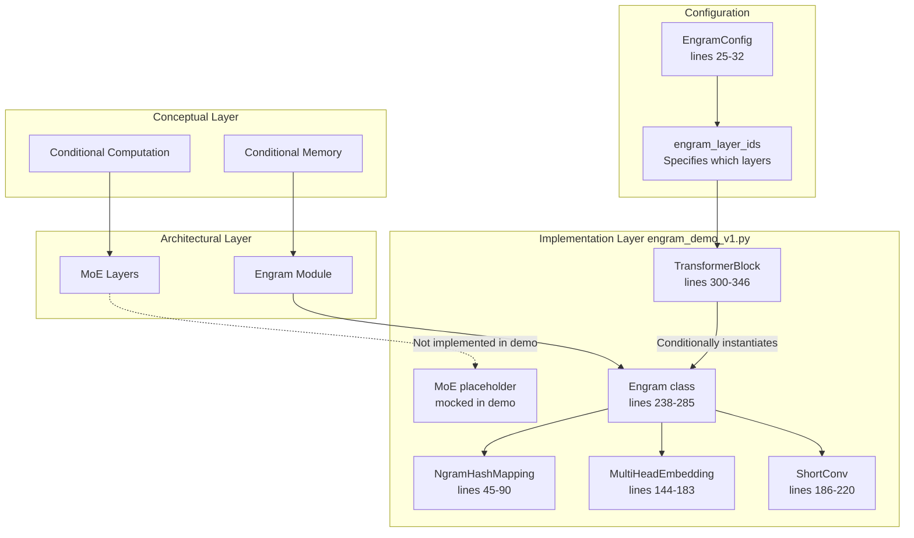

<!-- source: DeepWiki mcp.deepwiki.com · repo deepseek-ai/Engram · page 2.1 Conditional Memory vs Conditional Computation · fetched 2026-10-30 -->

# Conditional Memory vs Conditional Computation

<details>
<summary>Relevant source files</summary>

The following files were used as context for generating this wiki page:

- [Engram_paper.pdf](Engram_paper.pdf)
- [README.md](README.md)
- [figures/scaling_law.png](figures/scaling_law.png)

</details>


## Purpose and Scope

This document establishes the fundamental distinction between two complementary approaches to sparsity in large language models: **conditional computation** (instantiated via Mixture-of-Experts) and **conditional memory** (instantiated via Engram). It explains why these represent orthogonal scaling dimensions and how they address different architectural bottlenecks. For details on the optimal allocation between these two axes, see [Sparsity Allocation and U-shaped Scaling Law](#2.3). For implementation specifics of the Engram module, see [Engram Module Deep Dive](#3.2).

**Sources:** [README.md:32-40](), High-Level Diagram 2

---

## Conditional Computation: Mixture-of-Experts

**Conditional computation** refers to architectures that dynamically select which neural network parameters to activate based on input characteristics. The canonical implementation is Mixture-of-Experts (MoE), where:

- **Mechanism:** A routing function selects a sparse subset of expert networks for each token
- **Capacity axis:** Scales the number of trainable parameters without proportional FLOPs increase
- **Computation type:** Dynamic neural computation
- **Knowledge representation:** Implicitly learned in distributed parameters

In traditional transformer architectures augmented with MoE, all model capacity resides in neural parameters. This creates a fundamental limitation: early layers must expend representational capacity reconstructing static, deterministic patterns (e.g., common N-gram sequences, frequent token co-occurrences) before higher layers can perform complex reasoning.

### Diagram: MoE Sparsity Pattern



**Sources:** [README.md:32-34](), High-Level Diagram 2

---

## Conditional Memory: Engram

**Conditional memory** represents a fundamentally different sparsity axis that provides direct, O(1) lookup of static knowledge without neural computation. The Engram module instantiates this concept through:

- **Mechanism:** Deterministic hash-based retrieval of N-gram embeddings
- **Capacity axis:** Scales memory via massive embedding tables (billions of N-grams)
- **Computation type:** Static memory lookup (no gradients at inference)
- **Knowledge representation:** Explicit embeddings for token sequences

Rather than forcing the model to learn to reconstruct "the cat sat on" every time it appears, Engram provides pre-computed embeddings for such sequences via deterministic addressing. This frees neural capacity for tasks that require actual reasoning.

### Diagram: Engram Lookup Pattern



**Sources:** [README.md:34](), [engram_demo_v1.py:45-90](), High-Level Diagram 2

---

## Dual Sparsity Paradigm

The key insight is that conditional computation and conditional memory are **orthogonal and complementary**. They address different aspects of model capacity:

| Dimension | Conditional Computation (MoE) | Conditional Memory (Engram) |
|-----------|-------------------------------|------------------------------|
| **What it scales** | Neural parameters | Static memory |
| **Selection mechanism** | Learned routing (gradient-based) | Deterministic hashing (gradient-free) |
| **Lookup complexity** | O(k) where k = active experts | O(1) per N-gram |
| **Knowledge type** | Implicit, distributed | Explicit, indexed |
| **Best for** | Dynamic reasoning, abstraction | Static patterns, frequent sequences |
| **Training behavior** | Backprop through routing | Backprop through embedding lookups |
| **Inference behavior** | Activate subset of experts | Retrieve from offloaded tables |

### Diagram: Complementary Sparsity Axes



**Sources:** [README.md:36-37](), High-Level Diagrams 2 and 7

---

## Why Both Axes Are Necessary

Traditional MoE-only architectures face a fundamental bottleneck: they still represent all knowledge (including trivial static patterns) as learned neural parameters. This creates two problems:

1. **Representational Inefficiency:** Storing "the cat sat on the" as distributed weights across millions of parameters is wasteful when it could be a single explicit embedding
2. **Depth Consumption:** Early layers expend their representational capacity (the model's "effective depth") on pattern reconstruction rather than reasoning

Engram addresses these issues by:

- **Relieving Early Layers:** Static patterns are retrieved via O(1) lookup rather than multi-layer reconstruction
- **Preserving Effective Depth:** Neural capacity is freed for complex tasks that actually require computation
- **Explicit Indexing:** Billions of N-gram patterns can be stored without proportional parameter count

The **complementarity** arises because:
- MoE cannot efficiently handle the explosion of static patterns (requires exponentially more experts)
- Engram cannot handle dynamic reasoning (requires explicit enumeration of all possible contexts)
- Together, they partition the model's capacity optimally: memory for static lookup, computation for dynamic reasoning

**Sources:** [README.md:39](), High-Level Diagram 7

---

## Capacity Allocation Trade-off

A critical finding is that there exists an **optimal allocation** between MoE capacity and Engram capacity. Neither extreme works well:

- **Too much MoE, too little Engram:** Model wastes neural capacity on static patterns
- **Too much Engram, too little MoE:** Model lacks computational capacity for reasoning
- **Optimal balance:** U-shaped performance curve with a sweet spot

This trade-off is formalized as a **U-shaped scaling law** that guides architectural design. The specifics of this law and experimental validation are covered in [Sparsity Allocation and U-shaped Scaling Law](#2.3).

### Diagram: Capacity Allocation Concept



**Sources:** [README.md:37](), High-Level Diagram 2, [figures/scaling_law.png]()

---

## Implementation Mapping: Code Entities

The dual sparsity concept maps to concrete implementation components in the codebase:

### Diagram: Concept to Code Mapping



**Key Code Entities:**

- **`Engram` class** [engram_demo_v1.py:238-285](): Core module implementing conditional memory
- **`NgramHashMapping` class** [engram_demo_v1.py:45-90](): Deterministic hash function for O(1) addressing
- **`MultiHeadEmbedding` class** [engram_demo_v1.py:144-183](): Static N-gram embedding storage
- **`TransformerBlock` class** [engram_demo_v1.py:300-346](): Selectively integrates Engram based on `engram_layer_ids`
- **`EngramConfig.engram_layer_ids`** [engram_demo_v1.py:30](): Configuration specifying which layers use Engram (typically layers 1 and 15)

**Sources:** [engram_demo_v1.py:25-346](), High-Level Diagram 6

---

## Selective Layer Integration

An important architectural detail is that Engram is **not applied to all layers**—only specific layers receive conditional memory augmentation. This design choice reflects the understanding that:

- **Early layers** benefit most from static pattern lookup (common sequences appear early in processing)
- **Middle layers** may rely more on pure neural computation for abstraction
- **Specific depth points** (e.g., layer 1 and layer 15 in the demo) are strategically chosen

The selection is controlled via `EngramConfig.engram_layer_ids`:

```python
# From engram_demo_v1.py:30
engram_layer_ids: List[int] = field(default_factory=lambda: [1, 15])
```

This list determines which `TransformerBlock` instances instantiate an `Engram` module. The selective integration allows fine-grained control over the MoE-Engram capacity allocation.

**Sources:** [engram_demo_v1.py:25-32, 300-346](), [README.md:45-49]()

---

## Summary: Two Dimensions, One System

Conditional computation (MoE) and conditional memory (Engram) represent **two independent but complementary dimensions** for scaling language models:

- **MoE** scales what the model can *compute* dynamically
- **Engram** scales what the model can *remember* statically
- **Together** they enable optimal capacity allocation, with MoE handling reasoning and Engram handling lookup

This dual-axis approach challenges the prevailing paradigm that all model capacity must come from neural parameters. By treating memory as a first-class sparsity dimension alongside computation, Engram opens new architectural possibilities for efficient large language models.

**Sources:** [README.md:32-40](), High-Level Diagrams 2, 6, 7

---

