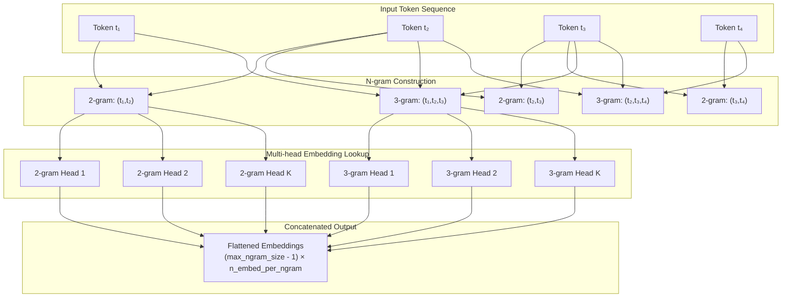
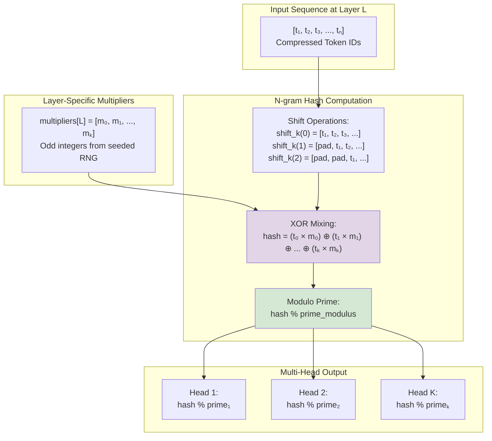
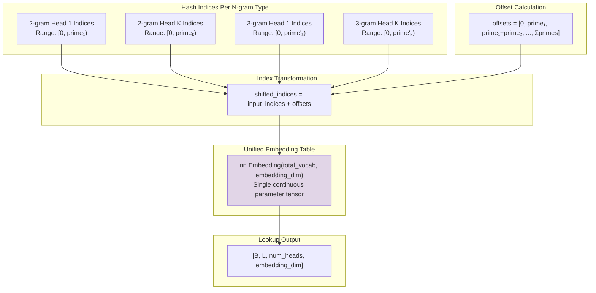
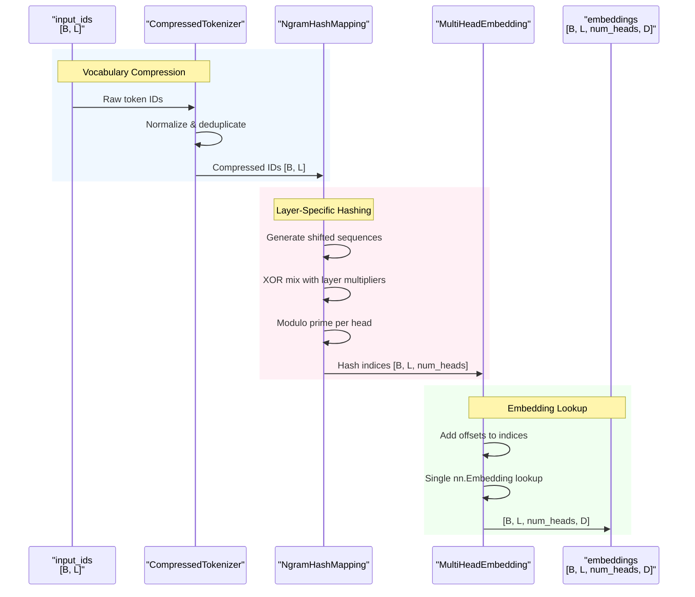
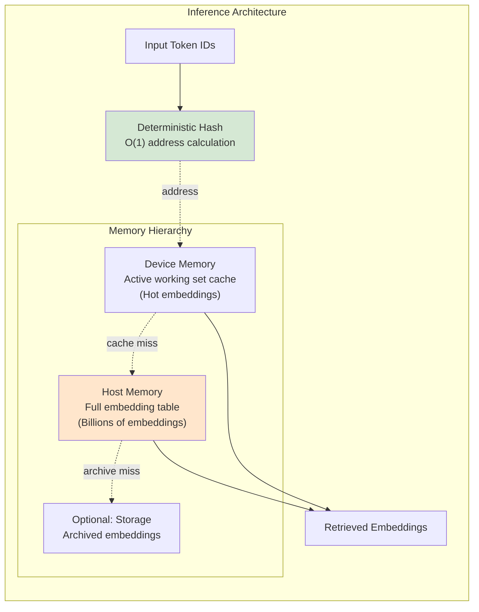

<!-- source: DeepWiki mcp.deepwiki.com · repo deepseek-ai/Engram · page 2.2 N-gram Embeddings and Scalable Lookup · fetched 2026-10-30 -->

# N-gram Embeddings and Scalable Lookup

Relevant source files

The following files were used as context for generating this wiki page:

- [Engram_paper.pdf](Engram_paper.pdf)
- [README.md](README.md)
- [engram_demo_v1.py](engram_demo_v1.py)

## Purpose and Scope

This page explains the core mechanism by which Engram stores and retrieves static knowledge: **N-gram embeddings with deterministic O(1) lookup**. We cover the representation of N-gram patterns, the hashing strategy that enables scalable retrieval, vocabulary compression techniques, and the memory hierarchy that allows offloading massive embedding tables to host memory.

For the broader architectural context of how this fits into the LLM backbone, see [System Overview](#3.1). For the dual sparsity paradigm that motivates this design, see [Conditional Memory vs Conditional Computation](#2.1). For implementation details of specific components, see [N-gram Hash Mapping](#4.2) and [Multi-Head Embedding](#4.4).

---

## Overview: Static Knowledge via N-gram Patterns

Unlike traditional LLM parameters that must be updated during training, Engram introduces **static memory** in the form of N-gram embeddings. These embeddings represent co-occurrence patterns learned from training data and remain accessible via deterministic addressing during inference.

### Key Design Principles

| Principle | Implementation | Benefit |
|-----------|---------------|---------|
| **Deterministic Addressing** | Hash-based O(1) lookup | No learned routing; predictable memory access |
| **Multi-scale Patterns** | 2-grams through N-grams | Captures patterns at multiple granularities |
| **Vocabulary Compression** | Normalization + deduplication | Reduces effective vocabulary size by ~70% |
| **Memory Hierarchy** | Offload tables to host memory | Scales to billions of embeddings without GPU memory constraints |
| **Layer-specific Hashing** | Different hash functions per layer | Avoids collision across layers; layer-specialized patterns |

**Sources:** [README.md:32-41](), [engram_demo_v1.py:188-303](), [Diagram 2 from high-level overview]

---

## N-gram Representation and Multi-head Architecture

### Conceptual Model

**Multi-head Design:** Each N-gram size (e.g., 2-gram, 3-gram) has multiple independent "heads" (controlled by `n_head_per_ngram`). This provides:
- **Collision mitigation:** Different heads use different hash moduli, reducing the probability that collisions align across all heads
- **Representation diversity:** Multiple embeddings per pattern capture different aspects of co-occurrence
- **Gradient flow:** During training, different heads can specialize in different pattern aspects

**Sources:** [engram_demo_v1.py:38-48](), [engram_demo_v1.py:305-324](), [engram_demo_v1.py:340-343]()

---

## Vocabulary Compression via Normalization

Before N-gram construction, input token IDs pass through a **CompressedTokenizer** that reduces vocabulary size through aggressive normalization.

### Normalization Pipeline

**Compression Strategy:**
1. **Text normalization:** Convert tokens to canonical form (NFKC → NFD → strip accents → lowercase → whitespace collapse)
2. **Key-based deduplication:** Map all tokens that normalize to the same string to a single compressed ID
3. **Special token handling:** Tokens containing replacement characters (�) use the raw token string as the key to preserve special tokens

**Compression Ratio:** The DeepSeek-V3 vocabulary (129,280 tokens) compresses to approximately 30-40% of the original size, significantly reducing the N-gram hash space.

**Code Entity Mapping:**
- `CompressedTokenizer` class: [engram_demo_v1.py:60-121]()
- `normalizer`: [engram_demo_v1.py:68-77]()
- `_build_lookup_table()`: [engram_demo_v1.py:84-110]()
- `lookup_table`: NumPy array mapping original token IDs to compressed IDs [engram_demo_v1.py:106-108]()

**Sources:** [engram_demo_v1.py:60-122](), [engram_demo_v1.py:207-213]()

---

## Deterministic Hash Mapping: O(1) Lookup

The core scalability mechanism is a **layer-specific, collision-resistant hash function** that maps N-grams to embedding indices without requiring learned routing.

### Hash Function Design

### Hash Properties

**Layer-Specific Seeding:**
- Each layer receives a different random seed: `base_seed = seed + PRIME_1 × layer_id`
- Generates unique multipliers per layer via `np.random.default_rng(base_seed)`
- Prevents N-gram collisions from propagating across layers

**XOR Mixing:**
- Combines tokens via bitwise XOR: `hash = (t[0] * m[0]) ^ (t[1] * m[1]) ^ ... ^ (t[k] * m[k])`
- XOR provides good avalanche properties: small input changes cascade through the hash
- Multiplication by odd integers ensures non-zero contribution from each token

**Prime Modulo Collision Reduction:**
- Each head uses a different **prime number** as the modulus
- Primes are selected starting from `vocab_size - 1` and incrementing to the next unused prime
- Prime moduli minimize systematic collision patterns (since primes share no common factors)

**Code Entity Mapping:**
- `NgramHashMapping` class: [engram_demo_v1.py:188-303]()
- `layer_multipliers`: Dictionary mapping layer IDs to multiplier arrays [engram_demo_v1.py:219-231]()
- `_get_ngram_hashes()`: Core hash computation [engram_demo_v1.py:262-296]()
- `calculate_vocab_size_across_layers()`: Prime modulus selection [engram_demo_v1.py:235-260]()
- `find_next_prime()`: Prime search utility [engram_demo_v1.py:181-186]()

**Sources:** [engram_demo_v1.py:188-303](), [engram_demo_v1.py:181-186]()

---

## Multi-Head Embedding Table with Offset-Based Indexing

Once hash indices are computed, they map to a unified embedding table using **offset-based indexing** to handle multiple vocabularies efficiently.

### Embedding Table Architecture

**Design Rationale:**
- **Single embedding table:** All N-gram types and heads share one `nn.Embedding` layer with `total_vocab = Σ(all prime moduli)`
- **Offset-based partitioning:** Each head's indices are offset by the sum of all preceding vocabulary sizes
- **Efficient GPU memory:** Single contiguous tensor allows better cache locality and batched operations

**Example:**
- 2-gram Head 1 modulus: 10007 → indices [0, 10007)
- 2-gram Head 2 modulus: 10009 → indices [0, 10009) → **offset by 10007** → [10007, 20016)
- 3-gram Head 1 modulus: 20011 → indices [0, 20011) → **offset by 20016** → [20016, 40027)

**Code Entity Mapping:**
- `MultiHeadEmbedding` class: [engram_demo_v1.py:305-324]()
- `offsets` buffer: [engram_demo_v1.py:311-315]()
- `embedding` layer: [engram_demo_v1.py:318]()
- `forward()` with offset addition: [engram_demo_v1.py:320-324]()

**Sources:** [engram_demo_v1.py:305-324](), [engram_demo_v1.py:340-343]()

---

## Complete Data Flow: Tokens to Embeddings

**Dimensionality Transformation:**
1. **Input:** `[batch_size, seq_len]` token IDs
2. **After compression:** `[batch_size, seq_len]` compressed token IDs
3. **After hashing:** `[batch_size, seq_len, num_heads]` hash indices
   - `num_heads = (max_ngram_size - 1) × n_head_per_ngram`
   - For default config: `(3 - 1) × 8 = 16 heads`
4. **After embedding:** `[batch_size, seq_len, num_heads, embedding_dim]`
   - `embedding_dim = n_embed_per_ngram / n_head_per_ngram`
   - For default config: `512 / 8 = 64`
5. **After flattening:** `[batch_size, seq_len, num_heads × embedding_dim]`
   - For default config: `16 × 64 = 1024` dimensions

**Sources:** [engram_demo_v1.py:298-303](), [engram_demo_v1.py:358-378]()

---

## Memory Hierarchy and Offloading

A critical feature enabling scalability is the ability to **offload embedding tables to host memory (CPU RAM)** without sacrificing O(1) lookup complexity.

### Training vs Inference Memory Layout

| Mode | Embedding Location | Update Mechanism | Synchronization |
|------|-------------------|------------------|-----------------|
| **Training** | Device memory (GPU) | Backpropagation through embedding gradients | All2All communication across distributed nodes |
| **Inference** | Host memory (CPU RAM) with device cache | No updates (static) | Not required |

### Offloading Strategy

**Deterministic Addressing Enables Offloading:**
- Hash function computes **exact memory addresses** without GPU computation
- No need to load entire table to determine which embeddings to fetch
- CPU can perform hash calculation and memory lookup in parallel with GPU computation
- Predictable memory access patterns enable prefetching and caching strategies

**Practical Deployment:**
- **Small models (< 10B params):** Keep embeddings in GPU memory for maximum speed
- **Medium models (10-100B params):** Use host memory with smart caching of frequent N-grams
- **Large models (> 100B params):** Multi-tier hierarchy with disk storage for rare patterns

**Contrast with Learned Routing:**
- MoE requires forward pass through gating network → unpredictable memory access
- Engram hash is computable on CPU → predictable, offload-friendly

**Sources:** [README.md:40-41](), [Diagram 3 from high-level overview]

---

## Configuration Parameters

The following parameters control N-gram embedding behavior (from `EngramConfig`):

| Parameter | Default | Description |
|-----------|---------|-------------|
| `engram_vocab_size` | `[129280×5, 129280×5]` | Vocabulary sizes for 2-grams and 3-grams (list length = `max_ngram_size - 1`) |
| `max_ngram_size` | `3` | Maximum N-gram length (e.g., 3 means 2-grams and 3-grams) |
| `n_embed_per_ngram` | `512` | Total embedding dimensions per N-gram type |
| `n_head_per_ngram` | `8` | Number of heads per N-gram type (collision mitigation) |
| `layer_ids` | `[1, 15]` | Which transformer layers receive Engram augmentation |
| `pad_id` | `2` | Token ID for padding in shifted sequences |
| `seed` | `0` | Base random seed for hash multiplier generation |

**Vocabulary Size Scaling:**
- Larger `engram_vocab_size` → lower collision rate → better pattern preservation
- Trade-off: Memory footprint grows linearly with vocabulary size
- Default 5× multiplier (relative to tokenizer vocab) provides good collision/memory balance

**Number of Heads Trade-off:**
- More heads → better collision mitigation → higher quality embeddings
- More heads → more parameters → larger memory footprint
- Default 8 heads per N-gram provides ~8× redundancy against collisions

**Sources:** [engram_demo_v1.py:38-48](), [engram_demo_v1.py:330-339]()

---

## Key Advantages Summary

| Advantage | Mechanism | Benefit |
|-----------|-----------|---------|
| **O(1) Lookup Complexity** | Deterministic hashing | No sequential search; constant-time retrieval regardless of table size |
| **Scalability to Billions** | Host memory offloading | GPU memory constraint eliminated; supports trillion-scale tables |
| **Layer Specialization** | Layer-specific hash functions | Each layer develops specialized pattern representations |
| **Collision Robustness** | Multi-head with prime moduli | Patterns preserved even with hash collisions |
| **Training Efficiency** | Shared embedding table | Single backward pass updates all N-gram heads jointly |
| **Inference Predictability** | No learned routing | Memory access pattern is deterministic; cache-friendly |

**Sources:** [README.md:34-41](), [Diagram 4 from high-level overview]

---

