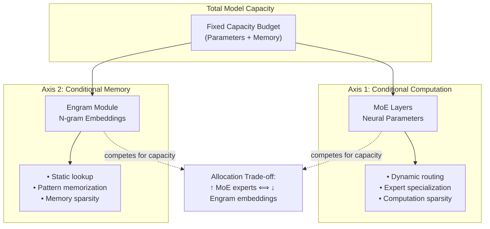
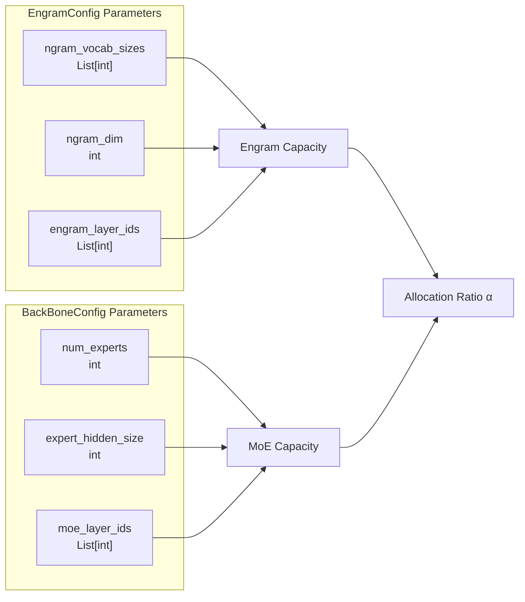
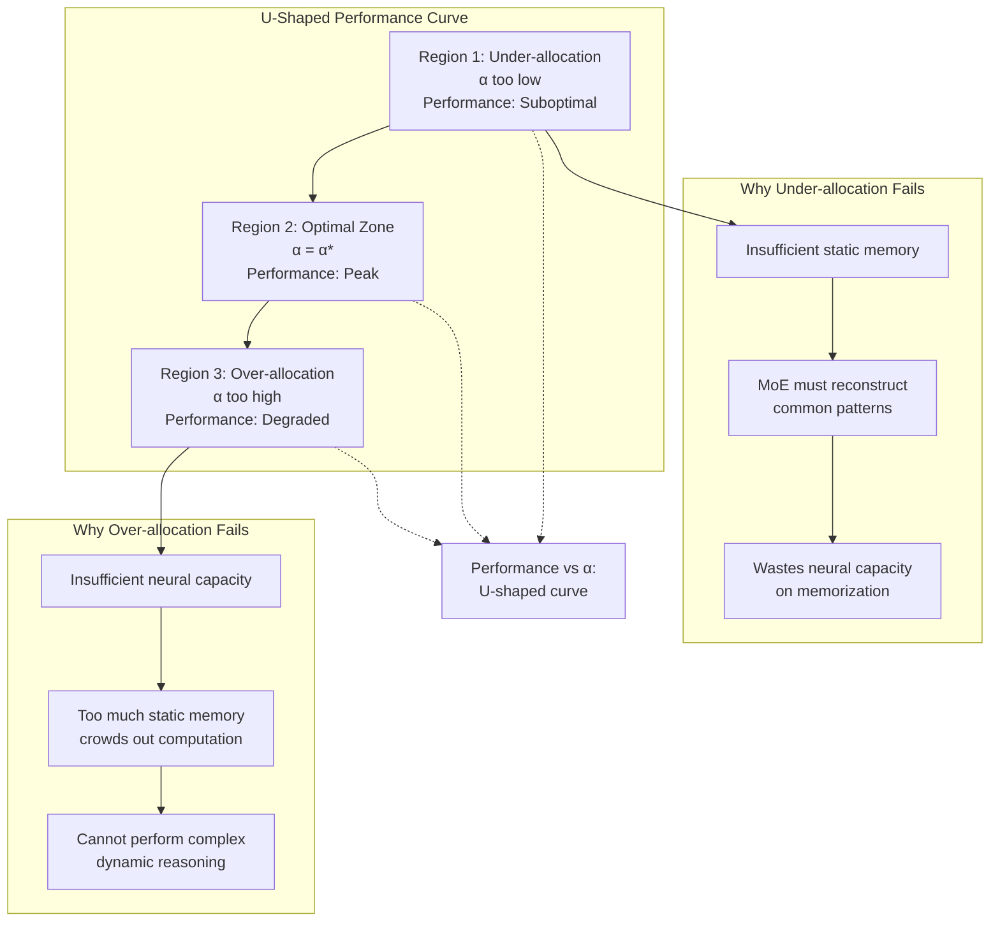
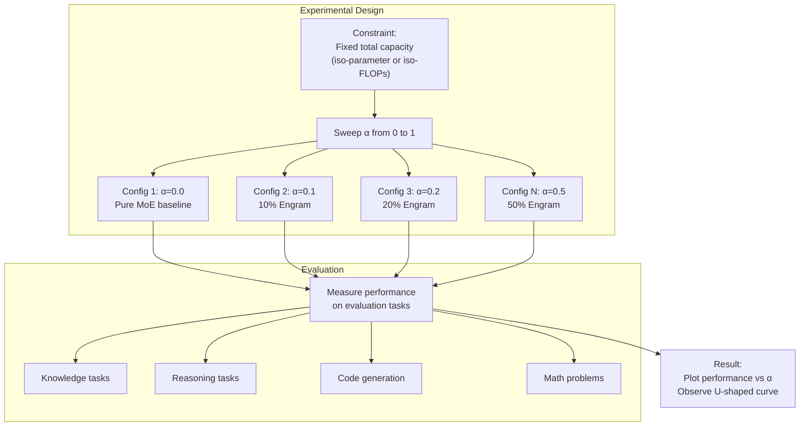
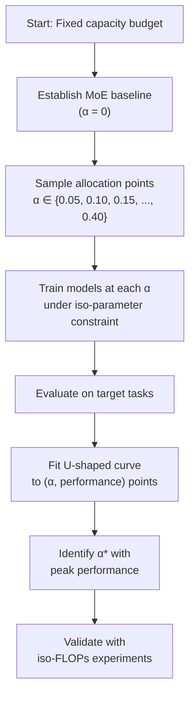

<!-- source: DeepWiki mcp.deepwiki.com · repo deepseek-ai/Engram · page 2.3 Sparsity Allocation and U-shaped Scaling Law · fetched 2026-10-30 -->

# Sparsity Allocation and U-shaped Scaling Law

Relevant source files

The following files were used as context for generating this wiki page:

- [Engram_paper.pdf](Engram_paper.pdf)
- [README.md](README.md)
- [figures/scaling_law.png](figures/scaling_law.png)

## Purpose and Scope

This document explains the fundamental trade-off between neural computation capacity and static memory capacity in Engram-augmented LLMs, and describes the U-shaped scaling law that governs optimal capacity allocation. This theoretical framework guides how to distribute model capacity between Mixture-of-Experts (MoE) layers and Engram memory modules.

For implementation details of the Engram module, see [Engram Module Deep Dive](#3.2). For experimental validation of the scaling law, see [Scaling Laws and Optimal Allocation](#5.3). For the conceptual distinction between MoE and Engram, see [Conditional Memory vs Conditional Computation](#2.1).

**Sources:** [README.md:32-40]()

---

## Dual Sparsity Paradigm

Traditional LLMs scale capacity primarily through parameter count. The Engram architecture introduces a **two-dimensional capacity allocation problem** by enabling sparsity along two complementary axes:

### Sparsity Axes Definition

| Axis | Component | Capacity Metric | Function | Activation Pattern |
|------|-----------|-----------------|----------|-------------------|
| **Conditional Computation** | MoE Experts | Number of expert networks | Neural transformation | Dynamically routed per token |
| **Conditional Memory** | Engram Embeddings | N-gram vocabulary size | Static pattern retrieval | Deterministically addressed |

The key insight is that these axes are **not redundant** but **complementary**: MoE excels at dynamic reasoning while Engram excels at static pattern retrieval. The question becomes: how should capacity be divided between them?

**Sources:** [README.md:32-40](), High-Level Diagram 2

---

## Capacity Allocation Framework

### Formulation

Given a fixed capacity budget (measured in parameters or FLOPs), the allocation problem can be expressed as:

$$
\text{Capacity}_{\text{total}} = \text{Capacity}_{\text{MoE}} + \text{Capacity}_{\text{Engram}}
$$

Where:
- **Capacity_MoE**: Number of MoE expert parameters across all MoE layers
- **Capacity_Engram**: Total size of N-gram embedding tables (vocab_size × embedding_dim)

### Allocation Ratio

The **Engram allocation ratio** is defined as:

$$
\alpha = \frac{\text{Capacity}_{\text{Engram}}}{\text{Capacity}_{\text{total}}}
$$

Where $\alpha \in [0, 1]$:
- $\alpha = 0$: Pure MoE baseline (no Engram)
- $\alpha = 1$: Pure Engram (no MoE, impractical)
- $\alpha = \alpha^*$: Optimal allocation point

### Configuration Parameters

The allocation ratio manifests in the codebase through several configuration parameters:

**Key Configuration Trade-offs:**

| Increase This | Effect on α | Impact on Model |
|---------------|-------------|-----------------|
| `ngram_vocab_sizes` | ↑ Engram capacity | More N-gram patterns memorized |
| `ngram_dim` | ↑ Engram capacity | Richer per-pattern representations |
| `num_experts` | ↓ Engram ratio | More neural computation capacity |
| `expert_hidden_size` | ↓ Engram ratio | More expressive expert networks |

**Sources:** [engram_demo_v1.py:25-40](), [README.md:37]()

---

## The U-Shaped Scaling Law

### Empirical Observation

Experiments reveal a **U-shaped relationship** between Engram allocation ratio ($\alpha$) and model performance:

### Mechanistic Interpretation

The U-shape arises from the **complementary failure modes** of the two sparsity axes:

| Allocation Regime | α Range | MoE State | Engram State | Failure Mode |
|-------------------|---------|-----------|--------------|--------------|
| **Under-allocation** | α < α* | Over-burdened | Under-utilized | Neural layers waste capacity reconstructing static patterns from scratch |
| **Optimal** | α ≈ α* | Balanced | Balanced | MoE handles dynamic reasoning, Engram handles static patterns |
| **Over-allocation** | α > α* | Starved | Over-provisioned | Insufficient neural capacity for complex transformations |

### Why the Optimal Point Exists

The optimal allocation point α* balances two competing needs:

1. **Static Pattern Coverage**: Engram must have sufficient vocabulary to capture frequent N-gram patterns in the training distribution
2. **Dynamic Reasoning Capacity**: MoE must retain enough expert capacity to perform non-trivial transformations on Engram-augmented representations

When these needs are balanced, the model achieves **optimal effective depth**: early layers can focus on complex reasoning rather than pattern reconstruction.

**Sources:** [README.md:37-39](), [figures/scaling_law.png](), High-Level Diagram 5

---

## Experimental Validation

### Allocation Sweep Methodology

The U-shaped scaling law is validated through systematic **sparsity allocation sweeps**:

### Iso-Constraint Validation

Two validation strategies ensure fair comparison:

| Constraint Type | Definition | Purpose |
|----------------|------------|---------|
| **Iso-parameter** | `total_params(MoE) = total_params(MoE + Engram)` | Ensures models have identical parameter counts |
| **Iso-FLOPs** | `FLOPs_per_token(MoE) = FLOPs_per_token(MoE + Engram)` | Ensures models have identical computational costs |

Under both constraints, the U-shaped curve emerges, validating that the phenomenon is not an artifact of unfair capacity comparisons.

### Observed Optimal Range

From the experimental results in `figures/scaling_law.png`, the optimal allocation ratio for the evaluated model family is approximately:

$$
\alpha^* \in [0.15, 0.25]
$$

This suggests that **15-25% of capacity should be allocated to Engram** for optimal performance, leaving 75-85% for MoE neural computation.

**Sources:** [README.md:38](), [figures/scaling_law.png](), High-Level Diagram 5

---

## Allocation Strategy Guidelines

### Determining Optimal α for a New Model

### Configuration Translation

To implement a target allocation ratio α*, adjust the following parameters:

**Increasing Engram Capacity (↑ α):**
- Increase `ngram_vocab_sizes` for 2-gram, 3-gram vocabularies
- Increase `ngram_dim` (embedding dimension)
- Add more `engram_layer_ids` (integrate at more layers)

**Increasing MoE Capacity (↓ α):**
- Increase `num_experts` per MoE layer
- Increase `expert_hidden_size` (FFN intermediate size)
- Add more `moe_layer_ids` (more MoE layers)

### Domain-Specific Considerations

| Task Domain | Recommended α Range | Rationale |
|-------------|---------------------|-----------|
| **Knowledge-intensive** | Higher (0.20-0.30) | Benefits from larger static memory for factual recall |
| **Reasoning-heavy** | Lower (0.10-0.20) | Requires more neural capacity for multi-step inference |
| **Code generation** | Moderate (0.15-0.25) | Balances pattern memorization and syntactic reasoning |
| **Long-context** | Higher (0.20-0.30) | Static memory reduces attention burden on frequent patterns |

**Sources:** [README.md:38-39](), [figures/27b_exp_results.png](), [figures/long_context_results.png]()

---

## Theoretical Implications

### Capacity Scaling Laws

The U-shaped scaling law reveals that **capacity is not fungible** between sparsity axes. Simply increasing total capacity does not guarantee performance improvements unless it is allocated appropriately.

**Corollary:** For a given computational budget, there exists an optimal decomposition into neural computation and static memory that maximizes effective model capacity.

### Relationship to Effective Depth

The mechanistic analysis (see [Mechanistic Analysis](#7.2)) suggests that Engram preserves **effective depth** by:

1. **Relieving early layers** from static pattern reconstruction
2. **Freeing neural capacity** for complex transformations
3. **Maintaining gradient flow** through residual connections

Under-allocation (α < α*) forces early layers to waste depth on memorization. Over-allocation (α > α*) starves later layers of transformation capacity.

### Generalization to Other Architectures

The dual sparsity framework generalizes beyond MoE + Engram:

| Neural Axis | Memory Axis | Allocation Challenge |
|-------------|-------------|---------------------|
| MoE experts | N-gram embeddings (Engram) | This work |
| Dense FFN | Retrieval-augmented memory | Future work |
| Attention heads | Key-value caches | Context management |

Any architecture combining **dynamic computation** with **static memory** must solve the capacity allocation problem. The U-shaped scaling law likely applies broadly.

**Sources:** [README.md:37-40](), Engram_paper.pdf

---

## Summary

The U-shaped scaling law establishes that:

1. **Optimal allocation exists**: Neither pure MoE nor pure Engram maximizes performance
2. **α* ≈ 0.15-0.25**: For the evaluated model family, 15-25% Engram capacity is optimal
3. **Complementary failure modes**: Under-allocation wastes neural capacity on memorization; over-allocation starves reasoning capacity
4. **Mechanistic grounding**: The optimum preserves effective depth by dividing labor between static recall and dynamic reasoning

This framework provides actionable guidance for practitioners building Engram-augmented models: systematically sweep allocation ratios under iso-parameter constraints to identify the optimal balance for your target workload.

**Sources:** [README.md:32-40](), [figures/scaling_law.png](), High-Level Diagrams 2, 5, 7

---

