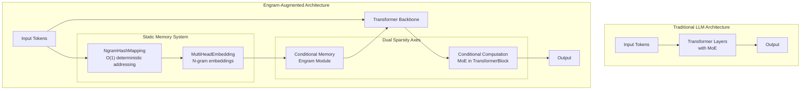
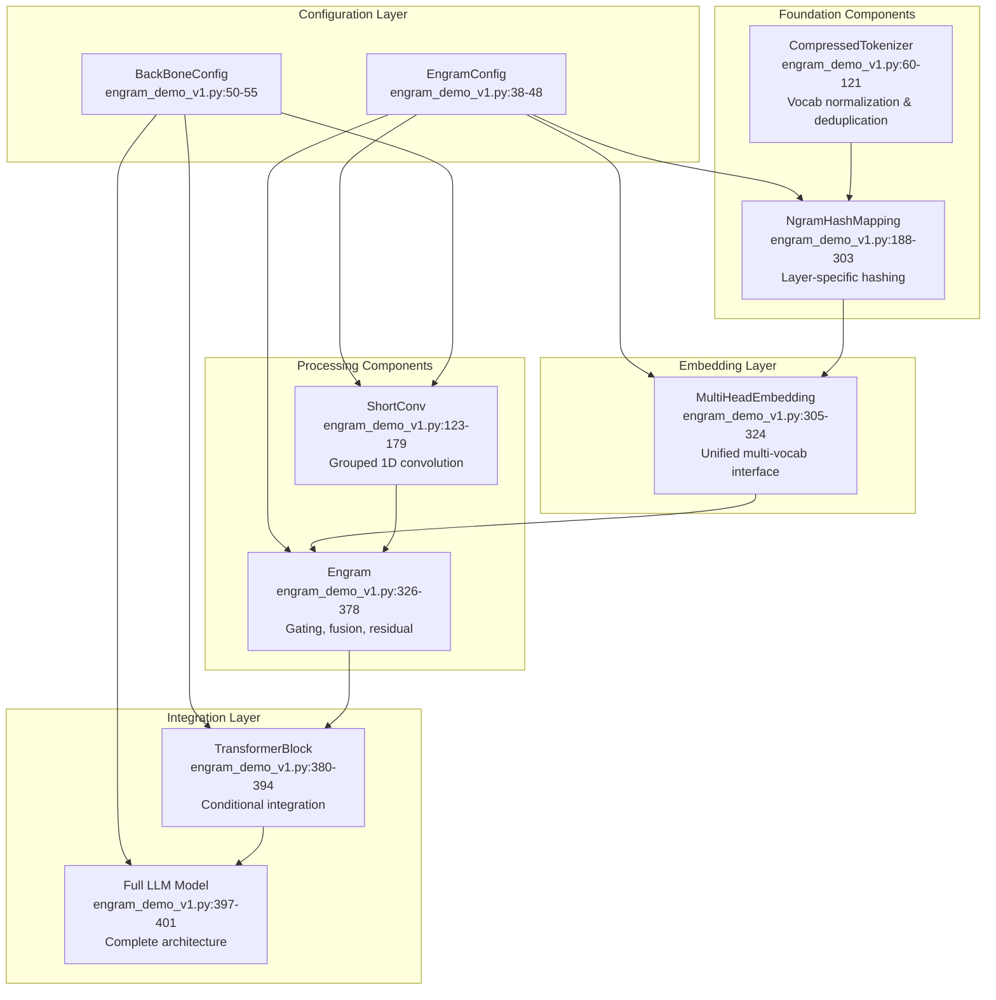
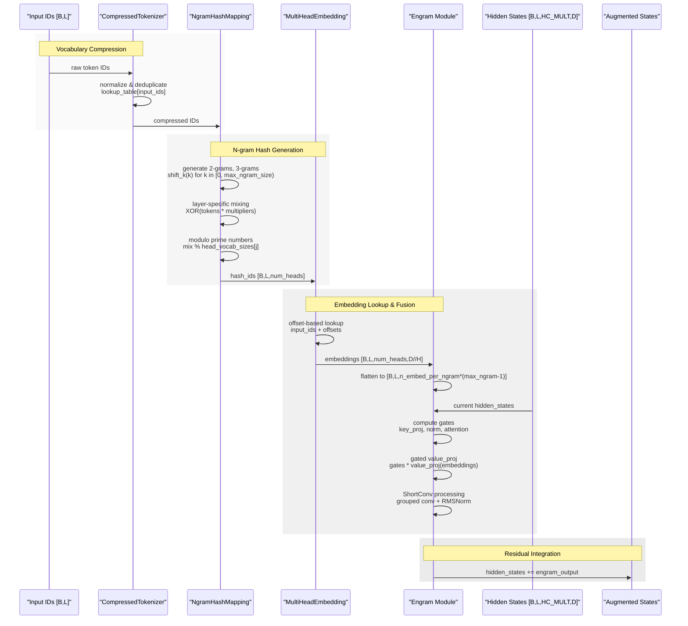
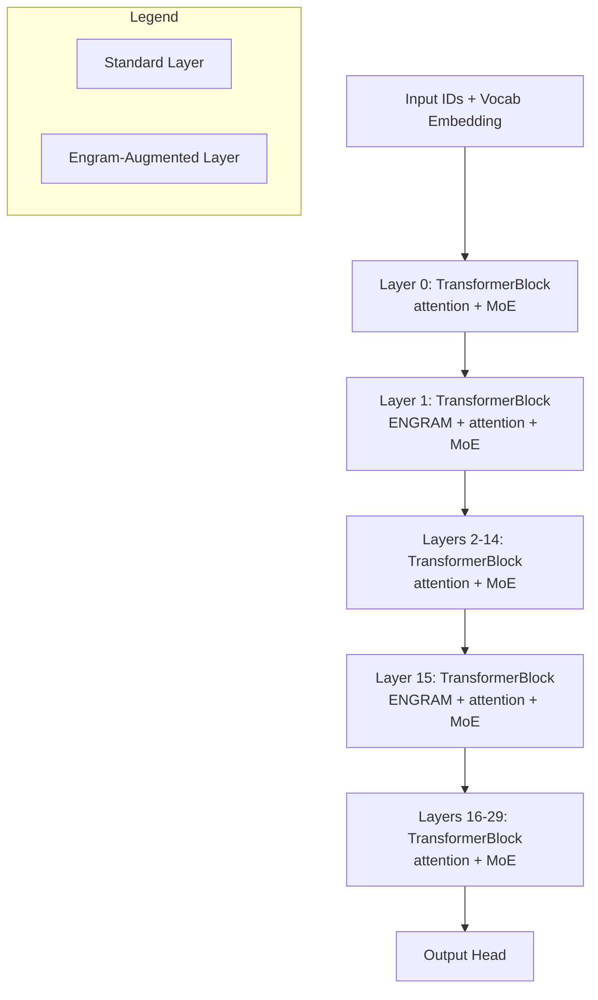

<!-- source: DeepWiki mcp.deepwiki.com · repo deepseek-ai/Engram · page 3 Architecture · fetched 2026-10-30 -->

# Architecture

<details>
<summary>Relevant source files</summary>

The following files were used as context for generating this wiki page:

- [README.md](README.md)
- [drawio/Engram.drawio](drawio/Engram.drawio)
- [engram_demo_v1.py](engram_demo_v1.py)
- [figures/arch.png](figures/arch.png)

</details>


This page provides a comprehensive overview of Engram's system architecture, explaining how the conditional memory module augments transformer-based Large Language Models through scalable N-gram lookup. It covers the component hierarchy, integration patterns, and key architectural decisions that enable efficient training and inference.

For detailed explanations of specific subsystems, see:
- [System Overview](#3.1) - High-level data flow and layer integration
- [Engram Module Deep Dive](#3.2) - Internal architecture of the Engram component
- [Training vs Inference Architecture](#3.3) - Differences between training and inference modes
- [Memory Hierarchy and Offloading](#3.4) - Deterministic addressing and host memory management

For conceptual foundations of conditional memory and dual sparsity, see [Core Concepts](#2).

---

## Architectural Paradigm

Engram introduces **conditional memory** as a complementary axis to the **conditional computation** provided by Mixture-of-Experts (MoE). Traditional LLM architectures rely entirely on neural parameters stored in model weights, forcing early transformer layers to reconstruct static patterns and consuming "effective depth" for simple tasks. Engram addresses this by offloading static knowledge retrieval to a deterministic N-gram embedding lookup system.

### Dual Sparsity Architecture



**Sources:** [README.md:18-40](), [engram_demo_v1.py:326-394]()

---

## Component Hierarchy

The Engram system is organized in five architectural layers, each with clearly defined responsibilities:



**Sources:** [engram_demo_v1.py:38-55](), [engram_demo_v1.py:60-394]()

---

## Configuration Parameters

The system uses two configuration dataclasses to separate concerns:

### EngramConfig Parameters

| Parameter | Type | Default | Purpose |
|-----------|------|---------|---------|
| `tokenizer_name_or_path` | `str` | `"deepseek-ai/DeepSeek-V3"` | Tokenizer for vocabulary compression |
| `engram_vocab_size` | `List[int]` | `[129280*5, 129280*5]` | Vocabulary size per N-gram order |
| `max_ngram_size` | `int` | `3` | Maximum N-gram length (2-gram, 3-gram, etc.) |
| `n_embed_per_ngram` | `int` | `512` | Total embedding dimension across all heads |
| `n_head_per_ngram` | `int` | `8` | Number of embedding heads per N-gram |
| `layer_ids` | `List[int]` | `[1, 15]` | Transformer layers where Engram is integrated |
| `pad_id` | `int` | `2` | Padding token ID for shifted sequences |
| `seed` | `int` | `0` | Random seed for layer-specific hash functions |
| `kernel_size` | `int` | `4` | Convolution kernel size in ShortConv |

### BackBoneConfig Parameters

| Parameter | Type | Default | Purpose |
|-----------|------|---------|---------|
| `hidden_size` | `int` | `1024` | Hidden dimension of transformer backbone |
| `hc_mult` | `int` | `4` | Hyper-connection multiplier (number of parallel paths) |
| `vocab_size` | `int` | `129280` | Vocabulary size of the base tokenizer |
| `num_layers` | `int` | `30` | Total number of transformer layers |

**Sources:** [engram_demo_v1.py:38-58]()

---

## Data Flow Through the System

The following diagram shows the complete data transformation pipeline from input tokens to augmented hidden states:



**Sources:** [engram_demo_v1.py:112-121](), [engram_demo_v1.py:262-296](), [engram_demo_v1.py:320-324](), [engram_demo_v1.py:358-378]()

---

## Selective Layer Integration

Engram modules are integrated at specific transformer layers defined by `EngramConfig.layer_ids`. The default configuration places Engram at layers 1 and 15 (early and middle depth).



The conditional integration logic in `TransformerBlock`:

```python
# engram_demo_v1.py:386-387
if layer_id in engram_cfg.layer_ids:
    self.engram = Engram(layer_id=layer_id)
```

During forward pass:

```python
# engram_demo_v1.py:390-391
if self.engram is not None:
    hidden_states = self.engram(hidden_states=hidden_states, input_ids=input_ids) + hidden_states
```

**Sources:** [engram_demo_v1.py:380-394](), [README.md:43-49]()

---

## Key Architectural Decisions

### 1. Deterministic Hashing

Engram uses deterministic hash functions rather than learned indexing or retrieval systems. This enables:
- **O(1) lookup complexity**: Direct addressing without search
- **Layer-specific specialization**: Different hash functions per layer via `layer_multipliers`
- **Collision reduction**: Prime modulo operations ensure uniform distribution

The hash function combines XOR mixing with prime modulo:

```
mix = tokens[0] * multipliers[0]
for k in 1..n:
    mix = XOR(mix, tokens[k] * multipliers[k])
hash = mix % prime_vocab_size
```

**Sources:** [engram_demo_v1.py:262-296](), [engram_demo_v1.py:235-260]()

### 2. Multi-Head Embedding Structure

Rather than creating separate `nn.Embedding` layers for each N-gram order and head, `MultiHeadEmbedding` uses a single unified embedding table with offset-based indexing:

```python
# engram_demo_v1.py:311-318
offsets = [0]
for n in list_of_N[:-1]:
    offsets.append(offsets[-1] + n)
self.register_buffer("offsets", torch.tensor(offsets, dtype=torch.long))
total_N = sum(list_of_N)
self.embedding = nn.Embedding(num_embeddings=total_N, embedding_dim=D)
```

This approach:
- Reduces memory fragmentation
- Enables efficient batch processing
- Simplifies parameter management

**Sources:** [engram_demo_v1.py:305-324]()

### 3. Gated Fusion Mechanism

The `Engram` module fuses static N-gram embeddings with dynamic hidden states using a gating mechanism:

```python
# engram_demo_v1.py:365-376
for hc_idx in range(backbone_config.hc_mult):
    key = self.key_projs[hc_idx](embeddings)
    normed_key = self.norm1[hc_idx](key)
    query = hidden_states[:,:,hc_idx,:]
    normed_query = self.norm2[hc_idx](query)
    gate = (normed_key * normed_query).sum(dim=-1) / math.sqrt(backbone_config.hidden_size)
    gate = gate.abs().clamp_min(1e-6).sqrt() * gate.sign()
    gate = gate.sigmoid().unsqueeze(-1)
```

The gate determines how much static memory to incorporate at each position, allowing the model to adaptively balance static and dynamic information.

**Sources:** [engram_demo_v1.py:358-378]()

### 4. Hyper-Connection Integration

The system uses a `hc_mult` parameter to create multiple parallel processing paths. Hidden states have shape `[B, L, hc_mult, D]`, and each hyper-connection path has its own:
- Gate computation in Engram
- Convolution group in ShortConv
- RMSNorm layer

```python
# engram_demo_v1.py:412-413 (mock hyper-connection expansion)
hidden_states = hidden_states.unsqueeze(2).expand(-1, -1, backbone_config.hc_mult, -1)
```

**Sources:** [engram_demo_v1.py:134-179](), [engram_demo_v1.py:344-356](), [engram_demo_v1.py:411-416]()

---

## Component Interaction Matrix

The following table shows how components interact during forward pass:

| Component | Input Shape | Output Shape | Dependencies |
|-----------|-------------|--------------|--------------|
| `CompressedTokenizer` | `[B, L]` int64 | `[B, L]` int64 | `lookup_table` |
| `NgramHashMapping.hash()` | `[B, L]` int64 | `[B, L, num_heads]` int64 | `CompressedTokenizer`, `layer_multipliers` |
| `MultiHeadEmbedding` | `[B, L, num_heads]` int64 | `[B, L, num_heads, D/H]` float | `offsets`, `embedding` |
| `Engram.forward()` | `[B, L, hc_mult, D]` float + `[B, L]` int64 | `[B, L, hc_mult, D]` float | All above + `key_projs`, `value_proj`, `ShortConv` |
| `ShortConv` | `[B, L, hc_mult, D]` float | `[B, L, hc_mult, D]` float | `conv`, `norms` |
| `TransformerBlock` | `[B, L, hc_mult, D]` float + `[B, L]` int64 | `[B, L, hc_mult, D]` float | `Engram` (conditional), `attn`, `moe` |

**Sources:** [engram_demo_v1.py:60-394]()

---

## Memory and Computational Complexity

### Space Complexity

| Component | Parameters | Notes |
|-----------|------------|-------|
| `MultiHeadEmbedding` | `O(sum(vocab_sizes) * D)` | Dominant memory consumer; can be offloaded |
| `Engram.value_proj` | `O((max_ngram-1) * n_embed * hidden_size)` | Linear projection |
| `Engram.key_projs` | `O(hc_mult * (max_ngram-1) * n_embed * hidden_size)` | Per-path projections |
| `ShortConv` | `O(hidden_size * kernel_size * hc_mult)` | Grouped convolution |

### Time Complexity

| Operation | Complexity | Notes |
|-----------|------------|-------|
| Hash computation | `O(B * L * max_ngram * num_heads)` | Deterministic, parallel |
| Embedding lookup | `O(B * L * num_heads)` | Single indexing operation |
| Gate computation | `O(B * L * hc_mult * D)` | Element-wise operations |
| Convolution | `O(B * L * hc_mult * D * kernel_size)` | Grouped, efficient |

**Sources:** [engram_demo_v1.py:188-324](), [engram_demo_v1.py:326-378]()

---

## Training vs Inference Differences

The architecture differs significantly between training and inference modes. During training, all N-gram embeddings reside in device memory and are updated via backpropagation. During inference, embeddings can be offloaded to host memory (CPU RAM) or storage, with only an active working set in device memory.

For detailed explanation of memory hierarchy and offloading strategies, see [Training vs Inference Architecture](#3.3) and [Memory Hierarchy and Offloading](#3.4).

**Sources:** [README.md:40-41](), [drawio/Engram.drawio:1-340]()

---

## Summary

Engram's architecture achieves efficient conditional memory through:

1. **Layered design**: Clear separation between configuration, foundation components, embedding, processing, and integration
2. **Deterministic addressing**: O(1) hash-based lookup eliminates search overhead
3. **Selective integration**: Engram modules at specific layers (default: layers 1 and 15)
4. **Gated fusion**: Adaptive blending of static N-gram embeddings with dynamic hidden states
5. **Unified embedding**: Single embedding table with offset-based multi-head access
6. **Hyper-connection support**: Multiple parallel processing paths with per-path gating

The system balances memory capacity (via large embedding tables) with computational efficiency (via deterministic hashing and selective layer integration), enabling large-scale conditional memory without proportional inference overhead.

**Sources:** [engram_demo_v1.py:1-423](), [README.md:17-49](), [drawio/Engram.drawio:1-1462]()

---

