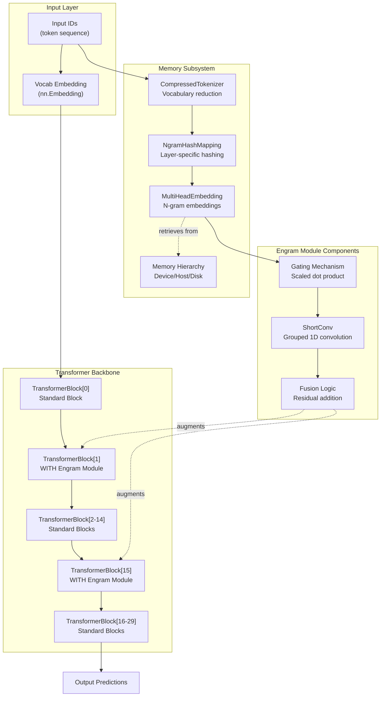
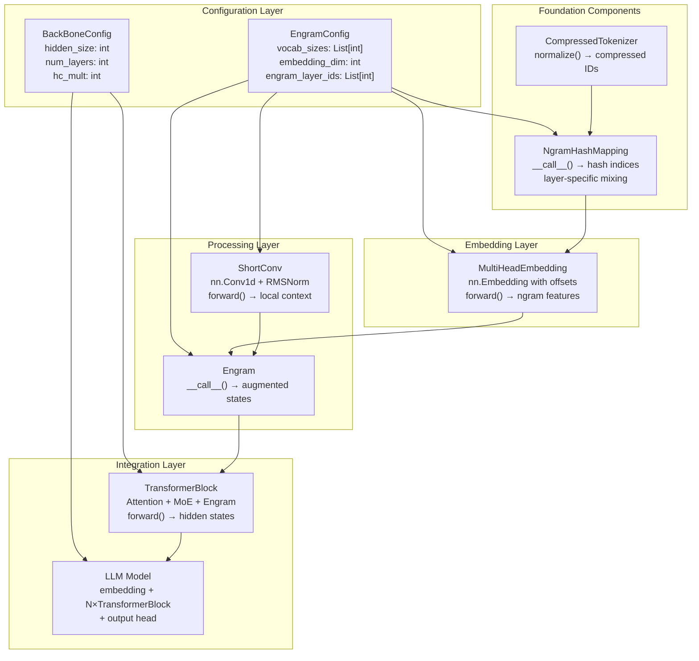
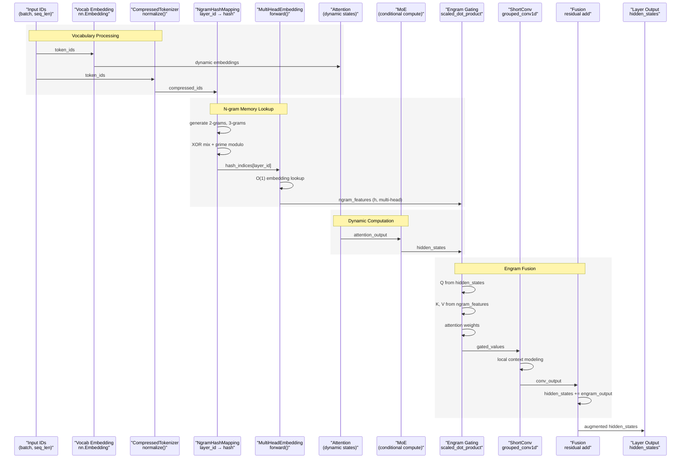
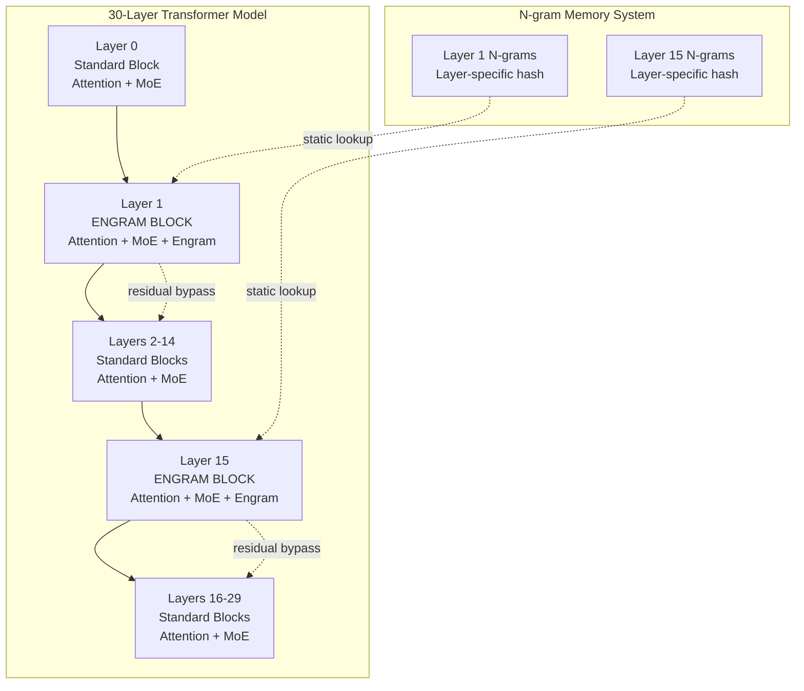
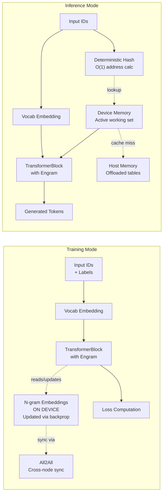

<!-- source: DeepWiki mcp.deepwiki.com · repo deepseek-ai/Engram · page 3.1 System Overview · fetched 2026-10-30 -->

# System Overview

Relevant source files

The following files were used as context for generating this wiki page:

- [README.md](README.md)
- [drawio/Engram.drawio](drawio/Engram.drawio)
- [figures/arch.png](figures/arch.png)

## Purpose and Scope

This page provides a high-level architectural overview of the Engram system, describing how it augments a standard transformer-based Large Language Model with conditional memory capabilities. The page covers the system's component hierarchy, data flow from input tokens to output predictions, and the integration strategy for embedding Engram modules within transformer layers.

For detailed explanations of individual components, see [Engram Module Deep Dive](#3.2). For differences between training and inference architectures, see [Training vs Inference Architecture](#3.3). For the theoretical foundations, see [Core Concepts](#2).

**Sources:** [README.md:1-97](), [drawio/Engram.drawio:1-752]()

---

## High-Level System Architecture

The Engram system consists of three primary architectural layers: (1) a standard transformer backbone with MoE layers, (2) selectively placed Engram modules that provide conditional memory lookup, and (3) a memory subsystem storing N-gram embeddings. The following diagram illustrates the complete system stack:

### Diagram: Engram System Stack

**Key Characteristics:**

| Component | Purpose | Integration Point |
|-----------|---------|-------------------|
| Transformer Backbone | Standard neural computation with MoE | All layers (0-29) |
| Engram Module | Conditional memory lookup | Layers 1 and 15 (configurable) |
| Memory Subsystem | Static N-gram knowledge storage | Accessed by Engram-enabled layers |
| Gating Mechanism | Selective memory fusion | Within Engram module |

**Sources:** [README.md:43-49](), [drawio/Engram.drawio:1-340]()

---

## Component Hierarchy and Code Mapping

The following diagram maps system components to their code-level implementations, bridging conceptual architecture to concrete classes and modules:

### Diagram: Code Entity Hierarchy

**Component Responsibilities:**

| Code Entity | File Reference | Primary Responsibility |
|-------------|----------------|------------------------|
| `EngramConfig` | Configuration dataclass | N-gram vocab sizes, layer placement |
| `CompressedTokenizer` | Preprocessing module | Vocabulary normalization and deduplication |
| `NgramHashMapping` | Core hashing logic | Deterministic O(1) address calculation |
| `MultiHeadEmbedding` | Embedding layer | Multi-vocabulary N-gram embedding lookup |
| `ShortConv` | Convolutional layer | Local context modeling via grouped conv |
| `Engram` | Main module | Gating, fusion, residual output |
| `TransformerBlock` | Backbone integration | Conditional Engram insertion |

**Sources:** [README.md:43-49](), [drawio/Engram.drawio:341-752]()

---

## Data Flow Pipeline

This diagram traces the complete transformation pipeline from raw input tokens to augmented hidden states within an Engram-enabled transformer layer:

### Diagram: Token-to-Output Data Flow

**Pipeline Stages:**

1. **Vocabulary Processing**: Raw token IDs are embedded via standard vocabulary embedding for the dynamic path, and normalized/compressed for the memory path
2. **N-gram Memory Lookup**: Compressed IDs generate multi-scale N-grams (2-gram, 3-gram), hashed to O(1) addresses, then retrieved from embedding tables
3. **Dynamic Computation**: Standard attention and MoE layers process hidden states using neural parameters
4. **Engram Fusion**: N-gram features are gated using attention mechanism, processed through grouped convolution, and residually added to hidden states

**Sources:** [README.md:43-49](), [drawio/Engram.drawio:341-752]()

---

## Selective Layer Integration

Engram modules are not inserted into every transformer layer. Instead, they are strategically placed at specific depths to maximize effectiveness while minimizing computational overhead. The default configuration places Engram at layers 1 and 15 in a 30-layer model:

### Diagram: Layer Integration Strategy

**Integration Rationale:**

| Aspect | Design Decision | Justification |
|--------|----------------|---------------|
| **Layer Count** | 2 Engram layers (default) | Balances performance gains vs. overhead |
| **Placement Depth** | Layers 1 and 15 | Early layer (1) handles static patterns; mid layer (15) handles complex patterns |
| **Layer-Specific Hashing** | Unique hash per layer | Prevents hash collisions across layers, allows layer-specialized knowledge |
| **Residual Connection** | Maintained through Engram | Preserves gradient flow and effective depth |

The `engram_layer_ids` parameter in `EngramConfig` allows configuring which layers receive Engram augmentation. Layer-specific hashing in `NgramHashMapping` ensures each Engram layer accesses a distinct subset of the N-gram embedding table.

**Sources:** [README.md:43-49](), [drawio/Engram.drawio:1-340]()

---

## Training vs Inference Architecture Overview

The system operates in two distinct modes with different memory management strategies:

### Comparison Table

| Aspect | Training Mode | Inference Mode |
|--------|--------------|----------------|
| **N-gram Embeddings** | Full table in device memory | Offloaded to host memory/disk |
| **Communication** | All2All synchronization across nodes | No synchronization required |
| **Embedding Updates** | Backpropagation updates embeddings | Read-only lookup |
| **Memory Hierarchy** | Single-tier (GPU memory) | Multi-tier (Device → Host → Disk) |
| **Lookup Mechanism** | Direct embedding access | Deterministic hash with cache misses |

### Diagram: Dual Mode Architecture

During training, all N-gram embeddings reside in GPU memory and are updated via gradient descent, with All2All collective operations synchronizing Engram states across distributed training nodes. During inference, the massive embedding tables (potentially billions of parameters) are offloaded to host memory or disk storage, with only an active working set in GPU memory. Deterministic hashing enables O(1) address calculation, allowing efficient retrieval even when embeddings are off-device.

For detailed architecture of each mode, see [Training vs Inference Architecture](#3.3). For memory hierarchy details, see [Memory Hierarchy and Offloading](#3.4).

**Sources:** [README.md:40-41](), [drawio/Engram.drawio:1-340]()

---

## Summary

The Engram system augments standard transformer architectures with conditional memory capabilities through:

1. **Selective Integration**: Engram modules inserted at specific layers (default: layers 1 and 15)
2. **Dual Sparsity**: Combining MoE conditional computation with Engram conditional memory
3. **Efficient Lookup**: O(1) deterministic hashing enables massive N-gram embedding tables
4. **Mode-Specific Design**: Training uses on-device embeddings with synchronization; inference uses memory hierarchy with offloading
5. **Residual Fusion**: N-gram features are gated and residually added, preserving gradient flow

This architecture enables models to access static knowledge from N-gram embeddings without consuming neural capacity, potentially preserving effective depth for complex reasoning tasks.

**Sources:** [README.md:1-97](), [drawio/Engram.drawio:1-752]()

---

