<!-- source: DeepWiki mcp.deepwiki.com · repo deepseek-ai/Engram · page 3.2 Engram Module Deep Dive · fetched 2026-10-30 -->

# Engram Module Deep Dive

<details>
<summary>Relevant source files</summary>

The following files were used as context for generating this wiki page:

- [README.md](README.md)
- [drawio/Engram.drawio](drawio/Engram.drawio)
- [engram_demo_v1.py](engram_demo_v1.py)

</details>


## Purpose and Scope

This page provides a detailed technical explanation of the `Engram` module's internal architecture, focusing on how N-gram hashing, multi-head embeddings, gating mechanisms, and convolution processing work together to augment hidden states with static memory.

For the high-level system architecture and how Engram integrates into the transformer backbone, see [System Overview](#3.1). For implementation guidance on individual components, see [N-gram Hash Mapping](#4.2), [Compressed Tokenizer](#4.3), and [Multi-Head Embedding and ShortConv](#4.4). For training and inference operational differences, see [Training vs Inference Architecture](#3.3).

---

## Module Architecture Overview

The `Engram` class ([engram_demo_v1.py:326-378]()) orchestrates four core subsystems to transform input token IDs into memory-augmented hidden state residuals:

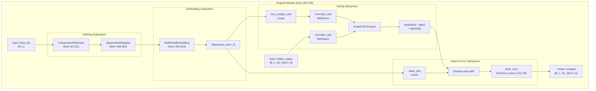

**Sources:** [engram_demo_v1.py:326-378](), [engram_demo_v1.py:358-378]()

---

## Component Dependency Graph

The `Engram` class instantiates and coordinates dependencies during initialization:

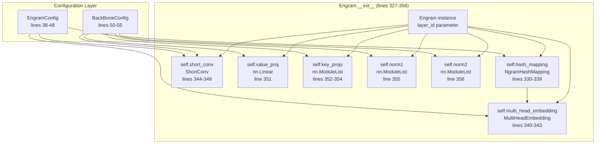

**Key dependency relationships:**
- `NgramHashMapping` requires `engram_vocab_size`, `max_ngram_size`, `n_embed_per_ngram`, `n_head_per_ngram` from `EngramConfig`
- `MultiHeadEmbedding` receives vocabulary sizes computed by `NgramHashMapping.vocab_size_across_layers[layer_id]`
- `ShortConv` uses `hidden_size` and `hc_mult` from `BackBoneConfig`
- Gating components (`key_projs`, `norm1`, `norm2`) are replicated `hc_mult` times for each hyper-connection dimension

**Sources:** [engram_demo_v1.py:327-356](), [engram_demo_v1.py:38-58]()

---

## Data Flow Pipeline

The `forward` method ([engram_demo_v1.py:358-378]()) implements a six-stage transformation pipeline:

### Stage 1: Hash Generation

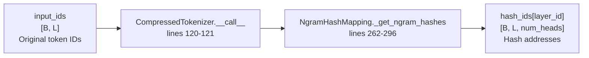

Line 363: `hash_input_ids = torch.from_numpy(self.hash_mapping.hash(input_ids)[self.layer_id])`

The hash mapping performs:
1. **Vocabulary compression** via `CompressedTokenizer` ([engram_demo_v1.py:112-118]()):
   - Normalizes tokens using NFKC, NFD, StripAccents, Lowercase
   - Deduplicates tokens to reduce vocabulary size
   - Returns compressed token IDs via lookup table
   
2. **N-gram construction** via shifting ([engram_demo_v1.py:272-278]()):
   - Creates 2-grams, 3-grams up to `max_ngram_size`
   - Pads with `pad_id` at sequence boundaries
   
3. **Hash computation** via XOR mixing ([engram_demo_v1.py:285-287]()):
   - Mixes shifted tokens with layer-specific random odd multipliers
   - Uses bitwise XOR: `mix = (tokens[0] * M[0]) ⊕ (tokens[1] * M[1]) ⊕ ...`
   - Takes modulo with head-specific prime numbers for collision reduction

**Sources:** [engram_demo_v1.py:363](), [engram_demo_v1.py:188-303](), [engram_demo_v1.py:60-121]()

---

### Stage 2: Embedding Lookup

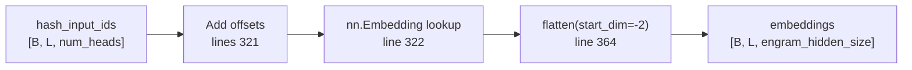

Line 364: `embeddings = self.multi_head_embedding(hash_input_ids).flatten(start_dim=-2)`

The `MultiHeadEmbedding` class ([engram_demo_v1.py:305-324]()) implements a unified embedding table with head-specific offsets:
- **Single embedding table** stores all N-gram embeddings: `total_N = sum(list_of_N)`
- **Offset mechanism** ([engram_demo_v1.py:311-315]()): each head's IDs are shifted by cumulative offsets
- **Dimension**: each embedding has size `n_embed_per_ngram // n_head_per_ngram`

After lookup, embeddings have shape `[B, L, num_heads, embed_dim]`. Flattening along the last two dimensions produces `[B, L, engram_hidden_size]` where `engram_hidden_size = (max_ngram_size - 1) * n_embed_per_ngram` ([engram_demo_v1.py:350]()).

**Sources:** [engram_demo_v1.py:364](), [engram_demo_v1.py:305-324](), [engram_demo_v1.py:350]()

---

### Stage 3: Gating Mechanism

The gating mechanism ([engram_demo_v1.py:365-375]()) computes attention-weighted gates for each hyper-connection dimension:

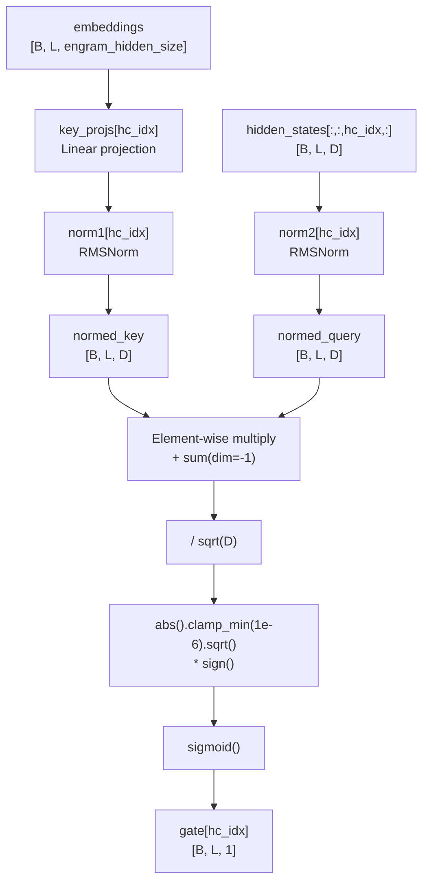

**Gating computation breakdown** ([engram_demo_v1.py:367-374]()):

| Line | Operation | Purpose |
|------|-----------|---------|
| 367 | `key = self.key_projs[hc_idx](embeddings)` | Project N-gram embeddings to hidden dimension |
| 368 | `normed_key = self.norm1[hc_idx](key)` | Normalize keys for stable attention |
| 369 | `query = hidden_states[:,:,hc_idx,:]` | Extract query from hyper-connection slice |
| 370 | `normed_query = self.norm2[hc_idx](query)` | Normalize queries for stable attention |
| 371 | `gate = (normed_key * normed_query).sum(dim=-1) / sqrt(D)` | Scaled dot-product attention (no softmax) |
| 372 | `gate = gate.abs().clamp_min(1e-6).sqrt() * gate.sign()` | Square-root scaling with sign preservation |
| 373 | `gate = gate.sigmoid().unsqueeze(-1)` | Convert to [0,1] gating weights |

This gating mechanism differs from standard attention by:
1. **No softmax normalization**: gates are computed independently per position
2. **Square-root scaling**: `sqrt(abs(x)) * sign(x)` reduces large values' impact
3. **Per-hyper-connection**: separate gates for each of `hc_mult` dimensions

**Sources:** [engram_demo_v1.py:365-375](), [engram_demo_v1.py:352-356]()

---

### Stage 4: Value Projection and Gate Application

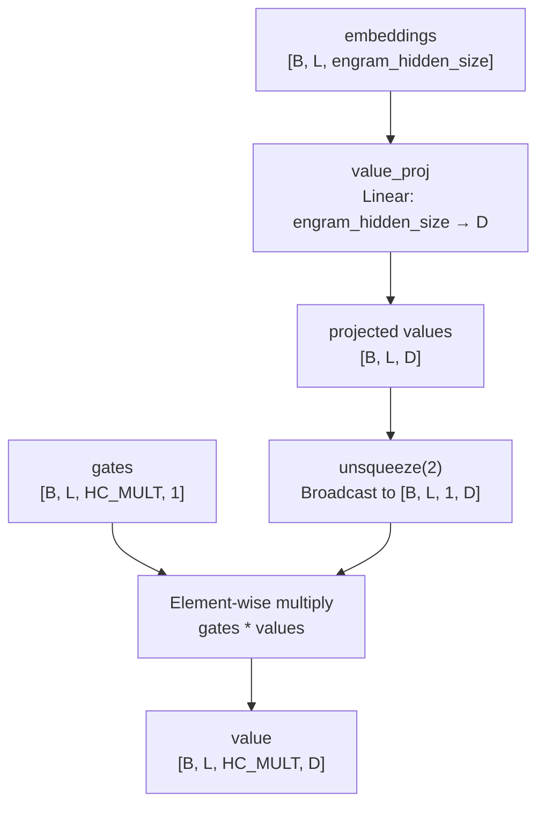

Lines 375-376:
```python
gates = torch.stack(gates, dim=2)  # [B, L, HC_MULT]
value = gates * self.value_proj(embeddings).unsqueeze(2)  # [B, L, HC_MULT, D]
```

The value projection ([engram_demo_v1.py:351]()) transforms N-gram embeddings from `engram_hidden_size` to `hidden_size` (dimension `D`). Broadcasting the values to `[B, L, 1, D]` and multiplying with gates `[B, L, HC_MULT, 1]` produces dimension-specific weighted values.

**Sources:** [engram_demo_v1.py:375-376](), [engram_demo_v1.py:351]()

---

### Stage 5: Convolution Processing

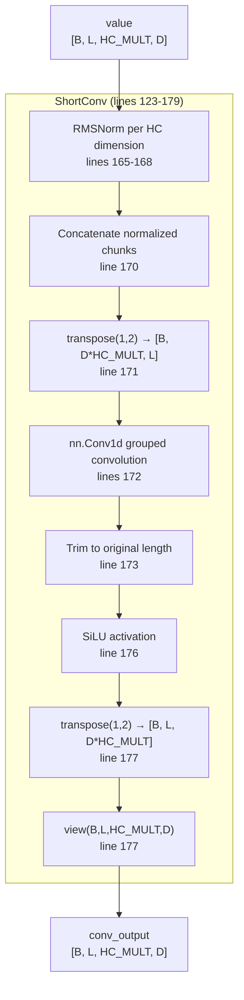

The `ShortConv` module ([engram_demo_v1.py:123-179]()) applies grouped 1D convolution:

**Configuration:**
- `kernel_size`: default 4 ([engram_demo_v1.py:346]())
- `dilation`: set to `max_ngram_size` (typically 3) ([engram_demo_v1.py:347]())
- `groups`: `hidden_size * hc_mult` for per-channel convolution ([engram_demo_v1.py:142]())
- `padding`: `(kernel_size - 1) * dilation` for causal processing ([engram_demo_v1.py:144]())

**Processing steps:**
1. Normalize each hyper-connection dimension independently
2. Concatenate into single tensor `[B, L, D * HC_MULT]`
3. Transpose to `[B, channels, L]` for conv1d
4. Apply grouped convolution with dilation
5. Trim padding to restore original sequence length
6. Apply SiLU activation
7. Reshape back to `[B, L, HC_MULT, D]`

The dilated convolution with `dilation=max_ngram_size` allows each position to attend to N-gram-spaced positions, providing localized context modeling.

**Sources:** [engram_demo_v1.py:123-179](), [engram_demo_v1.py:344-349](), [engram_demo_v1.py:156-178]()

---

### Stage 6: Residual Output

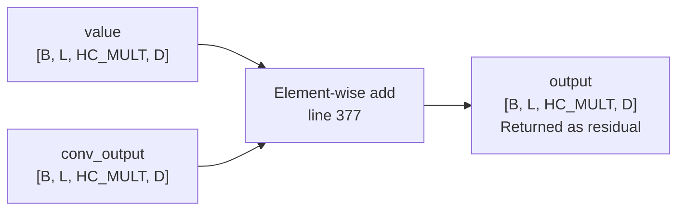

Line 377: `output = value + self.short_conv(value)`

The final output combines gated values with their convolved counterparts and is returned for residual addition in the transformer block ([engram_demo_v1.py:391]()): `hidden_states = self.engram(hidden_states, input_ids) + hidden_states`

**Sources:** [engram_demo_v1.py:377-378](), [engram_demo_v1.py:389-391]()

---

## Tensor Shape Transformations

The following table traces tensor shapes through the entire forward pass:

| Stage | Variable | Shape | Description |
|-------|----------|-------|-------------|
| Input | `input_ids` | `[B, L]` | Original token IDs |
| Input | `hidden_states` | `[B, L, HC_MULT, D]` | Dynamic transformer states |
| Hash | `hash_input_ids` | `[B, L, num_heads]` | Hash addresses (numpy) |
| Hash | `hash_input_ids` (torch) | `[B, L, num_heads]` | Converted to tensor |
| Embed | pre-flatten | `[B, L, num_heads, embed_dim]` | Multi-head embeddings |
| Embed | `embeddings` | `[B, L, engram_hidden_size]` | Flattened N-gram features |
| Gate | `key` | `[B, L, D]` | Projected keys (per hc_idx) |
| Gate | `query` | `[B, L, D]` | Hidden state queries (per hc_idx) |
| Gate | `gate` (scalar) | `[B, L]` | Attention scores (per hc_idx) |
| Gate | `gate` | `[B, L, 1]` | Unsqueezed for broadcasting |
| Gate | `gates` | `[B, L, HC_MULT, 1]` | Stacked across all hc dimensions |
| Value | projected | `[B, L, D]` | Value projection |
| Value | unsqueezed | `[B, L, 1, D]` | Broadcast-ready values |
| Value | `value` | `[B, L, HC_MULT, D]` | Gated values |
| Conv | normalized | `[B, L, D * HC_MULT]` | Pre-convolution concatenation |
| Conv | transposed | `[B, D * HC_MULT, L]` | Conv1d input format |
| Conv | conv_out | `[B, D * HC_MULT, L]` | After grouped convolution |
| Conv | trimmed | `[B, D * HC_MULT, L]` | Padding removed |
| Conv | reshaped | `[B, L, HC_MULT, D]` | Final convolution output |
| Output | `output` | `[B, L, HC_MULT, D]` | value + conv_output |

**Dimension key:**
- `B`: batch size
- `L`: sequence length
- `HC_MULT`: hyper-connection multiplier (default: 4)
- `D`: hidden size (default: 1024)
- `num_heads`: `(max_ngram_size - 1) * n_head_per_ngram` (typically: 2 × 8 = 16)
- `embed_dim`: `n_embed_per_ngram // n_head_per_ngram` (typically: 512 / 8 = 64)
- `engram_hidden_size`: `(max_ngram_size - 1) * n_embed_per_ngram` (typically: 2 × 512 = 1024)

**Sources:** [engram_demo_v1.py:358-378](), [engram_demo_v1.py:38-58]()

---

## Module Configuration Parameters

The `Engram` module's behavior is controlled by parameters from two configuration objects:

### EngramConfig Parameters

| Parameter | Default | Type | Usage | Lines |
|-----------|---------|------|-------|-------|
| `tokenizer_name_or_path` | `"deepseek-ai/DeepSeek-V3"` | str | Tokenizer for vocabulary compression | [40]() |
| `engram_vocab_size` | `[129280*5, 129280*5]` | List[int] | Vocabulary size per N-gram type | [41]() |
| `max_ngram_size` | `3` | int | Maximum N-gram length (2-gram, 3-gram) | [42]() |
| `n_embed_per_ngram` | `512` | int | Embedding dimension per N-gram type | [43]() |
| `n_head_per_ngram` | `8` | int | Number of hash heads per N-gram type | [44]() |
| `layer_ids` | `[1, 15]` | List[int] | Transformer layers with Engram | [45]() |
| `pad_id` | `2` | int | Padding token ID for N-gram boundaries | [46]() |
| `seed` | `0` | int | Random seed for layer-specific multipliers | [47]() |
| `kernel_size` | `4` | int | Convolution kernel size | [48]() |

### BackBoneConfig Parameters

| Parameter | Default | Type | Usage | Lines |
|-----------|---------|------|-------|-------|
| `hidden_size` | `1024` | int | Transformer hidden dimension (D) | [52]() |
| `hc_mult` | `4` | int | Hyper-connection multiplier | [53]() |
| `vocab_size` | `129280` | int | Original vocabulary size | [54]() |
| `num_layers` | `30` | int | Total transformer layers | [55]() |

**Derived quantities:**
- `engram_hidden_size = (max_ngram_size - 1) * n_embed_per_ngram` ([engram_demo_v1.py:350]())
- `embed_dim = n_embed_per_ngram // n_head_per_ngram` ([engram_demo_v1.py:342]())
- `num_heads = (max_ngram_size - 1) * n_head_per_ngram` (implicit in hash output shape)

**Sources:** [engram_demo_v1.py:38-58](), [engram_demo_v1.py:350](), [engram_demo_v1.py:342]()

---

## Integration with Transformer Block

The `Engram` module integrates into `TransformerBlock` conditionally based on `layer_ids`:

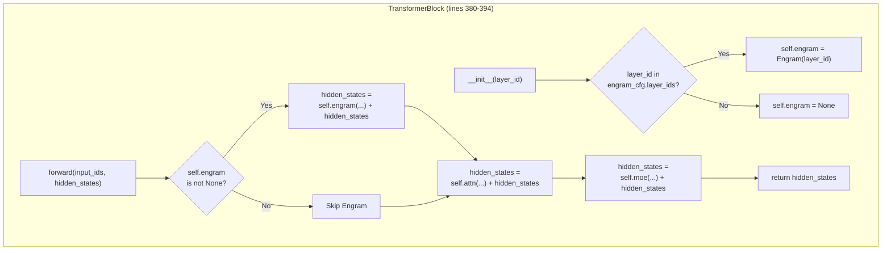

**Key integration points:**

1. **Conditional instantiation** ([engram_demo_v1.py:386-387]()):
   ```python
   if layer_id in engram_cfg.layer_ids:
       self.engram = Engram(layer_id=layer_id)
   ```

2. **Residual addition** ([engram_demo_v1.py:390-391]()):
   ```python
   if self.engram is not None:
       hidden_states = self.engram(hidden_states=hidden_states, input_ids=input_ids) + hidden_states
   ```

3. **Layer ordering** ([engram_demo_v1.py:389-393]()):
   - Engram (if present)
   - Attention
   - MoE
   - Each with residual connections

The default configuration ([engram_demo_v1.py:45]()) places Engram at layers 1 and 15, providing early-layer static pattern recognition and mid-layer memory augmentation.

**Sources:** [engram_demo_v1.py:380-394](), [engram_demo_v1.py:45]()

---

## Hash Mapping Internals

The `NgramHashMapping` class ([engram_demo_v1.py:188-303]()) implements layer-specific, collision-resistant hashing:

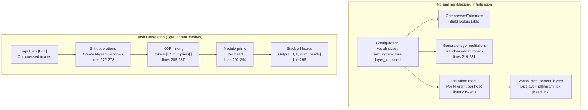

**Multi-scale hash generation:**

For `max_ngram_size=3`, the hash mapping generates:
- **2-gram hashes**: 8 heads (assuming `n_head_per_ngram=8`)
- **3-gram hashes**: 8 heads
- **Total**: 16 hash addresses per position

Each hash combines:
1. **N shifted token sequences** ([engram_demo_v1.py:272-278]())
2. **Layer-specific random multipliers** ([engram_demo_v1.py:285]())
3. **XOR mixing** ([engram_demo_v1.py:287]())
4. **Prime modulo** for collision reduction ([engram_demo_v1.py:293]())

**Prime selection strategy** ([engram_demo_v1.py:235-260]()):
- Each head uses a unique prime modulus
- Primes are selected sequentially starting above vocabulary size
- Ensures different heads have different collision patterns
- Stored in `vocab_size_across_layers` structure

**Sources:** [engram_demo_v1.py:188-303](), [engram_demo_v1.py:235-260](), [engram_demo_v1.py:262-296]()

---

## Multi-Head Embedding Structure

The `MultiHeadEmbedding` class ([engram_demo_v1.py:305-324]()) provides unified storage for multiple vocabulary sizes:

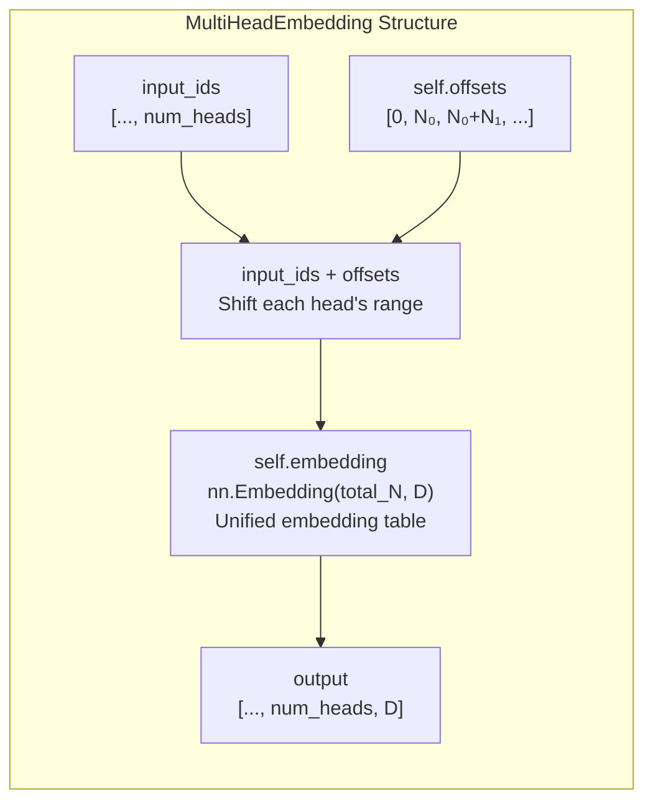

**Design rationale:**

Instead of creating separate `nn.Embedding` instances per head (which would complicate model parallelism and memory management), a single embedding table stores all heads' embeddings with offset-based addressing.

**Example with 3 heads:**
```
Head 0: vocabulary size = 100, embeddings [0, 99]
Head 1: vocabulary size = 150, embeddings [100, 249]  
Head 2: vocabulary size = 200, embeddings [250, 449]
Total table size = 450
Offsets = [0, 100, 250]
```

When input is `[[5], [10], [15]]` for heads 0, 1, 2:
- Shifted: `[[5], [110], [265]]`
- Lookup from unified table

**Implementation** ([engram_demo_v1.py:311-322]())):
```python
offsets = [0]
for n in list_of_N[:-1]:
    offsets.append(offsets[-1] + n)
self.register_buffer("offsets", torch.tensor(offsets, dtype=torch.long))
total_N = sum(list_of_N)
self.embedding = nn.Embedding(num_embeddings=total_N, embedding_dim=D)
```

**Sources:** [engram_demo_v1.py:305-324](), [engram_demo_v1.py:311-318]()

---

## Summary: Code Entity Reference

This table maps architectural concepts to concrete code entities:

| Concept | Primary Class/Function | File Location | Key Attributes/Methods |
|---------|------------------------|---------------|------------------------|
| Main Module | `Engram` | [engram_demo_v1.py:326-378]() | `forward(hidden_states, input_ids)` |
| Hash Mapping | `NgramHashMapping` | [engram_demo_v1.py:188-303]() | `hash(input_ids)`, `_get_ngram_hashes()` |
| Vocabulary Compression | `CompressedTokenizer` | [engram_demo_v1.py:60-121]() | `__call__(input_ids)`, `_compress()` |
| Embedding Lookup | `MultiHeadEmbedding` | [engram_demo_v1.py:305-324]() | `forward(input_ids)` |
| Convolution | `ShortConv` | [engram_demo_v1.py:123-179]() | `forward(x)` |
| Transformer Integration | `TransformerBlock` | [engram_demo_v1.py:380-394]() | `forward(input_ids, hidden_states)` |
| Engram Configuration | `EngramConfig` | [engram_demo_v1.py:38-48]() | Data class fields |
| Backbone Configuration | `BackBoneConfig` | [engram_demo_v1.py:50-55]() | Data class fields |

**Critical method signatures:**

```python
# Engram.forward
def forward(self, hidden_states: Tensor, input_ids: Tensor) -> Tensor:
    # hidden_states: [B, L, HC_MULT, D]
    # input_ids: [B, L]
    # returns: [B, L, HC_MULT, D]
```

```python
# NgramHashMapping.hash
def hash(self, input_ids: np.ndarray) -> Dict[int, np.ndarray]:
    # input_ids: [B, L]
    # returns: {layer_id: [B, L, num_heads]}
```

```python
# MultiHeadEmbedding.forward
def forward(self, input_ids: Tensor) -> Tensor:
    # input_ids: [..., num_heads]
    # returns: [..., num_heads, D]
```

**Sources:** [engram_demo_v1.py:326-378](), [engram_demo_v1.py:188-303](), [engram_demo_v1.py:60-121](), [engram_demo_v1.py:305-324](), [engram_demo_v1.py:123-179](), [engram_demo_v1.py:380-394]()

---

