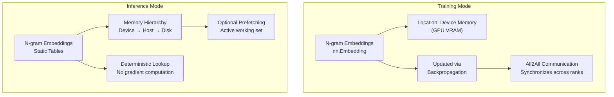
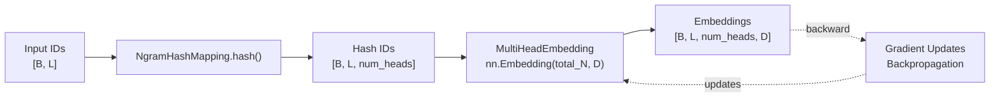
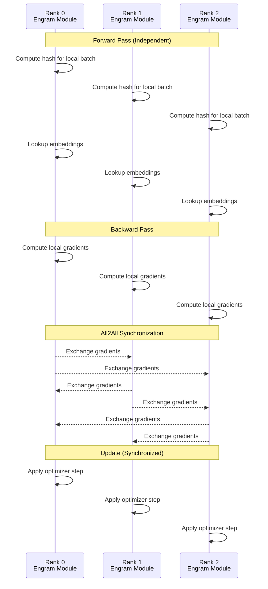
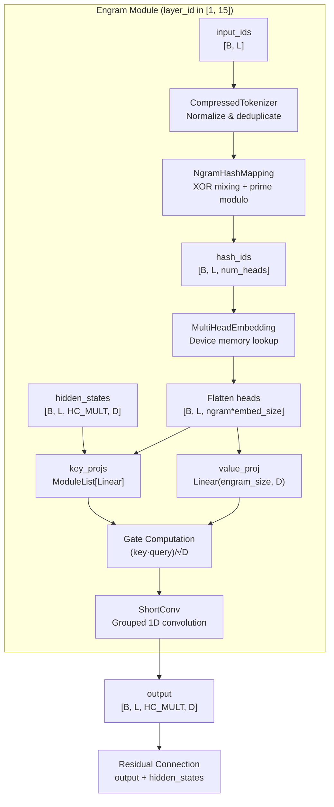
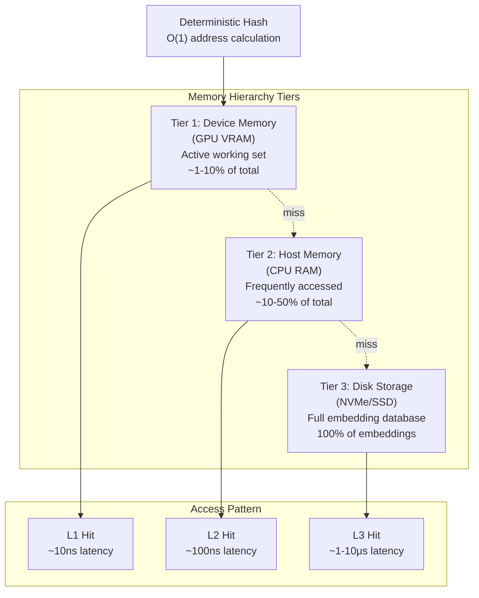
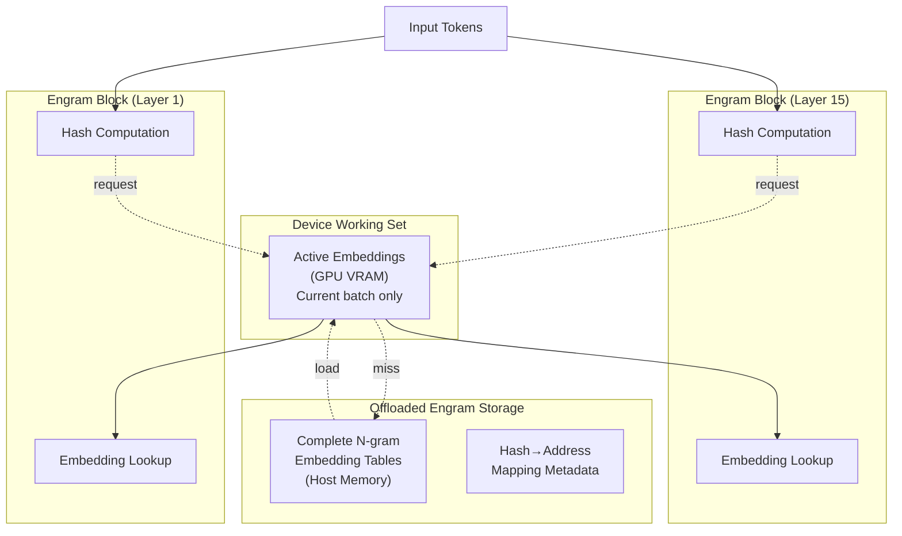
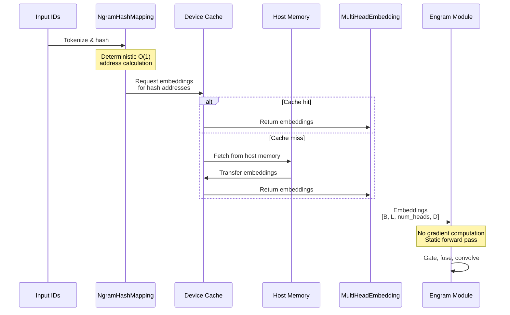
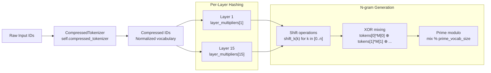
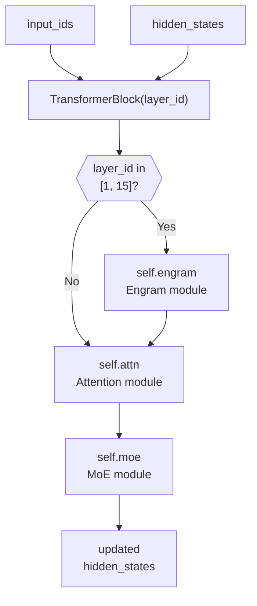
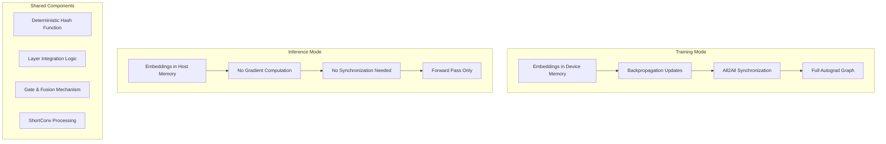

<!-- source: DeepWiki mcp.deepwiki.com · repo deepseek-ai/Engram · page 3.3 Training vs Inference Architecture · fetched 2026-10-30 -->

# Training vs Inference Architecture

<details>
<summary>Relevant source files</summary>

The following files were used as context for generating this wiki page:

- [README.md](README.md)
- [drawio/Engram.drawio](drawio/Engram.drawio)
- [engram_demo_v1.py](engram_demo_v1.py)

</details>


## Purpose and Scope

This page explains the architectural differences between Engram's training and inference modes. The distinction is critical: during training, all N-gram embeddings must reside in device memory for gradient computation, while during inference, Engram employs a sophisticated memory hierarchy to offload massive embedding tables while maintaining O(1) lookup performance.

For the general system architecture, see [System Overview](#3.1). For details on the memory offloading mechanism, see [Memory Hierarchy and Offloading](#3.4). For the internal workings of the Engram module, see [Engram Module Deep Dive](#3.2).

---

## Architectural Overview

The fundamental difference between training and inference lies in how N-gram embeddings are stored, accessed, and updated:



**Sources:** [README.md:43-50](), [drawio/Engram.drawio:1-340]()

---

## Training Architecture

### On-Device Embedding Storage

During training, the `MultiHeadEmbedding` layer stores all N-gram embeddings in device memory as a single `nn.Embedding` table:



The `MultiHeadEmbedding` class unifies multiple vocabulary sizes into a single embedding table using offset arithmetic:

| Component | Implementation | Purpose |
|-----------|---------------|---------|
| Total vocabulary | `sum(list_of_N)` | Combined size across all N-gram heads |
| Offset buffer | `self.offsets` | Maps head index to embedding table offset |
| Single embedding | `nn.Embedding(total_N, D)` | Unified table for gradient computation |

The implementation in [engram_demo_v1.py:305-324]() shows this design:

```python
# Multi-head embedding with offsets
shifted_input_ids = input_ids + self.offsets
output = self.embedding(shifted_input_ids)
```

**Sources:** [engram_demo_v1.py:305-324](), [drawio/Engram.drawio:130-212]()

### Distributed Training Synchronization

In distributed training, each rank maintains a replica of the Engram embeddings. The All2All communication pattern synchronizes gradients and states across ranks:



The All2All communication is indicated in the drawio diagrams as dashed lines between Engram modules with the label "All2All".

**Sources:** [drawio/Engram.drawio:312-328](), [README.md:40]()

### Training Data Flow

The complete forward pass during training for a transformer block with Engram:



The key difference in training is that the embedding lookup is backed by an `nn.Embedding` module that participates in autograd:

| Stage | Device Location | Gradient Flow |
|-------|----------------|---------------|
| Hash computation | Device | No gradients (deterministic) |
| Embedding lookup | Device | ✓ Gradients flow to embeddings |
| Gate computation | Device | ✓ Gradients flow to projections |
| Convolution | Device | ✓ Gradients flow to conv weights |

**Sources:** [engram_demo_v1.py:326-378](), [engram_demo_v1.py:380-394]()

---

## Inference Architecture

### Memory Hierarchy Design

During inference, Engram employs a three-tier memory hierarchy to accommodate massive embedding tables without requiring proportional GPU memory:



This hierarchy is possible because:
1. **Deterministic addressing**: Hash function provides direct address without search
2. **Static embeddings**: No updates required during inference
3. **Predictable access**: Input tokens determine which embeddings are needed

**Sources:** [README.md:40](), [drawio/Engram.drawio:85-93]()

### Offloaded Embedding Tables

The inference architecture diagram from the drawio file shows the "Offloaded Engram (Memory Hierarchy)" component connected to Engram blocks via dashed lines:



The dashed lines indicate communication that does not require gradient synchronization, in contrast to the All2All communication during training.

**Sources:** [drawio/Engram.drawio:1-340](), [README.md:40]()

### Inference Data Flow

The forward pass during inference differs in how embeddings are accessed:



Key differences from training:

| Aspect | Training | Inference |
|--------|----------|-----------|
| Embedding storage | `nn.Embedding` on device | Offloaded to host, cached subset on device |
| Gradient computation | Required | Disabled (`torch.no_grad()`) |
| Memory requirement | All embeddings on GPU | Only active subset on GPU |
| Synchronization | All2All across ranks | None (stateless) |
| Update mechanism | Optimizer updates | No updates (static) |

**Sources:** [engram_demo_v1.py:358-378](), [README.md:40]()

---

## Implementation in Demo Code

### Hash Computation (Shared)

Both training and inference use the same deterministic hash function from `NgramHashMapping`:



The hash function in [engram_demo_v1.py:262-296]() is stateless and deterministic:

```python
# From NgramHashMapping._get_ngram_hashes()
mix = (tokens[0] * multipliers[0])
for k in range(1, n):
    mix = np.bitwise_xor(mix, tokens[k] * multipliers[k])
head_hash = mix % mod
```

This deterministic nature is crucial for inference offloading: the same input always produces the same hash, enabling predictable memory access patterns.

**Sources:** [engram_demo_v1.py:188-303]()

### Embedding Lookup (Training)

In the demo code, `MultiHeadEmbedding.forward()` performs a standard PyTorch embedding lookup:

```python
# From MultiHeadEmbedding.forward()
shifted_input_ids = input_ids + self.offsets
output = self.embedding(shifted_input_ids)  # nn.Embedding lookup
```

This operation:
- Is differentiable (gradients flow to `self.embedding.weight`)
- Requires embeddings in device memory
- Participates in optimizer updates

**Sources:** [engram_demo_v1.py:320-323]()

### Embedding Lookup (Inference - Conceptual)

The demo code does not implement the full inference offloading mechanism. In production, the inference lookup would be structured as:

```
1. Hash input_ids → get addresses
2. Check device cache for addresses
3. If miss, request from host memory via async transfer
4. Return embeddings (from cache or transferred)
```

The deterministic hash from [engram_demo_v1.py:298-303]() enables this pattern:

```python
def hash(self, input_ids):
    input_ids = self.compressed_tokenizer(input_ids)
    hash_ids_for_all_layers = {}
    for layer_id in self.layer_ids:
        hash_ids_for_all_layers[layer_id] = self._get_ngram_hashes(
            input_ids, layer_id=layer_id
        )
    return hash_ids_for_all_layers
```

**Sources:** [engram_demo_v1.py:298-303](), [README.md:89]()

---

## Layer Integration (Both Modes)

The `TransformerBlock` integration is identical for training and inference:



From [engram_demo_v1.py:380-394]():

```python
class TransformerBlock(nn.Module):
    def __init__(self, layer_id):
        super().__init__()
        self.attn = lambda x: x
        self.moe = lambda x: x
        self.engram = None
        if layer_id in engram_cfg.layer_ids:  # [1, 15]
            self.engram = Engram(layer_id=layer_id)
    
    def forward(self, input_ids, hidden_states):
        if self.engram is not None:
            hidden_states = self.engram(
                hidden_states=hidden_states, 
                input_ids=input_ids
            ) + hidden_states  # Residual connection
        hidden_states = self.attn(hidden_states) + hidden_states
        hidden_states = self.moe(hidden_states) + hidden_states
        return hidden_states
```

The conditional instantiation ensures Engram is only present at configured layers, minimizing overhead.

**Sources:** [engram_demo_v1.py:380-394]()

---

## Configuration Impact

The `EngramConfig` dataclass controls behavior for both modes:

| Parameter | Training Impact | Inference Impact |
|-----------|----------------|------------------|
| `engram_vocab_size` | Total embedding table size in GPU memory | Total size to offload to host |
| `layer_ids` | Which layers compute gradients for Engram | Which layers need embedding cache |
| `max_ngram_size` | Number of N-gram types to train | Number of N-gram types to cache |
| `n_embed_per_ngram` | Embedding dimension (affects GPU memory) | Dimension of cached embeddings |
| `seed` | Deterministic hash initialization | Same seed ensures hash consistency |

From [engram_demo_v1.py:38-49]():

```python
@dataclass
class EngramConfig:
    tokenizer_name_or_path: str = "deepseek-ai/DeepSeek-V3"
    engram_vocab_size: List[int] = field(default_factory=lambda: [129280*5, 129280*5])
    max_ngram_size: int = 3
    n_embed_per_ngram: int = 512
    n_head_per_ngram: int = 8
    layer_ids: List[int] = field(default_factory=lambda: [1, 15])
    pad_id: int = 2
    seed: int = 0
    kernel_size: int = 4
```

The `seed` parameter is particularly important: it must be identical between training and inference to ensure the hash function produces consistent addresses.

**Sources:** [engram_demo_v1.py:38-49]()

---

## Summary of Key Differences



| Aspect | Training | Inference |
|--------|----------|-----------|
| **Memory location** | Device (GPU) | Host (CPU) with device cache |
| **Memory size** | Full table must fit in GPU | Unlimited (offloaded) |
| **Gradient flow** | Enabled | Disabled |
| **Communication** | All2All across ranks | None |
| **Updates** | Optimizer updates weights | Static (no updates) |
| **Lookup latency** | ~10ns (device) | ~100ns-1μs (device cache + host fetch) |
| **Hash function** | Deterministic (shared) | Deterministic (shared) |
| **Layer selection** | layer_ids=[1, 15] | layer_ids=[1, 15] |

The architectural separation enables Engram to scale to embedding tables orders of magnitude larger than GPU memory during inference, while maintaining training efficiency through on-device storage.

**Sources:** [README.md:40](), [drawio/Engram.drawio:1-340](), [engram_demo_v1.py:326-394]()

---

