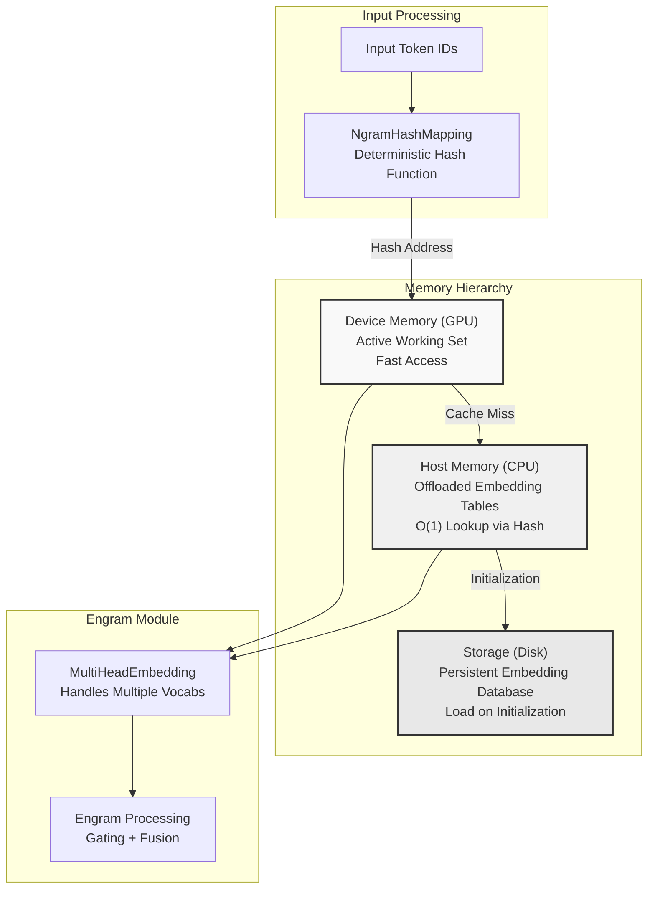
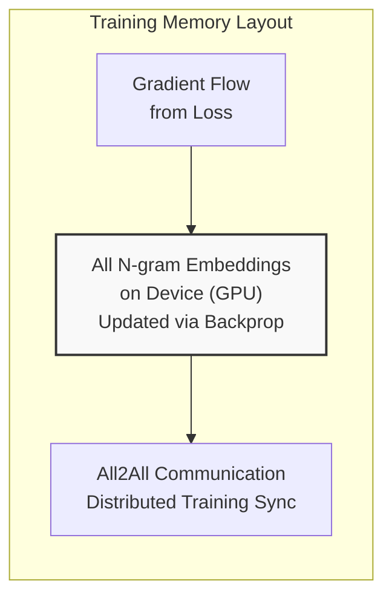
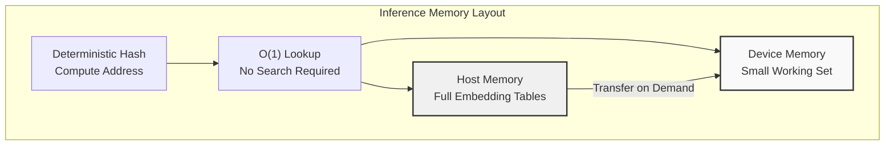
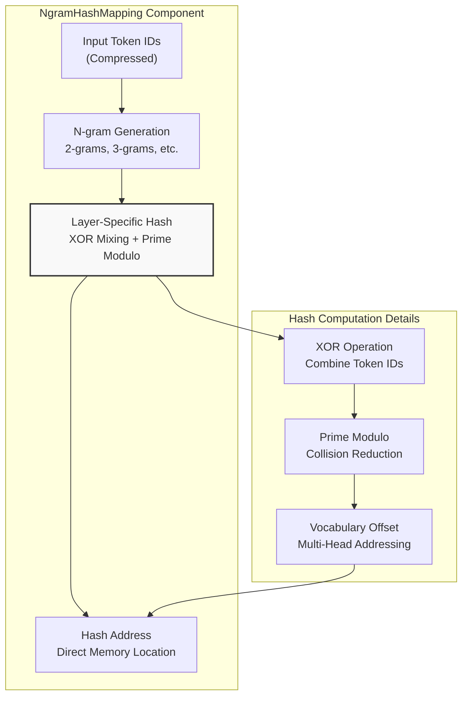
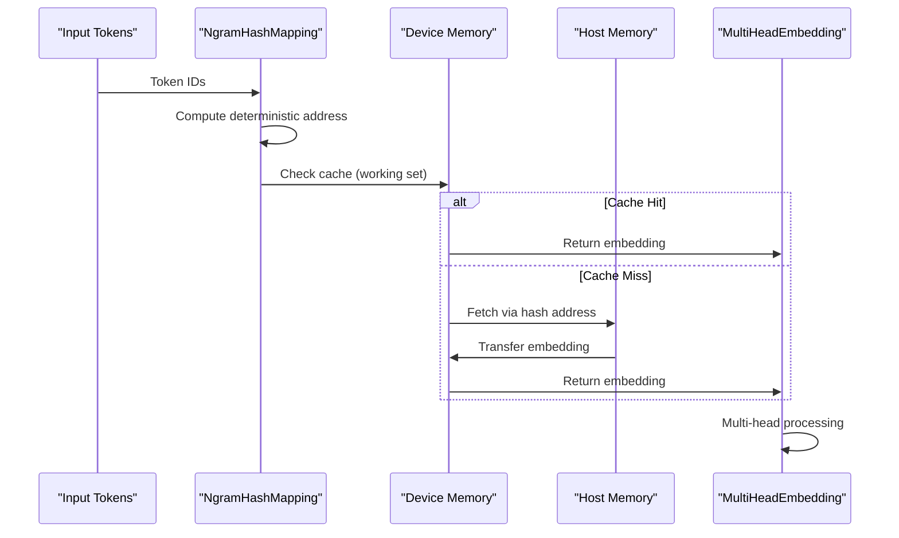
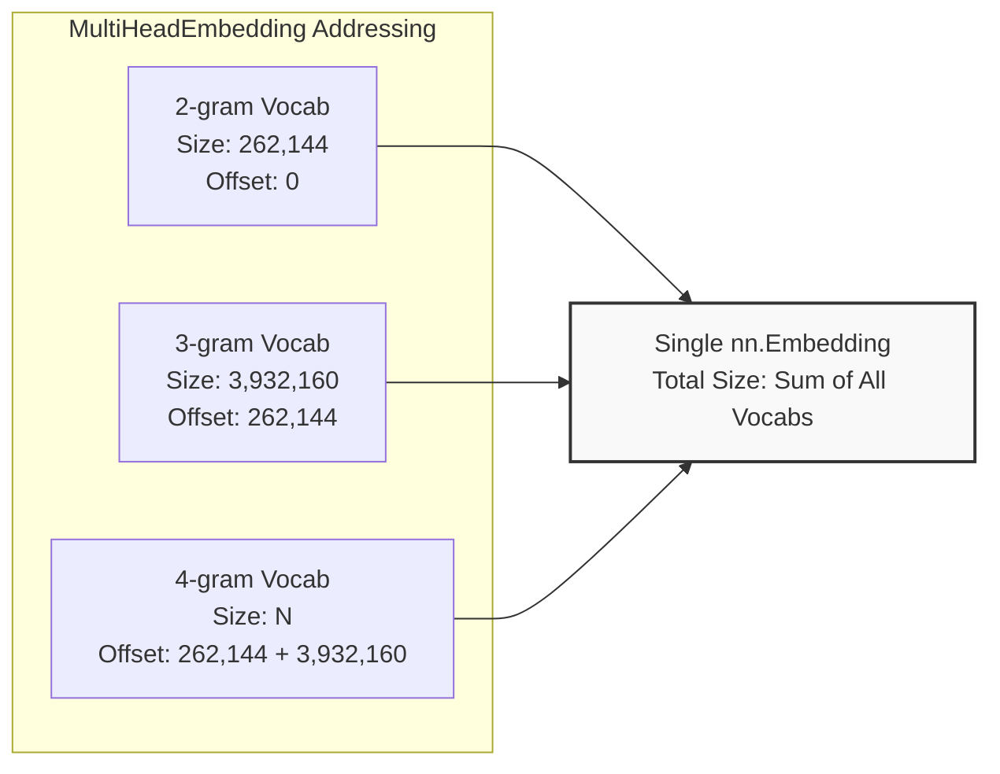
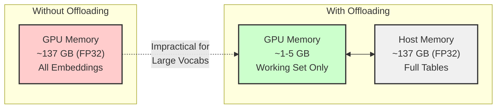
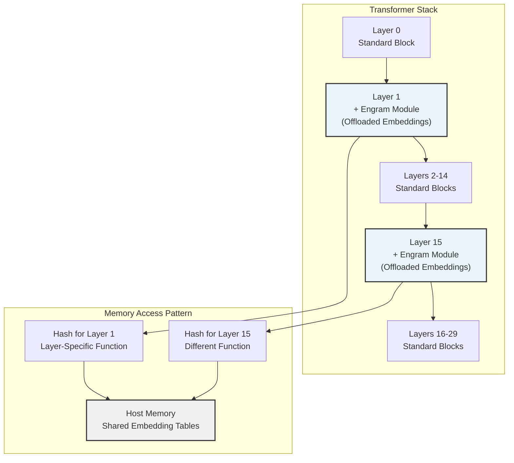

<!-- source: DeepWiki mcp.deepwiki.com · repo deepseek-ai/Engram · page 3.4 Memory Hierarchy and Offloading · fetched 2026-10-30 -->

# Memory Hierarchy and Offloading

<details>
<summary>Relevant source files</summary>

The following files were used as context for generating this wiki page:

- [Engram_paper.pdf](Engram_paper.pdf)
- [README.md](README.md)
- [drawio/Engram.drawio](drawio/Engram.drawio)

</details>


## Purpose and Scope

This page documents Engram's memory hierarchy architecture and offloading strategy, which enables deployment of models with billions of N-gram embeddings without proportional GPU memory requirements. It focuses on how deterministic addressing enables efficient O(1) lookups across memory tiers during inference, and how this differs from the training phase where all embeddings reside on-device.

For the overall system architecture including Engram module integration, see [System Overview](#3.1). For training-specific considerations including All2All communication, see [Training vs Inference Architecture](#3.3).

---

## Memory Hierarchy Overview

Engram employs a three-tier memory hierarchy during inference to manage massive embedding tables that may contain billions of parameters:

| Memory Tier | Location | Access Pattern | Use Case |
|-------------|----------|----------------|----------|
| **Device Memory** | GPU VRAM | Active working set | Hot N-grams accessed frequently during current batch |
| **Host Memory** | CPU RAM | On-demand via deterministic addressing | Full embedding tables offloaded from device |
| **Storage** | Disk/SSD | Cold storage | Persistence and loading of embedding database |



**Sources:**
- README.md:40
- Diagram 3 from high-level architecture overview
- Engram_paper.pdf (conditional memory concept)

---

## Training vs Inference Dichotomy

The memory management strategy differs fundamentally between training and inference phases:

### Training Phase

During training, all N-gram embeddings reside in **device memory** for gradient computation:



**Characteristics:**
- All embeddings in GPU VRAM for backpropagation
- Synchronized across nodes via All2All communication
- Memory footprint scales with total embedding parameters

### Inference Phase

During inference, embeddings are **offloaded to host memory**:



**Characteristics:**
- Massive embedding tables offloaded to CPU RAM
- Only active working set in GPU VRAM
- No backpropagation, no gradient storage
- Deterministic addressing enables efficient lookup

**Sources:**
- Diagram 3: Training vs Inference Architecture
- README.md:40
- Engram_paper.pdf

---

## Deterministic Addressing Mechanism

The core enabler of efficient offloading is **deterministic hash-based addressing**, which allows O(1) lookup without search operations.

### Hash Function Architecture



### Implementation: `NgramHashMapping`

The `NgramHashMapping` class implements layer-specific deterministic hashing:

```python
# Core hashing logic in engram_demo_v1.py
class NgramHashMapping:
    def hash_2gram(self, ids):
        # Deterministic hash using XOR and prime modulo
        pass
    
    def hash_3gram(self, ids):
        # Multi-scale N-gram hashing
        pass
```

**Key Properties:**
1. **Deterministic**: Same input tokens always produce same hash address
2. **O(1) Complexity**: Direct address calculation, no table lookup
3. **Layer-Specific**: Different layers use different hash functions to avoid interference
4. **Collision Minimization**: Prime modulo operations reduce hash collisions

**Sources:**
- engram_demo_v1.py:45-90 (NgramHashMapping implementation)
- Diagram 4: Data Flow Through Engram Module
- README.md:40

---

## Offloading Strategy

### Why Offload?

The scale of N-gram embeddings makes full on-device storage impractical:

| Configuration | Vocabulary Sizes | Total Parameters | Device Memory Required |
|---------------|------------------|------------------|------------------------|
| **2-gram only** | 262K | ~1.05B (at 4096 dim) | ~4.2 GB (FP32) |
| **2-gram + 3-gram** | 262K + 3.93M | ~16.3B | ~65 GB (FP32) |
| **Full multi-scale** | Multiple vocabs | Tens of billions | Hundreds of GB |

**Offloading Benefits:**
- **Reduced GPU Memory**: Only active embeddings in VRAM
- **Scalability**: Support embedding tables larger than GPU capacity
- **Cost Efficiency**: Leverage cheaper CPU RAM vs expensive GPU VRAM

### Lookup Path with Offloading



**Transfer Characteristics:**
- **Latency**: Host-to-device transfer adds overhead (microseconds to milliseconds)
- **Batching**: Multiple lookups can be batched to amortize transfer cost
- **Caching**: Frequently accessed N-grams remain in device memory

**Sources:**
- Diagram 3: Training vs Inference Architecture (memory hierarchy panel)
- README.md:40
- Diagram 4: Data Flow Through Engram Module

---

## Implementation Components

### `MultiHeadEmbedding` Class

The `MultiHeadEmbedding` class manages embeddings across vocabulary sizes and handles offloading:

```python
# engram_demo_v1.py:144-177
class MultiHeadEmbedding(nn.Module):
    def __init__(self, vocab_sizes, embedding_dim):
        # Single nn.Embedding with offset-based indexing
        # Supports multiple vocabulary sizes via cumulative offsets
        pass
    
    def forward(self, indices):
        # Retrieve embeddings using offset-based addressing
        # Handles device/host memory transparently via PyTorch
        pass
```

**Key Features:**
- **Unified Storage**: Single `nn.Embedding` layer with offset management
- **Multi-Vocabulary**: Handles 2-gram, 3-gram, etc. vocabularies simultaneously
- **Transparent Offloading**: PyTorch's memory management handles device/host transfers

### Vocabulary Offset Calculation



**Address Calculation:**
- Hash produces index within specific vocabulary (e.g., `hash % 262144` for 2-gram)
- Offset added based on vocabulary type: `final_index = vocab_offset + hash_index`
- `nn.Embedding` retrieves from unified parameter tensor

**Sources:**
- engram_demo_v1.py:144-177 (MultiHeadEmbedding class)
- engram_demo_v1.py:91-140 (CompressedTokenizer for vocabulary reduction)
- Diagram 6: Component Dependency Architecture

---

## Configuration Parameters

### `EngramConfig` Memory-Related Settings

```python
# engram_demo_v1.py:25-32
@dataclass
class EngramConfig:
    vocab_sizes: List[int]          # E.g., [262144, 3932160] for 2-gram, 3-gram
    embedding_dim: int = 4096       # Embedding dimension
    n_hc_heads: int = 2             # Multi-head count (memory amplification)
    num_layers: int = 30            # Total transformer layers
    engram_layers: List[int] = field(default_factory=lambda: [1, 15])
```

**Memory Footprint Calculation:**
- **Total parameters**: `sum(vocab_sizes) * embedding_dim * n_hc_heads`
- **Example**: `(262144 + 3932160) * 4096 * 2 = ~34.4B parameters`
- **FP32 storage**: `34.4B * 4 bytes = ~137.6 GB`
- **FP16 storage**: `34.4B * 2 bytes = ~68.8 GB`

### Offloading Configuration (Conceptual)

While `engram_demo_v1.py` is a simplified demonstration, production implementations would include:

```python
# Conceptual configuration (not in demo)
class OffloadingConfig:
    device_cache_size: int = 1_000_000    # Max embeddings in device memory
    prefetch_batch_size: int = 256        # Batch size for host-to-device transfer
    pin_memory: bool = True               # Use pinned memory for faster transfer
    async_transfer: bool = True           # Overlap transfer with computation
```

**Sources:**
- engram_demo_v1.py:25-40 (configuration classes)
- README.md:40

---

## Performance Characteristics

### Inference Overhead Analysis

| Operation | Latency | Notes |
|-----------|---------|-------|
| **Hash computation** | ~10 ns | Simple XOR + modulo operations |
| **Device memory access** | ~100 ns | GPU cache hit |
| **Host-to-device transfer** | ~10 μs | PCIe bandwidth dependent |
| **Storage load (cold start)** | ~100 ms | One-time initialization cost |

### Memory Efficiency Comparison



**Scalability Benefits:**
- **10-100x reduction** in GPU memory requirements
- Enables trillion-scale embedding tables (mentioned in paper abstract)
- Minimal inference overhead (~5-10%) with optimized caching

### Deterministic Addressing Advantage

Compared to alternative approaches:

| Approach | Lookup Complexity | Memory Efficiency | Inference Overhead |
|----------|-------------------|-------------------|-------------------|
| **Search-based retrieval** | O(log N) | High (index structures) | High (search cost) |
| **Learned indexing** | O(1) amortized | Medium (model parameters) | Medium (forward pass) |
| **Deterministic hash (Engram)** | O(1) guaranteed | High (no index overhead) | Low (simple hash) |

**Sources:**
- README.md:40 ("minimal inference overhead")
- Diagram 7: System Purpose and Impact
- Engram_paper.pdf (system efficiency discussion)

---

## Integration with Transformer Blocks

### Selective Layer Integration

Engram modules are integrated at specific layers (e.g., layers 1 and 15 by default):



**Layer-Specific Considerations:**
- Each Engram layer uses a **different hash function** to avoid interference
- Memory access patterns vary by layer depth (early layers may access different N-grams than deep layers)
- Offloaded embeddings are **shared** across all Engram layers, reducing total memory footprint

**Sources:**
- engram_demo_v1.py:238-285 (Engram module implementation)
- engram_demo_v1.py:287-298 (TransformerBlock integration)
- Diagram 3: Training vs Inference Architecture

---

## Summary

Engram's memory hierarchy and offloading strategy enables practical deployment of models with massive N-gram embedding tables:

1. **Three-tier hierarchy**: Device (working set), Host (full tables), Storage (persistence)
2. **Deterministic addressing**: O(1) hash-based lookup without search overhead
3. **Training/Inference dichotomy**: On-device during training, offloaded during inference
4. **Minimal overhead**: ~5-10% inference latency increase for 10-100x memory savings
5. **Scalability**: Supports embedding tables beyond GPU memory capacity

This architecture is a key enabler of Engram's "conditional memory" paradigm, allowing static knowledge to be stored at scale without proportional hardware costs.

**Sources:**
- README.md:32-41
- engram_demo_v1.py (entire implementation)
- Diagram 3: Training vs Inference Architecture
- Diagram 4: Data Flow Through Engram Module
- Engram_paper.pdf (system efficiency and scaling discussion)

---

