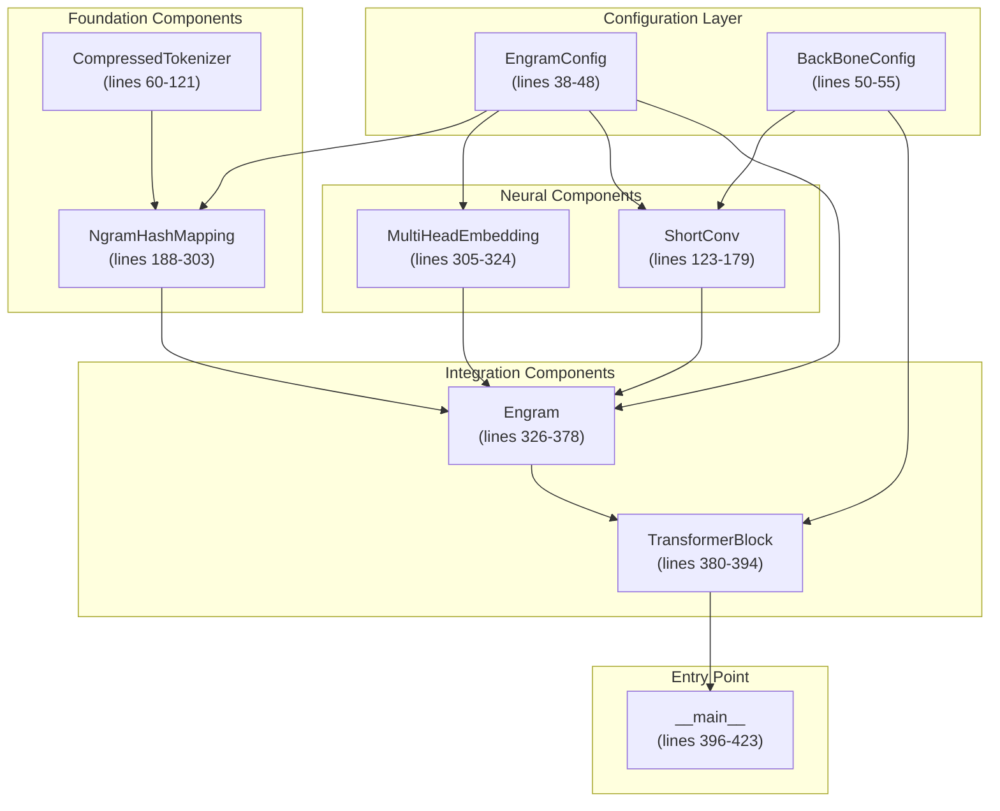
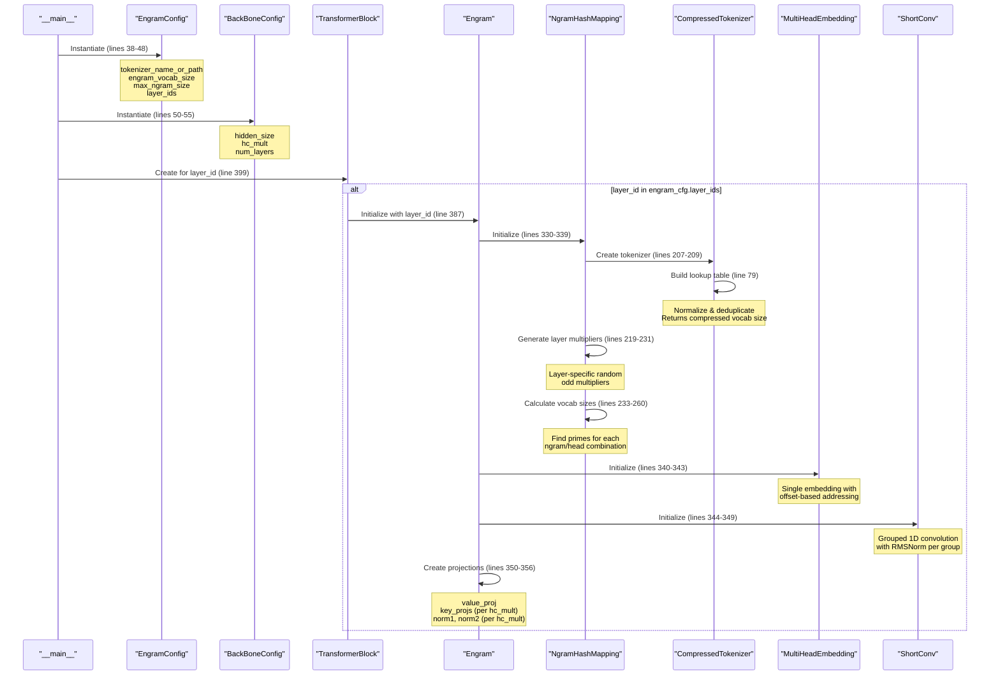
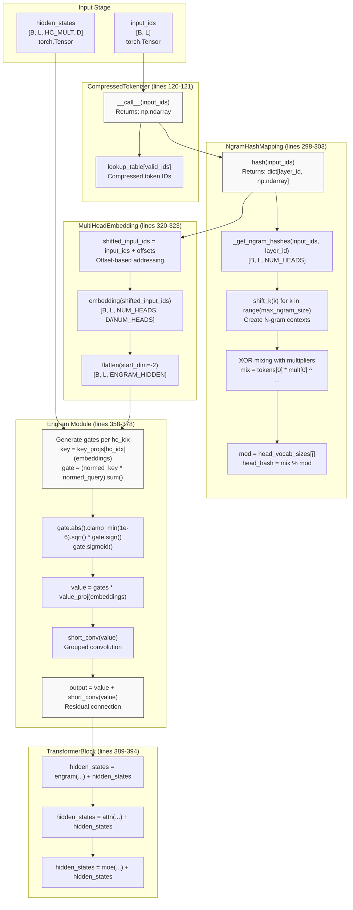
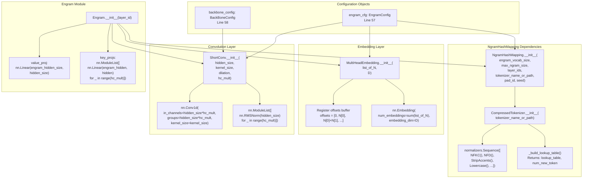
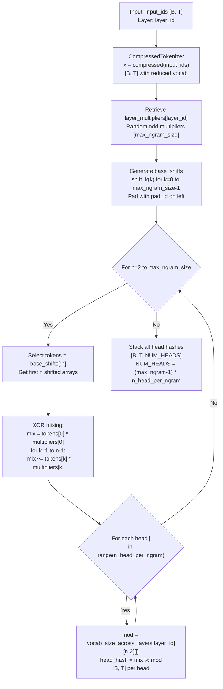
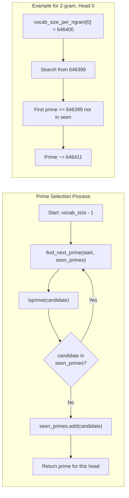
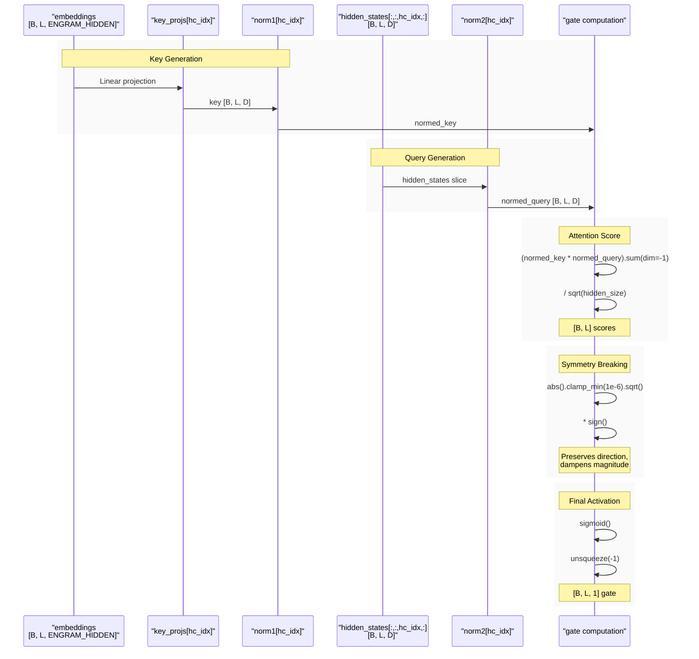
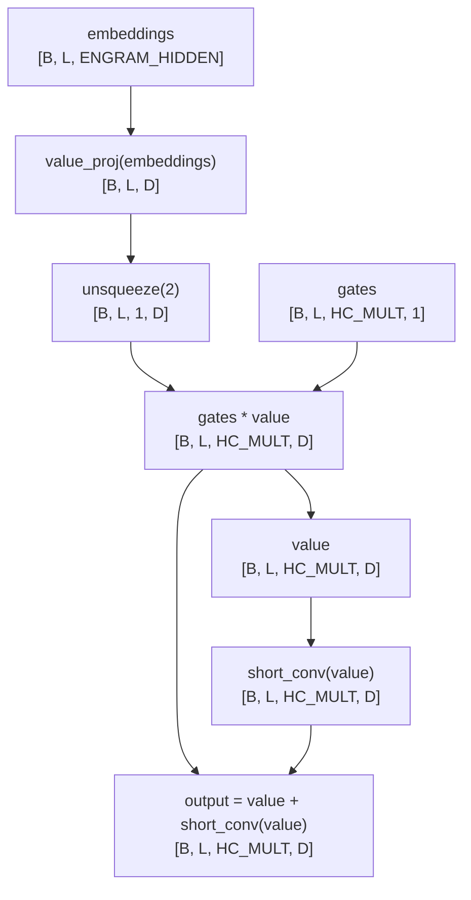
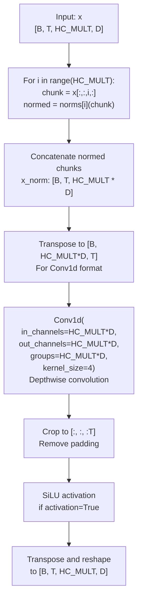
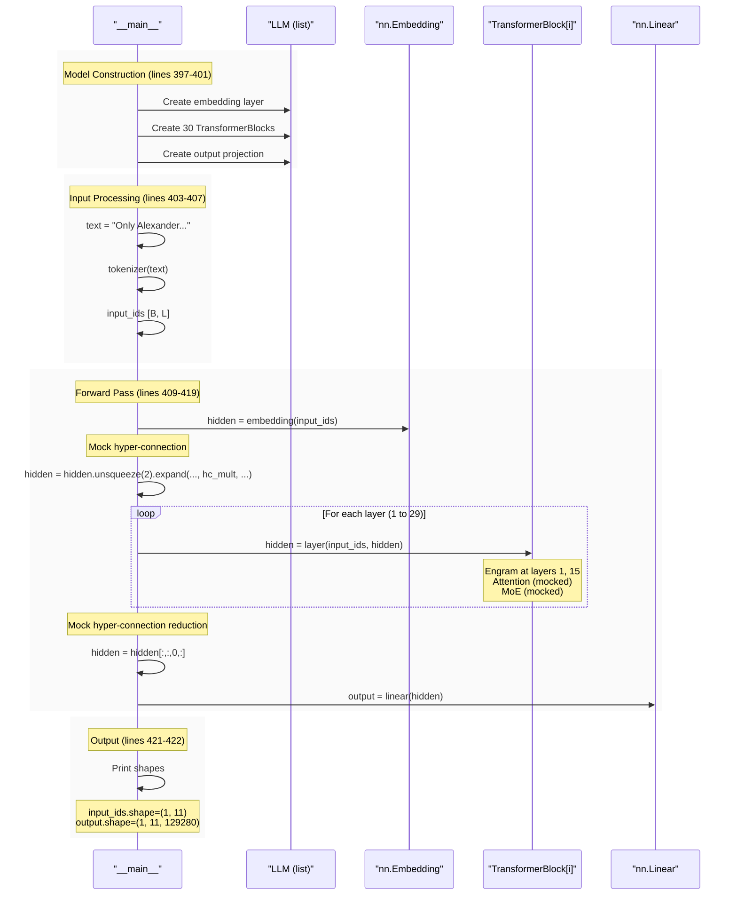

<!-- source: DeepWiki mcp.deepwiki.com · repo deepseek-ai/Engram · page 4 Implementation Guide · fetched 2026-10-30 -->

# Implementation Guide

Relevant source files

The following files were used as context for generating this wiki page:

- [README.md](README.md)
- [engram_demo_v1.py](engram_demo_v1.py)

## Purpose and Scope

This guide provides a practical walkthrough of the Engram codebase implementation, focusing on the demonstration code in `engram_demo_v1.py`. It explains how the theoretical concepts from [Core Concepts](#2) are realized in working code, detailing the class hierarchies, data transformations, and component interactions.

For architectural theory and system design principles, see [Architecture](#3). For experimental validation of the implementation's effectiveness, see [Experimental Validation](#5). For step-by-step usage instructions, see [Getting Started](#6).

---

## Code Structure Overview

The demonstration implementation in `engram_demo_v1.py` provides a self-contained illustration of the Engram module's core logic. The file contains approximately 423 lines organized into distinct functional components.

### File Organization

**Sources:** [engram_demo_v1.py:1-423]()

### Key Classes and Their Roles

| Class | Lines | Purpose | Key Methods |
|-------|-------|---------|-------------|
| `CompressedTokenizer` | 60-121 | Vocabulary compression via normalization | `__call__`, `_compress`, `_build_lookup_table` |
| `NgramHashMapping` | 188-303 | Deterministic N-gram hashing with layer-specific mixing | `hash`, `_get_ngram_hashes`, `calculate_vocab_size_across_layers` |
| `MultiHeadEmbedding` | 305-324 | Unified embedding table with offset-based indexing | `forward` |
| `ShortConv` | 123-179 | Grouped 1D convolution with per-head normalization | `forward` |
| `Engram` | 326-378 | Main module integrating hashing, embedding, and fusion | `forward` |
| `TransformerBlock` | 380-394 | Conditional integration of Engram into transformer layers | `forward` |

**Sources:** [engram_demo_v1.py:60-394]()

---

## Component Initialization Flow

The following diagram maps the initialization sequence, showing how configuration objects flow through component constructors and what dependencies are established.

**Sources:** [engram_demo_v1.py:38-58](), [engram_demo_v1.py:326-356](), [engram_demo_v1.py:380-394]()

---

## Forward Pass Data Flow

This diagram traces the complete data transformation pipeline through an Engram-augmented layer, using actual variable names and method calls from the implementation.

**Sources:** [engram_demo_v1.py:358-378](), [engram_demo_v1.py:389-394]()

---

## Component Dependency Graph

This graph shows the instantiation dependencies between components, using actual class names and constructor signatures.

**Sources:** [engram_demo_v1.py:326-356](), [engram_demo_v1.py:188-233](), [engram_demo_v1.py:305-318](), [engram_demo_v1.py:123-154]()

---

## N-gram Hash Computation Pipeline

The hash computation process is central to Engram's O(1) lookup mechanism. This diagram details the algorithmic steps in `NgramHashMapping._get_ngram_hashes`.

### Hashing Algorithm Flow

**Sources:** [engram_demo_v1.py:262-296]()

### Prime Modulo Collision Reduction

The hash function uses prime numbers as moduli to minimize collisions. The `calculate_vocab_size_across_layers` method ensures each head for each N-gram uses a distinct prime.

**Sources:** [engram_demo_v1.py:181-186](), [engram_demo_v1.py:235-260]()

---

## Gating Mechanism Implementation

The Engram module uses an attention-like gating mechanism to fuse static N-gram embeddings with dynamic hidden states. This occurs separately for each hyper-connection index.

**Sources:** [engram_demo_v1.py:365-375]()

### Gate Application and Residual Connection

**Sources:** [engram_demo_v1.py:376-378]()

---

## Configuration Parameters

### EngramConfig

The `EngramConfig` dataclass [engram_demo_v1.py:38-48]() specifies all Engram-specific hyperparameters:

| Parameter | Type | Default | Description |
|-----------|------|---------|-------------|
| `tokenizer_name_or_path` | `str` | `"deepseek-ai/DeepSeek-V3"` | HuggingFace tokenizer identifier for vocabulary compression |
| `engram_vocab_size` | `List[int]` | `[646400, 646400]` | Vocabulary size per N-gram (length = max_ngram_size - 1) |
| `max_ngram_size` | `int` | `3` | Maximum N-gram order (e.g., 3 means 2-grams and 3-grams) |
| `n_embed_per_ngram` | `int` | `512` | Total embedding dimension per N-gram |
| `n_head_per_ngram` | `int` | `8` | Number of heads per N-gram for multi-head embeddings |
| `layer_ids` | `List[int]` | `[1, 15]` | Transformer layers to augment with Engram |
| `pad_id` | `int` | `2` | Token ID for padding in N-gram contexts |
| `seed` | `int` | `0` | Random seed for hash multiplier generation |
| `kernel_size` | `int` | `4` | Convolution kernel size in ShortConv |

### BackBoneConfig

The `BackBoneConfig` dataclass [engram_demo_v1.py:50-55]() specifies LLM backbone parameters:

| Parameter | Type | Default | Description |
|-----------|------|---------|-------------|
| `hidden_size` | `int` | `1024` | Model hidden dimension |
| `hc_mult` | `int` | `4` | Hyper-connection multiplier (number of parallel streams) |
| `vocab_size` | `int` | `129280` | Original tokenizer vocabulary size |
| `num_layers` | `int` | `30` | Total number of transformer layers |

**Sources:** [engram_demo_v1.py:38-58]()

---

## ShortConv Architecture Details

The `ShortConv` module implements grouped 1D convolution with per-group normalization. This processes the gated N-gram features with local context modeling.

### Internal Structure

**Key Implementation Details:**
- **Grouped Convolution**: Each of the `hidden_size * hc_mult` channels has its own convolution kernel (groups = in_channels)
- **Dilation**: Set to `max_ngram_size` to match the N-gram context span [engram_demo_v1.py:347]()
- **Padding**: Calculated as `(kernel_size - 1) * dilation` to enable causal processing [engram_demo_v1.py:144]()
- **Per-Group Normalization**: Separate RMSNorm for each of the `hc_mult` groups [engram_demo_v1.py:148-151]()

**Sources:** [engram_demo_v1.py:123-179]()

---

## Main Execution Flow

The `__main__` block demonstrates end-to-end usage of the Engram-augmented LLM:

**Sources:** [engram_demo_v1.py:396-423]()

---

## Memory and Computation Characteristics

### Memory Layout

The implementation uses the following memory structures:

| Component | Data Structure | Shape | Notes |
|-----------|----------------|-------|-------|
| `CompressedTokenizer.lookup_table` | `np.ndarray` | `[vocab_size]` | Maps original to compressed token IDs |
| `NgramHashMapping.layer_multipliers` | `dict[int, np.ndarray]` | `{layer_id: [max_ngram_size]}` | Layer-specific hash multipliers |
| `MultiHeadEmbedding.offsets` | `torch.Tensor` | `[num_heads]` | Address offsets for unified embedding |
| `MultiHeadEmbedding.embedding.weight` | `nn.Parameter` | `[sum(vocab_sizes), D]` | Massive static memory table |
| `ShortConv.conv.weight` | `nn.Parameter` | `[hidden*hc_mult, 1, kernel_size]` | Depthwise convolution kernels |

### Computational Complexity

**Per-Token Operations in `Engram.forward`:**

1. **Hash Computation**: O(max_ngram_size × n_head_per_ngram) XOR and modulo operations
2. **Embedding Lookup**: O(1) deterministic addressing into embedding table
3. **Gating**: O(hc_mult × hidden_size) for key-query attention scores
4. **Convolution**: O(hc_mult × hidden_size × kernel_size) for local context modeling

Total: O(hc_mult × hidden_size) dominant term, same order as standard transformer operations.

**Sources:** [engram_demo_v1.py:358-378]()

---

## Simplifications and Production Considerations

The demonstration code includes several simplifications noted in the header [engram_demo_v1.py:5-18]():

### Mocked Components

- **Attention**: Replaced with identity function `lambda x: x` [engram_demo_v1.py:383]()
- **MoE**: Replaced with identity function `lambda x: x` [engram_demo_v1.py:384]()
- **Hyper-connections**: Manual expand/reduction operations [engram_demo_v1.py:413](), [engram_demo_v1.py:416]()

### Production Requirements

For deployment, the implementation would require:

1. **Custom CUDA Kernels**: Fused hash computation and embedding lookup
2. **Distributed Training**: All2All communication for N-gram embedding synchronization (see [Training vs Inference Architecture](#3.3))
3. **Memory Offloading**: Host memory management for massive embedding tables (see [Memory Hierarchy and Offloading](#3.4))
4. **Quantization**: Reduced precision for embedding tables to lower memory footprint
5. **Gradient Checkpointing**: For backward pass memory efficiency

**Sources:** [engram_demo_v1.py:5-18]()

---

