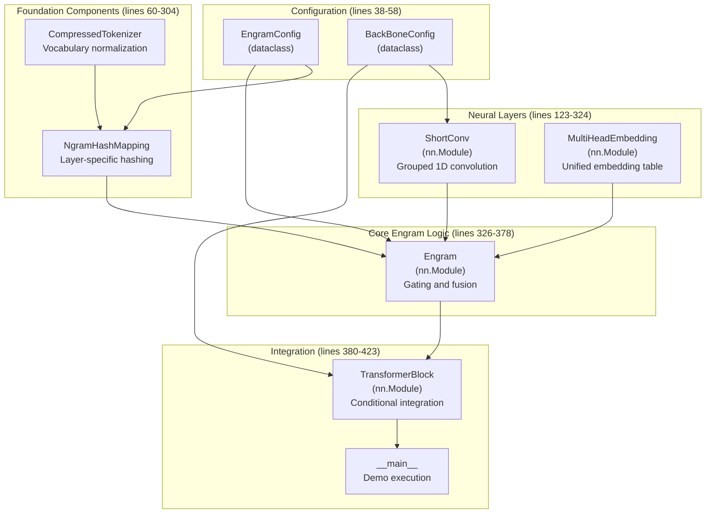
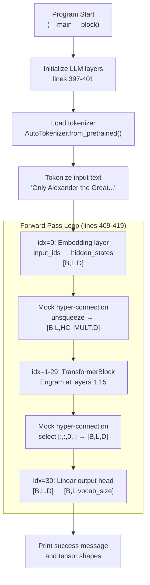
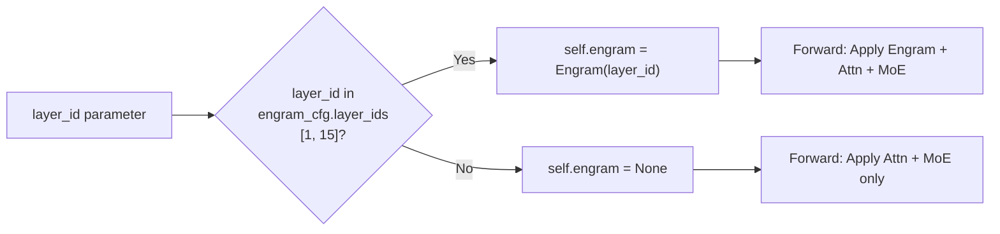
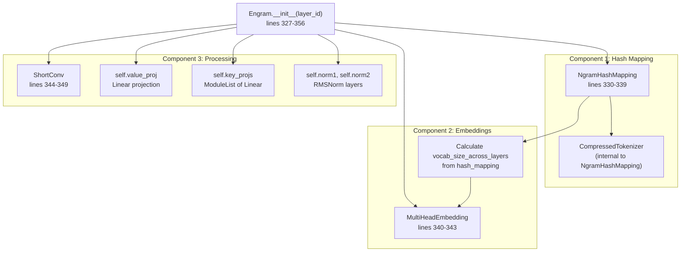

<!-- source: DeepWiki mcp.deepwiki.com · repo deepseek-ai/Engram · page 4.1 Demo Overview · fetched 2026-10-30 -->

# Demo Overview

<details>
<summary>Relevant source files</summary>

The following files were used as context for generating this wiki page:

- [README.md](README.md)
- [engram_demo_v1.py](engram_demo_v1.py)

</details>


## Purpose and Scope

This page documents `engram_demo_v1.py`, a standalone demonstration implementation that illustrates the core logic and data flow of the Engram module. The demo is designed for educational purposes to show how components interact, not for production deployment. It intentionally simplifies or mocks standard transformer components (Attention, MoE, hyper-connections) to focus exclusively on Engram-specific logic.

For detailed explanations of individual components, see:
- N-gram hash mapping: [N-gram Hash Mapping](#4.2)
- Tokenizer compression: [Compressed Tokenizer](#4.3)
- Embedding and convolution layers: [Multi-Head Embedding and ShortConv](#4.4)
- Integration with transformer blocks: [Transformer Block Integration](#4.5)
- Configuration parameters: [Configuration Reference](#4.6)

For experimental validation of the approach, see [Experimental Validation](#5).

**Sources:** [README.md:78-90](), [engram_demo_v1.py:1-18]()

---

## Demo Characteristics

The demonstration file has three defining characteristics that distinguish it from a production implementation:

### Simplifications

The demo mocks standard transformer components to isolate Engram-specific logic. The `TransformerBlock` class defines attention and MoE layers as identity functions (`lambda x:x`), allowing the demonstration to focus on the Engram module's data transformations without the complexity of full transformer mechanics.

| Component | Production Behavior | Demo Behavior |
|-----------|---------------------|---------------|
| Attention | Multi-head self-attention with KV cache | Identity function `lambda x:x` |
| MoE | Mixture-of-Experts routing and computation | Identity function `lambda x:x` |
| Hyper-connections | Multi-path gating mechanism | Simple expansion/reduction via `unsqueeze`/indexing |
| Normalization layers | Full RMSNorm with learnable parameters | RMSNorm present but not demonstrated in full context |

### Production Readiness Disclaimer

The implementation requires significant optimization before production use. Missing optimizations include:

- **Custom CUDA kernels** for N-gram hash computation (currently uses NumPy)
- **Distributed training support** with All2All communication for Engram state synchronization
- **Memory-efficient embedding table offloading** to host memory with asynchronous prefetching
- **Gradient checkpointing** for memory-efficient backpropagation through Engram layers
- **Mixed precision training** support with appropriate loss scaling

### Educational Focus

The code prioritizes readability over performance. Variable names are descriptive, intermediate transformations are explicit, and data flow is linear. This makes the implementation ideal for understanding the architecture but unsuitable for deployment without substantial re-engineering.

**Sources:** [engram_demo_v1.py:1-18](), [engram_demo_v1.py:380-394]()

---

## File Structure and Components

The `engram_demo_v1.py` file is organized into distinct sections, each responsible for a specific aspect of the Engram system.

### Component Hierarchy



**Sources:** [engram_demo_v1.py:38-423]()

### Configuration Data Classes

Two configuration dataclasses define system parameters:

**`EngramConfig` (lines 38-48)**
- `tokenizer_name_or_path`: Base tokenizer for vocabulary
- `engram_vocab_size`: List of vocabulary sizes per N-gram type (2-gram, 3-gram)
- `max_ngram_size`: Maximum N-gram order (default: 3)
- `n_embed_per_ngram`: Embedding dimension per N-gram
- `n_head_per_ngram`: Number of attention heads per N-gram
- `layer_ids`: Target transformer layers for Engram insertion
- `pad_id`: Padding token ID for boundary handling
- `seed`: Random seed for layer-specific hash multipliers
- `kernel_size`: Convolution kernel size for `ShortConv`

**`BackBoneConfig` (lines 50-55)**
- `hidden_size`: Transformer hidden dimension
- `hc_mult`: Hyper-connection multiplicity (number of parallel paths)
- `vocab_size`: Base vocabulary size
- `num_layers`: Total number of transformer layers

**Sources:** [engram_demo_v1.py:38-58]()

---

## Running the Demo

### Prerequisites

The demo requires Python 3.8+ and four dependencies:

```bash
pip install torch numpy transformers sympy
```

| Package | Purpose |
|---------|---------|
| `torch` | Neural network layers and tensor operations |
| `numpy` | Efficient N-gram hash computation |
| `transformers` | Tokenizer loading via `AutoTokenizer` |
| `sympy` | Prime number generation for hash collision reduction |

### Execution

Run the demo from the command line:

```bash
python engram_demo_v1.py
```

The script executes a complete forward pass through a minimal LLM architecture with Engram modules at layers 1 and 15. On successful completion, it prints:

```
✅ Forward Complete!
input_ids.shape=torch.Size([1, 11])
output.shape=torch.Size([1, 11, 129280])
```

Where:
- Input shape `[1, 11]` represents a single batch with 11 tokens
- Output shape `[1, 11, 129280]` represents logits over the full vocabulary for each token

### Demo Execution Flow



**Sources:** [engram_demo_v1.py:396-423]()

---

## Component Instantiation and Data Flow

The `__main__` block demonstrates how components are instantiated and connected in sequence.

### LLM Layer Assembly

The demo constructs a list-based LLM architecture with three layer types:

```python
LLM = [
    nn.Embedding(backbone_config.vocab_size, backbone_config.hidden_size),
    *[TransformerBlock(layer_id=layer_id) for layer_id in range(backbone_config.num_layers)],
    nn.Linear(backbone_config.hidden_size, backbone_config.vocab_size)
]
```

This creates:
1. **Embedding layer (index 0)**: Maps token IDs to hidden representations
2. **30 TransformerBlock instances (indices 1-30)**: Layers 1 and 15 contain Engram modules
3. **Output projection (index 31)**: Projects hidden states to vocabulary logits

### TransformerBlock Conditional Integration

Each `TransformerBlock` conditionally instantiates an Engram module based on layer ID:



**Sources:** [engram_demo_v1.py:380-394]()

### Forward Pass Data Transformations

The forward pass applies transformations sequentially:

| Step | Input Shape | Transformation | Output Shape | Component |
|------|-------------|----------------|--------------|-----------|
| 1 | `[B, L]` | Token embedding | `[B, L, D]` | `nn.Embedding` |
| 2 | `[B, L, D]` | Expand for hyper-connections | `[B, L, HC_MULT, D]` | `.unsqueeze(2).expand()` |
| 3 | `[B, L, HC_MULT, D]` | Engram + Attn + MoE (layer 1) | `[B, L, HC_MULT, D]` | `TransformerBlock(layer_id=1)` |
| 4 | `[B, L, HC_MULT, D]` | Attn + MoE (layers 2-14) | `[B, L, HC_MULT, D]` | `TransformerBlock(layer_id=2-14)` |
| 5 | `[B, L, HC_MULT, D]` | Engram + Attn + MoE (layer 15) | `[B, L, HC_MULT, D]` | `TransformerBlock(layer_id=15)` |
| 6 | `[B, L, HC_MULT, D]` | Attn + MoE (layers 16-29) | `[B, L, HC_MULT, D]` | `TransformerBlock(layer_id=16-29)` |
| 7 | `[B, L, HC_MULT, D]` | Collapse hyper-connections | `[B, L, D]` | `[:,:,0,:]` indexing |
| 8 | `[B, L, D]` | Output projection | `[B, L, vocab_size]` | `nn.Linear` |

Where:
- `B` = batch size (1 in demo)
- `L` = sequence length (11 tokens in demo)
- `D` = hidden dimension (1024 from `BackBoneConfig`)
- `HC_MULT` = hyper-connection multiplicity (4 from `BackBoneConfig`)
- `vocab_size` = vocabulary size (129280 from `BackBoneConfig`)

**Sources:** [engram_demo_v1.py:396-423]()

---

## Engram Module Instantiation Details

When a `TransformerBlock` at a target layer ID instantiates an `Engram` module, it creates three sub-components:

### Engram Constructor Dependencies



**Sources:** [engram_demo_v1.py:326-356]()

### Component Instantiation Sequence

The `Engram.__init__()` method constructs components in a specific order to satisfy dependencies:

1. **`self.hash_mapping`** (lines 330-339): Creates `NgramHashMapping` instance with configuration parameters. Internally instantiates `CompressedTokenizer` and calculates layer-specific vocabulary sizes.

2. **`self.multi_head_embedding`** (lines 340-343): Creates `MultiHeadEmbedding` with flattened vocabulary sizes from `hash_mapping.vocab_size_across_layers[layer_id]`. Uses list comprehension `[x for y in ... for x in y]` to flatten nested list of vocab sizes.

3. **`self.short_conv`** (lines 344-349): Creates `ShortConv` instance with `hidden_size` from backbone config, `kernel_size` and `max_ngram_size` (as dilation) from Engram config, and `hc_mult` for grouped convolution.

4. **`self.value_proj`** (line 351): Linear layer projecting from `engram_hidden_size` (computed as `(max_ngram_size-1) * n_embed_per_ngram`) to `backbone_config.hidden_size`.

5. **`self.key_projs`** (lines 352-354): `ModuleList` containing `hc_mult` linear layers, one per hyper-connection path.

6. **`self.norm1` and `self.norm2`** (lines 355-356): `ModuleList` instances each containing `hc_mult` RMSNorm layers for normalizing keys and queries in the gating mechanism.

**Sources:** [engram_demo_v1.py:326-356]()

---

## Demo Input and Output

### Sample Input Text

The demo processes a single sentence:

```python
text = "Only Alexander the Great could tame the horse Bucephalus."
```

This text is chosen to demonstrate:
- Multi-word named entities ("Alexander the Great", "Bucephalus")
- Historical/factual knowledge that benefits from N-gram memory lookup
- Reasonable token count (11 tokens) for quick execution

### Tokenization

The input is tokenized using the DeepSeek-V3 tokenizer:

```python
tokenizer = AutoTokenizer.from_pretrained(engram_cfg.tokenizer_name_or_path, trust_remote_code=True)
input_ids = tokenizer(text, return_tensors='pt').input_ids
```

Resulting in:
- `input_ids.shape = torch.Size([1, 11])` (batch size 1, sequence length 11)

### Expected Output

On successful forward pass, the demo prints:

```
✅ Forward Complete!
input_ids.shape=torch.Size([1, 11])
output.shape=torch.Size([1, 11, 129280])
```

The output tensor has shape `[1, 11, 129280]`:
- Dimension 0: Batch size (1)
- Dimension 1: Sequence length (11 tokens)
- Dimension 2: Vocabulary size (129280 logits per token position)

**Note:** The demo does not perform token generation or measure perplexity. It only validates that tensors flow through the architecture without shape mismatches or runtime errors.

**Sources:** [engram_demo_v1.py:403-422]()

---

## Limitations and Next Steps

### What the Demo Does Not Demonstrate

The simplified implementation excludes several production-critical features:

| Feature | Status in Demo | Notes |
|---------|----------------|-------|
| Attention mechanism | Identity function | Full multi-head attention not shown |
| MoE routing | Identity function | Expert selection and gating not shown |
| Hyper-connections | Simple expand/collapse | Full gating mechanism not implemented |
| Memory offloading | Not implemented | All embeddings in device memory |
| Distributed training | Not implemented | No All2All communication for Engram sync |
| Gradient checkpointing | Not implemented | Full backprop through all layers |
| Mixed precision | Not implemented | FP32 only |
| KV cache | Not implemented | No caching for autoregressive generation |

### Understanding Full System Behavior

To understand how Engram operates in a production setting:

1. **Component details**: See [N-gram Hash Mapping](#4.2), [Compressed Tokenizer](#4.3), [Multi-Head Embedding and ShortConv](#4.4)
2. **Integration strategy**: See [Transformer Block Integration](#4.5)
3. **Training vs inference differences**: See [Training vs Inference Architecture](#3.3)
4. **Memory hierarchy**: See [Memory Hierarchy and Offloading](#3.4)
5. **Performance validation**: See [Experimental Validation](#5)

### Extending the Demo

To adapt this demo for experimental use:

1. Replace identity functions for `attn` and `moe` with actual implementations
2. Implement full hyper-connection gating as described in the architecture diagrams
3. Add memory offloading logic to `MultiHeadEmbedding` with asynchronous prefetching
4. Integrate distributed training with All2All communication for Engram state synchronization
5. Add gradient checkpointing decorators to reduce memory consumption
6. Implement mixed precision training with automatic loss scaling

**Sources:** [engram_demo_v1.py:1-18](), [README.md:89-90]()

---

