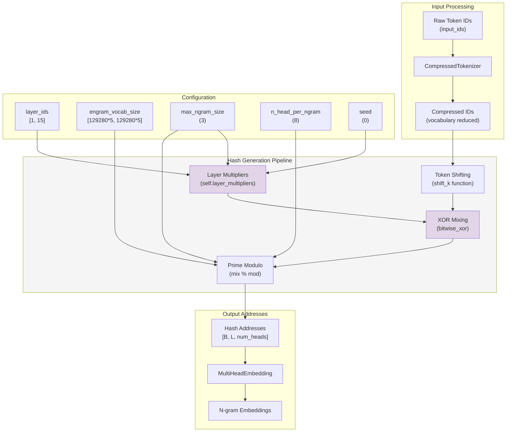
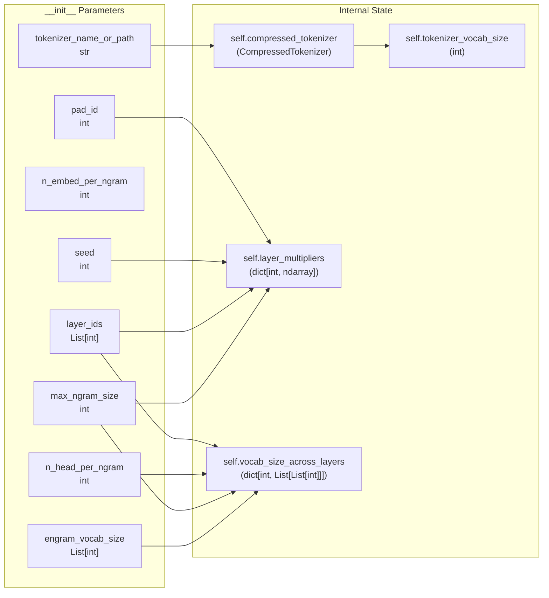
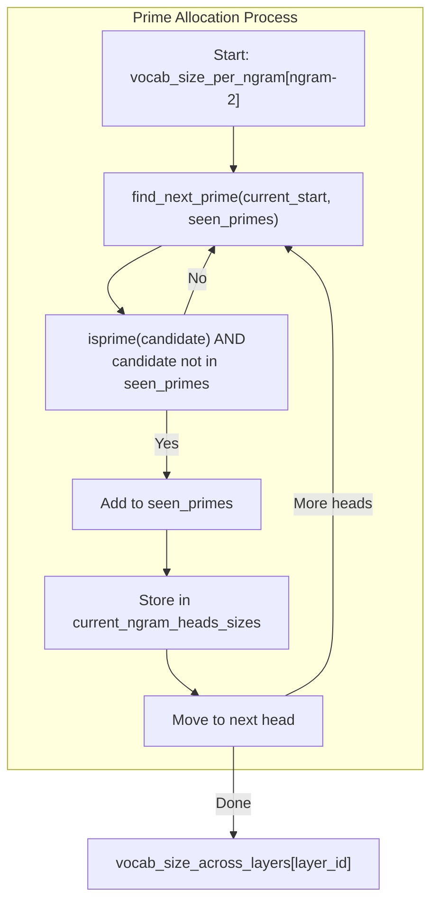
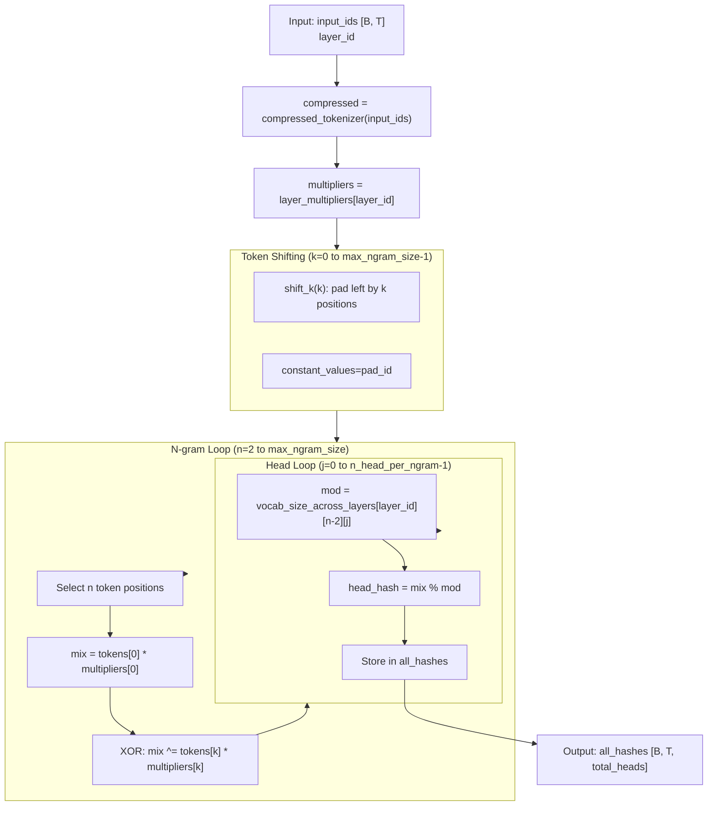
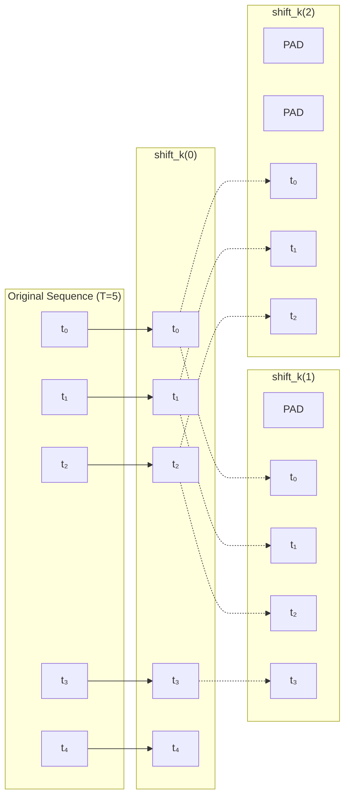
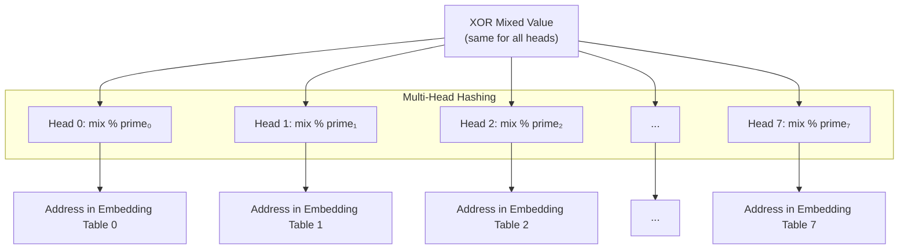
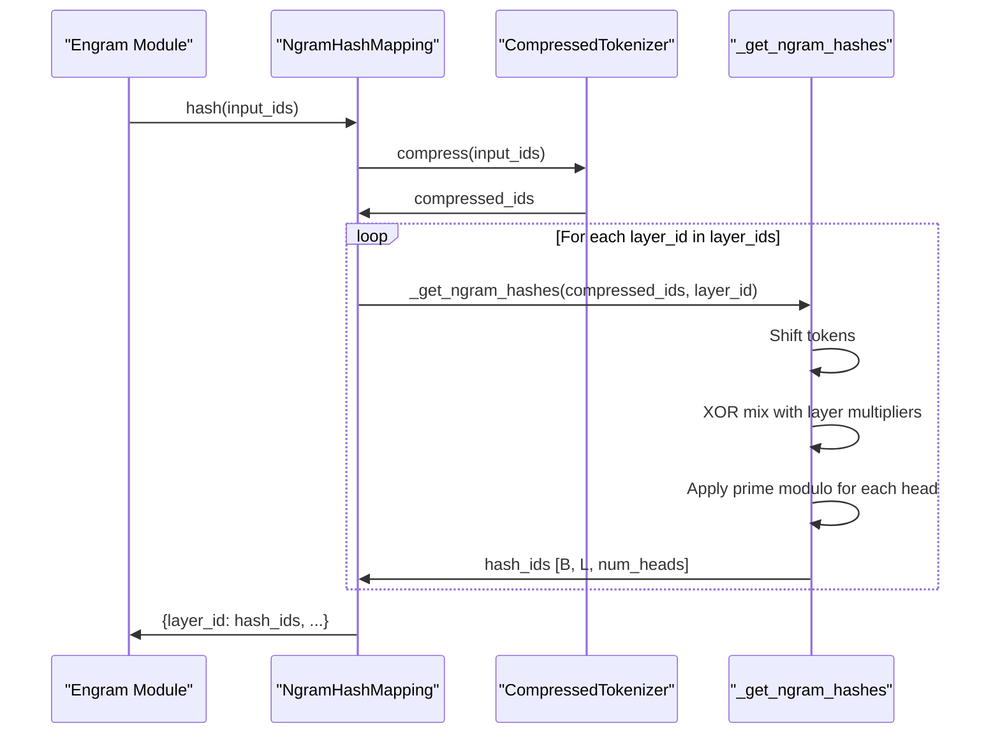
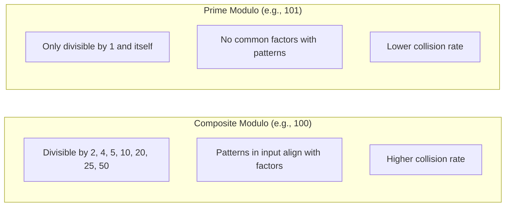
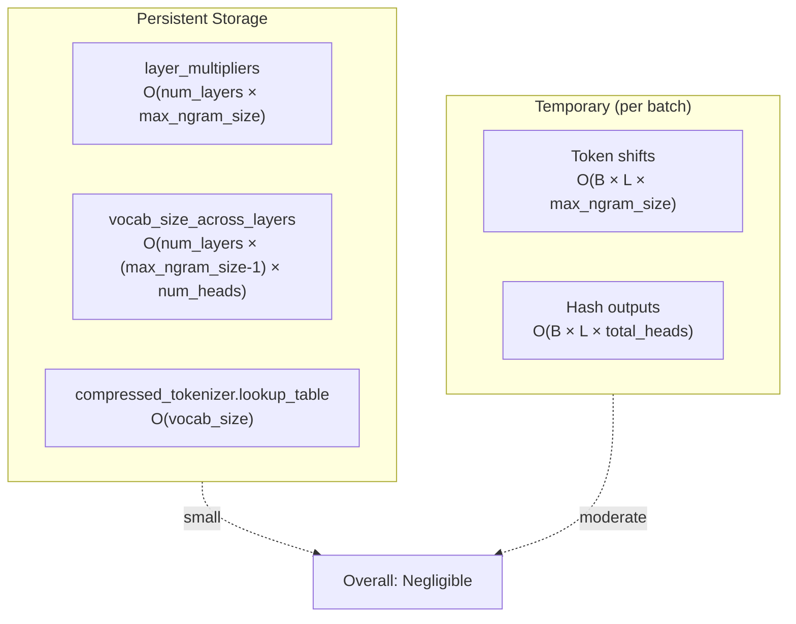

<!-- source: DeepWiki mcp.deepwiki.com · repo deepseek-ai/Engram · page 4.2 N-gram Hash Mapping · fetched 2026-10-30 -->

# N-gram Hash Mapping

<details>
<summary>Relevant source files</summary>

The following files were used as context for generating this wiki page:

- [drawio/Engram.drawio](drawio/Engram.drawio)
- [engram_demo_v1.py](engram_demo_v1.py)

</details>


## Purpose and Scope

This page provides a detailed technical explanation of the `NgramHashMapping` component, which implements the deterministic addressing system for Engram's N-gram embeddings. This component handles vocabulary compression, layer-specific hash generation, XOR mixing for collision resistance, and prime modulo operations for mapping N-grams to embedding indices.

**Related Pages:**
- For the overall Engram architecture and how hash mapping fits into the system, see [Engram Module Deep Dive](#3.2)
- For the vocabulary compression performed before hashing, see [Compressed Tokenizer](#4.3)
- For the multi-head embedding tables accessed via hash addresses, see [Multi-Head Embedding and ShortConv](#4.4)
- For configuration parameters controlling the hash mapping, see [Configuration Reference](#4.6)

---

## Component Overview

The `NgramHashMapping` class [engram_demo_v1.py:188-303]() serves as the deterministic addressing layer between input token sequences and N-gram embedding tables. It produces O(1) lookup addresses that are layer-specific, collision-resistant, and deterministically reproducible across training and inference.

### Core Responsibilities

| Responsibility | Implementation | Code Reference |
|---------------|----------------|----------------|
| Vocabulary Compression | Normalize and deduplicate tokens | [engram_demo_v1.py:207-213]() |
| Layer-Specific Hashing | Generate unique multipliers per layer | [engram_demo_v1.py:219-232]() |
| Prime Modulo Allocation | Find collision-resistant table sizes | [engram_demo_v1.py:235-260]() |
| N-gram Hash Generation | XOR mixing with multipliers | [engram_demo_v1.py:262-296]() |
| Multi-Head Addressing | Separate addresses for each head | [engram_demo_v1.py:291-295]() |

**Sources:** [engram_demo_v1.py:188-303]()

---

## System Architecture



**Diagram: NgramHashMapping Data Flow**

This diagram shows how raw token IDs flow through vocabulary compression, layer-specific XOR mixing with multipliers, and prime modulo operations to produce deterministic hash addresses for embedding lookup.

**Sources:** [engram_demo_v1.py:188-303](), [engram_demo_v1.py:298-303]()

---

## Initialization and Configuration

### Constructor Parameters

The `NgramHashMapping.__init__` method [engram_demo_v1.py:189-233]() accepts configuration parameters that define the hashing behavior:



**Diagram: NgramHashMapping Initialization**

**Sources:** [engram_demo_v1.py:189-233]()

### Layer-Specific Multiplier Generation

Layer-specific multipliers ensure that the same N-gram receives different hash addresses in different layers, enabling layer-wise specialization:

```mermaid
sequenceDiagram
    participant Init as "__init__"
    participant Loop as "Layer Loop"
    participant RNG as "np.random.default_rng"
    participant Store as "self.layer_multipliers"
    
    Init->>Loop: for layer_id in self.layer_ids
    Loop->>RNG: base_seed = seed + 10007 * layer_id
    RNG->>RNG: g.integers(low=0, high=half_bound)
    RNG->>Loop: random values r
    Loop->>Loop: multipliers = r * 2 + 1 (ensure odd)
    Loop->>Store: layer_multipliers[layer_id] = multipliers
    Loop->>Init: continue next layer
```

**Diagram: Layer Multiplier Generation Sequence**

The multipliers are odd integers [engram_demo_v1.py:230]() to ensure they are coprime with powers of 2, improving hash distribution. Each layer uses a different seed derived from `base_seed = seed + 10007 * layer_id` [engram_demo_v1.py:222]().

**Sources:** [engram_demo_v1.py:219-232]()

---

## Prime Modulo Allocation

### Collision Reduction Strategy

The `calculate_vocab_size_across_layers` method [engram_demo_v1.py:235-260]() allocates prime numbers as table sizes for each head in each N-gram in each layer. Prime modulos significantly reduce hash collisions compared to composite numbers.



**Diagram: Prime Number Search Algorithm**

### Prime Search Implementation

The helper function `find_next_prime` [engram_demo_v1.py:181-186]() ensures uniqueness:

| Step | Operation | Code Reference |
|------|-----------|----------------|
| 1. Start | `candidate = start + 1` | [engram_demo_v1.py:182]() |
| 2. Check | `isprime(candidate)` using sympy | [engram_demo_v1.py:184]() |
| 3. Verify | `candidate not in seen_primes` | [engram_demo_v1.py:184]() |
| 4. Return or Increment | Return if valid, else `candidate += 1` | [engram_demo_v1.py:185-186]() |

### Data Structure

The resulting `vocab_size_across_layers` is a nested dictionary structure:

```
vocab_size_across_layers = {
    layer_id: [
        [prime_0_head_0, prime_0_head_1, ..., prime_0_head_7],  # 2-gram
        [prime_1_head_0, prime_1_head_1, ..., prime_1_head_7],  # 3-gram
    ]
}
```

Each `prime_i_head_j` is a unique prime number used as the modulo for that specific N-gram size and head within that layer.

**Sources:** [engram_demo_v1.py:181-186](), [engram_demo_v1.py:235-260]()

---

## N-gram Hash Generation

### Core Algorithm

The `_get_ngram_hashes` method [engram_demo_v1.py:262-296]() implements the deterministic hashing algorithm:



**Diagram: N-gram Hash Generation Algorithm**

**Sources:** [engram_demo_v1.py:262-296]()

### Token Shifting Mechanism

The `shift_k` function [engram_demo_v1.py:272-276]() creates shifted views of the input sequence:



**Diagram: Token Shifting for N-gram Formation**

This shifting creates overlapping N-gram windows. For a 3-gram at position `t`, the algorithm accesses `[shift_k(0)[t], shift_k(1)[t], shift_k(2)[t]]` = `[t₀, t₋₁, t₋₂]`.

**Sources:** [engram_demo_v1.py:272-278]()

### XOR Mixing Formula

The core mixing operation [engram_demo_v1.py:285-287]() combines tokens with layer-specific multipliers:

```
Initial: mix = tokens[0] * multipliers[0]
Loop:    mix = mix XOR (tokens[k] * multipliers[k])  for k=1 to n-1
```

**Mathematical Properties:**
- **Commutativity:** Order independence within the same N-gram
- **Avalanche Effect:** Single bit changes propagate throughout the hash
- **Reversibility:** XOR is its own inverse, enabling theoretical hash inversion
- **Overflow Safety:** XOR prevents arithmetic overflow issues

### Multi-Head Distribution

For each N-gram size, the algorithm generates `n_head_per_ngram` (default: 8) separate hash addresses using different prime modulos [engram_demo_v1.py:288-294]():



**Diagram: Multi-Head Hash Distribution**

Each head's prime modulo is unique across all layers, N-gram sizes, and heads, minimizing cross-contamination of embeddings.

**Sources:** [engram_demo_v1.py:288-295]()

---

## Public Interface

### Hash Method

The `hash` method [engram_demo_v1.py:298-303]() provides the public interface:

```python
def hash(self, input_ids):
    """
    Args:
        input_ids: Raw token IDs [B, L] (numpy array or list)
    
    Returns:
        dict mapping layer_id -> hash_ids [B, L, num_heads]
    """
    input_ids = self.compressed_tokenizer(input_ids)
    hash_ids_for_all_layers = {}
    for layer_id in self.layer_ids:
        hash_ids_for_all_layers[layer_id] = self._get_ngram_hashes(input_ids, layer_id=layer_id)
    return hash_ids_for_all_layers
```

### Usage Example



**Diagram: Hash Method Call Sequence**

**Sources:** [engram_demo_v1.py:298-303](), [engram_demo_v1.py:358-378]()

---

## Integration with Engram Module

### Complete Pipeline

```mermaid
graph TB
    subgraph EngramInit["Engram.__init__"]
        CreateHash["self.hash_mapping = NgramHashMapping(...)"]
        CreateEmbed["self.multi_head_embedding = MultiHeadEmbedding(...)"]
        VocabLink["list_of_N from hash_mapping.vocab_size_across_layers"]
    end
    
    subgraph EngramForward["Engram.forward"]
        Input["input_ids [B, L]"]
        HashCall["hash_input_ids = hash_mapping.hash(input_ids)[layer_id]"]
        EmbedCall["embeddings = multi_head_embedding(hash_input_ids)"]
        Flatten["embeddings.flatten(start_dim=-2)"]
        Gates["Gate calculation and fusion"]
    end
    
    CreateHash --> VocabLink
    VocabLink --> CreateEmbed
    
    Input --> HashCall
    HashCall --> EmbedCall
    EmbedCall --> Flatten
    Flatten --> Gates
```



**Diagram: NgramHashMapping Integration in Engram Module**

The `Engram` class [engram_demo_v1.py:326-378]() creates a `NgramHashMapping` instance during initialization [engram_demo_v1.py:330-339]() and uses it in the forward pass [engram_demo_v1.py:363]() to convert token IDs to hash addresses before embedding lookup.

**Sources:** [engram_demo_v1.py:326-378](), [engram_demo_v1.py:330-339](), [engram_demo_v1.py:358-378]()

---

## Design Rationale

### Why XOR Mixing?

| Property | Benefit | Alternative Issues |
|----------|---------|-------------------|
| Bit-level mixing | Distributes information across all bits | Addition can cause locality |
| No overflow | Safe for arbitrary token values | Multiplication can overflow |
| Symmetric | Order-independent for same N-gram | Simplifies reasoning |
| Fast | Single CPU instruction | Cryptographic hashes too slow |

### Why Prime Modulos?

Prime modulos minimize hash collisions by avoiding common divisors:



**Diagram: Prime vs Composite Modulo Collision Characteristics**

### Why Layer-Specific Multipliers?

Different layers in the transformer learn different representations. Layer-specific hashing allows:
- **Layer Specialization:** Layer 1 N-grams learn early patterns, Layer 15 learns complex patterns
- **Gradient Separation:** Different hash addresses prevent gradient interference
- **Capacity Multiplication:** Same N-gram can be stored with different embeddings per layer

**Sources:** [engram_demo_v1.py:219-232](), [engram_demo_v1.py:262-296]()

---

## Performance Characteristics

### Computational Complexity

| Operation | Complexity | Code Reference |
|-----------|-----------|----------------|
| Vocabulary Compression | O(L) | [engram_demo_v1.py:112-118]() |
| Token Shifting | O(L × max_ngram_size) | [engram_demo_v1.py:272-278]() |
| XOR Mixing | O(L × max_ngram_size) | [engram_demo_v1.py:285-287]() |
| Prime Modulo | O(L × num_heads × (max_ngram_size - 1)) | [engram_demo_v1.py:291-294]() |
| **Total** | **O(L × max_ngram_size × num_heads)** | |

Where:
- `L` = sequence length
- `max_ngram_size` = 3 (default)
- `num_heads` = 8 (default)

### Memory Footprint



**Diagram: Memory Usage Breakdown**

The hash mapping itself has minimal memory overhead. The dominant memory cost is in the embedding tables accessed via these hashes, which can be offloaded to host memory (see [Memory Hierarchy and Offloading](#3.4)).

**Sources:** [engram_demo_v1.py:219-232](), [engram_demo_v1.py:235-260]()

---

## Implementation Notes

### Numerical Stability

The implementation uses `np.int64` throughout [engram_demo_v1.py:267]() to prevent overflow:

```python
x = np.asarray(input_ids, dtype=np.int64)  # Explicit 64-bit integers
```

The XOR operation [engram_demo_v1.py:287]() is inherently overflow-safe as it operates bit-wise:

```python
mix = np.bitwise_xor(mix, tokens[k] * multipliers[k])
```

### Reproducibility

Deterministic hashing ensures training-inference consistency:

1. **Fixed Seed:** `base_seed = seed + 10007 * layer_id` [engram_demo_v1.py:222]()
2. **NumPy RNG:** `np.random.default_rng(base_seed)` uses modern random API [engram_demo_v1.py:223]()
3. **Stored Multipliers:** Multipliers computed once at initialization [engram_demo_v1.py:230-231]()
4. **Deterministic Primes:** `find_next_prime` always returns the same sequence [engram_demo_v1.py:181-186]()

### Padding Strategy

The `pad_id` parameter [engram_demo_v1.py:204]() is compressed using the same tokenizer [engram_demo_v1.py:212]():

```python
if self.pad_id is not None:
    self.pad_id = int(self.compressed_tokenizer.lookup_table[self.pad_id])
```

This ensures consistency between padding in shifted sequences and regular tokens.

**Sources:** [engram_demo_v1.py:262-296](), [engram_demo_v1.py:219-232](), [engram_demo_v1.py:211-212]()

---

## Configuration Parameters

The `NgramHashMapping` is configured via `EngramConfig` [engram_demo_v1.py:38-48]():

| Parameter | Type | Default | Purpose |
|-----------|------|---------|---------|
| `engram_vocab_size` | `List[int]` | `[129280*5, 129280*5]` | Base vocab size for each N-gram (2-gram, 3-gram) |
| `max_ngram_size` | `int` | `3` | Maximum N-gram size (generates 2-grams and 3-grams) |
| `n_embed_per_ngram` | `int` | `512` | Embedding dimension per N-gram type |
| `n_head_per_ngram` | `int` | `8` | Number of hash heads per N-gram type |
| `layer_ids` | `List[int]` | `[1, 15]` | Which transformer layers include Engram |
| `pad_id` | `int` | `2` | Token ID used for padding in shifted sequences |
| `seed` | `int` | `0` | Random seed for multiplier generation |

### Total Hash Addresses Generated

For default configuration:
- **2-grams:** 8 heads
- **3-grams:** 8 heads
- **Total per layer:** 16 heads
- **Total across layers:** 16 heads × 2 layers = 32 hash addresses per position

**Sources:** [engram_demo_v1.py:38-48]()

---

## Example: Hash Computation Walkthrough

Given input tokens: `["Alexander", "the", "Great"]` with IDs `[12345, 67, 8901]`

### Step 1: Vocabulary Compression

```
Raw IDs:        [12345, 67, 8901]
Compressed IDs: [5432, 33, 4561]  (after normalization and deduplication)
```

### Step 2: Token Shifting (for 3-grams)

```
Position:    0      1      2
shift_k(0): [5432, 33,   4561]
shift_k(1): [PAD,  5432, 33  ]
shift_k(2): [PAD,  PAD,  5432]
```

### Step 3: XOR Mixing (for position 1, 3-gram)

```
tokens = [33, 5432, PAD]
multipliers = [M₀, M₁, M₂]  (layer-specific odd integers)

mix = 33 * M₀
mix = mix XOR (5432 * M₁)
mix = mix XOR (PAD * M₂)
```

### Step 4: Multi-Head Modulo (for 8 heads)

```
head_0: mix % 646413 = 123456
head_1: mix % 646433 = 234567
head_2: mix % 646471 = 345678
...
head_7: mix % 646633 = 789012
```

Each head index is used to look up embeddings in separate tables.

**Sources:** [engram_demo_v1.py:262-296]()

---

