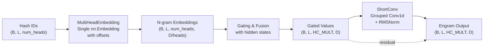
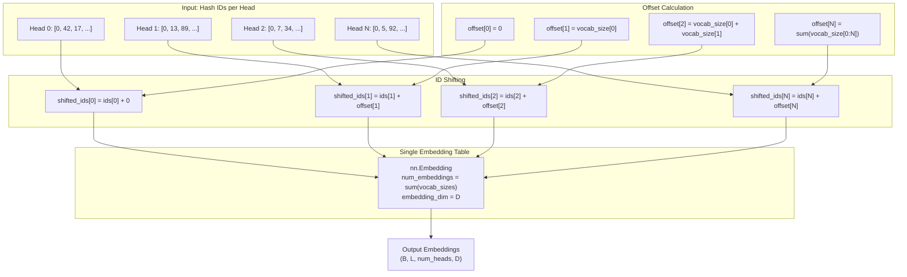
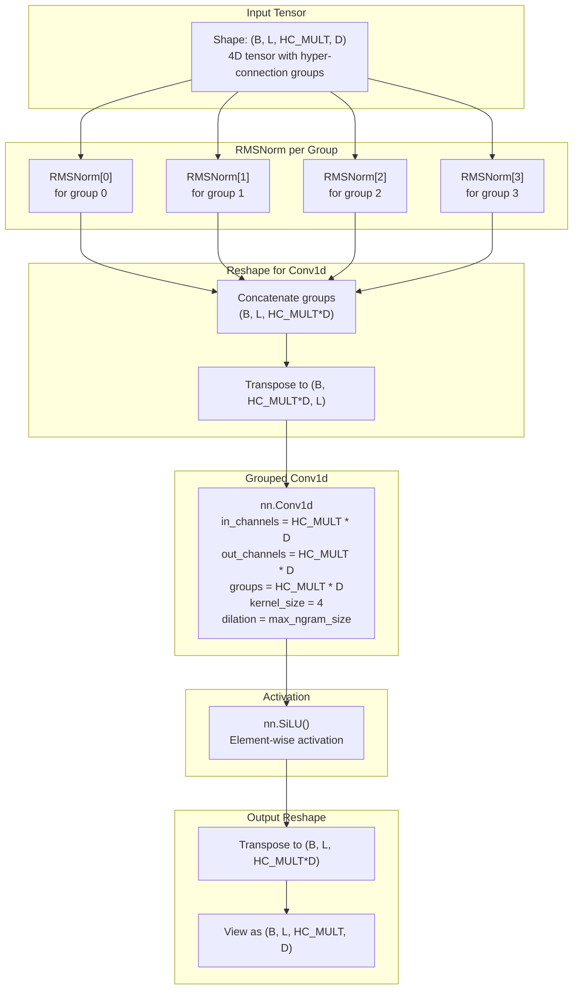
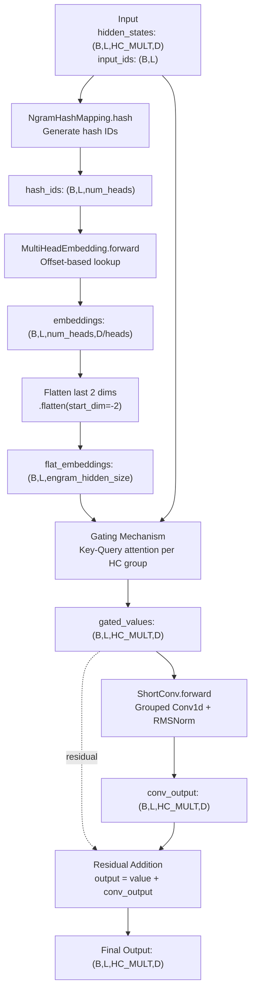

<!-- source: DeepWiki mcp.deepwiki.com · repo deepseek-ai/Engram · page 4.4 Multi-Head Embedding and ShortConv · fetched 2026-10-30 -->

# Multi-Head Embedding and ShortConv

<details>
<summary>Relevant source files</summary>

The following files were used as context for generating this wiki page:

- [drawio/Engram.drawio](drawio/Engram.drawio)
- [engram_demo_v1.py](engram_demo_v1.py)

</details>


## Purpose and Scope

This document explains two critical processing components in the Engram module: `MultiHeadEmbedding` and `ShortConv`. The `MultiHeadEmbedding` layer efficiently handles multiple vocabulary sizes (one per N-gram head) using a single embedding table with offset-based addressing. The `ShortConv` layer applies grouped 1D convolution to model local context dependencies across the sequence. For information about how N-gram hash addresses are generated, see [N-gram Hash Mapping](#4.2). For information about how these components integrate into the full Engram module, see [Engram Module Deep Dive](#3.2).

---

## Component Overview

The Engram module processes N-gram embeddings through two sequential stages after hash-based lookup:



**Sources:** [engram_demo_v1.py:305-378]()

---

## MultiHeadEmbedding: Unified Multi-Vocabulary Embedding

### Problem Statement

Each N-gram size (2-gram, 3-gram, etc.) and each head requires a different vocabulary size to minimize hash collisions. For example, with 2 N-gram sizes and 8 heads per N-gram, we need 16 separate vocabularies. Creating 16 separate `nn.Embedding` modules would be inefficient for memory management and parameter updates during training.

### Architecture and Implementation

The `MultiHeadEmbedding` class solves this by maintaining a single `nn.Embedding` table and using offset-based addressing to partition it into logical sub-vocabularies:



**Sources:** [engram_demo_v1.py:305-324]()

### Class Definition and Initialization

The `MultiHeadEmbedding` constructor accepts a list of vocabulary sizes and a shared embedding dimension:

| Parameter | Type | Description |
|-----------|------|-------------|
| `list_of_N` | `List[int]` | Vocabulary size for each head (e.g., `[646403, 646409, ...]` for prime moduli) |
| `D` | `int` | Embedding dimension per head (typically `n_embed_per_ngram // n_head_per_ngram`) |

The initialization process:

1. **Calculate offsets**: Cumulative sum of vocabulary sizes determines where each head's vocabulary starts in the unified table
2. **Register offset buffer**: Offsets stored as a non-learnable tensor buffer for efficient device placement
3. **Create unified embedding**: Single `nn.Embedding` with `num_embeddings = sum(list_of_N)` and `embedding_dim = D`

**Sources:** [engram_demo_v1.py:306-318]()

### Forward Pass Mechanics

The forward pass performs offset-based addressing in two steps:

```python
# Input: (B, L, num_heads) tensor of hash IDs
# self.offsets: (num_heads,) tensor registered as buffer

# Step 1: Broadcasting addition to shift IDs into correct vocabulary partition
shifted_input_ids = input_ids + self.offsets  # (B, L, num_heads)

# Step 2: Standard embedding lookup
output = self.embedding(shifted_input_ids)  # (B, L, num_heads, D)
```

The offset broadcasting ensures each head's IDs are mapped to non-overlapping ranges in the embedding table. For example:
- Head 0 IDs in range [0, vocab_size[0])
- Head 1 IDs in range [vocab_size[0], vocab_size[0] + vocab_size[1])
- Head 2 IDs in range [vocab_size[0] + vocab_size[1], vocab_size[0] + vocab_size[1] + vocab_size[2])

**Sources:** [engram_demo_v1.py:320-323]()

### Integration in Engram Module

The `MultiHeadEmbedding` is instantiated within the `Engram` module with vocabulary sizes derived from the `NgramHashMapping`:

```python
# Flatten all head vocabulary sizes across all N-gram types
list_of_N = [x for y in self.hash_mapping.vocab_size_across_layers[self.layer_id] for x in y]

# Create multi-head embedding with per-head dimension
self.multi_head_embedding = MultiHeadEmbedding(
    list_of_N=list_of_N,
    D=engram_cfg.n_embed_per_ngram // engram_cfg.n_head_per_ngram,
)
```

For a configuration with `max_ngram_size=3` (2-grams and 3-grams) and `n_head_per_ngram=8`, this creates 16 logical vocabularies managed by a single embedding table.

**Sources:** [engram_demo_v1.py:340-343](), [engram_demo_v1.py:363-364]()

---

## ShortConv: Grouped Convolution for Local Context

### Problem Statement

After gating and fusion with hidden states, the Engram module needs to model local temporal dependencies in the N-gram features. Standard attention mechanisms are computationally expensive for this purpose. The `ShortConv` layer provides an efficient alternative using grouped 1D convolution with dilated kernels.

### Architecture Components

The `ShortConv` layer consists of three primary components:



**Sources:** [engram_demo_v1.py:123-179]()

### Constructor Parameters

| Parameter | Type | Default | Description |
|-----------|------|---------|-------------|
| `hidden_size` | `int` | - | Base hidden dimension (D) |
| `kernel_size` | `int` | 4 | Convolution kernel size (local window) |
| `dilation` | `int` | 1 | Dilation rate (typically set to `max_ngram_size`) |
| `norm_eps` | `float` | 1e-5 | Epsilon for RMSNorm numerical stability |
| `hc_mult` | `int` | 4 | Hyper-connection multiplier (number of groups) |
| `activation` | `bool` | True | Whether to apply SiLU activation |

**Sources:** [engram_demo_v1.py:123-132]()

### Grouped Convolution Configuration

The key architectural choice is using **depthwise convolution** (also called grouped convolution with `groups=in_channels`):

```python
total_channels = hidden_size * hc_mult  # e.g., 1024 * 4 = 4096

self.conv = nn.Conv1d(
    in_channels=total_channels,      # 4096
    out_channels=total_channels,     # 4096
    kernel_size=kernel_size,         # 4
    groups=total_channels,           # 4096 (each channel operates independently)
    bias=False,
    padding=(kernel_size - 1) * dilation,  # Causal padding
    dilation=dilation,               # e.g., 3 for max_ngram_size=3
)
```

This configuration ensures:
- Each channel has its own 1D convolution kernel (no cross-channel mixing)
- Parameters scale linearly: `O(hidden_size * hc_mult * kernel_size)` instead of `O((hidden_size * hc_mult)^2 * kernel_size)`
- Local temporal patterns are captured independently per channel

**Sources:** [engram_demo_v1.py:137-146]()

### Forward Pass Algorithm

The forward pass processes the input through several transformations:

#### Step 1: Per-Group RMSNorm

```python
# Input shape: (B, L, HC_MULT, D)
# Extract and normalize each group independently
normed_chunks = []
for i in range(HC_MULT):
    chunk = x[:, :, i, :]  # (B, L, D)
    normed_chunks.append(self.norms[i](chunk))
```

This ensures each hyper-connection group maintains its own normalization statistics.

**Sources:** [engram_demo_v1.py:165-168]()

#### Step 2: Reshape for Conv1d

```python
# Concatenate along feature dimension
x_norm = torch.cat(normed_chunks, dim=-1)  # (B, L, HC_MULT*D)

# Transpose to (B, C, L) format expected by Conv1d
x_bct = x_norm.transpose(1, 2)  # (B, HC_MULT*D, L)
```

**Sources:** [engram_demo_v1.py:170-171]()

#### Step 3: Grouped Convolution with Causal Truncation

```python
y_bct = self.conv(x_bct)  # (B, HC_MULT*D, L+padding)

# Truncate to original sequence length (causal masking)
y_bct = y_bct[..., :T]  # (B, HC_MULT*D, L)
```

The padding applied during convolution is truncated to maintain causal structure (no future information leakage).

**Sources:** [engram_demo_v1.py:172-173]()

#### Step 4: Activation and Reshape

```python
if self.activation:
    y_bct = self.act_fn(y_bct)  # SiLU activation

# Transpose back to (B, L, HC_MULT*D) and view as grouped format
y = y_bct.transpose(1, 2).view(B, T, HC_MULT, D).contiguous()
# Output shape: (B, L, HC_MULT, D)
```

**Sources:** [engram_demo_v1.py:175-177]()

### Dilation for Multi-Scale Receptive Field

The `dilation` parameter is typically set to `max_ngram_size` to create a receptive field that matches the N-gram scale:

```
kernel_size = 4, dilation = 3:
Receptive field = (4 - 1) * 3 + 1 = 10 positions

This allows the convolution to capture dependencies across
the span covered by the largest N-gram (3-gram)
```

**Sources:** [engram_demo_v1.py:344-349]()

---

## Integration in the Engram Forward Pass

The `MultiHeadEmbedding` and `ShortConv` components are integrated in the `Engram` module's forward pass:



The critical code sequence in `Engram.forward`:

```python
# Step 1: Hash input_ids to get N-gram addresses
hash_input_ids = torch.from_numpy(self.hash_mapping.hash(input_ids)[self.layer_id])

# Step 2: MultiHeadEmbedding lookup
embeddings = self.multi_head_embedding(hash_input_ids).flatten(start_dim=-2)

# Step 3: Gating (compute per-HC-group gates using key-query attention)
gates = []
for hc_idx in range(hc_mult):
    key = self.key_projs[hc_idx](embeddings)
    normed_key = self.norm1[hc_idx](key)
    query = hidden_states[:,:,hc_idx,:]
    normed_query = self.norm2[hc_idx](query)
    gate = (normed_key * normed_query).sum(dim=-1) / math.sqrt(hidden_size)
    gate = gate.abs().clamp_min(1e-6).sqrt() * gate.sign()
    gate = gate.sigmoid().unsqueeze(-1)
    gates.append(gate)

gates = torch.stack(gates, dim=2)

# Step 4: Apply gates to value projection
value = gates * self.value_proj(embeddings).unsqueeze(2)

# Step 5: ShortConv with residual connection
output = value + self.short_conv(value)
```

**Sources:** [engram_demo_v1.py:358-378]()

---

## Configuration and Hyperparameters

The two components are configured through `EngramConfig` and `BackBoneConfig`:

| Parameter | Config Class | Usage | Typical Value |
|-----------|-------------|-------|---------------|
| `n_embed_per_ngram` | `EngramConfig` | Total embedding dimension for each N-gram type | 512 |
| `n_head_per_ngram` | `EngramConfig` | Number of heads per N-gram (affects `list_of_N` length) | 8 |
| `kernel_size` | `EngramConfig` | ShortConv kernel size | 4 |
| `hidden_size` | `BackBoneConfig` | Base hidden dimension (D) | 1024 |
| `hc_mult` | `BackBoneConfig` | Hyper-connection multiplier | 4 |
| `max_ngram_size` | `EngramConfig` | Used as dilation in ShortConv | 3 |

Derived dimensions:
- `MultiHeadEmbedding.D = n_embed_per_ngram // n_head_per_ngram` (e.g., 512 / 8 = 64)
- `ShortConv.total_channels = hidden_size * hc_mult` (e.g., 1024 * 4 = 4096)
- `engram_hidden_size = (max_ngram_size - 1) * n_embed_per_ngram` (e.g., 2 * 512 = 1024)

**Sources:** [engram_demo_v1.py:38-58](), [engram_demo_v1.py:340-351]()

---

## Memory and Computational Efficiency

### MultiHeadEmbedding Efficiency

The unified embedding table approach provides:

- **Memory savings**: Single allocation instead of `num_heads` separate tables reduces memory fragmentation
- **Training efficiency**: Single backward pass through one embedding layer rather than multiple independent layers
- **Cache locality**: Contiguous memory layout improves GPU cache utilization during lookup

Parameter count: `O(sum(vocab_sizes) * embedding_dim)`

Example: 16 heads with average vocabulary size 646,000 and dimension 64:
- Unified: ~661M parameters (16 * 646,000 * 64 / 1M)
- Separate: Same parameter count but higher overhead

**Sources:** [engram_demo_v1.py:305-324]()

### ShortConv Efficiency

The grouped (depthwise) convolution design provides:

- **Parameter efficiency**: `O(channels * kernel_size)` instead of `O(channels^2 * kernel_size)`
- **Computational efficiency**: No cross-channel mixing reduces FLOPs significantly
- **Parallelization**: Each group operates independently, enabling efficient GPU parallelization

Parameter count: `O(hidden_size * hc_mult * kernel_size)` plus RMSNorm parameters

Example: `hidden_size=1024, hc_mult=4, kernel_size=4`:
- Conv parameters: 16,384 (4096 channels * 4)
- RMSNorm parameters: 4,096 (4 groups * 1024)
- Total: ~20K parameters (vs millions for standard convolution)

**Sources:** [engram_demo_v1.py:123-179]()

---

## Summary

The `MultiHeadEmbedding` and `ShortConv` components provide efficient processing of N-gram features in the Engram module:

1. **MultiHeadEmbedding** unifies multiple vocabularies into a single embedding table using offset-based addressing, enabling efficient parameter management and training
2. **ShortConv** applies grouped 1D convolution with dilation to capture local temporal dependencies without the computational overhead of full attention
3. Together, they transform hash-addressed N-gram lookups into contextually-aware feature representations that augment the transformer's hidden states

**Sources:** [engram_demo_v1.py:123-179](), [engram_demo_v1.py:305-324](), [engram_demo_v1.py:326-378]()

---

