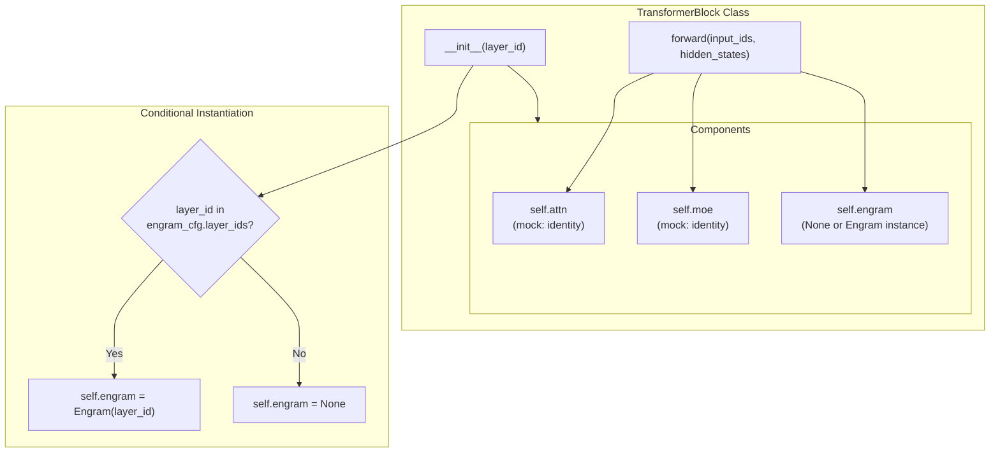
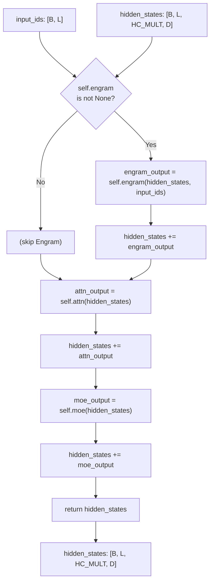
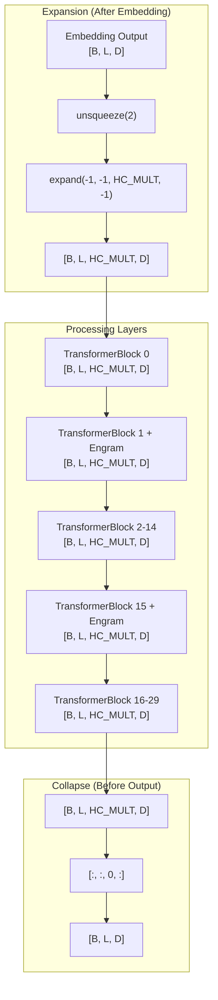
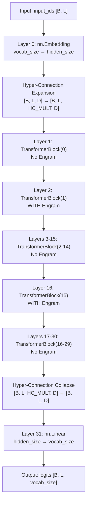
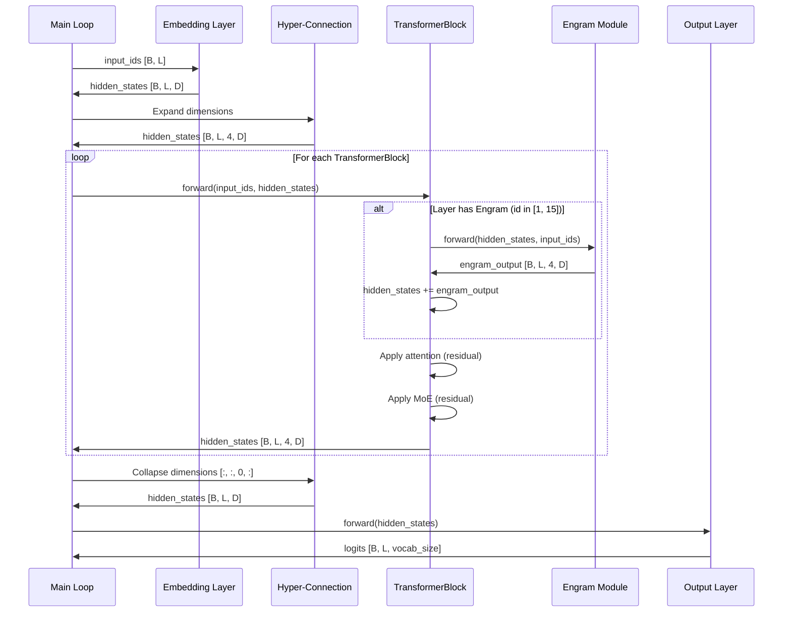

<!-- source: DeepWiki mcp.deepwiki.com · repo deepseek-ai/Engram · page 4.5 Transformer Block Integration · fetched 2026-10-30 -->

# Transformer Block Integration

<details>
<summary>Relevant source files</summary>

The following files were used as context for generating this wiki page:

- [drawio/Engram.drawio](drawio/Engram.drawio)
- [engram_demo_v1.py](engram_demo_v1.py)

</details>


## Purpose and Scope

This page explains how the Engram module is selectively integrated into specific transformer layers within the LLM backbone. It covers the `TransformerBlock` class architecture, the role of hyper-connections in managing multi-channel hidden states, and the complete model assembly process. For details on the internal workings of the Engram module itself, see [Engram Module Deep Dive](#3.2). For configuration parameters, see [Configuration Reference](#4.6).

## Overview

The Engram architecture does not replace the transformer backbone but augments it at strategic layers. The integration follows three key principles:

1. **Selective Placement**: Engram modules are inserted at specific layer indices only (default: layers 1 and 15)
2. **Conditional Execution**: TransformerBlocks conditionally instantiate and execute Engram based on layer ID
3. **Hyper-Connection Management**: Hidden states maintain multiple parallel channels (`hc_mult`) throughout the network

**Sources:** [engram_demo_v1.py:380-394](), [engram_demo_v1.py:51-54]()

## Selective Layer Placement

### Layer ID Configuration

Engram modules are instantiated only at layers specified in `EngramConfig.layer_ids`. The default configuration targets early and middle layers:

```python
layer_ids: List[int] = field(default_factory=lambda: [1, 15])
```

This strategic placement addresses different processing stages:

| Layer Position | Target Layer ID | Purpose |
|---------------|-----------------|---------|
| Early Layer | 1 | Capture local N-gram patterns immediately after token embedding |
| Middle Layer | 15 | Augment representations at mid-depth for complex pattern integration |

The selective placement preserves computational efficiency while maximizing the impact of static memory augmentation. Not all layers require N-gram lookup—most benefit from standard attention and MoE processing.

**Sources:** [engram_demo_v1.py:45](), [engram_demo_v1.py:386-387]()

## TransformerBlock Architecture

### Class Structure



**Diagram: TransformerBlock Component Structure**

The `TransformerBlock` class conditionally instantiates the Engram module during initialization:

```python
def __init__(self, layer_id):
    super().__init__()
    self.attn = lambda x: x  # Mock: Standard attention
    self.moe = lambda x: x   # Mock: MoE layers
    self.engram = None
    if layer_id in engram_cfg.layer_ids:
        self.engram = Engram(layer_id=layer_id)
```

This architecture allows the same `TransformerBlock` class to serve as both standard layers and Engram-augmented layers, simplifying model construction.

**Sources:** [engram_demo_v1.py:380-387]()

### Forward Pass Logic



**Diagram: TransformerBlock Forward Pass with Conditional Engram**

The forward pass executes three operations in sequence, each with residual connections:

1. **Engram (conditional)**: If present, augment with N-gram embeddings
2. **Attention**: Process with self-attention mechanism
3. **MoE**: Apply mixture-of-experts feed-forward layers

All residual additions preserve the shape `[B, L, HC_MULT, D]`, maintaining hyper-connection structure throughout.

**Sources:** [engram_demo_v1.py:389-394]()

## Hyper-Connection Mechanism

### Multi-Channel Hidden States

The `hc_mult` parameter controls the number of parallel processing channels maintained throughout the network. Hidden states have shape `[Batch, Length, HC_MULT, Hidden_Dim]`:

```python
hc_mult: int = 4  # Default: 4 parallel channels
```

| Parameter | Value | Tensor Dimension | Description |
|-----------|-------|------------------|-------------|
| Batch (B) | Variable | Dimension 0 | Batch size |
| Length (L) | Variable | Dimension 1 | Sequence length |
| HC_MULT (G) | 4 | Dimension 2 | Number of hyper-connection channels |
| Hidden_Dim (D) | 1024 | Dimension 3 | Hidden size per channel |

### Expansion and Collapse Operations



**Diagram: Hyper-Connection Expansion and Collapse**

The hyper-connection mechanism requires expansion after the embedding layer and collapse before the output projection:

**Expansion (after embedding):**
```python
hidden_states = LLM[0](input_ids)  # [B, L, D]
hidden_states = hidden_states.unsqueeze(2).expand(-1, -1, backbone_config.hc_mult, -1)
# Result: [B, L, 4, D]
```

**Collapse (before output projection):**
```python
hidden_states = hidden_states[:, :, 0, :]  # [B, L, D]
output = layer(hidden_states)  # [B, L, vocab_size]
```

Only the first channel is used for final prediction, but all channels contribute to learning through gradient flow during training.

**Sources:** [engram_demo_v1.py:412-417](), [engram_demo_v1.py:51-54]()

## Complete Model Assembly

### Layer-by-Layer Construction



**Diagram: Complete Model Assembly with Engram Integration**

The model is constructed as a sequential list of layers:

```python
LLM = [
    nn.Embedding(backbone_config.vocab_size, backbone_config.hidden_size),
    *[TransformerBlock(layer_id=layer_id) for layer_id in range(backbone_config.num_layers)],
    nn.Linear(backbone_config.hidden_size, backbone_config.vocab_size)
]
```

This architecture creates 32 total components:
- 1 embedding layer (index 0)
- 30 transformer blocks (indices 1-30), where blocks at indices 1 and 15 contain Engram modules
- 1 output projection layer (index 31)

**Sources:** [engram_demo_v1.py:397-401]()

### Forward Pass Implementation



**Diagram: End-to-End Forward Pass Sequence**

The forward pass iterates through layers with special handling for the first and last layers:

```python
for idx, layer in enumerate(LLM):
    if idx == 0:
        # Embedding + Hyper-connection expansion
        hidden_states = LLM[0](input_ids)
        hidden_states = hidden_states.unsqueeze(2).expand(-1, -1, backbone_config.hc_mult, -1)
    elif idx == len(LLM) - 1:
        # Hyper-connection collapse + Output projection
        hidden_states = hidden_states[:, :, 0, :]
        output = layer(hidden_states)
    else:
        # Standard TransformerBlock forward
        hidden_states = layer(input_ids=input_ids, hidden_states=hidden_states)
```

Each TransformerBlock receives both `input_ids` (for potential Engram hash computation) and `hidden_states` (for transformation), ensuring Engram modules have access to the original token sequence.

**Sources:** [engram_demo_v1.py:409-420]()

## Integration Benefits

The selective integration strategy provides several architectural advantages:

1. **Computational Efficiency**: Only 2 out of 30 layers perform N-gram lookups, minimizing overhead
2. **Modularity**: TransformerBlock class handles both standard and Engram-augmented layers uniformly
3. **Gradient Flow**: Residual connections ensure Engram contributions propagate through the network
4. **Flexibility**: Layer IDs can be adjusted without changing model architecture
5. **Hyper-Connection Compatibility**: Multi-channel design allows parallel feature processing

The integration preserves the core transformer backbone while augmenting it with conditional memory access at strategic points in the network.

**Sources:** [engram_demo_v1.py:380-394](), [engram_demo_v1.py:409-420]()

---

