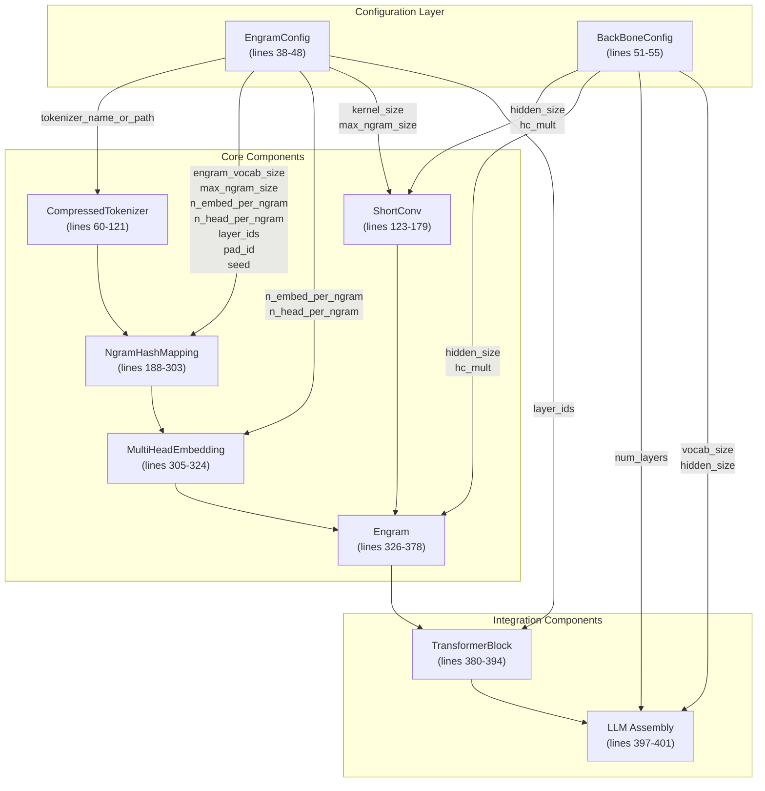
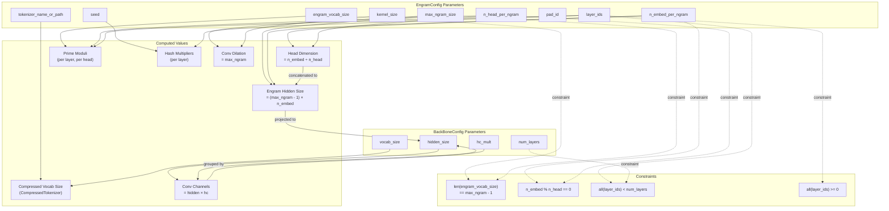

<!-- source: DeepWiki mcp.deepwiki.com · repo deepseek-ai/Engram · page 4.6 Configuration Reference · fetched 2026-10-30 -->

# Configuration Reference

<details>
<summary>Relevant source files</summary>

The following files were used as context for generating this wiki page:

- [README.md](README.md)
- [engram_demo_v1.py](engram_demo_v1.py)

</details>


This document provides a comprehensive reference for configuring the Engram system. It covers the two primary configuration dataclasses—`EngramConfig` and `BackBoneConfig`—that control the behavior of the Engram module and its integration with the transformer backbone. For implementation details of how these configurations are used in code, see [Transformer Block Integration](#4.5). For architectural context on how configuration choices affect system behavior, see [System Overview](#3.1).

**Sources:** [engram_demo_v1.py:38-58]()

---

## Configuration Classes Overview

The Engram system uses two separate configuration dataclasses to maintain clear separation of concerns between the conditional memory system and the transformer backbone.



**Sources:** [engram_demo_v1.py:38-58](), [engram_demo_v1.py:60-394]()

---

## EngramConfig Parameters

The `EngramConfig` dataclass controls all aspects of the conditional memory system, including N-gram vocabulary sizes, embedding dimensions, hash mapping behavior, and integration points with the transformer backbone.

### Parameter Reference Table

| Parameter | Type | Default | Description |
|-----------|------|---------|-------------|
| `tokenizer_name_or_path` | `str` | `"deepseek-ai/DeepSeek-V3"` | HuggingFace model identifier or local path for the tokenizer |
| `engram_vocab_size` | `List[int]` | `[129280*5, 129280*5]` | Vocabulary size for each N-gram order (2-gram, 3-gram, etc.) |
| `max_ngram_size` | `int` | `3` | Maximum N-gram length to consider (e.g., 3 means 2-grams and 3-grams) |
| `n_embed_per_ngram` | `int` | `512` | Total embedding dimension across all heads for each N-gram order |
| `n_head_per_ngram` | `int` | `8` | Number of attention heads per N-gram order |
| `layer_ids` | `List[int]` | `[1, 15]` | Transformer layer indices where Engram modules are inserted |
| `pad_id` | `int` | `2` | Token ID used for padding in N-gram construction |
| `seed` | `int` | `0` | Random seed for layer-specific hash function generation |
| `kernel_size` | `int` | `4` | Convolution kernel size for ShortConv processing |

**Sources:** [engram_demo_v1.py:38-48]()

---

### Detailed Parameter Explanations

#### tokenizer_name_or_path

Specifies the tokenizer used for vocabulary compression. The `CompressedTokenizer` (lines 60-121) loads this tokenizer and builds a lookup table that normalizes and deduplicates tokens, reducing the effective vocabulary size for more efficient N-gram hashing.

**Impact on system:** The compressed vocabulary size determines the input space for N-gram hash functions and affects collision probabilities in the hash mapping.

**Sources:** [engram_demo_v1.py:40](), [engram_demo_v1.py:60-121]()

---

#### engram_vocab_size

A list where each element specifies the vocabulary size for a corresponding N-gram order. The length of this list must equal `max_ngram_size - 1` (since N-grams start at order 2).

**Example:** `[129280*5, 129280*5]` provides vocabulary sizes for 2-grams and 3-grams respectively.

**Impact on system:** 
- Larger vocabulary sizes reduce hash collisions but increase memory requirements
- The `NgramHashMapping.calculate_vocab_size_across_layers()` method (lines 235-260) uses these values to find prime numbers for modulo operations, ensuring better hash distribution
- Each head within an N-gram order gets a unique prime modulus derived from this base vocabulary size

**Memory calculation:** Total embedding parameters = Σ(vocab_size[i] × n_head_per_ngram × embedding_dim_per_head) across all N-gram orders and layers.

**Sources:** [engram_demo_v1.py:41](), [engram_demo_v1.py:235-260]()

---

#### max_ngram_size

Defines the maximum N-gram order to construct. With `max_ngram_size = 3`, the system generates 2-grams and 3-grams.

**Impact on system:**
- Determines the number of shift operations in N-gram construction (lines 272-276)
- Controls the dilation parameter for ShortConv: `dilation = max_ngram_size` (line 347)
- Affects the total dimensionality of N-gram features: `engram_hidden_size = (max_ngram_size - 1) × n_embed_per_ngram` (line 350)

**Trade-offs:**
- Higher values capture longer-range patterns but increase computational cost
- N-gram orders beyond 3-4 typically show diminishing returns for most language modeling tasks

**Sources:** [engram_demo_v1.py:42](), [engram_demo_v1.py:272-296](), [engram_demo_v1.py:347](), [engram_demo_v1.py:350]()

---

#### n_embed_per_ngram

Total embedding dimension allocated to each N-gram order, distributed across all heads.

**Computation:** Each head receives `n_embed_per_ngram // n_head_per_ngram` dimensions (line 342).

**Example:** With `n_embed_per_ngram = 512` and `n_head_per_ngram = 8`, each head has 64 dimensions.

**Impact on system:**
- Larger values increase model capacity but require more memory
- This parameter is independent of the backbone's `hidden_size`, allowing flexible capacity allocation
- The concatenated N-gram embeddings are projected to `hidden_size` via `value_proj` (line 351)

**Sources:** [engram_demo_v1.py:43](), [engram_demo_v1.py:342](), [engram_demo_v1.py:350-351]()

---

#### n_head_per_ngram

Number of multi-head embeddings for each N-gram order. Each head uses a different prime modulus for hash collision reduction.

**Impact on system:**
- The `NgramHashMapping.calculate_vocab_size_across_layers()` method (lines 235-260) finds unique prime numbers for each head
- Multiple heads provide ensemble-like behavior, reducing the impact of individual hash collisions
- Each head's embeddings are concatenated before projection (line 364)

**Trade-offs:**
- More heads → better hash distribution but higher memory usage
- Typical values range from 4 to 16

**Sources:** [engram_demo_v1.py:44](), [engram_demo_v1.py:235-260](), [engram_demo_v1.py:364]()

---

#### layer_ids

List of transformer layer indices where Engram modules are instantiated. Strategic placement is critical for performance.

**Default:** `[1, 15]` places Engram in early (layer 1) and middle (layer 15) layers.

**Impact on system:**
- Each layer ID triggers conditional instantiation in `TransformerBlock` (lines 386-387)
- Each layer uses layer-specific hash multipliers generated via `layer_multipliers` (lines 219-231)
- Layer-specific hashing ensures different layers capture different patterns

**Design rationale (from paper):**
- Early layers: Relieves static pattern reconstruction burden
- Middle layers: Augments contextual representation building
- Late layers typically omitted: Focus on output distribution modeling

**Sources:** [engram_demo_v1.py:45](), [engram_demo_v1.py:219-231](), [engram_demo_v1.py:386-387]()

---

#### pad_id

Token ID used for padding when constructing N-grams at sequence boundaries. This is compressed through the `CompressedTokenizer` lookup table (line 212).

**Example:** At position 0, a 3-gram requires tokens at positions [-2, -1, 0]. Positions -2 and -1 are filled with `pad_id`.

**Impact on system:**
- The `shift_k()` function (lines 272-276) uses this value for padding
- Incorrect pad_id can cause boundary tokens to have invalid N-gram representations

**Sources:** [engram_demo_v1.py:46](), [engram_demo_v1.py:211-212](), [engram_demo_v1.py:272-276]()

---

#### seed

Random seed for generating layer-specific hash multipliers. Combined with layer index and a prime constant (PRIME_1 = 10007) to create unique random states per layer (line 222).

**Impact on system:**
- Ensures reproducible hash functions across runs
- Different layers get different multipliers even with the same seed
- Changing seed alters hash distributions, affecting which N-grams collide

**Sources:** [engram_demo_v1.py:47](), [engram_demo_v1.py:218-231]()

---

#### kernel_size

Convolution kernel size for the `ShortConv` module, which applies grouped 1D convolution to N-gram features.

**Impact on system:**
- Controls local context window: `kernel_size = 4` means each position sees 4 tokens
- Padding is computed as `(kernel_size - 1) × dilation` (line 144)
- Larger kernels capture more local context but increase computation

**Sources:** [engram_demo_v1.py:48](), [engram_demo_v1.py:123-179](), [engram_demo_v1.py:144]()

---

## BackBoneConfig Parameters

The `BackBoneConfig` dataclass controls the transformer backbone architecture and its integration points with Engram.

### Parameter Reference Table

| Parameter | Type | Default | Description |
|-----------|------|---------|-------------|
| `hidden_size` | `int` | `1024` | Hidden dimension of the transformer backbone |
| `hc_mult` | `int` | `4` | Hyper-connection multiplier (number of parallel representation streams) |
| `vocab_size` | `int` | `129280` | Vocabulary size for the main embedding layer |
| `num_layers` | `int` | `30` | Total number of transformer layers |

**Sources:** [engram_demo_v1.py:51-55]()

---

### Detailed Parameter Explanations

#### hidden_size

The hidden dimension used throughout the transformer backbone. This is the target dimension for all Engram projections.

**Impact on system:**
- Engram's `value_proj` projects from `engram_hidden_size` to `hidden_size` (line 351)
- Each `key_proj` in the gating mechanism projects to `hidden_size` (line 353)
- ShortConv operates on channels of size `hidden_size` (line 345)
- The attention mechanism in gating divides by `sqrt(hidden_size)` for scaling (line 371)

**Sources:** [engram_demo_v1.py:52](), [engram_demo_v1.py:345](), [engram_demo_v1.py:351](), [engram_demo_v1.py:353](), [engram_demo_v1.py:371]()

---

#### hc_mult

Hyper-connection multiplier representing the number of parallel processing streams in the architecture. This implements a form of multi-path processing.

**Impact on system:**
- Hidden states have shape `[B, L, hc_mult, hidden_size]` (line 360)
- Each hyper-connection stream has independent gating (lines 366-374)
- ShortConv processes all streams with grouped convolution (lines 123-179)
- Each stream has its own RMSNorm instances in both Engram and ShortConv

**Implementation details:**
- Engram creates `hc_mult` key projections (line 353)
- Engram creates `hc_mult` normalization layers (lines 355-356)
- ShortConv creates `hc_mult` normalization layers (lines 148-151)
- The demo mocks hyper-connection expansion/reduction (lines 413, 416)

**Sources:** [engram_demo_v1.py:53](), [engram_demo_v1.py:148-151](), [engram_demo_v1.py:352-356](), [engram_demo_v1.py:366-374](), [engram_demo_v1.py:413](), [engram_demo_v1.py:416]()

---

#### vocab_size

The vocabulary size for the main token embedding layer. This is separate from `engram_vocab_size` and represents the raw tokenizer vocabulary.

**Impact on system:**
- Used for the main embedding layer initialization (line 398)
- Used for the output projection head (line 400)
- The `CompressedTokenizer` reduces this to a smaller effective vocabulary

**Note:** This is the uncompressed vocabulary size. The actual N-gram hash space uses the compressed vocabulary from `CompressedTokenizer`.

**Sources:** [engram_demo_v1.py:54](), [engram_demo_v1.py:398](), [engram_demo_v1.py:400]()

---

#### num_layers

Total number of transformer layers in the model, including both standard layers and Engram-augmented layers.

**Impact on system:**
- Controls the loop creating `TransformerBlock` instances (line 399)
- Determines valid values for `layer_ids` (must be in range [0, num_layers))
- Affects the effective depth available for reasoning after Engram augmentation

**Sources:** [engram_demo_v1.py:55](), [engram_demo_v1.py:399]()

---

## Parameter Interactions and Dependencies

The configuration parameters interact in complex ways. This diagram illustrates the key dependencies and constraint relationships.



**Sources:** [engram_demo_v1.py:38-58](), [engram_demo_v1.py:60-378]()

---

## Configuration Validation and Constraints

Several implicit constraints must be satisfied for the system to function correctly:

### Hard Constraints

1. **Vocabulary size list length:**
   ```
   len(engram_vocab_size) == max_ngram_size - 1
   ```
   The list must have one entry per N-gram order (2-gram, 3-gram, ...).

2. **Embedding divisibility:**
   ```
   n_embed_per_ngram % n_head_per_ngram == 0
   ```
   Each head must receive an integer number of dimensions (line 342).

3. **Layer ID validity:**
   ```
   all(0 <= layer_id < num_layers for layer_id in layer_ids)
   ```
   Layer IDs must be valid indices into the transformer stack.

4. **Non-empty layer list:**
   ```
   len(layer_ids) > 0
   ```
   At least one Engram module must be instantiated for the system to function.

**Sources:** [engram_demo_v1.py:41-42](), [engram_demo_v1.py:342](), [engram_demo_v1.py:386-387]()

---

### Soft Constraints and Best Practices

1. **Layer placement strategy:**
   - Include at least one early layer (e.g., layer 1) to relieve static pattern reconstruction
   - Include at least one middle layer (e.g., layer 15) for contextual augmentation
   - Avoid placing Engram in the final layers (preserve capacity for output modeling)

2. **Vocabulary size scaling:**
   - Larger models benefit from larger `engram_vocab_size` (reduced collisions)
   - Rule of thumb: `engram_vocab_size[i] ≈ compressed_vocab_size × multiplier` where multiplier ∈ [3, 10]

3. **Hyper-connection multiplier:**
   - Typical values: `hc_mult ∈ {2, 4, 8}`
   - Higher values increase capacity but also memory and computation

4. **N-gram order:**
   - `max_ngram_size = 3` is a strong baseline (2-grams and 3-grams)
   - Values beyond 4 show diminishing returns for most tasks

**Sources:** [engram_demo_v1.py:45](), [README.md:36-40]()

---

## Configuration Examples

### Small-Scale Development Configuration

For rapid prototyping and debugging:

```python
from dataclasses import dataclass, field
from typing import List

@dataclass
class EngramConfig:
    tokenizer_name_or_path: str = "deepseek-ai/DeepSeek-V3"
    engram_vocab_size: List[int] = field(default_factory=lambda: [50000, 50000])
    max_ngram_size: int = 3
    n_embed_per_ngram: int = 256
    n_head_per_ngram: int = 4
    layer_ids: List[int] = field(default_factory=lambda: [1, 7])
    pad_id: int = 2
    seed: int = 42
    kernel_size: int = 4

@dataclass
class BackBoneConfig:
    hidden_size: int = 512
    hc_mult: int = 2
    vocab_size: int = 129280
    num_layers: int = 12
```

**Characteristics:**
- Reduced embedding dimensions for faster iteration
- Fewer heads and smaller N-gram vocabularies
- Shallow backbone with only 2 Engram layers
- Total parameters significantly reduced

**Sources:** [engram_demo_v1.py:38-58]()

---

### Production-Scale Configuration

For large-scale pre-training (matching the paper's setup):

```python
@dataclass
class EngramConfig:
    tokenizer_name_or_path: str = "deepseek-ai/DeepSeek-V3"
    engram_vocab_size: List[int] = field(default_factory=lambda: [129280*5, 129280*5])
    max_ngram_size: int = 3
    n_embed_per_ngram: int = 512
    n_head_per_ngram: int = 8
    layer_ids: List[int] = field(default_factory=lambda: [1, 15])
    pad_id: int = 2
    seed: int = 0
    kernel_size: int = 4

@dataclass
class BackBoneConfig:
    hidden_size: int = 1024
    hc_mult: int = 4
    vocab_size: int = 129280
    num_layers: int = 30
```

**Characteristics:**
- Large N-gram vocabularies (646,400 per order) for minimal collisions
- Strategic layer placement at depths 1 and 15
- Full hyper-connection multiplicity (4 streams)
- 30-layer backbone for complex reasoning

**Sources:** [engram_demo_v1.py:38-58](), [README.md:36-40]()

---

### Long-Context Specialized Configuration

For tasks requiring extended context handling:

```python
@dataclass
class EngramConfig:
    tokenizer_name_or_path: str = "deepseek-ai/DeepSeek-V3"
    engram_vocab_size: List[int] = field(default_factory=lambda: [200000, 200000, 150000])
    max_ngram_size: int = 4  # Include 4-grams for longer patterns
    n_embed_per_ngram: int = 512
    n_head_per_ngram: int = 8
    layer_ids: List[int] = field(default_factory=lambda: [1, 10, 20])
    pad_id: int = 2
    seed: int = 0
    kernel_size: int = 6  # Larger kernel for longer-range local context

@dataclass
class BackBoneConfig:
    hidden_size: int = 1024
    hc_mult: int = 4
    vocab_size: int = 129280
    num_layers: int = 30
```

**Characteristics:**
- Extended N-gram orders (up to 4-grams) for longer-range patterns
- Three Engram insertion points distributed across depth
- Larger ShortConv kernel for broader local context
- Increased N-gram vocabularies to handle longer sequences without collisions

**Sources:** [engram_demo_v1.py:38-58](), [README.md:67-70]()

---

## Instantiation and Usage Pattern

The configuration objects are instantiated as module-level globals in the demo implementation:

```python
engram_cfg = EngramConfig()  # Line 57
backbone_config = BackBoneConfig()  # Line 58
```

These configurations are then accessed by various components:

| Component | Configuration Access | Lines |
|-----------|---------------------|-------|
| `NgramHashMapping.__init__` | `engram_cfg` members | 330-339 |
| `MultiHeadEmbedding.__init__` | Computed from `engram_cfg` | 340-343 |
| `ShortConv.__init__` | `backbone_config.hidden_size`, `backbone_config.hc_mult`, `engram_cfg.kernel_size` | 344-349 |
| `Engram.__init__` | Both configs | 327-378 |
| `TransformerBlock.__init__` | `engram_cfg.layer_ids` | 386-387 |
| LLM assembly | `backbone_config.vocab_size`, `backbone_config.num_layers` | 397-401 |

**Pattern:** The demo uses global configuration objects for simplicity. Production implementations should use dependency injection or configuration management systems.

**Sources:** [engram_demo_v1.py:57-58](), [engram_demo_v1.py:327-401]()

---

## Memory and Computational Cost Estimation

Understanding the resource implications of configuration choices is critical for deployment planning.

### Embedding Table Size

Total N-gram embedding parameters:

```
total_params = Σ (for each layer in layer_ids)
                 Σ (for each N-gram order from 2 to max_ngram_size)
                   engram_vocab_size[ngram-2] × n_head_per_ngram × (n_embed_per_ngram // n_head_per_ngram)
```

**Default configuration calculation:**
- 2 layers × 2 N-gram orders × 646,400 vocab × 8 heads × 64 dims = 1,319,116,800 parameters (~5.0 GB at fp32)

**Key factor:** Multiple layers with Engram share hash functions but maintain separate embedding tables, multiplying memory requirements.

**Sources:** [engram_demo_v1.py:41-45](), [engram_demo_v1.py:305-324]()

---

### Computational Overhead Per Token

Per Engram layer, per token:

1. **N-gram hashing:** O(max_ngram_size) XOR operations
2. **Embedding lookup:** (max_ngram_size - 1) × n_head_per_ngram lookups
3. **Projection:** (max_ngram_size - 1) × n_embed_per_ngram × hidden_size FLOPs
4. **Gating:** hc_mult × (2 × hidden_size) FLOPs (key-query dot products)
5. **ShortConv:** kernel_size × hc_mult × hidden_size × sequence_length FLOPs

**Dominant cost:** Projections and convolution. Hash computation is negligible.

**Sources:** [engram_demo_v1.py:262-303](), [engram_demo_v1.py:358-378]()

---

## Modifying Configurations Safely

When modifying configurations, follow this checklist:

1. **Validate constraints:**
   - Check `len(engram_vocab_size) == max_ngram_size - 1`
   - Ensure `n_embed_per_ngram % n_head_per_ngram == 0`
   - Verify all `layer_ids` are valid

2. **Consider memory implications:**
   - Estimate embedding table size before training
   - Plan for host memory offloading if tables exceed device memory

3. **Maintain checkpoint compatibility:**
   - Changing `n_embed_per_ngram`, `n_head_per_ngram`, or `layer_ids` breaks checkpoint compatibility
   - Changing `seed` creates different hash functions (incompatible embeddings)

4. **Test incrementally:**
   - Start with a small configuration to verify correctness
   - Scale up gradually while monitoring memory and performance

5. **Document changes:**
   - Record all non-default configuration values
   - Track performance metrics for each configuration variant

**Sources:** [engram_demo_v1.py:38-58]()

---

## Related Configuration Topics

- For implementation details of how configurations affect N-gram hashing, see [N-gram Hash Mapping](#4.2)
- For understanding how `layer_ids` determines integration points, see [Transformer Block Integration](#4.5)
- For memory hierarchy implications of large `engram_vocab_size`, see [Memory Hierarchy and Offloading](#3.4)
- For empirical guidance on capacity allocation between MoE and Engram, see [Sparsity Allocation and U-shaped Scaling Law](#2.3)

**Sources:** [engram_demo_v1.py:1-423](), [README.md:1-97]()

---

