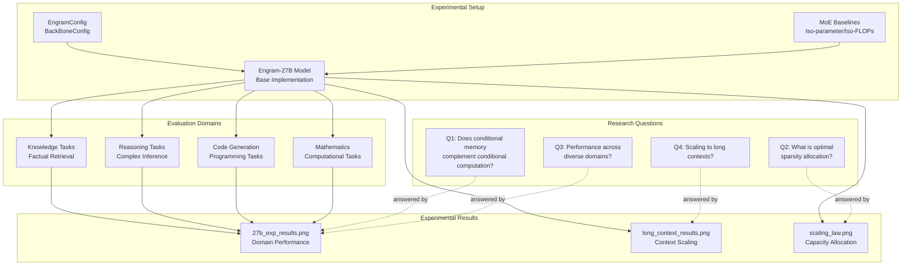
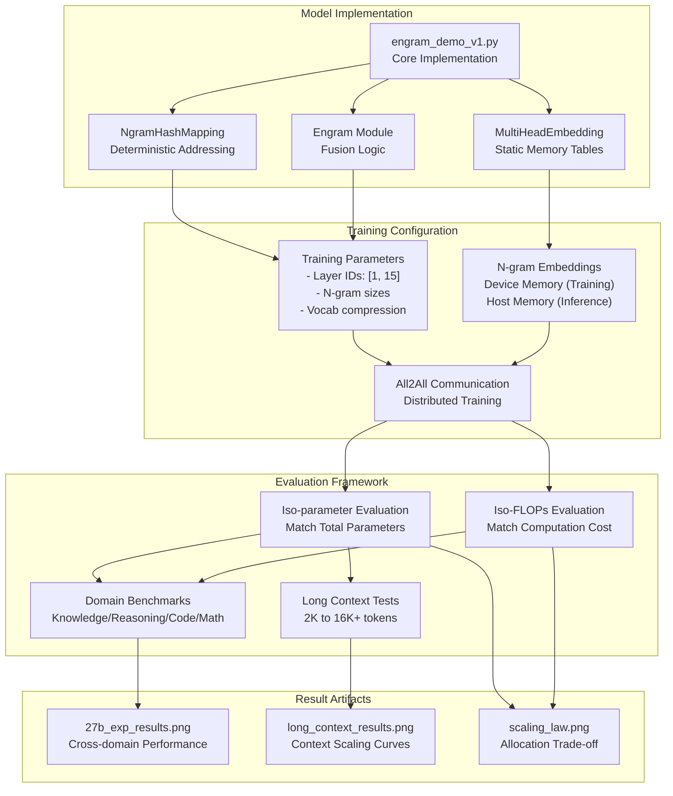
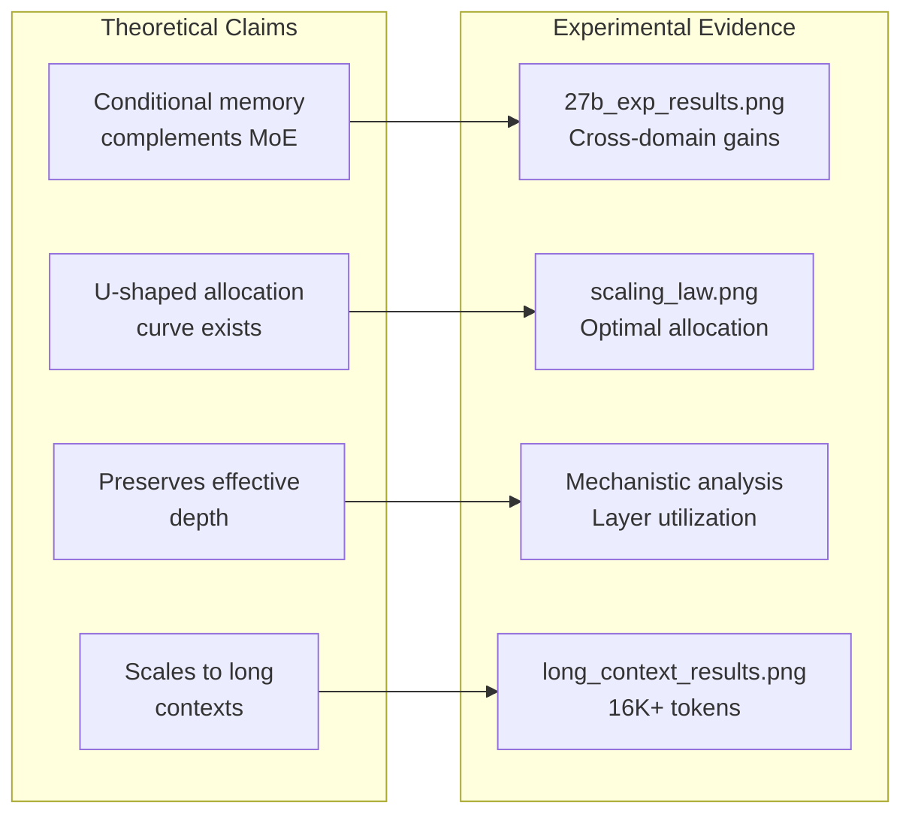

<!-- source: DeepWiki mcp.deepwiki.com · repo deepseek-ai/Engram · page 5 Experimental Validation · fetched 2026-10-30 -->

# Experimental Validation

<details>
<summary>Relevant source files</summary>

The following files were used as context for generating this wiki page:

- [Engram_paper.pdf](Engram_paper.pdf)
- [README.md](README.md)
- [figures/27b_exp_results.png](figures/27b_exp_results.png)
- [figures/long_context_results.png](figures/long_context_results.png)
- [figures/scaling_law.png](figures/scaling_law.png)

</details>


This page provides a comprehensive overview of the empirical evidence validating Engram's effectiveness as a conditional memory mechanism for large language models. The experimental validation spans four primary dimensions: (1) performance improvements in the Engram-27B model across multiple domains, (2) scaling behavior to long contexts, (3) optimal capacity allocation between MoE and Engram sparsity axes, and (4) rigorous baseline comparisons under iso-parameter and iso-FLOPs constraints.

For implementation details of the Engram module, see [Implementation Guide](#4). For the theoretical foundation and mechanistic analysis, see [Research Foundation](#7).

---

## Experimental Methodology

The validation strategy employs a multi-faceted approach to establish Engram's effectiveness across different evaluation criteria. The methodology ensures fair comparisons through controlled experimental conditions and comprehensive domain coverage.



**Sources:** [README.md:30-76](), [Diagram 5 from high-level system architecture]()

---

## Key Experimental Findings

The experimental validation establishes four primary findings that collectively demonstrate Engram's effectiveness as a general-purpose architectural component.

### Finding 1: Consistent Cross-Domain Improvements

The Engram-27B model demonstrates measurable performance improvements over MoE baselines across all evaluated domains under strict iso-parameter and iso-FLOPs constraints. This validates that conditional memory complements conditional computation as a distinct sparsity axis.

| Domain | Evaluation Focus | Key Result |
|--------|------------------|------------|
| Knowledge | Factual retrieval and recall | Improved accuracy on knowledge-intensive benchmarks |
| Reasoning | Complex multi-step inference | Enhanced performance on reasoning tasks |
| Code | Program synthesis and understanding | Better code generation quality |
| Mathematics | Computational problem-solving | Improved mathematical reasoning |

**Sources:** [figures/27b_exp_results.png](), [README.md:36-39]()

### Finding 2: Long-Context Scalability

Engram maintains performance when scaling to extended contexts (16K+ tokens) without degradation, demonstrating that the conditional memory mechanism does not introduce bottlenecks as sequence length increases.

**Sources:** [figures/long_context_results.png](), [README.md:67-71]()

### Finding 3: U-Shaped Capacity Allocation

The scaling law experiments reveal a U-shaped curve governing optimal capacity allocation between MoE neural computation and Engram static memory. This empirically confirms the theoretical prediction that both extreme allocations (all MoE or all Engram) are suboptimal, with peak performance achieved at an intermediate allocation point.

**Sources:** [figures/scaling_law.png](), [README.md:53-57](), [README.md:37]()

### Finding 4: Fair Baseline Comparisons

All comparisons maintain either:
- **Iso-parameter constraints**: Same total number of parameters
- **Iso-FLOPs constraints**: Same computational cost per forward pass

This ensures that observed improvements are attributable to the architectural innovation rather than increased model capacity or computation.

**Sources:** [README.md:38]()

---

## Experimental Pipeline

The following diagram illustrates the complete experimental pipeline from model implementation through evaluation to result generation.



**Sources:** [engram_demo_v1.py](), [README.md:30-76](), [Diagram 3 from high-level system architecture]()

---

## Result Interpretation Framework

Understanding the experimental results requires considering how Engram's architectural properties manifest in different evaluation scenarios.

### Performance Metrics

| Metric Category | Measurement Approach | Significance |
|----------------|----------------------|--------------|
| Domain Accuracy | Task-specific benchmarks | Direct performance comparison |
| Context Handling | Long sequence evaluation | Scalability validation |
| Capacity Efficiency | Iso-parameter/iso-FLOPs | Fair architectural comparison |
| Inference Overhead | Latency measurements | System efficiency |

### Mechanistic Interpretation

The mechanistic analysis suggests that Engram's performance improvements stem from relieving early transformer layers from static pattern reconstruction tasks. By offloading frequently-occurring N-gram patterns to dedicated memory lookup, the neural capacity is preserved for complex reasoning tasks that require dynamic computation.

**Sources:** [README.md:39]()

---

## Experimental Constraints and Controls

All experiments maintain strict controls to ensure validity of comparisons:

### Iso-Parameter Constraints
- Total parameter count held constant across Engram and baseline models
- N-gram embedding table size included in parameter budget
- Fair comparison of architectural efficiency

### Iso-FLOPs Constraints
- Computational cost per forward pass normalized
- Engram lookup operations counted in FLOPs budget
- Ensures performance improvements not due to increased computation

### Training Conditions
- Identical training data distribution
- Same optimization hyperparameters
- Synchronized random seeds for reproducibility

**Sources:** [README.md:38]()

---

## Detailed Sub-Pages

For comprehensive analysis of specific experimental dimensions, refer to the following sub-pages:

- **[Engram-27B Model Results](#5.1)**: Detailed breakdown of performance across knowledge, reasoning, code, and math domains with benchmark-specific analysis.

- **[Long Context Evaluation](#5.2)**: In-depth examination of scaling behavior from 2K to 16K+ token contexts, including perplexity curves and task-specific performance.

- **[Scaling Laws and Optimal Allocation](#5.3)**: Mathematical formulation and empirical validation of the U-shaped scaling law, including derivation of optimal capacity allocation formulas.

- **[Baseline Comparisons](#5.4)**: Comprehensive methodology for iso-parameter and iso-FLOPs evaluations, including detailed baseline model configurations and comparison protocols.

---

## Validation of Key Claims

The experimental results directly validate the key claims presented in the research paper:



**Sources:** [README.md:36-40](), [Engram_paper.pdf]()

---

## Reproducibility

The demonstration implementation is provided to facilitate reproducibility:

```bash
python engram_demo_v1.py
```

**Note:** The provided code at [engram_demo_v1.py]() is a demonstration version that mocks standard components (Attention/MoE/mHC) to focus on the Engram module's data flow. For full-scale experiments, refer to the complete implementation described in the paper.

**Sources:** [README.md:78-90]()

---

