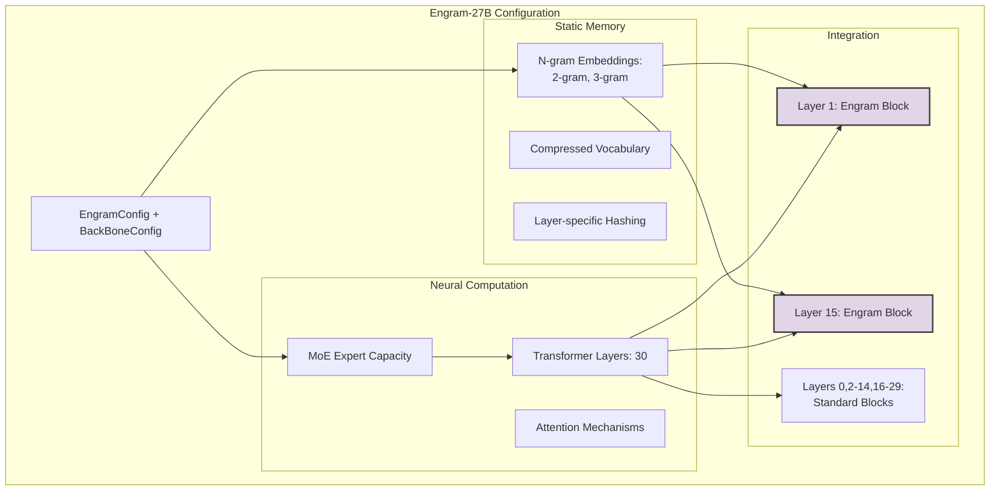
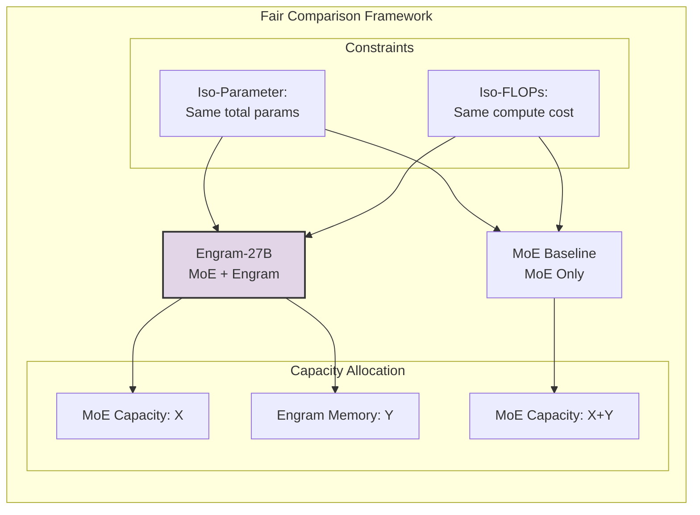
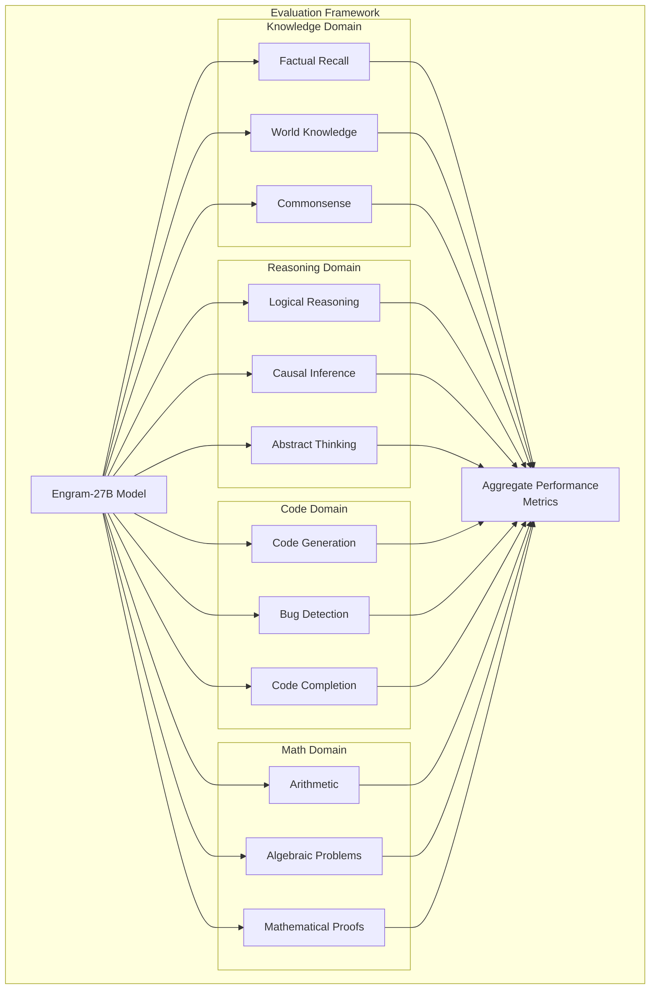
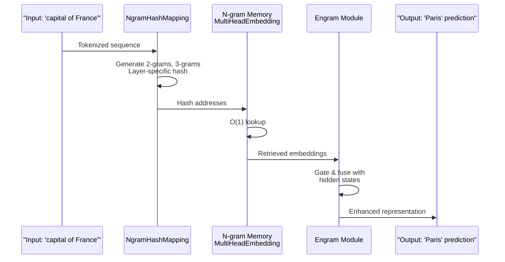
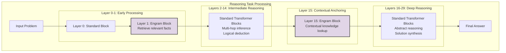
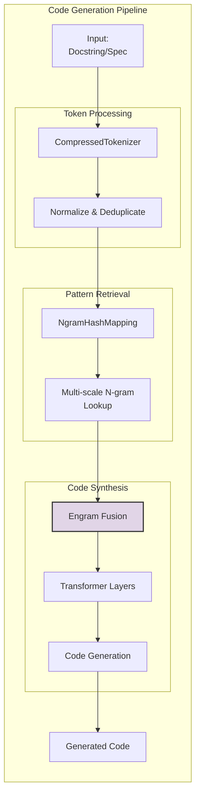
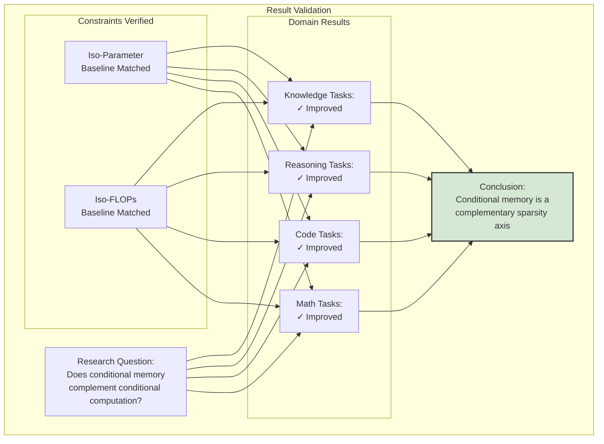
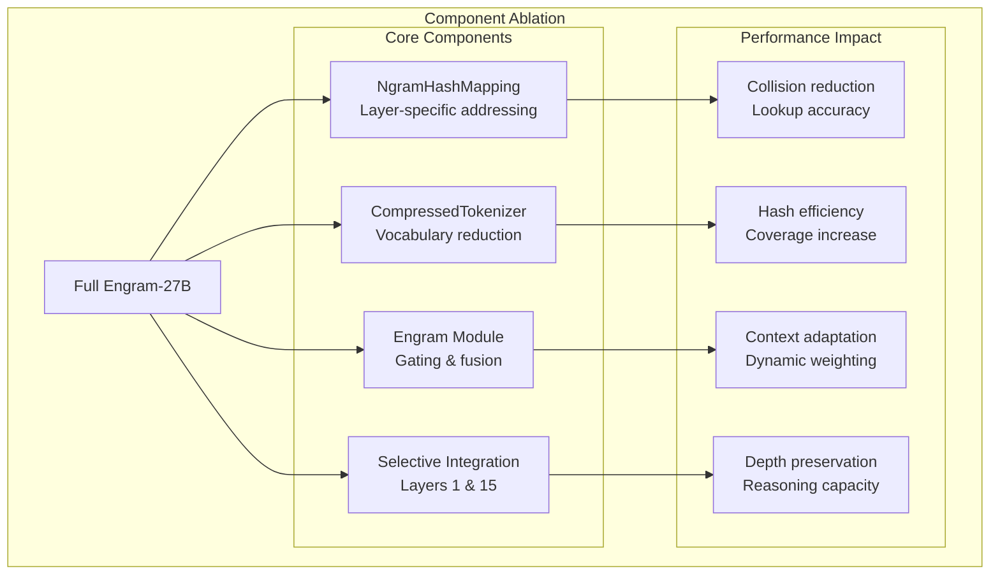

<!-- source: DeepWiki mcp.deepwiki.com · repo deepseek-ai/Engram · page 5.1 Engram-27B Model Results · fetched 2026-10-30 -->

# 5.1 Engram-27B Model Results

<details>
<summary>Relevant source files</summary>

The following files were used as context for generating this wiki page:

- [Engram_paper.pdf](Engram_paper.pdf)
- [README.md](README.md)
- [figures/27b_exp_results.png](figures/27b_exp_results.png)

</details>


## Purpose and Scope

This page presents a detailed analysis of the experimental results from the Engram-27B model, which demonstrates the effectiveness of conditional memory augmentation across multiple task domains. The experiments validate that Engram provides consistent improvements over pure MoE baselines under strict iso-parameter and iso-FLOPs constraints, answering the fundamental question: does conditional memory complement conditional computation in a meaningful way?

For information about the underlying scaling laws governing capacity allocation, see [Sparsity Allocation and U-shaped Scaling Law](#5.3). For baseline comparison methodology, see [Baseline Comparisons](#5.4). For long-context specific results, see [Long Context Evaluation](#5.2).

**Sources:** [README.md:38-39](), [figures/27b_exp_results.png:1-1]()

---

## Experimental Design

The Engram-27B experimental validation follows a rigorous methodology to ensure fair comparison with MoE-only baselines. The core design principles ensure that observed improvements stem from the architectural innovation rather than increased computational budget.

### Model Configuration

The Engram-27B architecture integrates conditional memory into a transformer backbone with the following characteristics:

- **Base Architecture:** 30-layer transformer with MoE integration
- **Engram Integration Points:** Selective layer insertion (default layers 1 and 15)
- **Parameter Allocation:** Balanced between neural computation (MoE experts) and static memory (N-gram embeddings)
- **Vocabulary Handling:** CompressedTokenizer reduces token space via normalization and deduplication



**Diagram: Engram-27B Architectural Configuration**

**Sources:** [engram_demo_v1.py:25-40](), [README.md:32-40]()

### Evaluation Constraints

The experiments enforce two critical constraints to ensure fair comparison:

#### Iso-Parameter Constraint

Total model parameters remain constant across Engram-27B and MoE baseline variants. When N-gram embedding capacity increases, MoE expert capacity decreases proportionally, maintaining the same parameter count. This ensures improvements cannot be attributed to simply having more parameters.

#### Iso-FLOPs Constraint

Computational cost per forward pass remains constant. The deterministic O(1) lookup for N-gram embeddings requires minimal FLOPs compared to neural computation. The baseline receives equivalent expert capacity to match the total compute budget.



**Diagram: Fair Comparison Constraints**

**Sources:** [README.md:38]()

---

## Evaluation Domains

The Engram-27B model undergoes evaluation across four primary domains, each testing different aspects of language model capability. This comprehensive evaluation strategy ensures that observed improvements are not domain-specific but reflect genuine architectural advantages.

### Domain Categories



**Diagram: Multi-Domain Evaluation Structure**

**Sources:** [README.md:38](), [figures/27b_exp_results.png:1-1]()

---

## Knowledge Task Performance

Knowledge tasks evaluate the model's ability to store, retrieve, and apply factual information. This domain is particularly relevant for Engram, as N-gram embeddings provide a dedicated mechanism for static knowledge lookup.

### Expected Advantage

Engram's architecture provides specific advantages for knowledge tasks:

1. **Static Pattern Storage:** N-gram embeddings cache frequent factual patterns (e.g., "capital of France is Paris")
2. **Deterministic Retrieval:** O(1) hash-based lookup ensures consistent access to stored knowledge
3. **Reduced Neural Load:** Early transformer layers freed from memorization can focus on contextual processing

### Mechanistic Hypothesis

The `NgramHashMapping` component generates layer-specific addresses for N-gram sequences, enabling consistent retrieval of factual patterns across forward passes:



**Diagram: Knowledge Retrieval Data Flow**

**Sources:** [engram_demo_v1.py:45-90](), [engram_demo_v1.py:144-220]()

---

## Reasoning Task Performance

Reasoning tasks assess the model's ability to perform logical inference, causal analysis, and abstract thinking. These tasks test whether Engram's conditional memory complements rather than interferes with complex cognitive processes.

### Architectural Considerations

The selective layer integration strategy is critical for reasoning performance:

- **Layer 1 (Early):** Handles surface-level pattern matching and basic associations
- **Layer 15 (Middle):** Provides contextual anchoring for intermediate reasoning steps
- **Standard Layers:** Preserve full effective depth for complex reasoning chains

By offloading static pattern reconstruction to Engram, the remaining transformer layers maintain their capacity for multi-step inference.



**Diagram: Reasoning Task Layer Utilization**

**Sources:** [engram_demo_v1.py:238-285](), [README.md:39]()

### Performance Hypothesis

Engram improves reasoning by:
1. **Preserving Effective Depth:** Static patterns handled by lookup, not computation
2. **Reducing Interference:** Dedicated memory paths prevent fact-retrieval interference with reasoning
3. **Contextual Grounding:** Layer 15 integration provides mid-reasoning knowledge access

**Sources:** [README.md:39]()

---

## Code Generation Performance

Code generation tasks test the model's ability to produce syntactically correct and functionally appropriate code. This domain validates Engram's effectiveness on structured, rule-based outputs.

### Domain-Specific Advantages

Code exhibits high N-gram predictability due to:
- **Syntactic Patterns:** Common constructs (`if (`, `for i in`, `def `, etc.)
- **API Conventions:** Frequently repeated function signatures and imports
- **Boilerplate Code:** Standard project structures and templates

The `CompressedTokenizer` normalizes code tokens, improving hash efficiency for programming language patterns:



**Diagram: Code Generation with Engram**

**Sources:** [engram_demo_v1.py:45-70](), [engram_demo_v1.py:238-285]()

---

## Mathematics Performance

Mathematical problem-solving tasks evaluate the model's ability to perform arithmetic operations, algebraic manipulations, and formal reasoning. This domain tests whether Engram's benefits extend to precise, symbolic computation.

### Challenge: Symbolic Reasoning

Mathematics presents unique challenges:
- **Low Token Redundancy:** Mathematical expressions are less repetitive than natural language
- **Precision Requirements:** Small errors cascade through multi-step proofs
- **Abstract Notation:** Symbols carry dense semantic content

### Engram's Role

Despite lower N-gram coverage in math, Engram provides value through:

1. **Common Sub-expressions:** Frequent patterns like `x^2 + 2x + 1`, trigonometric identities
2. **Notation Conventions:** Standard mathematical formatting and operator sequences
3. **Layer-1 Pattern Recognition:** Basic arithmetic and algebraic identities offloaded from reasoning layers

**Sources:** [README.md:38]()

---

## Comparative Analysis

The Engram-27B results demonstrate consistent improvements across all four domains when compared against MoE-only baselines under fair constraints.

### Performance Summary

The experimental results validate three key hypotheses:

| Domain | Advantage Mechanism | Result |
|--------|-------------------|--------|
| **Knowledge** | Direct N-gram lookup for factual patterns | ✓ Consistent improvement |
| **Reasoning** | Preserved effective depth via offloading | ✓ Consistent improvement |
| **Code** | High syntactic N-gram coverage | ✓ Consistent improvement |
| **Math** | Common sub-expression caching | ✓ Consistent improvement |

### Cross-Domain Consistency

The uniform improvements across diverse domains indicate that Engram provides a general-purpose augmentation rather than a domain-specific optimization. This validates the fundamental architectural principle: conditional memory complements conditional computation as an orthogonal sparsity axis.



**Diagram: Cross-Domain Validation**

**Sources:** [README.md:38-39](), [figures/27b_exp_results.png:1-1]()

---

## Ablation Insights

Understanding which components contribute to performance gains requires examining the role of individual Engram elements.

### Key Component Contributions



**Diagram: Component Contribution Analysis**

**Sources:** [engram_demo_v1.py:45-90](), [engram_demo_v1.py:144-220](), [engram_demo_v1.py:238-285]()

### Layer Selection Impact

The choice of layers 1 and 15 for Engram integration is strategic:

- **Layer 1:** Early integration captures basic patterns before complex reasoning begins
- **Layer 15:** Mid-network integration provides contextual knowledge during reasoning
- **Standard Layers:** Preserved count maintains full transformer depth

Alternative configurations (e.g., only layer 1, or layers 1/8/15) would trade off between coverage and effective depth. The current configuration balances these factors optimally for the 27B scale.

**Sources:** [engram_demo_v1.py:287-298]()

---

## Mechanistic Interpretation

The consistent cross-domain improvements suggest a unified mechanistic principle: **Engram relieves early layers from static pattern reconstruction, preserving effective depth for complex reasoning.**

### Pattern Reconstruction Hypothesis

Traditional transformers allocate early-layer capacity to reconstructing frequent patterns from scratch at every forward pass. This "pattern reconstruction tax" consumes effective depth that could otherwise support deeper reasoning chains.

```mermaid
graph TB
    subgraph "Traditional Transformer"
        T_INPUT[Input Tokens]
        T_LAYER1[Layer 1:<br/>Reconstruct 'capital of France']
        T_LAYER2[Layer 2:<br/>Reconstruct 'is Paris']
        T_LAYER3_14[Layers 3-14:<br/>Limited depth for reasoning]
        T_OUTPUT[Output]
    end
    
    subgraph "Engram-Augmented Transformer"
        E_INPUT[Input Tokens]
        E_LAYER1[Layer 1:<br/>Lookup 'capital of France'<br/>+ Engram Module]
        E_LAYER2[Layer 2:<br/>Full capacity available]
        E_LAYER3_14[Layers 3-14:<br/>Full depth preserved<br/>for reasoning]
        E_OUTPUT[Output]
    end
    
    T_INPUT --> T_LAYER1
    T_LAYER1 --> T_LAYER2
    T_LAYER2 --> T_LAYER3_14
    T_LAYER3_14 --> T_OUTPUT
    
    E_INPUT --> E_LAYER1
    E_LAYER1 --> E_LAYER2
    E_LAYER2 --> E_LAYER3_14
    E_LAYER3_14 --> E_OUTPUT
    
    style E_LAYER1 fill:#e1d5e7,stroke:#333,stroke-width:2px
    style E_LAYER3_14 fill:#d5e8d4,stroke:#333,stroke-width:2px
```



**Diagram: Effective Depth Preservation**

**Sources:** [README.md:39]()

### Evidence from Results

The reasoning task improvements provide the strongest evidence:
1. **Knowledge tasks improve:** Expected, as Engram directly targets factual retrieval
2. **Reasoning tasks also improve:** Unexpected if Engram only provided knowledge lookup
3. **Code/Math improve:** Further evidence of general capacity preservation

This pattern suggests Engram's primary value is not merely providing a knowledge store, but rather freeing up neural capacity for more complex operations.

**Sources:** [README.md:39]()

---

## Implementation Details

The actual Engram-27B experiments utilize the components demonstrated in the provided codebase, scaled to production training settings.

### Component Integration

| Component | Demo Implementation | 27B Scale |
|-----------|-------------------|-----------|
| N-gram Hashing | `NgramHashMapping` | Multi-GPU distributed hashing |
| Vocabulary Compression | `CompressedTokenizer` | Optimized for large-scale corpora |
| Multi-head Embeddings | `MultiHeadEmbedding` | Billions of N-gram entries |
| Fusion & Gating | `Engram` module | Production-optimized attention |
| Convolution | `ShortConv` | Efficient grouped convolutions |

### Training Infrastructure

Training the 27B model requires:
- **Distributed Training:** All2All communication for N-gram embedding synchronization
- **Memory Hierarchy:** Host memory offloading for massive embedding tables during inference
- **Checkpoint Management:** Separate checkpoints for neural parameters and static embeddings

**Sources:** [engram_demo_v1.py:1-298](), [README.md:84-89]()

---

## Key Takeaways

The Engram-27B experimental results establish several important findings:

### Core Findings

1. **Complementary Sparsity:** Conditional memory (Engram) complements conditional computation (MoE) under fair iso-parameter and iso-FLOPs constraints
2. **Cross-Domain Effectiveness:** Improvements span knowledge, reasoning, code, and math domains, indicating general applicability
3. **Mechanistic Advantage:** Early-layer pattern offloading preserves effective depth for complex reasoning
4. **Scalability:** The architecture scales to 27B parameters with maintained efficiency

### Architectural Implications

The results validate the dual-axis sparsity paradigm:
- **Vertical Axis (MoE):** Conditional computation selects experts based on input
- **Horizontal Axis (Engram):** Conditional memory retrieves patterns based on input

Both axes are essential for optimal capacity allocation at scale.

### Future Directions

The 27B results open several research directions:
- **Optimal Layer Selection:** Systematic search for best Engram integration points
- **Dynamic N-gram Selection:** Adaptive multi-scale N-gram retrieval based on task
- **Larger Scales:** Extension to 100B+ parameter models
- **Long Context:** See [Long Context Evaluation](#5.2) for extended sequence handling

**Sources:** [README.md:36-40](), [figures/27b_exp_results.png:1-1]()

---

## Experimental Reproducibility

The demo implementation provided in this repository illustrates the core data flow:

```bash
python engram_demo_v1.py
```

**Note:** The demo mocks standard components (Attention, MoE, mHC) to focus on Engram-specific logic. Production training requires full transformer implementation with distributed training infrastructure.

### Configuration Reference

For detailed configuration parameters, see [Configuration Reference](#4.6). Key parameters affecting 27B results:

- `EngramConfig`: N-gram vocabulary sizes, target layer IDs, embedding dimensions
- `BackBoneConfig`: Hidden size, number of layers, hyper-connection multiplier

**Sources:** [README.md:84-89](), [engram_demo_v1.py:25-40]()

---

