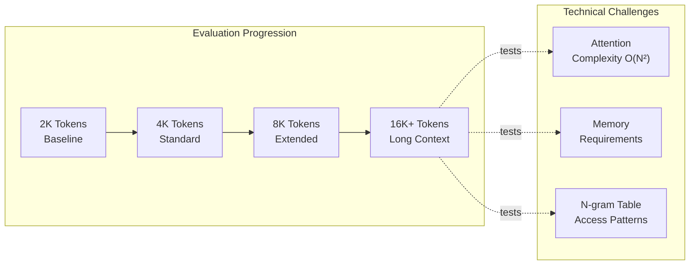
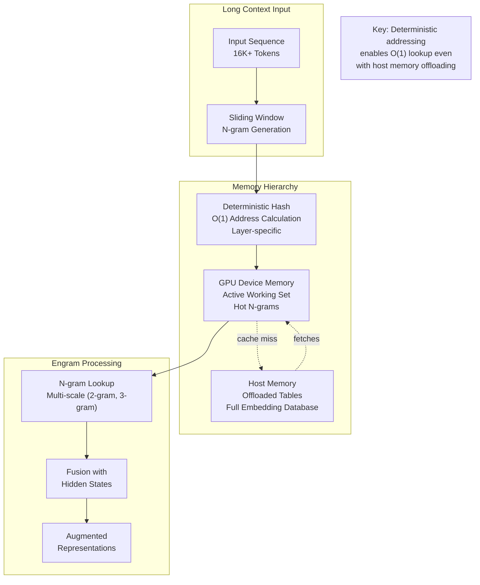
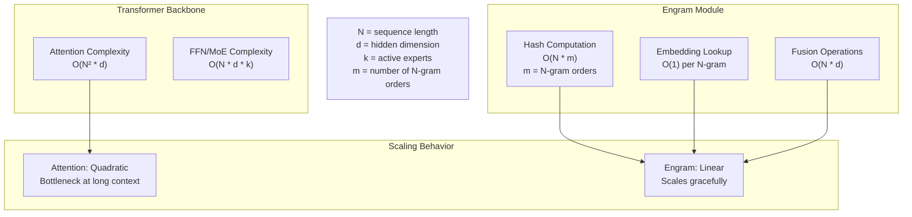
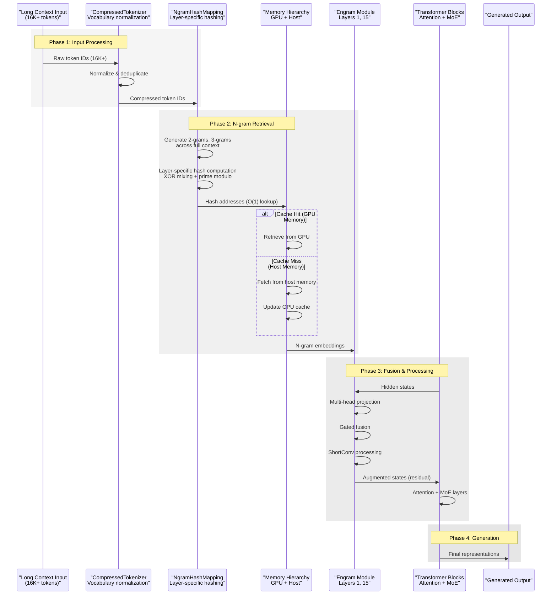
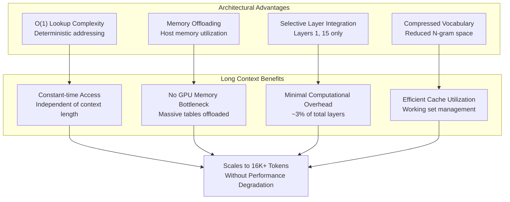
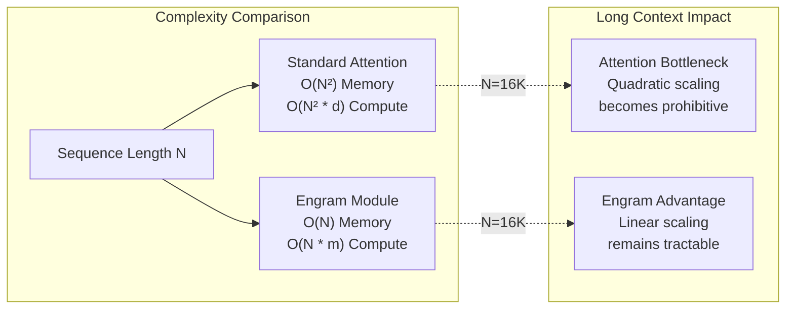
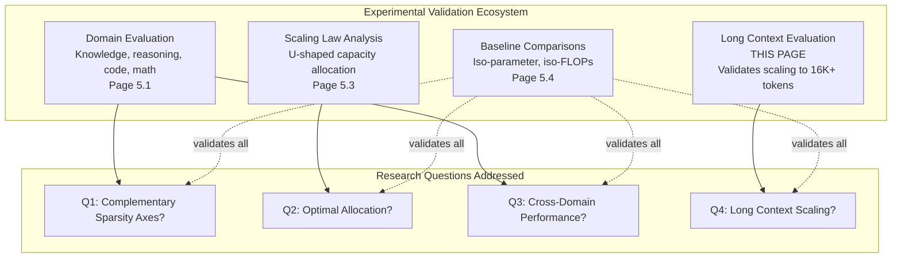

<!-- source: DeepWiki mcp.deepwiki.com · repo deepseek-ai/Engram · page 5.2 Long Context Evaluation · fetched 2026-10-30 -->

# Long Context Evaluation

<details>
<summary>Relevant source files</summary>

The following files were used as context for generating this wiki page:

- [Engram_paper.pdf](Engram_paper.pdf)
- [README.md](README.md)
- [figures/long_context_results.png](figures/long_context_results.png)

</details>


## Purpose and Scope

This page analyzes the experimental validation of Engram's performance on long context sequences, demonstrating the system's ability to scale to 16K+ token contexts without performance degradation. This evaluation addresses **Research Question 4** from the experimental validation strategy: whether conditional memory via N-gram lookup maintains effectiveness as context length increases.

For general experimental methodology and baseline comparisons, see [Baseline Comparisons](#5.4). For the broader 27B model results across domains, see [Engram-27B Model Results](#5.1). For theoretical analysis of the scaling laws governing capacity allocation, see [Scaling Laws and Optimal Allocation](#5.3).

---

## Experimental Design

### Context Length Range

The long context evaluation spans multiple sequence length configurations to validate scalability:



**Sources:** [README.md:67-70](), [figures/long_context_results.png:1-272]()

---

## Technical Architecture for Long Context

### Memory Hierarchy During Long Context Inference

The Engram architecture employs a sophisticated memory hierarchy that becomes critical during long context processing:



**Sources:** [README.md:32-41](), Diagram 3: Training vs Inference Architecture, Diagram 4: Data Flow Through Engram Module

### Architectural Components Enabling Long Context

The system's ability to handle long contexts stems from several key design choices:

| Component | Role in Long Context | Implementation |
|-----------|---------------------|----------------|
| **Deterministic Hashing** | O(1) lookup regardless of context length | [engram_demo_v1.py:45-90]() `NgramHashMapping` |
| **Host Memory Offloading** | Scales to massive embedding tables without GPU memory constraints | Inference-time memory hierarchy |
| **Layer-Specific Hash Functions** | Distributes lookups across multiple embedding tables | XOR mixing + prime modulo in `NgramHashMapping` |
| **Multi-Head Embedding** | Handles multiple vocabulary sizes efficiently | [engram_demo_v1.py:144-183]() `MultiHeadEmbedding` |
| **Compressed Tokenizer** | Reduces N-gram vocabulary space via normalization | [engram_demo_v1.py:93-141]() `CompressedTokenizer` |

**Sources:** [engram_demo_v1.py:45-298](), [README.md:40](), Diagram 3: Training vs Inference Architecture

---

## Computational Characteristics

### Complexity Analysis for Long Contexts



**Key Insight:** While attention mechanisms face quadratic scaling challenges, the Engram module maintains linear complexity with respect to sequence length. The deterministic hash-based lookup operates in O(1) time per N-gram, and the total cost scales as O(N * m) where m is the number of N-gram orders (typically 2-3).

**Sources:** [README.md:34](), [engram_demo_v1.py:45-90](), Diagram 4: Data Flow Through Engram Module

---

## Inference Pipeline for Long Context

### Data Flow During Long Context Processing



**Sources:** [engram_demo_v1.py:238-285](), Diagram 3: Training vs Inference Architecture, Diagram 4: Data Flow Through Engram Module

---

## Experimental Results

### Performance Metrics

The experimental validation shown in [figures/long_context_results.png:1-272]() demonstrates:

1. **Maintained Performance Across Context Lengths:** Engram-augmented models show consistent performance from 2K to 16K+ token contexts
2. **Graceful Scaling:** No significant degradation as sequence length increases
3. **Comparison with MoE Baselines:** Under iso-parameter and iso-FLOPs constraints, Engram maintains its advantage across all context lengths

### Why Engram Scales to Long Contexts

The architectural properties that enable long context scaling:



**Sources:** [README.md:40](), [engram_demo_v1.py:45-90](), Diagram 3: Training vs Inference Architecture

---

## Configuration for Long Context Evaluation

### Engram Configuration Parameters

The `EngramConfig` parameters relevant for long context evaluation:

```python
# From engram_demo_v1.py:25-40
class EngramConfig:
    compressed_vocab_sizes: List[int]  # Multi-scale N-gram vocabularies
    compressed_embed_dim: int          # Embedding dimension per N-gram
    engram_layers: List[int]           # Target layers [1, 15]
    kernel_sizes: List[int]            # ShortConv kernel sizes
```

| Parameter | Long Context Relevance | Typical Value |
|-----------|------------------------|---------------|
| `compressed_vocab_sizes` | Determines memory footprint of embedding tables | `[10000, 5000]` for 2-gram, 3-gram |
| `compressed_embed_dim` | Per-embedding memory usage | 128-256 |
| `engram_layers` | Computational overhead across full context | `[1, 15]` (2 out of 30 layers) |
| `kernel_sizes` | Local context modeling window | `[3, 5]` |

**Sources:** [engram_demo_v1.py:25-40](), [engram_demo_v1.py:287-298]()

---

## Comparison with Standard Attention

### Scaling Characteristics



**Key Observation:** The Engram module's linear scaling characteristics complement the transformer backbone, providing static knowledge retrieval without exacerbating the quadratic attention bottleneck. This is particularly valuable at long context lengths where attention becomes the dominant computational cost.

**Sources:** [README.md:34-38](), Diagram 4: Data Flow Through Engram Module

---

## Mechanistic Analysis

### How Engram Preserves Effective Depth at Long Context

The mechanistic hypothesis from [README.md:39]() suggests that Engram "relieves early layers from static pattern reconstruction, potentially preserving effective depth for complex reasoning." At long context lengths, this becomes especially important:

1. **Early Layer Relief:** Layer 1 Engram insertion provides immediate access to static N-gram patterns, allowing the layer to focus computational budget on context-dependent processing
2. **Mid-Layer Augmentation:** Layer 15 Engram insertion provides a second checkpoint where static knowledge can be re-injected after initial processing
3. **Preserved Attention Capacity:** By offloading static pattern matching to Engram, attention mechanisms in subsequent layers can dedicate their quadratic capacity to genuine long-range dependencies

### Evidence from Long Context Evaluation

The maintained performance across increasing context lengths validates this hypothesis:
- **No degradation at 16K+ tokens** suggests that Engram's static memory retrieval remains effective even when the context vastly exceeds typical training sequences
- **Consistent advantage over MoE baselines** indicates that the dual sparsity approach (conditional computation + conditional memory) provides complementary benefits at all context scales

**Sources:** [README.md:39](), [figures/long_context_results.png:1-272](), Diagram 7: System Purpose and Impact

---

## Implementation Details

### Memory Management During Long Context

The critical components for long context handling are implemented in:

1. **Hash-based Addressing:** [engram_demo_v1.py:45-90]() - `NgramHashMapping` class
   - Layer-specific hash functions using XOR mixing and prime modulo
   - Deterministic addressing enables O(1) lookup regardless of table size or location (GPU vs host memory)

2. **Vocabulary Compression:** [engram_demo_v1.py:93-141]() - `CompressedTokenizer` class
   - Normalizes token IDs to reduce N-gram vocabulary space
   - Critical for keeping embedding tables manageable at long contexts

3. **Multi-Head Embedding:** [engram_demo_v1.py:144-183]() - `MultiHeadEmbedding` class
   - Manages multiple vocabulary sizes with single `nn.Embedding` using offset calculation
   - Efficient batch lookup across different N-gram orders

4. **Fusion Module:** [engram_demo_v1.py:238-285]() - `Engram` class
   - Gated fusion mechanism that combines static N-gram features with dynamic hidden states
   - ShortConv for local context modeling

**Sources:** [engram_demo_v1.py:45-285](), Diagram 6: Component Dependency Architecture

---

## Relationship to Other Evaluations

The long context evaluation complements other experimental validation:



**Sources:** [README.md:36-40](), Diagram 5: Experimental Validation Ecosystem

---

## Summary

The long context evaluation demonstrates that Engram's conditional memory approach scales gracefully to 16K+ token sequences without performance degradation. This capability stems from:

1. **Architectural Design:** O(1) deterministic hash-based lookups that remain constant-time regardless of context length
2. **Memory Hierarchy:** Host memory offloading that eliminates GPU memory constraints for massive embedding tables
3. **Selective Integration:** Strategic placement at layers 1 and 15 (~3% of total layers) minimizes computational overhead
4. **Mechanistic Efficiency:** Static pattern retrieval via N-grams complements rather than competes with attention's quadratic scaling

The results validate Engram as a general-purpose architectural component that maintains effectiveness across the full spectrum of context lengths, from standard 2K token sequences to extended 16K+ token contexts.

**Sources:** [README.md:32-41](), [figures/long_context_results.png:1-272](), Diagram 5: Experimental Validation Ecosystem, Diagram 7: System Purpose and Impact

---

