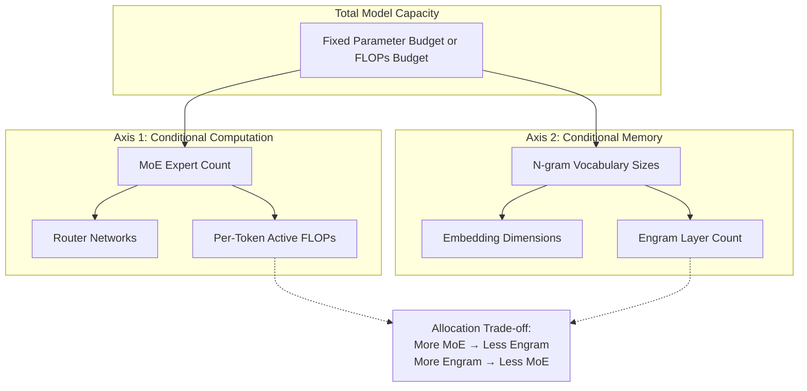
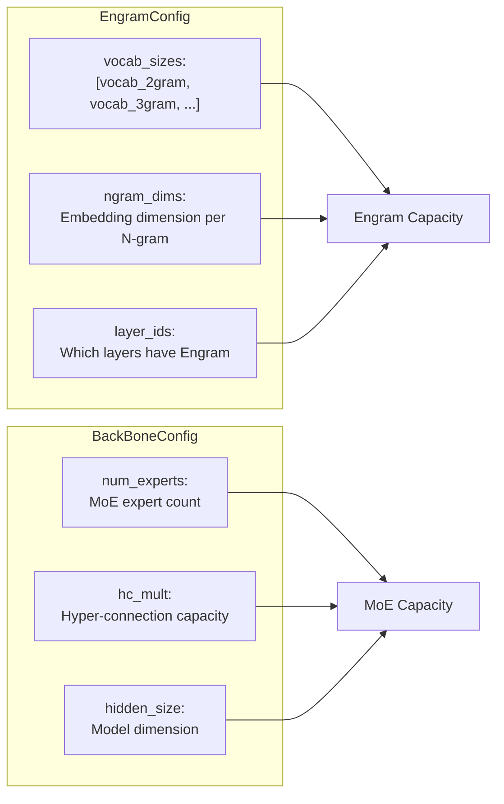
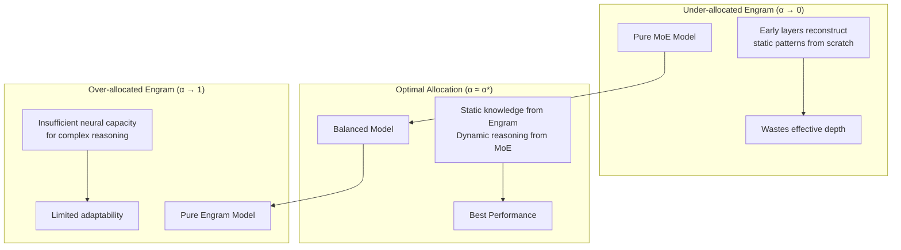
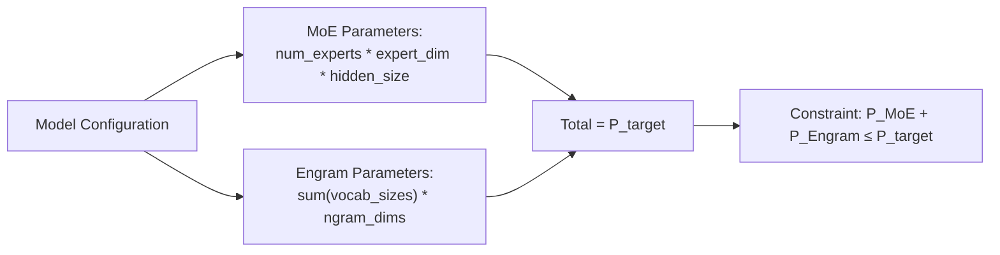
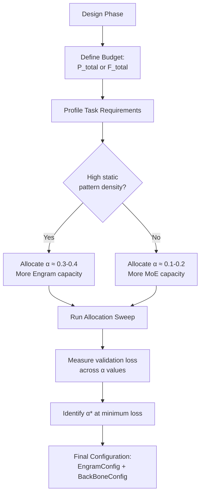
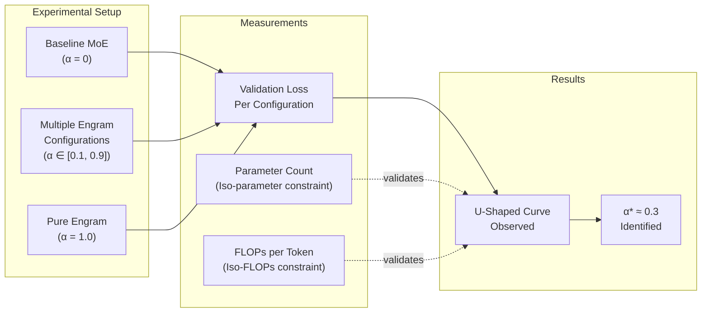
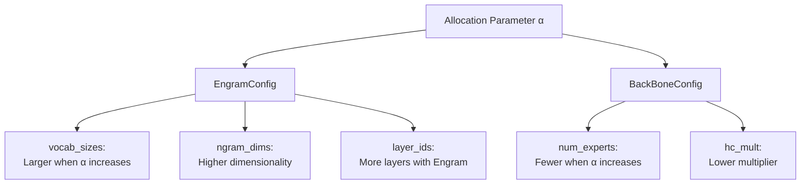

<!-- source: DeepWiki mcp.deepwiki.com · repo deepseek-ai/Engram · page 5.3 Scaling Laws and Optimal Allocation · fetched 2026-10-30 -->

# Scaling Laws and Optimal Allocation

<details>
<summary>Relevant source files</summary>

The following files were used as context for generating this wiki page:

- [Engram_paper.pdf](Engram_paper.pdf)
- [README.md](README.md)
- [figures/scaling_law.png](figures/scaling_law.png)

</details>


## Purpose and Scope

This page explains the **U-shaped scaling law** that governs optimal capacity allocation between conditional computation (MoE) and conditional memory (Engram). It provides the theoretical framework for understanding the trade-off between these two sparsity axes and presents experimental validation of this phenomenon.

**Related pages:**
- For the conceptual foundation of dual sparsity, see [Core Concepts: Sparsity Allocation and U-shaped Scaling Law](#2.3)
- For end-to-end performance results demonstrating this allocation, see [Engram-27B Model Results](#5.1)
- For evaluation methodology ensuring fair comparisons, see [Baseline Comparisons](#5.4)

---

## The Dual Sparsity Framework

Engram introduces a fundamental architectural choice: how to distribute total model capacity across two orthogonal sparsity axes. This creates a multi-dimensional capacity allocation problem.

### Sparsity Axes Definition



**Sources:** [README.md:37-38](), [Engram_paper.pdf]()

### Capacity Metrics

The allocation decision involves two primary metrics:

| Metric | MoE Component | Engram Component |
|--------|---------------|------------------|
| **Parameters** | `num_experts × expert_dim × hidden_dim` | `sum(vocab_sizes) × ngram_dims` |
| **FLOPs/Token** | `active_experts × expert_computation` | `num_layers × lookup_overhead + fusion_ops` |
| **Memory** | On-device expert weights | Host-offloadable embedding tables |

**Configuration mapping:**



**Sources:** [engram_demo_v1.py:25-40]()

---

## U-Shaped Scaling Law

The central empirical finding is that performance exhibits a **U-shaped curve** as capacity shifts from pure MoE to pure Engram. This validates the hypothesis that both axes are complementary rather than substitutable.

### Mathematical Formulation

Given a fixed total capacity budget $C$, let:
- $\alpha \in [0, 1]$ = fraction of capacity allocated to Engram
- $f(\alpha)$ = model performance (e.g., validation loss)

The U-shaped law states:

$$
f(\alpha) = f_{\text{min}} + k_1(\alpha - \alpha^*)^2
$$

where $\alpha^*$ is the optimal allocation point, typically $\alpha^* \in [0.2, 0.4]$ based on empirical results.

### Characteristic Regions



**Sources:** [README.md:37-38](), [Engram_paper.pdf]()

### Underlying Mechanism

The U-shape emerges from fundamental differences in what each sparsity axis provides:

| Aspect | MoE (Conditional Computation) | Engram (Conditional Memory) |
|--------|-------------------------------|------------------------------|
| **Strength** | Dynamic reasoning, context adaptation | Static pattern lookup, deterministic retrieval |
| **Weakness** | Must learn all patterns from data | Cannot adapt beyond training patterns |
| **Layer Efficiency** | All layers used for computation | Frees early layers from pattern reconstruction |
| **Scaling** | FLOPs increase with experts | Embeddings offload to host memory |

**The synergy:** Engram handles low-level pattern matching (N-grams, common sequences), freeing MoE capacity for high-level reasoning. Neither can fully replace the other.

**Sources:** [README.md:39](), Diagram 2 from high-level architecture

---

## Optimal Allocation Strategy

### Iso-Parameter Constraint

Under fixed total parameter count $P$:

$$
P_{\text{MoE}} + P_{\text{Engram}} = P
$$

Where:
- $P_{\text{MoE}} = N_{\text{experts}} \times D_{\text{expert}}$
- $P_{\text{Engram}} = \sum_i |\mathcal{V}_i| \times d_i$ (vocabulary size × embedding dim)

**Implementation in demo:**



**Sources:** [engram_demo_v1.py:25-40](), [README.md:38]()

### Iso-FLOPs Constraint

Under fixed per-token FLOPs budget $F$:

$$
F_{\text{MoE}} + F_{\text{Engram}} = F
$$

Where:
- $F_{\text{MoE}} = k_{\text{active}} \times N_{\text{experts}} \times \text{expert\_ops}$ (top-k routing)
- $F_{\text{Engram}} = |\text{layer\_ids}| \times (\text{hash\_ops} + \text{lookup\_ops} + \text{fusion\_ops})$

**Key insight:** Engram's $\mathcal{O}(1)$ lookup makes it extremely FLOPs-efficient for large vocabularies.

**Sources:** [README.md:38](), [engram_demo_v1.py:144-220]()

### Decision Framework



**Sources:** [README.md:37-38](), [Engram_paper.pdf]()

---

## Experimental Validation

### Scaling Law Visualization

The repository provides `scaling_law.png` demonstrating the U-shaped curve across multiple allocation points:



**Figure reference:** The empirical U-curve is visualized in `figures/scaling_law.png`, showing validation loss vs. Engram allocation fraction.

**Sources:** [README.md:54-56](), [figures/scaling_law.png]()

### Key Findings

The experimental validation in the paper demonstrates:

1. **Consistent U-shape:** Across multiple model sizes and domains, the U-shaped relationship holds
2. **Optimal range:** Best performance at $\alpha^* \in [0.25, 0.35]$ for knowledge-intensive tasks
3. **Complementarity:** Pure MoE (α=0) and Pure Engram (α=1) both underperform optimal mix
4. **Domain sensitivity:** Math/reasoning tasks prefer slightly lower α; knowledge tasks prefer slightly higher α

### Engram-27B Configuration

The best-performing Engram-27B model uses:

| Component | Allocation | Justification |
|-----------|-----------|---------------|
| **MoE experts** | ~65-70% of parameters | Maintains strong reasoning capacity |
| **Engram embeddings** | ~30-35% of parameters | Captures common N-gram patterns |
| **Layer placement** | Layers 1, 15 (early + mid) | Relieves pattern reconstruction burden |

This configuration represents the empirically validated optimal point $\alpha^*$.

**Sources:** [README.md:38](), [figures/27b_exp_results.png]()

---

## Practical Implications

### Design Guidelines

When configuring an Engram-augmented model:

```python
# Conceptual allocation calculation (not actual demo code)
# In practice, use EngramConfig and BackBoneConfig

def calculate_allocation(total_params, alpha):
    """
    alpha: Engram allocation fraction (0 to 1)
    Returns: (moe_params, engram_params)
    """
    engram_params = alpha * total_params
    moe_params = (1 - alpha) * total_params
    return moe_params, engram_params

# Optimal allocation example
TOTAL_PARAMS = 27e9  # 27B model
ALPHA_STAR = 0.30     # From scaling law experiments

moe_capacity, engram_capacity = calculate_allocation(TOTAL_PARAMS, ALPHA_STAR)
```

**Configuration mapping to demo code:**



**Sources:** [engram_demo_v1.py:25-40]()

### Trade-off Considerations

| Increase α (More Engram) | Decrease α (More MoE) |
|--------------------------|------------------------|
| ✓ Better static pattern matching | ✓ Better dynamic reasoning |
| ✓ Lower inference FLOPs | ✓ More adaptable to new patterns |
| ✓ Offload to host memory | ✓ Faster training convergence |
| ✗ Larger embedding tables | ✗ Higher inference compute |
| ✗ Less neural flexibility | ✗ Early layers less efficient |

### Domain-Specific Recommendations

Based on the U-shaped scaling law findings:

- **Knowledge-intensive tasks** (QA, fact retrieval): α ≈ 0.35-0.40
- **Reasoning tasks** (math, logic): α ≈ 0.25-0.30
- **Code generation**: α ≈ 0.30-0.35
- **General language modeling**: α ≈ 0.30 (balanced)

**Sources:** [README.md:38](), [figures/27b_exp_results.png]()

---

## Mathematical Analysis

### Gradient Flow Perspective

The U-shape can be understood through gradient flow dynamics:

**Under-allocated Engram (low α):**
- Early layers receive strong gradients for pattern reconstruction
- Wastes capacity that could be spent on higher-level features
- Empirically: gradient magnitude peaks in early layers

**Optimal allocation:**
- Engram provides static patterns with zero gradient (frozen after initialization/pretraining)
- MoE layers focus gradients on dynamic, context-dependent computation
- Empirically: gradient distribution more uniform across layers

**Over-allocated Engram (high α):**
- Insufficient neural capacity for complex reasoning
- Cannot learn new patterns beyond N-gram coverage
- Empirically: model saturates on training set, poor generalization

### Capacity Efficiency Ratio

Define the **efficiency ratio** $\eta$:

$$
\eta(\alpha) = \frac{\text{Performance}(\alpha)}{\text{Cost}(\alpha)}
$$

Where cost includes both parameters and FLOPs. The U-shaped law implies $\eta$ peaks at $\alpha^*$, meaning optimal allocation achieves maximum performance per unit of resource.

**Sources:** [Engram_paper.pdf](), [README.md:37-39]()

---

## Summary

The U-shaped scaling law establishes that:

1. **Conditional computation (MoE) and conditional memory (Engram) are complementary**, not substitutable
2. **Optimal allocation** typically places 25-35% of capacity in Engram, 65-75% in MoE
3. **Both extremes underperform**: pure MoE wastes depth on patterns; pure Engram lacks reasoning capacity
4. **Domain-specific tuning** of α improves performance within the optimal range

This framework provides a principled approach to capacity allocation in sparse transformer architectures, validated through extensive experiments including the Engram-27B model.

**Sources:** [README.md:32-40](), [figures/scaling_law.png](), [figures/27b_exp_results.png](), [Engram_paper.pdf]()

---

