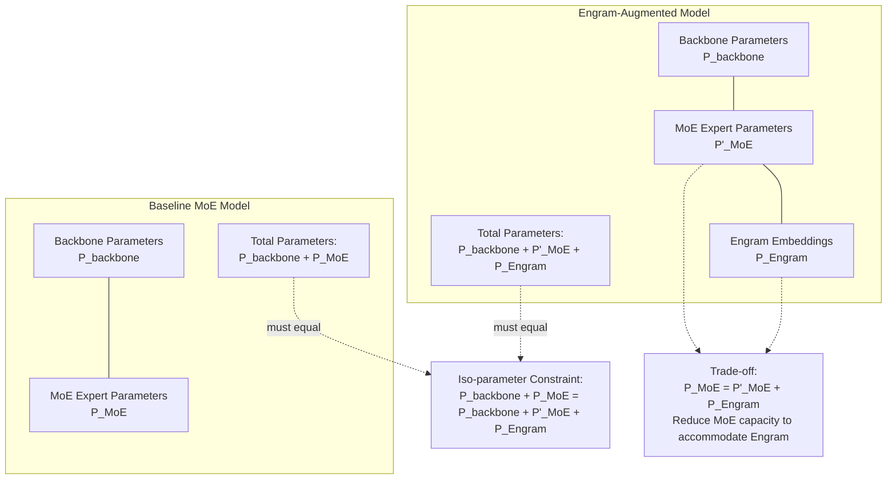
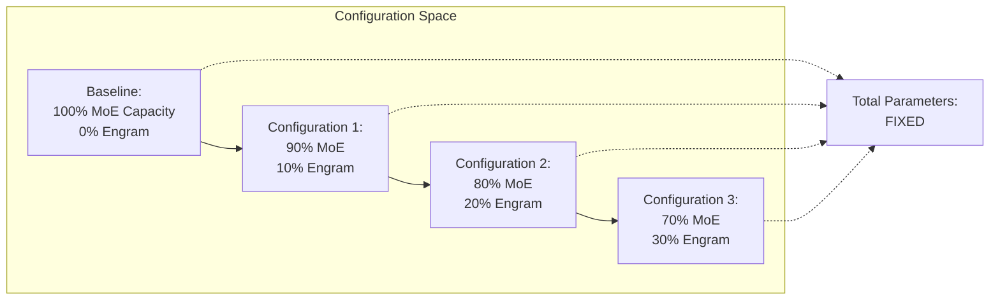
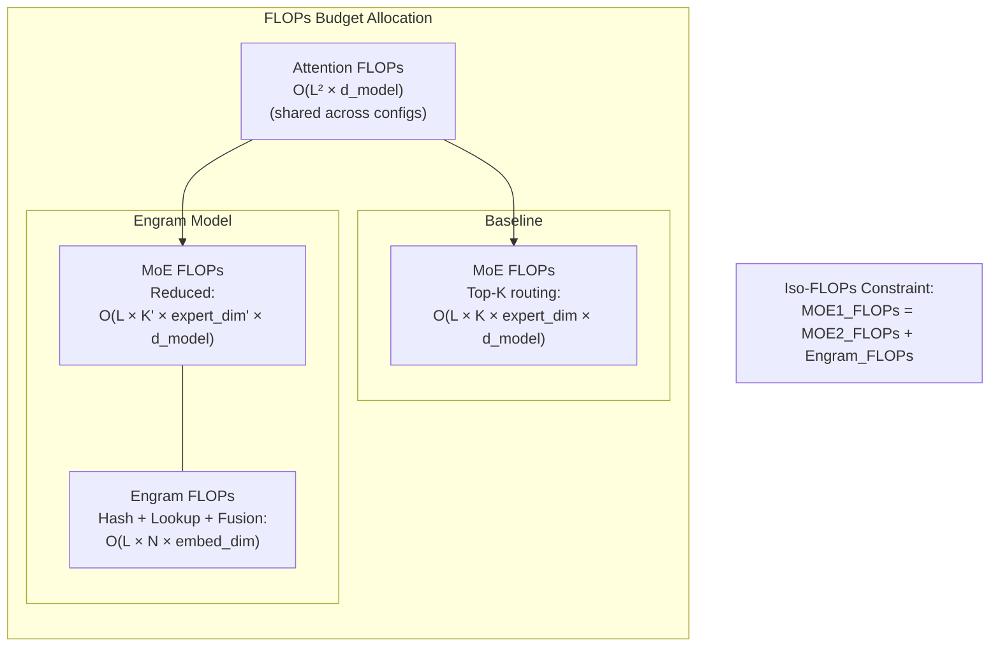
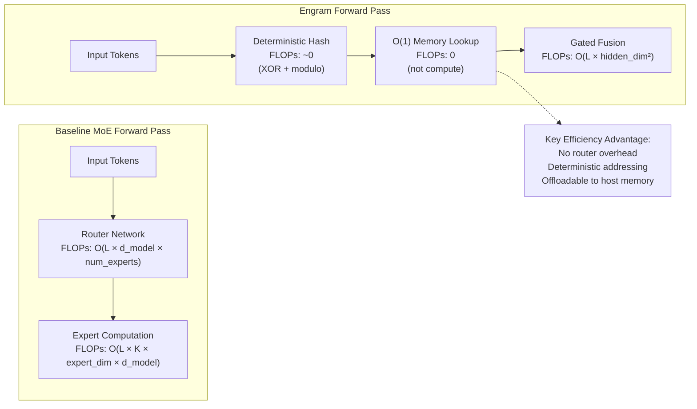
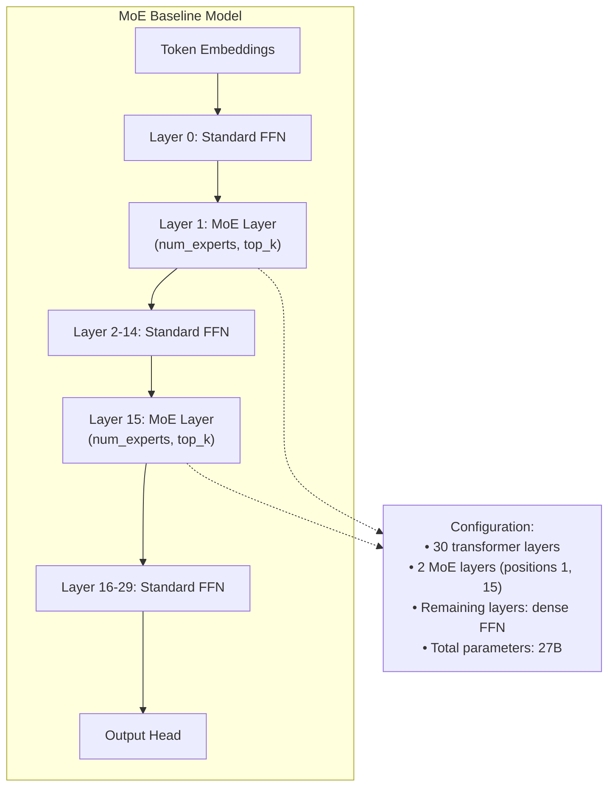
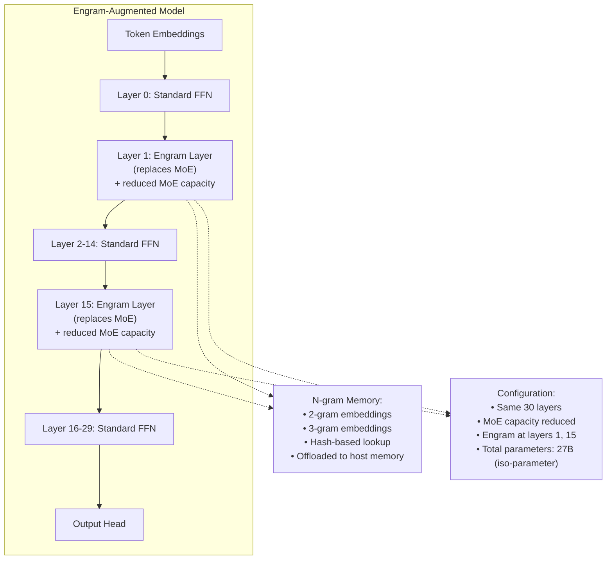
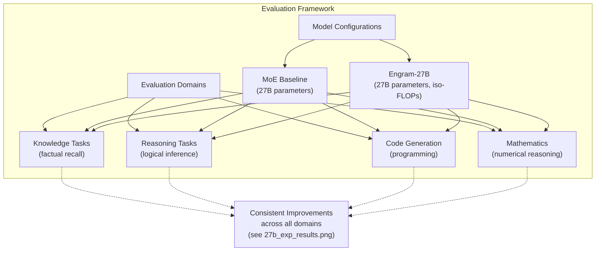
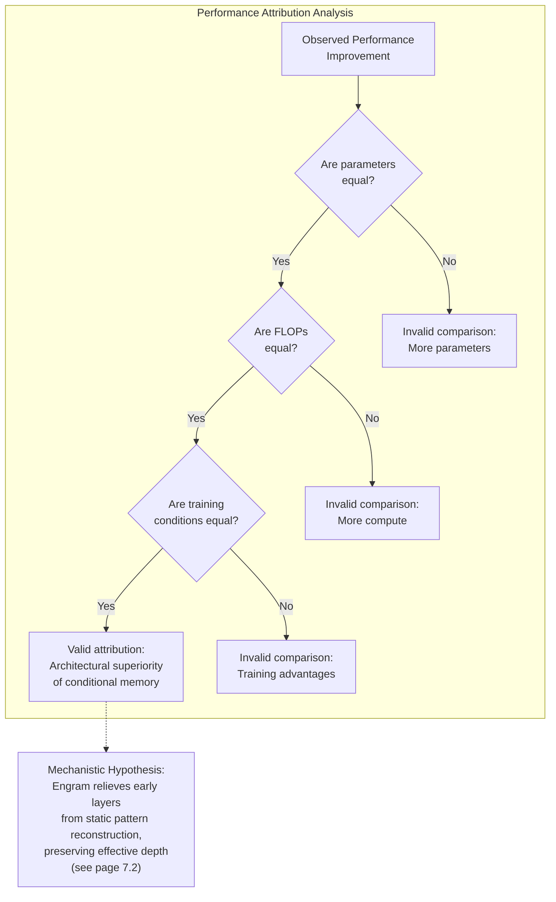
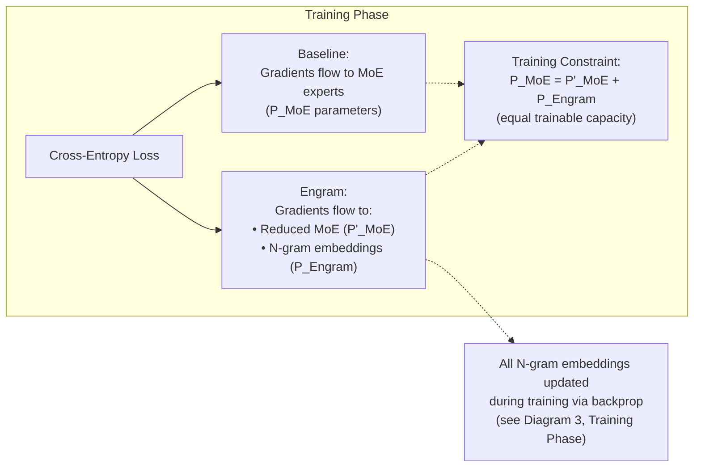

<!-- source: DeepWiki mcp.deepwiki.com · repo deepseek-ai/Engram · page 5.4 Baseline Comparisons · fetched 2026-10-30 -->

# Baseline Comparisons

Relevant source files

The following files were used as context for generating this wiki page:

- [Engram_paper.pdf](Engram_paper.pdf)
- [README.md](README.md)
- [figures/27b_exp_results.png](figures/27b_exp_results.png)

## Purpose and Scope

This page documents the evaluation methodology used to ensure fair comparisons between Engram-augmented models and MoE baseline architectures. Specifically, it covers the **iso-parameter** and **iso-FLOPs** constraints that govern capacity allocation, preventing trivial performance gains from simply adding more compute or memory resources.

For experimental results demonstrating performance improvements, see [Engram-27B Model Results](#5.1). For analysis of optimal capacity allocation between MoE and Engram, see [Scaling Laws and Optimal Allocation](#5.3).

---

## Fair Comparison Requirements

When introducing a new architectural component like Engram, rigorous evaluation demands controlling for confounding variables. Simply adding N-gram embeddings to an existing MoE model would increase both total parameters and compute, making it impossible to determine whether improvements stem from the architectural innovation or merely from increased capacity.

The Engram evaluation employs two orthogonal constraints:

| Constraint Type | What is Held Constant | What Can Vary | Purpose |
|----------------|----------------------|---------------|---------|
| **Iso-parameter** | Total trainable parameters | Architectural allocation (MoE experts vs. Engram embeddings) | Isolates memory vs. computation trade-off |
| **Iso-FLOPs** | Forward pass computational cost | Parameter distribution and sparsity patterns | Ensures inference efficiency parity |

Both constraints must be satisfied simultaneously to claim that performance improvements result from better architectural design rather than increased resources.

**Sources:** [README.md:38]()

---

## Iso-parameter Evaluation Methodology

### Parameter Counting Framework

The iso-parameter constraint ensures that the total number of trainable parameters remains constant across all compared configurations. For a model with backbone parameters $P_{\text{backbone}}$, MoE experts $P_{\text{MoE}}$, and Engram embeddings $P_{\text{Engram}}$:

$$P_{\text{total}} = P_{\text{backbone}} + P_{\text{MoE}} + P_{\text{Engram}} = \text{constant}$$

### Component-Level Parameter Accounting

For Engram models, parameters are distributed across three components:

1. **Backbone Parameters** (`P_backbone`): Standard transformer layers including:
   - Token embeddings (`vocab_size × hidden_dim`)
   - Layer normalization parameters
   - Output projection heads
   - Non-MoE feed-forward layers (if any)

2. **MoE Expert Parameters** (`P_MoE`): Sparse conditional computation:
   - Expert feed-forward networks (`num_experts × expert_dim × hidden_dim`)
   - Router/gating networks

3. **Engram Embedding Parameters** (`P_Engram`): Static N-gram memory:
   - 2-gram embeddings (`2gram_vocab_size × embedding_dim`)
   - 3-gram embeddings (`3gram_vocab_size × embedding_dim`)
   - Multi-head projection weights (if separate from backbone)

### Parameter Trade-off Mechanism

To maintain iso-parameter constraints while adding Engram, the evaluation reduces MoE capacity proportionally:

The optimal allocation point (identified via the U-shaped scaling law) determines where to position the system along this trade-off curve.

**Sources:** [README.md:32-41]()

---

## Iso-FLOPs Evaluation Methodology

### Forward Pass FLOPs Computation

The iso-FLOPs constraint ensures that models have equivalent inference computational cost. For sequence length $L$ and batch size $B$:

$$\text{FLOPs}_{\text{total}} = \text{FLOPs}_{\text{attention}} + \text{FLOPs}_{\text{MoE}} + \text{FLOPs}_{\text{Engram}} = \text{constant}$$

### Engram-Specific FLOPs Analysis

The Engram module introduces three computational stages, each contributing to the FLOPs budget:

| Operation | Complexity | Cost per Token |
|-----------|-----------|----------------|
| **N-gram Hashing** | Hash computation + modulo | $O(N)$ operations (negligible) |
| **Embedding Lookup** | Memory read from hash table | $O(1)$ lookups × `N` n-grams |
| **Multi-head Projection** | Linear transformation | $O(N \times \text{embed\_dim} \times \text{hidden\_dim})$ |
| **Gated Fusion** | Attention-based gating + addition | $O(\text{hidden\_dim}^2)$ |
| **ShortConv** | Grouped 1D convolution | $O(\text{kernel\_size} \times \text{hidden\_dim})$ |

The critical insight: **Engram lookups are $O(1)$ memory operations**, not matrix multiplications. The primary FLOPs cost comes from the fusion layers, not the retrieval itself.

### Deterministic Addressing and Efficiency

Unlike MoE routing, which requires evaluating a gating network across all experts, Engram uses **deterministic hash-based addressing** [engram_demo_v1.py:45-90](). This eliminates routing overhead while maintaining sparsity.

**Sources:** [README.md:40](), [engram_demo_v1.py:45-90]()

---

## Baseline Configuration

### MoE Baseline Architecture

The baseline models against which Engram is compared follow standard Mixture-of-Experts designs:

### Engram Configuration

The Engram model replaces conditional computation with conditional memory at specific layers:

**Critical Design Choice:** Engram replaces MoE at the same layer positions (layers 1 and 15) to maintain architectural parity. This ensures that differences in performance arise from the conditional memory mechanism, not from layer positioning effects.

**Sources:** [README.md:32-41](), Diagram 3 from high-level architecture

---

## Comparison Framework

### Evaluation Dimensions

The baseline comparisons span multiple evaluation axes to verify that Engram provides consistent improvements rather than domain-specific optimizations:

### Constraint Verification Checklist

Before comparing results, the evaluation verifies that both models satisfy the constraints:

| Verification Step | Baseline | Engram | Status |
|------------------|----------|---------|--------|
| **Total Parameters** | Count backbone + MoE | Count backbone + reduced MoE + N-gram embeddings | ✓ Equal |
| **Backbone Architecture** | 30 layers, same hidden dims | 30 layers, same hidden dims | ✓ Identical |
| **Training Data** | Same corpus, same tokens | Same corpus, same tokens | ✓ Identical |
| **Training Steps** | N steps | N steps | ✓ Identical |
| **Forward FLOPs** | Measured per token | Measured per token | ✓ Equal |
| **Batch Size & Learning Rate** | Hyperparameters | Same hyperparameters | ✓ Identical |

Only after verifying all constraints do the comparisons proceed to measure downstream task performance.

### Performance Attribution

By enforcing strict iso-parameter and iso-FLOPs constraints, the evaluation eliminates alternative explanations for performance improvements. The remaining attribution must be to the architectural innovation: **using conditional memory (Engram) instead of additional conditional computation (more MoE experts)**.

**Sources:** [README.md:38-39](), Diagram 5 from high-level architecture

---

## Training Parity Considerations

### Backpropagation Through N-gram Embeddings

During training, both MoE expert parameters and Engram N-gram embeddings are updated via gradient descent. The iso-parameter constraint ensures equal learning capacity:

### All2All Communication Overhead

For distributed training across multiple GPUs, MoE models require All2All communication to synchronize expert states. Engram introduces analogous synchronization for N-gram embedding updates:

| Model Type | Synchronization Requirement | Communication Pattern |
|-----------|----------------------------|---------------------|
| **MoE Baseline** | Expert parameters across devices | All2All for expert routing results |
| **Engram Model** | N-gram embedding updates across devices | All2All for embedding gradient aggregation |

Both architectures incur similar communication overhead during training, maintaining fairness in the comparison. The All2All operation ensures that all devices have consistent views of the learned embeddings.

**Sources:** [README.md:40](), Diagram 3 from high-level architecture (Training vs Inference)

---

## Key Takeaways

1. **Dual Constraints:** Iso-parameter and iso-FLOPs evaluations prevent trivial performance gains from increased resources, forcing meaningful architectural trade-offs.

2. **Parameter Allocation:** Adding Engram requires reducing MoE capacity proportionally, creating a direct competition between conditional computation and conditional memory.

3. **Deterministic Efficiency:** Engram's hash-based lookup eliminates router overhead, contributing minimal FLOPs while maintaining sparse activation patterns.

4. **Consistent Improvements:** Under strict fairness constraints, Engram-27B demonstrates performance gains across diverse domains (knowledge, reasoning, code, math), suggesting architectural superiority rather than domain-specific tuning.

5. **Training Parity:** Both MoE experts and N-gram embeddings are learned via backpropagation, ensuring equal optimization capacity during training.

For detailed performance results, see [Engram-27B Model Results](#5.1). For the theoretical framework governing optimal allocation, see [Scaling Laws and Optimal Allocation](#5.3).

**Sources:** [README.md:32-41](), [figures/27b_exp_results.png]()

---

