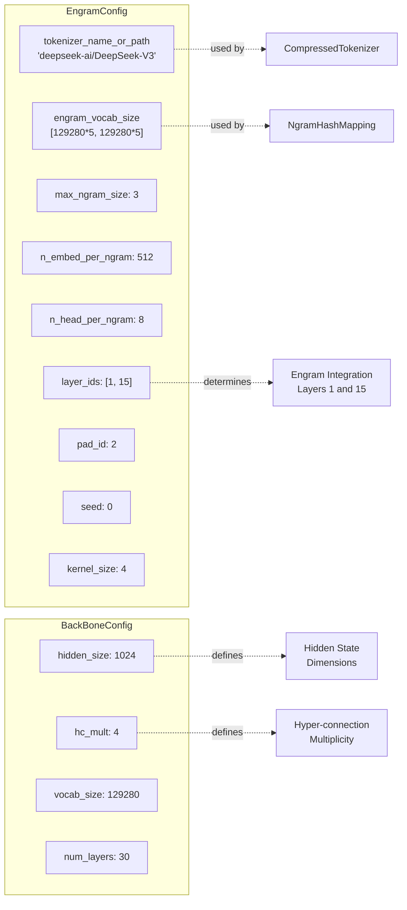
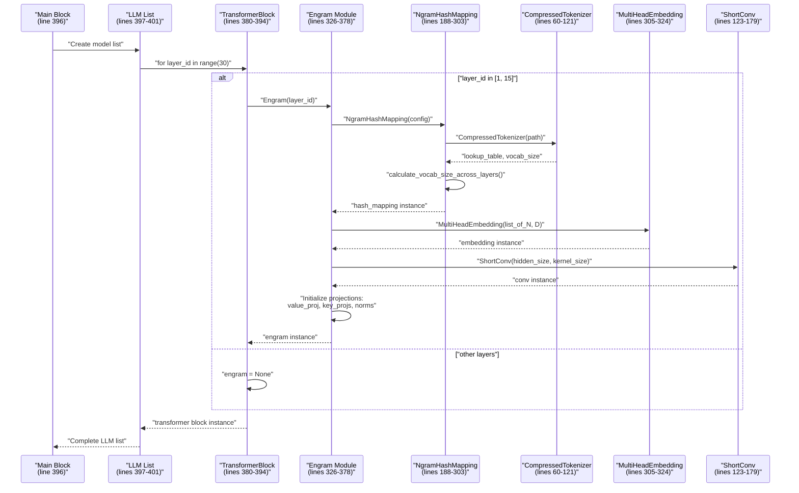
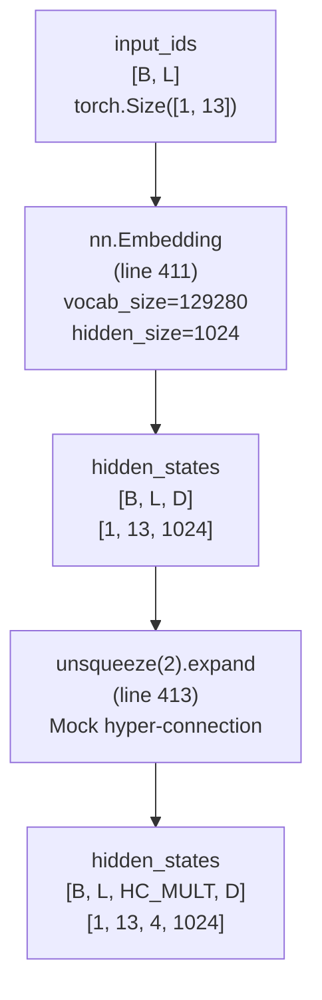
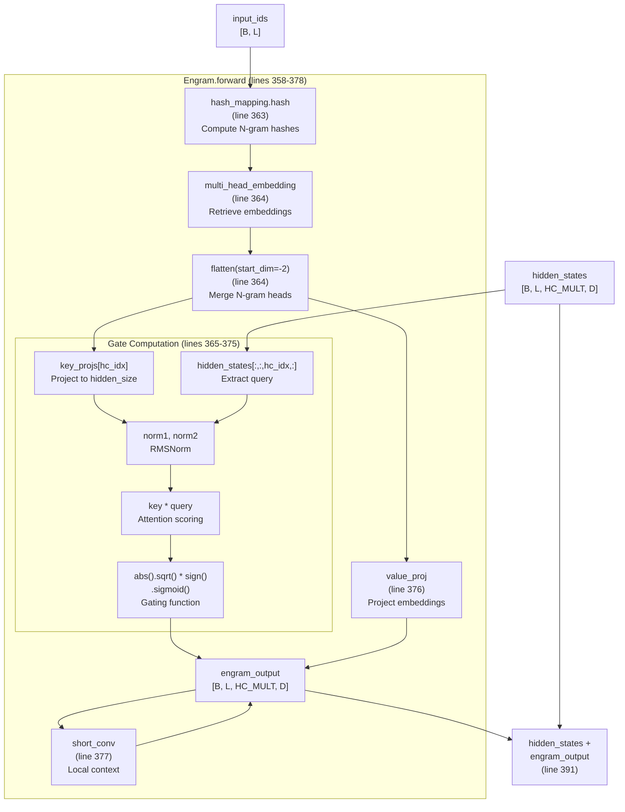
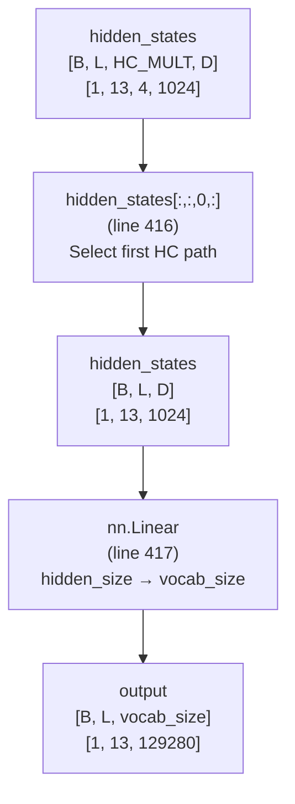
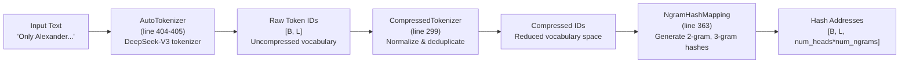
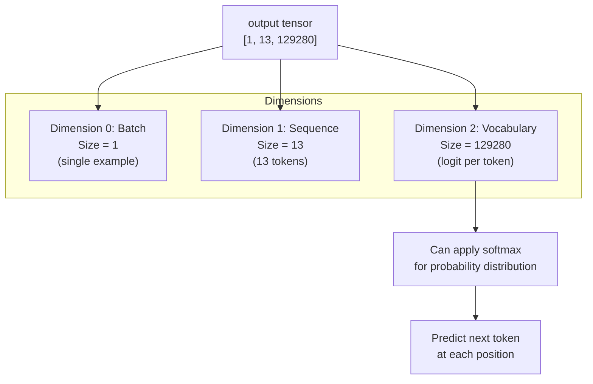

<!-- source: DeepWiki mcp.deepwiki.com · repo deepseek-ai/Engram · page 6 Getting Started · fetched 2026-10-30 -->

# Getting Started

<details>
<summary>Relevant source files</summary>

The following files were used as context for generating this wiki page:

- [README.md](README.md)
- [engram_demo_v1.py](engram_demo_v1.py)

</details>


This document provides a practical guide for users to begin working with the Engram repository. It covers environment setup, dependency installation, running the demonstration implementation, and understanding the demo's output and structure.

For detailed architectural concepts, see [Core Concepts](#2). For production implementation guidance, see [Implementation Guide](#4). For experimental validation details, see [Experimental Validation](#5).

---

## Prerequisites

The Engram demo requires a Python environment with the following specifications:

| Requirement | Specification |
|------------|---------------|
| Python Version | 3.8 or higher (recommended) |
| PyTorch | Latest stable version |
| Operating System | Linux, macOS, or Windows with WSL |
| Hardware | CPU sufficient for demo; GPU not required |
| Memory | Minimum 4GB RAM for small examples |

**Important Notes:**
- The provided demo ([engram_demo_v1.py:1-423]()) is designed for demonstration purposes, not production deployment
- Standard components (Attention, MoE, advanced hyper-connections) are mocked to focus on Engram module logic
- The demo illustrates data flow and core algorithms without requiring distributed training infrastructure

**Sources:** [README.md:80-90](), [engram_demo_v1.py:1-19]()

---

## Installation

### Step 1: Clone the Repository

```bash
git clone https://github.com/deepseek-ai/Engram.git
cd Engram
```

### Step 2: Install Dependencies

Install the required Python packages:

```bash
pip install torch numpy transformers sympy
```

**Dependency Purposes:**

| Package | Purpose | Used By |
|---------|---------|---------|
| `torch` | Neural network implementation | All module components |
| `numpy` | N-gram hash computation | `NgramHashMapping` class |
| `transformers` | Tokenizer loading | `CompressedTokenizer` class |
| `sympy` | Prime number calculations | Hash table sizing logic |

The installation is complete when all dependencies resolve without errors.

**Sources:** [README.md:80-83](), [engram_demo_v1.py:22-36]()

---

## Running the Demo

### Basic Execution

Execute the demo script from the repository root:

```bash
python engram_demo_v1.py
```

### Expected Output

The demo processes a sample text through the Engram-augmented architecture and displays:

```
✅ Forward Complete!
input_ids.shape=torch.Size([1, 13])
output.shape=torch.Size([1, 13, 129280])
```

This output confirms:
- **Input Shape:** `[batch_size, sequence_length]` = `[1, 13]` for the demo text
- **Output Shape:** `[batch_size, sequence_length, vocab_size]` = `[1, 13, 129280]` logits for next-token prediction

**Sources:** [engram_demo_v1.py:396-422]()

---

## Demo Execution Flow

The following diagram traces the execution path from script invocation to output:

```mermaid
graph TB
    START["Script Entry<br/>(engram_demo_v1.py:396)"]
    
    CONFIG["Load Configurations<br/>EngramConfig<br/>BackBoneConfig"]
    
    TOKENIZER["Initialize Tokenizer<br/>AutoTokenizer.from_pretrained<br/>(line 404)"]
    
    TOKENIZE["Tokenize Input Text<br/>'Only Alexander...'<br/>(line 405)"]
    
    BUILD_LLM["Construct Model<br/>List[nn.Module]<br/>(lines 397-401)"]
    
    EMBED["Embedding Layer<br/>nn.Embedding<br/>(line 411)"]
    
    MOCK_HC["Mock Hyper-connection<br/>unsqueeze(2).expand<br/>(line 413)"]
    
    subgraph "Transformer Layers"
        LAYER0["Layer 0<br/>TransformerBlock<br/>(no Engram)"]
        LAYER1["Layer 1<br/>TransformerBlock<br/>(with Engram)"]
        LAYER_MID["Layers 2-14<br/>(standard blocks)"]
        LAYER15["Layer 15<br/>TransformerBlock<br/>(with Engram)"]
        LAYER_END["Layers 16-29<br/>(standard blocks)"]
    end
    
    UNMOCK["Unmock Hyper-connection<br/>hidden_states[:,:,0,:]<br/>(line 416)"]
    
    OUTPUT_PROJ["Output Projection<br/>nn.Linear<br/>(line 417)"]
    
    PRINT["Print Results<br/>(lines 421-422)"]
    
    START --> CONFIG
    CONFIG --> TOKENIZER
    TOKENIZER --> TOKENIZE
    TOKENIZE --> BUILD_LLM
    BUILD_LLM --> EMBED
    EMBED --> MOCK_HC
    MOCK_HC --> LAYER0
    LAYER0 --> LAYER1
    LAYER1 --> LAYER_MID
    LAYER_MID --> LAYER15
    LAYER15 --> LAYER_END
    LAYER_END --> UNMOCK
    UNMOCK --> OUTPUT_PROJ
    OUTPUT_PROJ --> PRINT
```



**Sources:** [engram_demo_v1.py:396-422]()

---

## Understanding the Demo Implementation

### Configuration Architecture

The demo uses two configuration dataclasses that control system behavior:



**Key Configuration Parameters:**

| Parameter | Value | Purpose |
|-----------|-------|---------|
| `engram_vocab_size` | `[129280*5, 129280*5]` | Hash table sizes for 2-gram and 3-gram embeddings |
| `max_ngram_size` | `3` | Generate up to 3-grams (bigrams and trigrams) |
| `n_embed_per_ngram` | `512` | Embedding dimension per N-gram type |
| `n_head_per_ngram` | `8` | Multi-head configuration for each N-gram type |
| `layer_ids` | `[1, 15]` | Transformer layers with Engram integration |
| `hc_mult` | `4` | Hyper-connection multiplicity (4 parallel paths) |

**Sources:** [engram_demo_v1.py:38-58]()

---

### Component Initialization Sequence

The following diagram maps initialization order to specific code entities:



**Sources:** [engram_demo_v1.py:326-378](), [engram_demo_v1.py:380-394](), [engram_demo_v1.py:397-401]()

---

### Forward Pass Data Flow

The demo processes input through three main phases:

**Phase 1: Embedding and Preparation**



**Phase 2: Engram Processing (Layer 1 and Layer 15)**



**Phase 3: Output Projection**



**Sources:** [engram_demo_v1.py:409-419](), [engram_demo_v1.py:358-378](), [engram_demo_v1.py:389-394]()

---

## Demo Text Processing Example

The demo uses a fixed input text to demonstrate the complete pipeline:

### Input Text

```
"Only Alexander the Great could tame the horse Bucephalus."
```

### Tokenization Process



**Tokenization Details:**

| Stage | Shape | Vocabulary Size | Purpose |
|-------|-------|-----------------|---------|
| Raw Tokens | `[1, 13]` | 129,280 | Standard DeepSeek-V3 tokenization |
| Compressed Tokens | `[1, 13]` | ~80,000 (typical) | Normalized, deduplicated vocabulary |
| Hash Addresses | `[1, 13, 16]` | 16 heads (8 per N-gram type) | Per-layer N-gram embedding addresses |

**Sources:** [engram_demo_v1.py:403-405](), [engram_demo_v1.py:60-121](), [engram_demo_v1.py:298-303]()

---

## Interpreting Demo Output

### Success Indicators

When the demo runs successfully, you should observe:

1. **No Errors:** Module initialization and forward pass complete without exceptions
2. **Shape Consistency:** Output shape matches expected `[batch_size, sequence_length, vocab_size]`
3. **Completion Message:** `✅ Forward Complete!` printed to console

### Output Tensor Analysis



**Key Observations:**

- The output represents **unnormalized logits** for next-token prediction
- Each position in the sequence has a distribution over the entire vocabulary
- For generation tasks, apply `softmax` along dimension 2, then sample or take `argmax`
- The demo does **not** implement autoregressive generation; it performs a single forward pass

**Sources:** [engram_demo_v1.py:421-422]()

---

## Next Steps

After successfully running the demo, consider the following paths:

### Understanding Components

Explore individual components in depth:

- **N-gram Hashing:** See [N-gram Hash Mapping](#4.2) for deterministic addressing details
- **Multi-Head Embeddings:** See [Multi-Head Embedding and ShortConv](#4.4) for embedding architecture
- **Configuration:** See [Configuration Reference](#4.6) for parameter tuning

### Architectural Concepts

Understand the theoretical foundations:

- **Conditional Memory:** See [Conditional Memory vs Conditional Computation](#2.1)
- **Scaling Laws:** See [Sparsity Allocation and U-shaped Scaling Law](#2.3)
- **Memory Hierarchy:** See [Memory Hierarchy and Offloading](#3.4)

### Experimental Results

Review validation evidence:

- **Performance Metrics:** See [Engram-27B Model Results](#5.1)
- **Long Context:** See [Long Context Evaluation](#5.2)
- **Baseline Comparisons:** See [Baseline Comparisons](#5.4)

### Research Foundation

Consult the research paper:

- **PDF Document:** `Engram_paper.pdf` in repository root
- **Paper Summary:** See [Paper Summary](#7.1)
- **Mechanistic Analysis:** See [Mechanistic Analysis](#7.2)

### Modification Guidelines

To experiment with the demo:

1. **Adjust N-gram Size:** Modify `max_ngram_size` in `EngramConfig` (lines 42-43)
2. **Change Integration Layers:** Modify `layer_ids` in `EngramConfig` (line 45)
3. **Alter Hyper-connections:** Modify `hc_mult` in `BackBoneConfig` (line 53)
4. **Test Different Text:** Replace the sample text at line 403

**Important:** The demo is simplified for illustration. Production deployment requires:
- Custom CUDA kernels for efficient N-gram hashing
- Distributed training infrastructure (All2All communication)
- Memory offloading mechanisms for large embedding tables
- Integration with full Attention and MoE implementations

**Sources:** [README.md:78-93](), [engram_demo_v1.py:1-19]()

---

