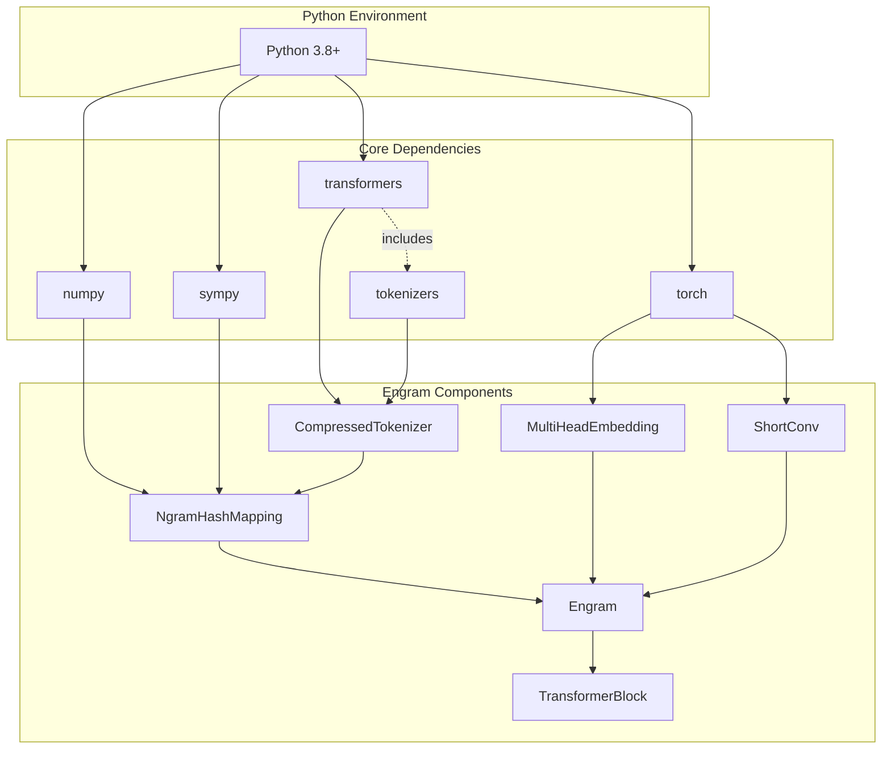
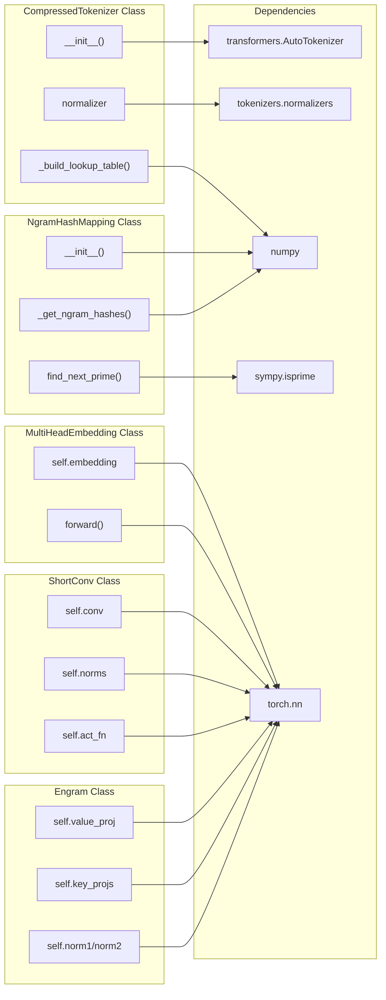
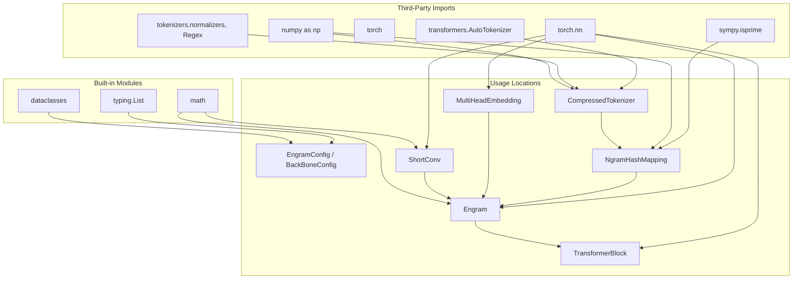

<!-- source: DeepWiki mcp.deepwiki.com · repo deepseek-ai/Engram · page 6.1 Installation and Dependencies · fetched 2026-10-30 -->

# Installation and Dependencies

<details>
<summary>Relevant source files</summary>

The following files were used as context for generating this wiki page:

- [README.md](README.md)
- [engram_demo_v1.py](engram_demo_v1.py)

</details>


This page covers the required dependencies and installation steps for running the Engram demonstration code. The focus is on setting up a minimal environment to execute [engram_demo_v1.py](). For guidance on actually running the demo, see [Running the Demo](#6.2). For production deployment considerations, see [Demo Overview](#4.1).

## Purpose and Scope

The Engram repository provides a demonstration implementation that illustrates the core logic and data flow of the Engram module. This page documents the software dependencies required to run this demonstration code on a local machine. Note that production-scale deployment requires additional optimizations (custom CUDA kernels, distributed training infrastructure) not covered here.

**Sources:** [README.md:78-90](), [engram_demo_v1.py:1-18]()

---

## System Requirements

### Python Version

The Engram demo requires **Python 3.8 or higher**. This version requirement ensures compatibility with modern type hints and dataclass features used throughout the implementation.

**Sources:** [README.md:80]()

### Hardware Requirements

The demonstration code runs on CPU and does not strictly require GPU acceleration, though PyTorch GPU support is recommended for performance. Memory requirements are minimal for the demo's mock implementation, as it does not load full-scale embedding tables.

**Sources:** [engram_demo_v1.py:6-18]()

---

## Core Dependencies

The following table summarizes all required dependencies and their roles in the Engram system:

| Package | Minimum Version | Purpose | Primary Usage Location |
|---------|----------------|---------|------------------------|
| `torch` | Latest stable | Neural network framework, tensor operations | Embedding layers, convolution, normalization |
| `numpy` | Latest stable | N-gram hash computation, array manipulation | `NgramHashMapping` hash calculation |
| `transformers` | Latest stable | Tokenizer loading and text preprocessing | `CompressedTokenizer` initialization |
| `sympy` | Latest stable | Prime number generation for collision reduction | `find_next_prime()` in hash mapping |
| `tokenizers` | (via transformers) | Low-level tokenization primitives, normalization | NFKC/NFD normalization in `CompressedTokenizer` |

**Sources:** [README.md:80-82](), [engram_demo_v1.py:22](), [engram_demo_v1.py:26-36]()

---

## Dependency Architecture

The following diagram shows how each Python package supports specific components in the Engram implementation:



**Sources:** [engram_demo_v1.py:26-36](), [engram_demo_v1.py:60-122](), [engram_demo_v1.py:181-303](), [engram_demo_v1.py:305-378]()

---

## Package Roles and Code Mappings

### torch: Neural Network Operations

The `torch` package provides the foundational neural network primitives used throughout the Engram module:

- **Embedding layers**: `MultiHeadEmbedding` uses `nn.Embedding` at [engram_demo_v1.py:318]()
- **Convolution**: `ShortConv` uses `nn.Conv1d` for grouped convolution at [engram_demo_v1.py:138-146]()
- **Normalization**: `nn.RMSNorm` applied in multiple locations ([engram_demo_v1.py:149-150](), [engram_demo_v1.py:355-356]())
- **Linear projections**: Value and key projections at [engram_demo_v1.py:351-354]()
- **Activation functions**: SiLU activation at [engram_demo_v1.py:154]()

**Sources:** [engram_demo_v1.py:33-34](), [engram_demo_v1.py:123-179](), [engram_demo_v1.py:305-324](), [engram_demo_v1.py:326-378]()

### numpy: Hash Computation

The `numpy` package handles efficient array operations for N-gram hash generation:

- **Hash calculation**: XOR mixing operations in `NgramHashMapping._get_ngram_hashes()` at [engram_demo_v1.py:285-287]()
- **Array shifting**: Token sequence shifts for N-gram construction at [engram_demo_v1.py:272-278]()
- **Lookup tables**: Compressed tokenizer mapping at [engram_demo_v1.py:106-108]()
- **Type conversions**: Int64 dtype enforcement at [engram_demo_v1.py:267](), [engram_demo_v1.py:294]()

**Sources:** [engram_demo_v1.py:32](), [engram_demo_v1.py:84-110](), [engram_demo_v1.py:262-296]()

### transformers: Tokenization

The `transformers` package provides the `AutoTokenizer` interface for loading the DeepSeek-V3 tokenizer:

- **Tokenizer loading**: `AutoTokenizer.from_pretrained()` at [engram_demo_v1.py:65]()
- **Token decoding**: Vocabulary normalization at [engram_demo_v1.py:91]()
- **Token conversion**: ID to token mapping at [engram_demo_v1.py:94]()

The demo uses the pretrained tokenizer from `"deepseek-ai/DeepSeek-V3"` as specified in `EngramConfig.tokenizer_name_or_path` at [engram_demo_v1.py:40]().

**Sources:** [engram_demo_v1.py:35](), [engram_demo_v1.py:60-121](), [engram_demo_v1.py:404]()

### sympy: Prime Number Generation

The `sympy` package provides symbolic mathematics functions, specifically used for prime number generation:

- **Prime checking**: `isprime()` function at [engram_demo_v1.py:184]()
- **Collision reduction**: Finding prime moduli for hash table sizes at [engram_demo_v1.py:249-255]()

The prime numbers ensure minimal hash collisions by using moduli that are coprime to common token ID patterns.

**Sources:** [engram_demo_v1.py:31](), [engram_demo_v1.py:181-186]()

### tokenizers: Text Normalization

The `tokenizers` library (installed as a dependency of `transformers`) provides low-level text normalization primitives:

- **NFKC/NFD normalization**: Unicode canonicalization at [engram_demo_v1.py:69-70]()
- **Accent stripping**: Diacritic removal at [engram_demo_v1.py:71]()
- **Lowercase conversion**: Case normalization at [engram_demo_v1.py:72]()
- **Whitespace normalization**: Space/tab/newline handling at [engram_demo_v1.py:73-74]()

These normalizations reduce vocabulary diversity for more efficient N-gram hashing.

**Sources:** [engram_demo_v1.py:36](), [engram_demo_v1.py:67-77]()

---

## Installation Steps

### Standard Installation

Execute the following command to install all required dependencies:

```bash
pip install torch numpy transformers sympy
```

This single command installs all four core packages. The `tokenizers` library is automatically installed as a dependency of `transformers` and does not require explicit specification.

**Sources:** [README.md:82](), [engram_demo_v1.py:22]()

### Installation with Virtual Environment

For isolated dependency management, use a virtual environment:

```bash
# Create virtual environment
python3 -m venv engram_env

# Activate (Linux/Mac)
source engram_env/bin/activate

# Activate (Windows)
engram_env\Scripts\activate

# Install dependencies
pip install torch numpy transformers sympy
```

**Sources:** [README.md:80-82]()

### Verification After Installation

Verify the installation by checking package imports:

```bash
python -c "import torch, numpy, transformers, sympy, tokenizers; print('✅ All dependencies installed')"
```

This command attempts to import all required packages. Success indicates a complete installation.

---

## Component-Dependency Mapping

The following diagram maps specific code constructs to their dependency requirements:



**Sources:** [engram_demo_v1.py:60-122](), [engram_demo_v1.py:181-303](), [engram_demo_v1.py:305-324](), [engram_demo_v1.py:123-179](), [engram_demo_v1.py:326-378]()

---

## Tokenizer Model Download

On first run, the `transformers` library will automatically download the DeepSeek-V3 tokenizer model from Hugging Face Hub. This download occurs when `AutoTokenizer.from_pretrained("deepseek-ai/DeepSeek-V3")` is called at [engram_demo_v1.py:65]() and [engram_demo_v1.py:404]().

### Network Requirements

- Internet connection required for initial tokenizer download
- Downloaded files cached in `~/.cache/huggingface/` by default
- Approximate download size: ~500KB for tokenizer files

### Offline Usage

After initial download, the cached tokenizer enables offline usage. To pre-download for offline environments:

```bash
python -c "from transformers import AutoTokenizer; AutoTokenizer.from_pretrained('deepseek-ai/DeepSeek-V3', trust_remote_code=True)"
```

**Sources:** [engram_demo_v1.py:40](), [engram_demo_v1.py:65](), [engram_demo_v1.py:404]()

---

## Import Structure

The following diagram shows the actual import statements and their locations in the codebase:



**Sources:** [engram_demo_v1.py:26-36](), [engram_demo_v1.py:38-58]()

---

## Troubleshooting Common Issues

### Import Errors

**Issue**: `ModuleNotFoundError: No module named 'transformers'`

**Solution**: Ensure all dependencies are installed. Re-run installation command:
```bash
pip install torch numpy transformers sympy
```

**Issue**: `ImportError: cannot import name 'normalizers' from 'tokenizers'`

**Solution**: The `tokenizers` package may be outdated. Update it:
```bash
pip install --upgrade transformers
```

### Tokenizer Download Failures

**Issue**: Network timeout when downloading DeepSeek-V3 tokenizer

**Solution**: Set longer timeout or use manual download:
```bash
export HF_HUB_DOWNLOAD_TIMEOUT=300
python engram_demo_v1.py
```

### Version Compatibility

All dependencies use latest stable versions. If encountering compatibility issues between PyTorch and NumPy, install specific versions:

```bash
pip install torch==2.0.0 numpy==1.24.0 transformers==4.30.0 sympy==1.12
```

**Sources:** [README.md:80-90](), [engram_demo_v1.py:6-18]()

---

## Next Steps

After successfully installing dependencies:

1. **Run the demo**: See [Running the Demo](#6.2) for execution instructions
2. **Understand configuration**: See [Configuration Reference](#4.6) for parameter tuning
3. **Explore architecture**: See [Demo Overview](#4.1) for code walkthrough

**Sources:** [README.md:78-90]()

---

