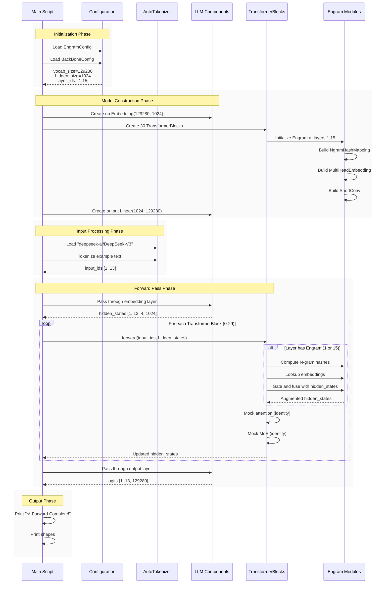
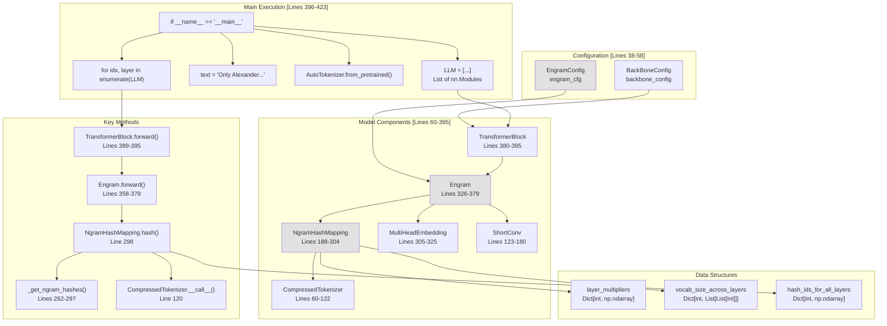
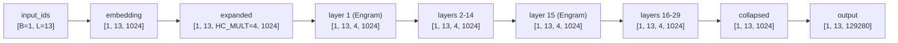

<!-- source: DeepWiki mcp.deepwiki.com · repo deepseek-ai/Engram · page 6.2 Running the Demo · fetched 2026-10-30 -->

# Running the Demo

<details>
<summary>Relevant source files</summary>

The following files were used as context for generating this wiki page:

- [README.md](README.md)
- [engram_demo_v1.py](engram_demo_v1.py)

</details>


## Purpose and Scope

This page provides a step-by-step guide to executing the Engram demonstration script and understanding its behavior. The demo file [`engram_demo_v1.py`](engram_demo_v1.py:1-423)() is a simplified implementation that illustrates the core Engram module data flow without the complexity of distributed training or production optimizations.

For installation prerequisites, see [Installation and Dependencies](#6.1). For practical applications and use cases, see [Use Cases and Examples](#6.3). For detailed component architecture, see [Engram Module Deep Dive](#3.2).

**Sources:** [README.md:78-90](), [engram_demo_v1.py:1-19]()

---

## Prerequisites

Before running the demo, ensure you have installed the required dependencies as described in [Installation and Dependencies](#6.1):

```bash
pip install torch numpy transformers sympy
```

The demo requires Python 3.8+ and will automatically download the DeepSeek-V3 tokenizer from Hugging Face on first run.

**Sources:** [README.md:80-83](), [engram_demo_v1.py:22]()

---

## Basic Execution

To run the demo, execute the following command from the repository root:

```bash
python engram_demo_v1.py
```

The script performs a single forward pass through a mock 30-layer transformer with Engram modules at layers 1 and 15. Upon successful completion, you will see:

```
✅ Forward Complete!
input_ids.shape=torch.Size([1, 13])
output.shape=torch.Size([1, 13, 129280])
```

**Expected Runtime:** On a typical CPU, the demo completes in 5-15 seconds, with most time spent downloading the tokenizer on first run and computing hash mappings.

**Sources:** [README.md:85-87](), [engram_demo_v1.py:396-423]()

---

## Demo Execution Flow

The following diagram traces the execution sequence when you run `python engram_demo_v1.py`:



**Key Observations:**

| Phase | Duration | Critical Operation |
|-------|----------|-------------------|
| Initialization | ~1s | Configuration loading |
| Model Construction | ~2-5s | Engram hash table computation |
| Input Processing | ~3-8s (first run) | Tokenizer download |
| Forward Pass | ~1-3s | N-gram hashing and embedding lookup |
| Output | <1s | Shape validation |

**Sources:** [engram_demo_v1.py:396-423]()

---

## Code Path and Component Mapping

This diagram maps the demo's execution to specific code entities, bridging natural language concepts to implementation:



**Code Entity Reference:**

| Entity | Location | Purpose |
|--------|----------|---------|
| `EngramConfig` | [engram_demo_v1.py:38-48]() | Engram-specific parameters |
| `BackBoneConfig` | [engram_demo_v1.py:50-55]() | Transformer backbone parameters |
| `CompressedTokenizer` | [engram_demo_v1.py:60-122]() | Vocabulary compression via normalization |
| `NgramHashMapping` | [engram_demo_v1.py:188-304]() | Layer-specific N-gram hashing |
| `MultiHeadEmbedding` | [engram_demo_v1.py:305-325]() | Multi-vocabulary embedding lookup |
| `ShortConv` | [engram_demo_v1.py:123-180]() | Grouped 1D convolution with RMSNorm |
| `Engram` | [engram_demo_v1.py:326-379]() | Main Engram module with gating and fusion |
| `TransformerBlock` | [engram_demo_v1.py:380-395]() | Transformer layer with conditional Engram |
| `LLM` | [engram_demo_v1.py:397-401]() | Complete model structure list |

**Sources:** [engram_demo_v1.py:25-395]()

---

## Understanding the Output

When the demo completes successfully, it prints the following:

```
✅ Forward Complete!
input_ids.shape=torch.Size([1, 13])
output.shape=torch.Size([1, 13, 129280])
```

### Output Interpretation

| Output Component | Value | Meaning |
|------------------|-------|---------|
| Exit status | `✅ Forward Complete!` | All layers processed without errors |
| `input_ids.shape` | `[1, 13]` | Batch size 1, sequence length 13 tokens |
| `output.shape` | `[1, 13, 129280]` | Logits over vocabulary for each token position |

The example text "Only Alexander the Great could tame the horse Bucephalus." tokenizes to 13 tokens using the DeepSeek-V3 tokenizer. The output shape `[1, 13, 129280]` represents logits for next-token prediction at each position across the 129,280-token vocabulary.

### Internal Data Flow Shapes

During execution, hidden states pass through the following shape transformations:



**Key:** `B`=batch, `L`=sequence length, `HC_MULT`=hyper-connection multiplier (4), dimensions are `(batch, seq_len, hc_mult, hidden_size)`.

**Sources:** [engram_demo_v1.py:396-423]()

---

## Demo Configuration

The demo uses default configurations defined at module level:

### Engram Configuration

```python
# Lines 38-48
EngramConfig(
    tokenizer_name_or_path = "deepseek-ai/DeepSeek-V3"
    engram_vocab_size = [129280*5, 129280*5]  # For 2-gram and 3-gram
    max_ngram_size = 3
    n_embed_per_ngram = 512
    n_head_per_ngram = 8
    layer_ids = [1, 15]
    pad_id = 2
    seed = 0
    kernel_size = 4
)
```

### Backbone Configuration

```python
# Lines 50-55
BackBoneConfig(
    hidden_size = 1024
    hc_mult = 4
    vocab_size = 129280
    num_layers = 30
)
```

### Parameter Counts

| Component | Parameters | Notes |
|-----------|-----------|-------|
| Vocabulary Embedding | 132M | `129280 * 1024` |
| Each Engram Module | ~1.3M | Embeddings + projections + conv |
| Output Layer | 132M | `1024 * 129280` |
| **Total (excl. attention/MoE)** | ~267M | Mock implementation only |

**Note:** The demo mocks attention and MoE layers as identity functions to focus on Engram data flow.

**Sources:** [engram_demo_v1.py:38-58](), [engram_demo_v1.py:326-357]()

---

## Customizing the Demo

### Modifying the Input Text

To test with different input, edit line 403:

```python
# Original
text = "Only Alexander the Great could tame the horse Bucephalus."

# Custom example
text = "Your custom text here for testing Engram lookup behavior."
```

### Changing Engram Layer Placement

To place Engram modules at different layers, modify line 45:

```python
# Original: layers 1 and 15
layer_ids: List[int] = field(default_factory=lambda: [1, 15])

# Example: early, middle, late layers
layer_ids: List[int] = field(default_factory=lambda: [0, 10, 20])
```

**Impact:** Each layer gets its own hash multipliers via `self.layer_multipliers[layer_id]` at [engram_demo_v1.py:219-231]().

### Adjusting N-gram Size

To change the maximum N-gram size, edit line 42:

```python
# Original: 2-grams and 3-grams
max_ngram_size: int = 3

# Example: 2-grams through 4-grams
max_ngram_size: int = 4
```

**Warning:** Increasing `max_ngram_size` requires adding corresponding entries to `engram_vocab_size` at line 41.

### Vocabulary Size Configuration

The `engram_vocab_size` list defines the hash table size for each N-gram order:

```python
# Line 41
# Index 0: 2-gram vocabulary size
# Index 1: 3-gram vocabulary size
engram_vocab_size: List[int] = field(default_factory=lambda: [129280*5, 129280*5])
```

Larger values reduce hash collisions but increase memory usage. Each vocabulary size is automatically rounded up to the next prime number per head for collision reduction at [engram_demo_v1.py:181-186]().

**Sources:** [engram_demo_v1.py:38-48](), [engram_demo_v1.py:327-357]()

---

## Limitations and Caveats

The demo has intentional simplifications to focus on Engram logic:

| Limitation | Demo Behavior | Production Requirement |
|------------|---------------|----------------------|
| Attention | Identity function (`lambda x:x`) | Full multi-head attention with RoPE |
| MoE | Identity function (`lambda x:x`) | Sparse expert routing |
| Hyper-connections | Mock expand/collapse | Full multi-latent-attention (mHA) |
| Distributed Training | N/A | All2All communication for Engram sync |
| Memory Offloading | All embeddings in device memory | Host memory offloading for inference |
| Gradient Computation | Forward-only | Backpropagation through all components |
| Batch Processing | Single sequence | Dynamic batching with padding |

**Warning:** This demo is **not suitable for production use**. It serves solely to illustrate the Engram module data flow as stated in [engram_demo_v1.py:5-18]().

For architectural details on production requirements, see [Training vs Inference Architecture](#3.3) and [Memory Hierarchy and Offloading](#3.4).

**Sources:** [engram_demo_v1.py:1-18](), [engram_demo_v1.py:380-395]()

---

## Troubleshooting

### Common Issues

**Issue:** `ModuleNotFoundError: No module named 'transformers'`

**Solution:** Install dependencies per [Installation and Dependencies](#6.1):
```bash
pip install torch numpy transformers sympy
```

**Issue:** First run takes 10+ seconds

**Solution:** This is expected behavior. The tokenizer downloads from Hugging Face on first run and is cached locally for subsequent executions.

**Issue:** Memory error on large vocabulary sizes

**Solution:** The demo loads all N-gram embeddings into device memory. For `engram_vocab_size = [129280*5, 129280*5]` with `n_head_per_ngram = 8`, total embedding parameters exceed 660M. Reduce vocabulary sizes or embedding dimensions if running on limited memory.

**Issue:** Hash collision warnings

**Solution:** The system uses prime number moduli to minimize collisions at [engram_demo_v1.py:181-186](). If you modify vocabulary sizes significantly, ensure they remain near prime numbers for optimal distribution.

### Verification Steps

To verify the demo is working correctly:

1. **Shape consistency:** Output shape should be `[batch_size, seq_len, vocab_size]`
2. **Engram execution:** Add debug prints in `Engram.forward()` at [engram_demo_v1.py:358]() to verify it executes at layers 1 and 15
3. **Hash distribution:** Print `hash_ids_for_all_layers` values at [engram_demo_v1.py:302]() to inspect hash outputs

**Sources:** [engram_demo_v1.py:396-423](), [README.md:78-90]()

---

