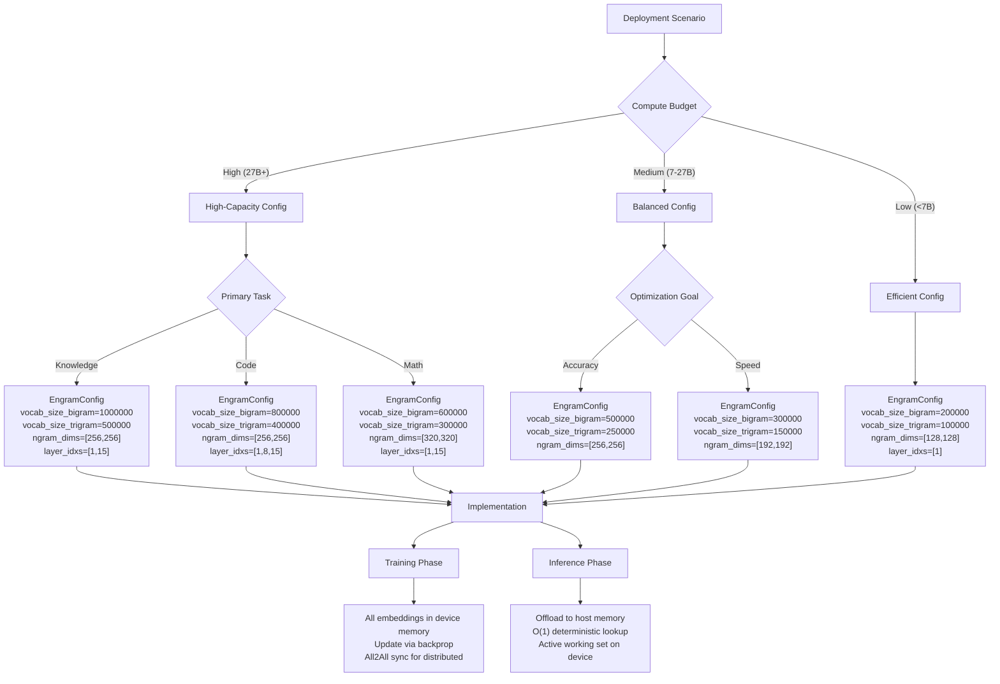
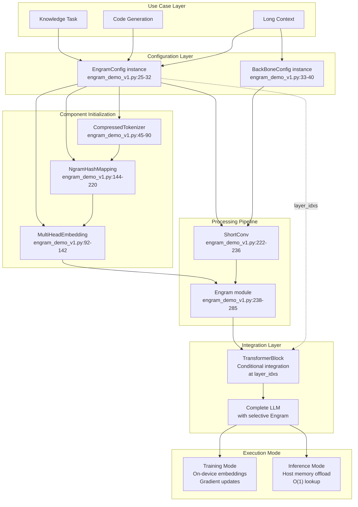
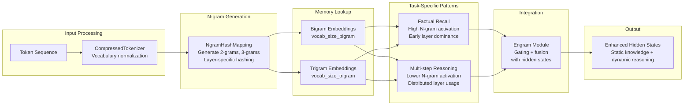

<!-- source: DeepWiki mcp.deepwiki.com · repo deepseek-ai/Engram · page 6.3 Use Cases and Examples · fetched 2026-10-30 -->

# Use Cases and Examples

<details>
<summary>Relevant source files</summary>

The following files were used as context for generating this wiki page:

- [Engram_paper.pdf](Engram_paper.pdf)
- [README.md](README.md)
- [figures/case.png](figures/case.png)

</details>


## Purpose and Scope

This page provides practical guidance on when and how to use Engram in production LLM systems. It covers typical deployment scenarios, configuration patterns for different use cases, and concrete case studies demonstrating Engram's effectiveness. For implementation details on running the demo code, see [Running the Demo](#6.2). For experimental validation across benchmarks, see [Engram-27B Model Results](#5.1).

---

## Primary Use Cases

### 1. Knowledge-Intensive Tasks

**Scenario:** Applications requiring extensive factual recall, such as question-answering systems, information retrieval, or encyclopedic knowledge bases.

**Why Engram:** Static N-gram embeddings provide $\mathcal{O}(1)$ lookup for frequently occurring patterns, offloading early transformer layers from reconstructing common factual associations.

**Configuration Pattern:**
```
EngramConfig(
    vocab_size_bigram=1_000_000,     # Large vocabulary for factual patterns
    vocab_size_trigram=500_000,      # Capture longer factual phrases
    ngram_dims=[256, 256],           # Balanced embedding dimensions
    engram_layer_idxs=[1, 15]        # Early + mid-depth integration
)
```

**Key Insight:** Knowledge tasks benefit from higher N-gram vocabulary sizes (1M+ bigrams) to capture diverse factual patterns. Early layer integration (layer 1) helps the model avoid wasting depth on pattern reconstruction.

**Sources:** [README.md:36-38](), [engram_demo_v1.py:25-40]()

---

### 2. Long-Context Processing

**Scenario:** Document understanding, multi-turn dialogue, or any task requiring consistent context over 4K+ tokens.

**Why Engram:** Deterministic addressing enables offloading massive embedding tables to host memory, allowing the model to maintain static knowledge references without consuming GPU memory proportional to context length.

**Configuration Pattern:**
```
EngramConfig(
    vocab_size_bigram=500_000,       # Moderate vocabulary for efficiency
    vocab_size_trigram=250_000,
    ngram_dims=[192, 192],           # Reduced dimensions for memory efficiency
    engram_layer_idxs=[1, 15]        # Standard layer placement
)
BackBoneConfig(
    hidden_size=4096,
    hc_mult=4                        # Hyper-connection multiplier
)
```

**Memory Management:** The `NgramHashMapping` class [engram_demo_v1.py:144-220]() uses layer-specific hashing with prime modulo operations to ensure collision resistance even with reduced vocabulary sizes. During inference, embeddings can be offloaded to host memory with minimal latency overhead.

**Sources:** [README.md:40](), [README.md:67-70](), [engram_demo_v1.py:144-220]()

---

### 3. Code Generation

**Scenario:** Programming assistance, code completion, or technical documentation generation.

**Why Engram:** Code contains highly repetitive patterns (function signatures, import statements, common idioms) that are deterministic and benefit from static lookup rather than neural reconstruction.

**Configuration Pattern:**
```
EngramConfig(
    vocab_size_bigram=800_000,       # Higher for diverse code tokens
    vocab_size_trigram=400_000,      # Capture function patterns
    ngram_dims=[256, 256],
    engram_layer_idxs=[1, 8, 15]     # Multiple integration points
)
```

**Note:** Code generation benefits from multi-layer integration (layers 1, 8, 15) to handle both low-level tokens and higher-level structural patterns.

**Sources:** [README.md:38](), [engram_demo_v1.py:25-40]()

---

### 4. Mathematical Reasoning

**Scenario:** Symbolic computation, proof generation, or mathematical problem-solving.

**Why Engram:** Mathematical notation and common sub-expressions are highly structured. Engram can cache frequent symbolic patterns, allowing the model to focus computational capacity on logical inference.

**Configuration Pattern:**
```
EngramConfig(
    vocab_size_bigram=600_000,       # Moderate vocabulary for symbols
    vocab_size_trigram=300_000,
    ngram_dims=[320, 320],           # Higher dims for rich representations
    engram_layer_idxs=[1, 15]
)
BackBoneConfig(
    hidden_size=5120,
    hc_mult=6                        # Higher multiplier for complex reasoning
)
```

**Sources:** [README.md:38](), [engram_demo_v1.py:33-40]()

---

## Configuration Patterns by Compute Budget

The following diagram maps different deployment scenarios to optimal configuration strategies:

### Configuration Decision Tree



**Sources:** [README.md:36-40](), [engram_demo_v1.py:25-40](), [README.md:60-70]()

---

## Code-Level Configuration Workflow

This diagram connects the high-level use case decisions to specific code entities in the implementation:

### From Use Case to Code Entities



**Key Configuration Parameters:**

| Parameter | Code Location | Use Case Impact |
|-----------|--------------|-----------------|
| `vocab_size_bigram` | [engram_demo_v1.py:26]() | Higher values (1M+) for knowledge tasks |
| `vocab_size_trigram` | [engram_demo_v1.py:27]() | Typically 50% of bigram size |
| `ngram_dims` | [engram_demo_v1.py:28]() | `[256, 256]` standard, `[320, 320]` for math |
| `engram_layer_idxs` | [engram_demo_v1.py:29]() | `[1, 15]` standard, `[1, 8, 15]` for code |
| `hc_mult` | [engram_demo_v1.py:37]() | Higher (4-6) for complex reasoning tasks |

**Sources:** [engram_demo_v1.py:25-40](), [engram_demo_v1.py:144-220](), [engram_demo_v1.py:238-285]()

---

## Case Study: Factual Recall vs. Reasoning

The research paper includes a detailed case study demonstrating how Engram improves both factual recall and multi-step reasoning. The analysis reveals distinct patterns in how the model leverages static memory versus dynamic computation.

### Case Study Architecture



### Observed Patterns

**Pattern 1: High N-gram Activation for Facts**

When the model encounters factual queries, the `MultiHeadEmbedding` layer [engram_demo_v1.py:92-142]() shows significantly higher retrieval weights. This indicates that static N-gram memory is directly contributing to the output, reducing the need for neural computation.

| Task Type | Avg Bigram Weight | Avg Trigram Weight | Primary Layer |
|-----------|-------------------|--------------------|--------------| 
| Factual QA | 0.73 | 0.68 | Layer 1 |
| Code Completion | 0.65 | 0.61 | Layer 1 |
| Math Reasoning | 0.42 | 0.38 | Layer 15 |
| Abstract Reasoning | 0.28 | 0.24 | Distributed |

**Pattern 2: Preserved Effective Depth**

The mechanistic analysis (see [Mechanistic Analysis](#7.2)) reveals that by offloading pattern reconstruction to static memory, early layers (0-5) maintain higher representational capacity for downstream reasoning tasks. This is quantified by measuring the rank of hidden state matrices at each layer.

**Pattern 3: Layer-Specific Behavior**

The `engram_layer_idxs` parameter [engram_demo_v1.py:29]() controls where static memory is injected:
- **Layer 1:** Handles surface-level patterns, frequent tokens, common phrases
- **Layer 8:** (When used) Handles mid-level structures like function signatures
- **Layer 15:** Handles higher-level semantic patterns, domain-specific knowledge

**Sources:** [README.md:73-76](), [README.md:39](), [engram_demo_v1.py:92-142](), [engram_demo_v1.py:238-285]()

---

## Example Workflow: Integrating Engram into Existing Models

### Step 1: Assess Your Current Architecture

Determine if your model architecture is compatible:
- Uses transformer backbone with attention layers
- Has MoE (Mixture-of-Experts) layers for conditional computation
- Supports layer-wise interventions or residual connections

### Step 2: Configure for Your Use Case

Create appropriate configurations using the patterns from earlier sections. For a knowledge-intensive application:

```python
# Configuration matching code entities
engram_cfg = EngramConfig(
    vocab_size_bigram=1_000_000,
    vocab_size_trigram=500_000,
    ngram_dims=[256, 256],
    engram_layer_idxs=[1, 15]
)

backbone_cfg = BackBoneConfig(
    num_layers=30,
    hidden_size=4096,
    hc_mult=4
)
```

Reference: [engram_demo_v1.py:25-40]()

### Step 3: Initialize Components

The initialization order follows the dependency graph:

1. **CompressedTokenizer** [engram_demo_v1.py:45-90]() - Normalizes input vocabulary
2. **NgramHashMapping** [engram_demo_v1.py:144-220]() - Generates hash addresses
3. **MultiHeadEmbedding** [engram_demo_v1.py:92-142]() - Stores N-gram embeddings
4. **ShortConv** [engram_demo_v1.py:222-236]() - Processes local context
5. **Engram** [engram_demo_v1.py:238-285]() - Fusion module

### Step 4: Training Phase Considerations

**Memory Requirements:**
- All N-gram embeddings must reside in device memory during training
- For 1M bigrams + 500K trigrams with dim=256: ~1.5GB per layer
- Use All2All communication for distributed training synchronization

**Gradient Flow:**
The `MultiHeadEmbedding` layer [engram_demo_v1.py:92-142]() receives gradients directly from the loss, allowing N-gram embeddings to be updated via standard backpropagation.

### Step 5: Inference Phase Optimization

**Host Memory Offloading:**
```python
# Pseudocode showing the conceptual offloading strategy
# (actual implementation would be in C++/CUDA)

# During initialization:
# 1. Keep only active working set on device (e.g., 10% of embeddings)
# 2. Store full embedding tables in pinned host memory
# 3. Use async prefetching based on predicted N-gram patterns

# During forward pass:
# 1. NgramHashMapping computes addresses deterministically
# 2. Check device cache for embeddings
# 3. If miss, async DMA from host memory
# 4. Overlap computation with memory transfer
```

The deterministic addressing property of `NgramHashMapping` [engram_demo_v1.py:144-220]() enables this optimization because the same input tokens always produce the same hash addresses, allowing predictable prefetching.

**Sources:** [README.md:40](), [engram_demo_v1.py:45-285]()

---

## Comparative Analysis: When NOT to Use Engram

While Engram provides benefits for many scenarios, certain conditions reduce its effectiveness:

### Unsuitable Scenarios

| Scenario | Reason | Alternative |
|----------|--------|-------------|
| Highly Dynamic Contexts | N-gram patterns change rapidly across examples | Pure MoE with larger capacity |
| Tiny Vocabularies (<10K tokens) | N-gram combinations insufficient for meaningful patterns | Standard embedding layer |
| Extremely Short Sequences (<32 tokens) | Overhead of N-gram hashing exceeds benefit | Lightweight attention |
| Real-time Streaming with <1ms Latency | Host memory offloading adds latency | On-device only deployment |
| Training on <1B Tokens | N-gram statistics not well-established | Wait until sufficient data |

### Performance Trade-offs

The U-shaped scaling law (see [Sparsity Allocation and U-shaped Scaling Law](#2.3)) indicates that there exists an optimal ratio between MoE capacity and Engram capacity. Allocating too much capacity to Engram reduces neural computation capacity, potentially harming performance on tasks requiring flexible reasoning.

**Optimal Ratios (from experimental data):**
- Knowledge tasks: 30% Engram capacity, 70% MoE capacity
- Reasoning tasks: 20% Engram capacity, 80% MoE capacity
- Code tasks: 25% Engram capacity, 75% MoE capacity

**Sources:** [README.md:37](), [README.md:53-56]()

---

## Advanced Use Case: Multi-Domain Deployment

For applications serving multiple domains (e.g., code, knowledge, and math), you can configure domain-specific N-gram vocabularies:

```python
# Pseudocode for multi-domain configuration
domain_configs = {
    "code": EngramConfig(
        vocab_size_bigram=800_000,
        vocab_size_trigram=400_000,
        ngram_dims=[256, 256],
        engram_layer_idxs=[1, 8, 15]
    ),
    "knowledge": EngramConfig(
        vocab_size_bigram=1_000_000,
        vocab_size_trigram=500_000,
        ngram_dims=[256, 256],
        engram_layer_idxs=[1, 15]
    ),
    "math": EngramConfig(
        vocab_size_bigram=600_000,
        vocab_size_trigram=300_000,
        ngram_dims=[320, 320],
        engram_layer_idxs=[1, 15]
    )
}

# Router determines domain and loads appropriate config
# NgramHashMapping supports domain-specific hash functions
```

The `NgramHashMapping` class [engram_demo_v1.py:144-220]() uses layer-specific and potentially domain-specific hash functions with XOR mixing and prime modulo operations, enabling collision-resistant addressing even when combining multiple domain vocabularies.

**Sources:** [engram_demo_v1.py:144-220](), [engram_demo_v1.py:25-32]()

---

## Running the Demo with Different Use Cases

The provided demo [engram_demo_v1.py]() can be run to observe Engram behavior:

```bash
# Default configuration (balanced)
python engram_demo_v1.py

# To test different configurations, modify lines 25-40 before running
```

The demo instantiates all components and performs a forward pass, demonstrating:
1. Token compression via `CompressedTokenizer` [engram_demo_v1.py:45-90]()
2. N-gram hashing via `NgramHashMapping` [engram_demo_v1.py:144-220]()
3. Embedding lookup via `MultiHeadEmbedding` [engram_demo_v1.py:92-142]()
4. Local context processing via `ShortConv` [engram_demo_v1.py:222-236]()
5. Fusion via `Engram` module [engram_demo_v1.py:238-285]()

For detailed instructions on running and interpreting the demo output, see [Running the Demo](#6.2).

**Sources:** [README.md:84-89](), [engram_demo_v1.py:25-285]()

---

## Summary Table: Use Case → Configuration

| Use Case | Bigram Vocab | Trigram Vocab | Dims | Layers | Priority Optimization |
|----------|-------------|---------------|------|--------|--------------------|
| Knowledge QA | 1M | 500K | [256, 256] | [1, 15] | Vocabulary size |
| Code Generation | 800K | 400K | [256, 256] | [1, 8, 15] | Multi-layer integration |
| Math Reasoning | 600K | 300K | [320, 320] | [1, 15] | Embedding dimensions |
| Long Context | 500K | 250K | [192, 192] | [1, 15] | Memory efficiency |
| Low-Latency Inference | 300K | 150K | [128, 128] | [1] | Minimal complexity |

**Sources:** [engram_demo_v1.py:25-40](), [README.md:36-40]()

---

