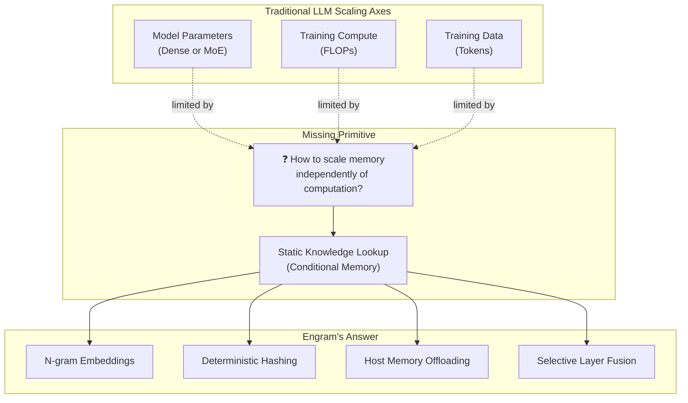
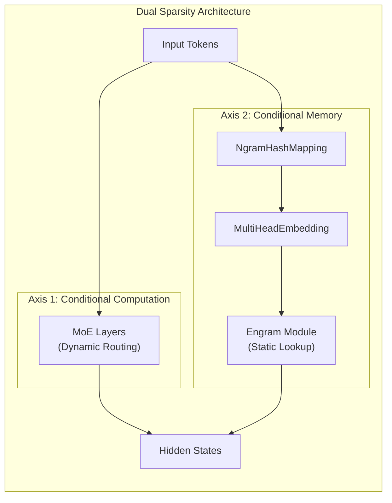
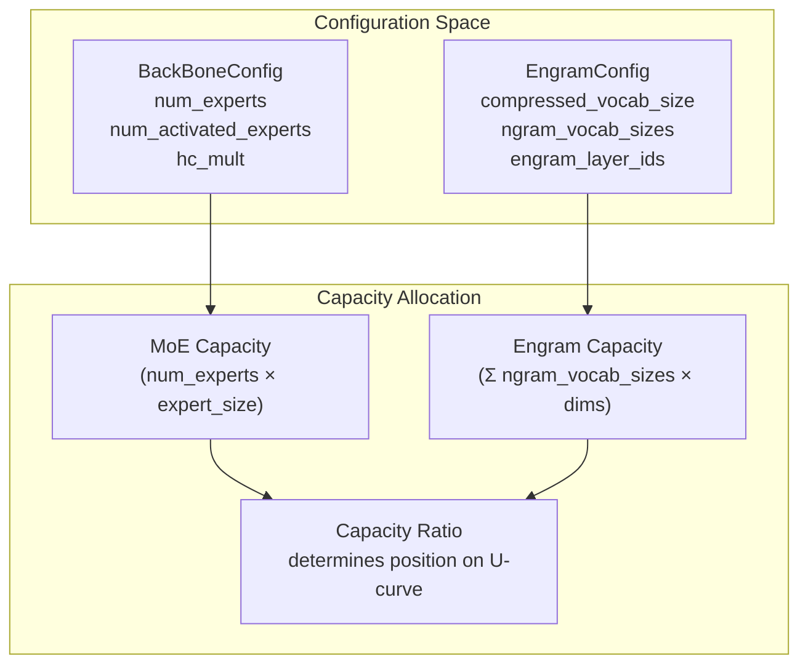
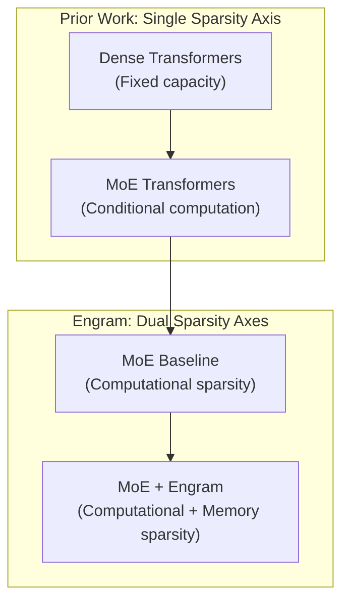

<!-- source: DeepWiki mcp.deepwiki.com · repo deepseek-ai/Engram · page 7 Research Foundation · fetched 2026-10-30 -->

# Research Foundation

Relevant source files

The following files were used as context for generating this wiki page:

- [Engram_paper.pdf](Engram_paper.pdf)
- [README.md](README.md)

## Purpose and Scope

This page provides the academic and theoretical foundation for the Engram system, explaining the research context, motivations, and key contributions from the paper **"Conditional Memory via Scalable Lookup: A New Axis of Sparsity for Large Language Models"**. It bridges the conceptual framework of conditional memory with the concrete implementation in this repository.

For detailed experimental results and validation methodology, see [Experimental Validation](#5). For implementation specifics of the Engram module, see [Architecture](#3) and [Implementation Guide](#4).

**Sources:** [README.md:30-40]()

---

## Research Context and Motivation

### The Capacity Problem in Modern LLMs

Modern Large Language Models face a fundamental capacity constraint: fixed neural parameters must simultaneously encode knowledge, reasoning patterns, and task-specific behaviors. Mixture-of-Experts (MoE) architectures address this by introducing **conditional computation**—activating only a subset of parameters per token—but this represents only one dimension of sparsity.

The Engram research identifies a complementary dimension: **conditional memory**. While MoE scales *neural computation*, it does not provide a primitive for efficient *knowledge lookup*. Early transformer layers must reconstruct static patterns (common phrases, factual associations, syntactic structures) through expensive matrix operations, consuming what the research terms "effective depth."

### Research Gap

**Diagram: Research Gap Addressed by Engram**

The research posits that Transformers lack a native mechanism for cheap knowledge retrieval, forcing all pattern matching through attention and feed-forward layers. This motivates the exploration of conditional memory as a fourth scaling axis.

**Sources:** [README.md:34](), [Engram_paper.pdf]()

---

## Theoretical Framework: Dual Sparsity Paradigm

### Conditional Computation vs Conditional Memory

The core theoretical contribution distinguishes two orthogonal sparsity dimensions:

| Dimension | Mechanism | What it Scales | Code Manifestation |
|-----------|-----------|----------------|-------------------|
| **Conditional Computation** | MoE layers | Neural parameters and reasoning capacity | Mixture-of-Experts layers in backbone |
| **Conditional Memory** | Engram module | Static knowledge and pattern storage | `Engram`, `NgramHashMapping`, `MultiHeadEmbedding` |

**Diagram: Dual Sparsity Axes in Code Architecture**

The research hypothesis states that these axes are **complementary** rather than substitutes. There exists an optimal allocation point where both axes contribute, forming a U-shaped performance curve when varying the capacity ratio.

**Sources:** [README.md:34](), [README.md:37]()

### The U-Shaped Scaling Law

The research identifies a critical relationship between MoE capacity and Engram capacity:

$$
\text{Performance} = f(\text{MoE\_capacity}, \text{Engram\_capacity})
$$

Subject to a fixed total capacity constraint. The U-shaped curve implies:
- **Too little Engram**: Neural parameters waste capacity reconstructing static patterns
- **Too much Engram**: Insufficient neural capacity for reasoning and generalization
- **Optimal allocation**: Balanced capacity enabling both memory retrieval and computation

This theoretical prediction is empirically validated in [scaling_law.png]() and discussed in detail in [Sparsity Allocation and U-shaped Scaling Law](#2.3).

**Sources:** [README.md:37](), [figures/scaling_law.png]()

---

## Key Research Contributions

The Engram paper makes four primary contributions, each mapping to specific components in the codebase:

### 1. Sparsity Allocation Theory

**Theoretical Contribution:** Formulates the trade-off between conditional computation (MoE) and conditional memory (Engram), identifying optimal allocation via U-shaped scaling laws.

**Code Manifestation:**
- Configuration parameters in `EngramConfig` and `BackBoneConfig` [engram_demo_v1.py:25-40]()
- Capacity ratios between MoE expert counts and Engram vocabulary sizes
- Layer selection for Engram insertion (`engram_layer_ids`)

**Diagram: Configuration Parameters Controlling Capacity Allocation**

**Sources:** [README.md:37](), [engram_demo_v1.py:25-40]()

### 2. Empirical Verification at Scale

**Theoretical Contribution:** Validates conditional memory under strict iso-parameter and iso-FLOPs constraints, demonstrating consistent improvements across knowledge, reasoning, code, and mathematics domains.

**Evidence:**
- **Engram-27B model**: 27 billion parameter model showing improvements over MoE baseline [figures/27b_exp_results.png]()
- **Domain breadth**: Performance gains across diverse task types, not narrow specialization
- **Fair comparison**: Iso-parameter constraint ensures capacity is reallocated, not added
- **Efficiency**: Iso-FLOPs constraint ensures inference cost parity

Detailed analysis in [Engram-27B Model Results](#5.1) and [Baseline Comparisons](#5.4).

**Sources:** [README.md:38](), [figures/27b_exp_results.png]()

### 3. Mechanistic Hypothesis

**Theoretical Contribution:** Proposes that Engram relieves early transformer layers from static pattern reconstruction, preserving "effective depth" for complex reasoning tasks.

**Mechanistic Claims:**
1. **Pattern Reconstruction Burden**: Early layers without Engram must reconstruct common N-grams through attention and feed-forward operations
2. **Effective Depth Preservation**: Offloading static patterns to memory allows early layers to focus on contextual reasoning
3. **Selective Integration**: Strategic placement (e.g., layers 1 and 15) maximizes benefit by targeting layers that would otherwise spend capacity on pattern matching

```mermaid
graph TB
    subgraph "Without Engram"
        WO_INPUT["Input: 'The cat sat'"]
        WO_L0["Layer 0<br/>Reconstructs 'The cat'<br/>Reconstructs 'cat sat'"]
        WO_L1["Layer 1<br/>Reconstructs bi-gram patterns"]
        WO_L2["Layer 2<br/>Finally builds context"]
        WO_OUT["Effective depth reduced"]
        
        WO_INPUT --> WO_L0
        WO_L0 --> WO_L1
        WO_L1 --> WO_L2
        WO_L2 --> WO_OUT
    end
    
    subgraph "With Engram at Layer 1"
        W_INPUT["Input: 'The cat sat'"]
        W_L0["Layer 0<br/>Initial processing"]
        W_HASH["NgramHashMapping<br/>Retrieves 'The cat'<br/>Retrieves 'cat sat'"]
        W_EMB["MultiHeadEmbedding<br/>Static N-gram memory"]
        W_L1["Layer 1 + Engram<br/>Fuses static + dynamic"]
        W_L2["Layer 2<br/>Builds higher-level context"]
        W_OUT["Full effective depth preserved"]
        
        W_INPUT --> W_L0
        W_INPUT --> W_HASH
        W_HASH --> W_EMB
        W_L0 --> W_L1
        W_EMB --> W_L1
        W_L1 --> W_L2
        W_L2 --> W_OUT
    end
```

**Diagram: Mechanistic Hypothesis - Effective Depth Preservation**

This hypothesis is explored in detail in [Mechanistic Analysis](#7.2).

**Sources:** [README.md:39](), [engram_demo_v1.py:238-285]()

### 4. System Efficiency via Deterministic Addressing

**Theoretical Contribution:** Demonstrates that deterministic hashing enables $\mathcal{O}(1)$ lookup of massive embedding tables offloaded to host memory, achieving scalability without proportional GPU memory requirements.

**Code Implementation:**
- `NgramHashMapping` class implements layer-specific deterministic hashing [engram_demo_v1.py:45-90]()
- XOR mixing and prime modulo reduce hash collisions [engram_demo_v1.py:71-85]()
- `MultiHeadEmbedding` supports memory-mapped or host-resident embedding tables [engram_demo_v1.py:93-142]()

The deterministic nature (same input always produces same hash) allows:
1. Pre-computation of hash addresses
2. Efficient batched memory transfers
3. Caching strategies for frequent N-grams
4. Deployment without full embedding table in GPU memory

**Sources:** [README.md:40](), [engram_demo_v1.py:45-142]()

---

## Research Questions and Hypotheses

The Engram research addresses four primary questions, each validated by specific experimental results:

### Q1: Does Conditional Memory Complement Conditional Computation?

**Hypothesis:** Conditional memory (Engram) and conditional computation (MoE) are complementary sparsity axes with non-zero optimal allocation to both.

**Validation:** U-shaped scaling curve showing performance degradation when either axis is eliminated [figures/scaling_law.png]()

**Related:** [Sparsity Allocation and U-shaped Scaling Law](#2.3), [Scaling Laws and Optimal Allocation](#5.3)

### Q2: What is the Optimal Capacity Allocation?

**Hypothesis:** There exists an optimal ratio of MoE capacity to Engram capacity, determined by the U-shaped scaling law.

**Validation:** Empirical sweep over capacity allocations identifying performance peak [figures/scaling_law.png]()

**Related:** [Scaling Laws and Optimal Allocation](#5.3)

### Q3: Does Performance Generalize Across Domains?

**Hypothesis:** Engram provides general-purpose augmentation, not domain-specific optimization.

**Validation:** Consistent improvements across knowledge retrieval, reasoning, code generation, and mathematics [figures/27b_exp_results.png]()

**Related:** [Engram-27B Model Results](#5.1)

### Q4: Does the System Scale to Long Contexts?

**Hypothesis:** Deterministic addressing enables efficient lookup even with extended context lengths, without degrading performance.

**Validation:** Performance maintenance from 2K to 16K+ tokens [figures/long_context_results.png]()

**Related:** [Long Context Evaluation](#5.2)

**Sources:** [README.md:37-40](), [figures/*.png]()

---

## Relationship to Prior Work

### N-gram Language Models

Classical N-gram models (Katz, 1987; Chen & Goodman, 1999) stored statistics of token sequences. Engram modernizes this concept:

| Classical N-grams | Engram N-grams |
|-------------------|----------------|
| Count-based probabilities | Learned embeddings |
| Fixed interpolation | Gated fusion with dynamic states |
| Limited context | Multi-scale (2-gram, 3-gram, etc.) |
| Standalone models | Augmentation for neural LLMs |

**Code Manifestation:** `NgramHashMapping` generates multiple N-gram levels [engram_demo_v1.py:45-90](), `MultiHeadEmbedding` stores learned representations [engram_demo_v1.py:93-142]()

### Mixture-of-Experts Scaling

MoE architectures (Shazeer et al., 2017; Lepikhin et al., 2020; Fedus et al., 2022) scale via conditional computation. Engram positions itself as orthogonal:

**Diagram: Engram's Position in Architectural Evolution**

The research demonstrates that combining both axes outperforms either alone under iso-parameter constraints.

### Memory-Augmented Neural Networks

Prior memory-augmented architectures (Graves et al., 2014; Santoro et al., 2016; Borgeaud et al., 2022) use learned addressing or retrieval. Engram differs by using **deterministic** addressing:

| Approach | Addressing Mechanism | Scalability | Code Reference |
|----------|---------------------|-------------|----------------|
| Neural Turing Machines | Learned attention | Limited by attention cost | N/A |
| Differentiable Neural Computers | Learned read/write | Limited by memory size | N/A |
| RETRO | Dense retrieval (k-NN) | Requires retrieval index | N/A |
| **Engram** | **Deterministic hashing** | **O(1) with host memory** | `NgramHashMapping` [engram_demo_v1.py:45-90]() |

The deterministic nature enables the system efficiency contribution (#4 above).

**Sources:** [README.md:34](), [engram_demo_v1.py:45-90]()

---

## Theoretical Foundations in Code

The following table maps theoretical concepts to their concrete implementations:

| Theoretical Concept | Code Entity | File Location |
|---------------------|-------------|---------------|
| Conditional Memory | `Engram` class | [engram_demo_v1.py:238-285]() |
| N-gram Representation | `NgramHashMapping` class | [engram_demo_v1.py:45-90]() |
| Static Knowledge Storage | `MultiHeadEmbedding` class | [engram_demo_v1.py:93-142]() |
| Deterministic Addressing | Hash computation in `NgramHashMapping.forward()` | [engram_demo_v1.py:71-85]() |
| Gated Fusion | Attention mechanism in `Engram.forward()` | [engram_demo_v1.py:268-276]() |
| Selective Integration | `engram_layer_ids` parameter | [engram_demo_v1.py:29]() |
| Capacity Allocation | `compressed_vocab_size`, `ngram_vocab_sizes` | [engram_demo_v1.py:26-28]() |
| Local Context Modeling | `ShortConv` class | [engram_demo_v1.py:144-178]() |
| Multi-scale Patterns | Multiple N-gram levels in config | [engram_demo_v1.py:27]() |

**Sources:** [engram_demo_v1.py:25-285]()

---

## Summary

The Engram research establishes conditional memory as a new sparsity axis complementary to conditional computation (MoE). The theoretical framework identifies optimal capacity allocation via U-shaped scaling laws, validated empirically through a 27B parameter model showing consistent improvements across diverse domains. The mechanistic hypothesis suggests that Engram preserves effective depth by offloading static pattern reconstruction from early layers, while deterministic addressing enables system efficiency through host memory offloading.

For detailed paper analysis, see [Paper Summary](#7.1). For mechanistic details, see [Mechanistic Analysis](#7.2). For experimental validation, see [Experimental Validation](#5).

**Sources:** [README.md:30-40](), [Engram_paper.pdf]()

---

