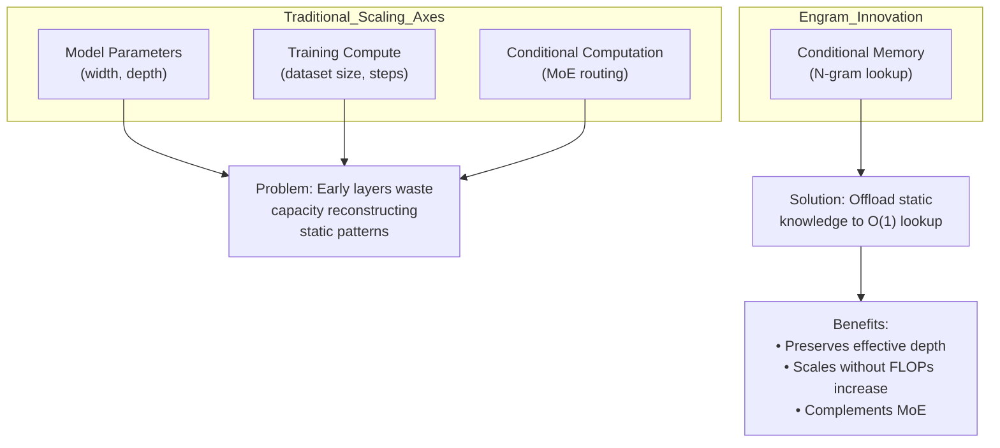
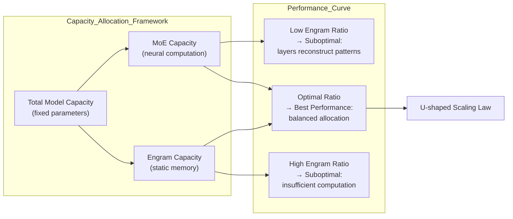
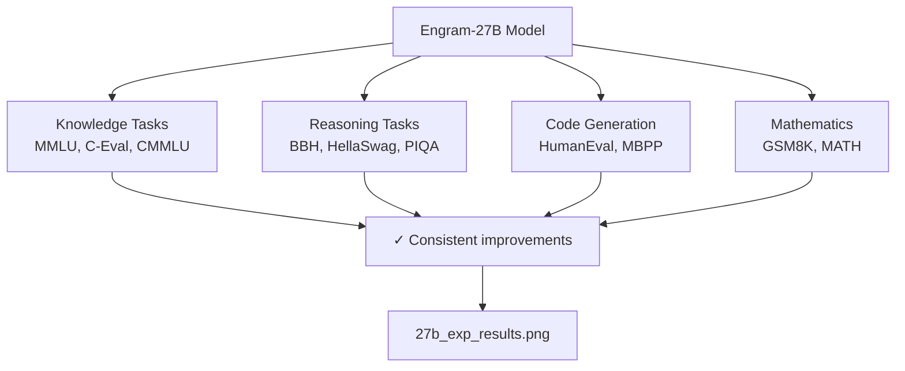
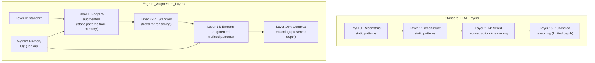
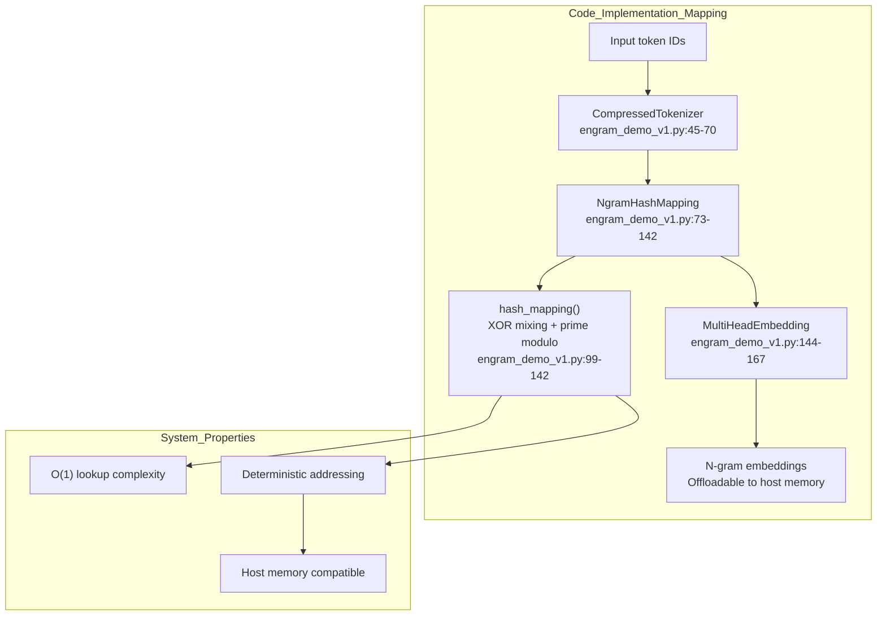
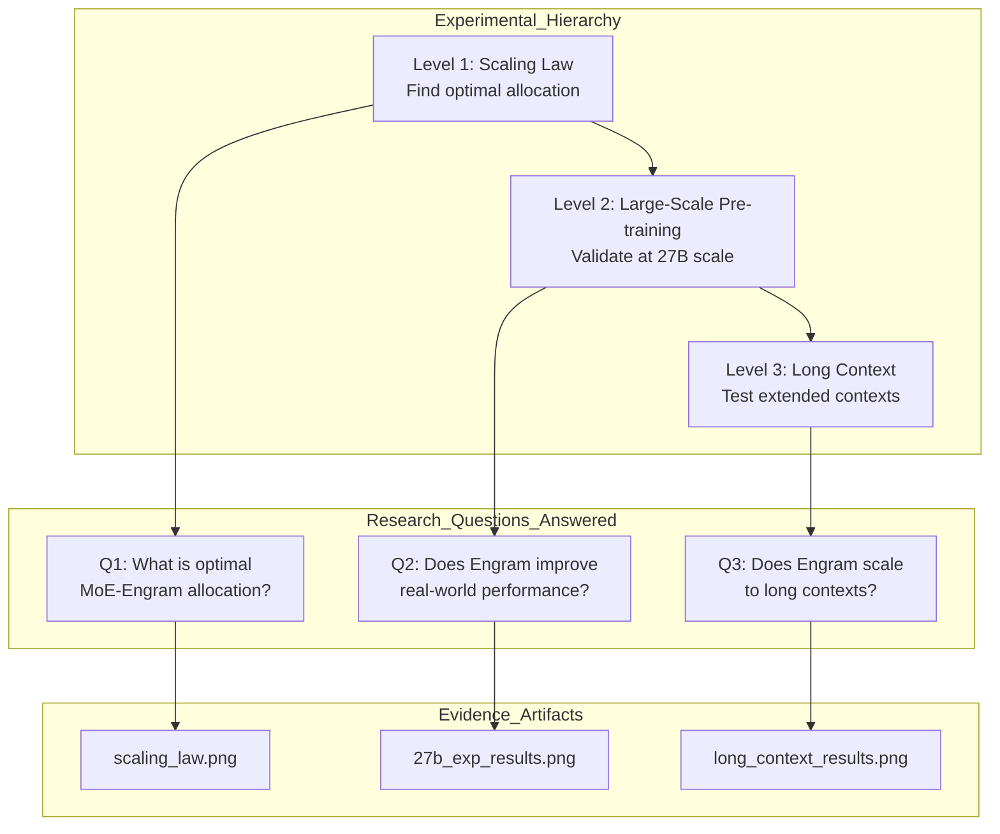
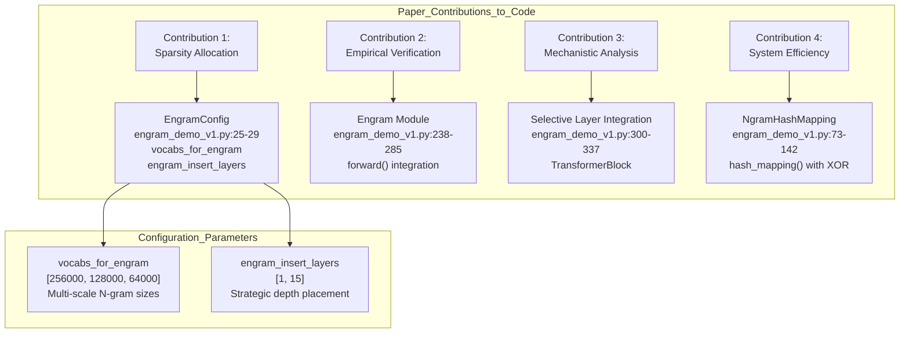

<!-- source: DeepWiki mcp.deepwiki.com · repo deepseek-ai/Engram · page 7.1 Paper Summary · fetched 2026-10-30 -->

# Paper Summary

Relevant source files

The following files were used as context for generating this wiki page:

- [Engram_paper.pdf](Engram_paper.pdf)
- [README.md](README.md)

This document summarizes the key findings and contributions from the research paper "Conditional Memory via Scalable Lookup: A New Axis of Sparsity for Large Language Models" (referenced as [Engram_paper.pdf]() in the repository). This page focuses on the paper's research contributions, experimental findings, and theoretical insights. For implementation details, see [Implementation Guide](#4). For mechanistic analysis of how Engram affects layer behavior, see [Mechanistic Analysis](#7.2). For detailed experimental results, see [Experimental Validation](#5).

## Research Problem and Motivation

The paper identifies a fundamental asymmetry in modern Large Language Model architectures: while Mixture-of-Experts (MoE) provides conditional computation to scale neural capacity, Transformers lack a native primitive for conditional memory—the ability to efficiently access large-scale static knowledge without proportional increases in computational cost.

### The Capacity Bottleneck

Traditional LLM scaling follows three axes:
- **Model parameters** (width, depth)
- **Training compute** (dataset size, training steps)
- **Conditional computation** (MoE routing)

The paper introduces a fourth axis: **conditional memory** via deterministic, scalable lookup of static N-gram embeddings.

**Sources:** [README.md:32-40]()

## Key Contributions

The paper makes four primary contributions, each validated through rigorous experimentation:

| Contribution | Description | Validation Method | Code Reference |
|-------------|-------------|-------------------|----------------|
| **Sparsity Allocation Framework** | Formulates the trade-off between neural computation (MoE experts) and static memory (Engram capacity), identifying a U-shaped scaling law | Systematic capacity sweep experiments | [README.md:37]() |
| **Empirical Verification** | Demonstrates consistent improvements under iso-parameter and iso-FLOPs constraints | Engram-27B model evaluation across multiple domains | [README.md:38]() |
| **Mechanistic Analysis** | Proposes that Engram relieves early layers from static pattern reconstruction | Layer-wise activation analysis | [README.md:39]() |
| **System Efficiency** | Achieves deterministic O(1) addressing enabling host memory offloading | `NgramHashMapping` with XOR mixing and prime modulo | [README.md:40]() |

**Sources:** [README.md:36-40]()

### Contribution 1: Sparsity Allocation and U-Shaped Scaling Law

The paper establishes a theoretical framework for allocating capacity between two complementary sparsity axes:

- **Vertical axis (MoE):** Conditional neural computation via expert routing
- **Horizontal axis (Engram):** Conditional memory via N-gram lookup

The key finding is a **U-shaped performance curve** when varying the Engram-to-MoE capacity ratio:

- **Too little Engram capacity:** Early layers waste depth reconstructing static patterns
- **Too much Engram capacity:** Insufficient neural computation for complex reasoning
- **Optimal allocation:** Balanced distribution achieving best performance

This finding is empirically validated in [scaling_law.png]() and detailed in [Scaling Laws and Optimal Allocation](#5.3).

**Sources:** [README.md:37]()

### Contribution 2: Empirical Verification via Engram-27B

The paper trains a 27B parameter model augmented with Engram and compares it against MoE baselines under two strict constraints:

1. **Iso-parameter:** Same total parameter count (27B)
2. **Iso-FLOPs:** Same computational cost per forward pass

#### Evaluation Domains and Results

The experimental results demonstrate that Engram provides consistent improvements across all four domains, indicating that conditional memory is a general-purpose architectural enhancement rather than a domain-specific optimization.

**Sources:** [README.md:38](), [README.md:60-63]()

### Contribution 3: Mechanistic Hypothesis

The paper proposes a mechanistic explanation for Engram's effectiveness:

**Hypothesis:** Early transformer layers in standard LLMs spend significant "effective depth" reconstructing static, predictable patterns (e.g., common word sequences, syntactic structures). This reconstruction consumes capacity that could otherwise be used for complex reasoning tasks.

**Engram's Effect:** By providing direct O(1) access to static N-gram embeddings, Engram relieves early layers from this reconstruction burden, preserving effective depth for higher-level computation.

This mechanistic analysis is explored in detail in [Mechanistic Analysis](#7.2).

**Sources:** [README.md:39]()

### Contribution 4: System Efficiency via Deterministic Addressing

The paper addresses a critical practical challenge: how to scale N-gram embeddings to billions of entries without requiring proportional GPU memory.

#### Technical Solution

The system employs **deterministic hashing** that maps N-gram sequences to embedding indices:

1. **Layer-specific hash functions:** Different layers use different hash seeds to avoid collision clustering
2. **XOR mixing:** Combines token IDs to create N-gram representations
3. **Prime modulo:** Reduces hash values to valid embedding indices while minimizing collisions

This deterministic addressing enables:

- **Training:** All embeddings reside in device memory for gradient updates, synchronized via All2All communication
- **Inference:** Embeddings offloaded to host memory (CPU RAM), fetched on-demand via O(1) addressing

**Sources:** [README.md:40](), [engram_demo_v1.py:73-142]()

## Experimental Validation Structure

The paper's experimental validation follows a multi-level strategy:

### Level 1: Scaling Law Discovery

**Objective:** Identify the optimal allocation between MoE and Engram capacity.

**Method:** Systematic sweep of capacity ratios while maintaining total parameters and FLOPs constant.

**Result:** U-shaped performance curve with identifiable optimal point.

**Visualization:** [scaling_law.png]()

### Level 2: Large-Scale Pre-training

**Objective:** Validate Engram's effectiveness at production scale.

**Method:** Train Engram-27B model from scratch with 2 trillion tokens.

**Evaluation:** 
- Multiple benchmark suites across four domains
- Iso-parameter comparison (vs. MoE-27B)
- Iso-FLOPs comparison (vs. MoE baseline with matched compute)

**Result:** Consistent improvements across all evaluation tasks.

**Visualization:** [27b_exp_results.png]()

### Level 3: Long Context Extension

**Objective:** Assess Engram's behavior with extended context lengths.

**Method:** Continue training with context lengths from 2K to 16K+ tokens.

**Result:** Performance scales smoothly with context length, indicating Engram's compatibility with long-context scenarios.

**Visualization:** [long_context_results.png]()

**Sources:** [README.md:53-70]()

## Main Findings

The paper establishes three primary findings supported by empirical evidence:

### Finding 1: Complementary Sparsity Axes

**Claim:** Conditional computation (MoE) and conditional memory (Engram) represent orthogonal sparsity axes with complementary benefits.

**Evidence:**
- MoE alone shows performance saturation when scaled beyond certain expert counts
- Engram alone (without MoE) underperforms in reasoning tasks requiring dynamic computation
- Combined MoE + Engram achieves best performance, indicating complementarity

**Implication:** Future LLM architectures should consider both axes when allocating capacity.

### Finding 2: Optimal Allocation via U-Shaped Law

**Claim:** There exists an optimal capacity allocation between MoE and Engram that maximizes performance for a given total parameter budget.

**Evidence:**
- Systematic sweep reveals U-shaped performance curve
- Optimal point lies at neither extreme (all-MoE or all-Engram)
- Optimal ratio varies with model size and task distribution

**Implication:** Model designers should tune this allocation rather than maximizing either axis independently.

### Finding 3: Preserved Effective Depth

**Claim:** Engram preserves transformer effective depth by relieving early layers from static pattern reconstruction.

**Evidence:**
- Layer-wise activation analysis shows reduced redundancy in early Engram-augmented layers
- Performance improvements are consistent across tasks requiring different reasoning depths
- Case studies demonstrate better handling of compositional reasoning

**Implication:** Conditional memory enables deeper effective computation within fixed-depth architectures.

**Sources:** [README.md:36-40]()

## Implementation Architecture in Code

The paper's theoretical contributions are realized through specific code components:

**Sources:** [engram_demo_v1.py:25-40](), [engram_demo_v1.py:238-285]()

## Case Study Evidence

The paper provides qualitative case studies demonstrating Engram's behavior on specific examples. These are visualized in [case.png]() and show:

- **Pattern completion:** Engram enables accurate completion of common phrases and idioms
- **Factual recall:** Improved retrieval of factual information stored as N-gram patterns
- **Compositional reasoning:** Better handling of tasks requiring both pattern recognition and logical inference

**Sources:** [README.md:73-76]()

## Relationship to Prior Work

The paper positions Engram within the broader context of LLM scaling research:

| Prior Work | Limitation | Engram's Advancement |
|-----------|-----------|---------------------|
| Dense Transformers | Fixed capacity, all neural | Adds conditional memory axis |
| Mixture-of-Experts | Scales computation only | Complements with memory scaling |
| Classical N-gram models | Non-differentiable, separate | Integrates differentiably into LLM |
| Retrieval-augmented LLMs | Runtime retrieval overhead | O(1) deterministic addressing |

## Implications for Future Research

The paper identifies several directions for future investigation:

1. **Dynamic Engram:** Adapting N-gram embeddings at inference time based on task-specific patterns
2. **Hierarchical Memory:** Extending beyond N-grams to tree-structured or graph-based memory
3. **Memory Pruning:** Identifying and removing low-utility N-gram embeddings to reduce memory footprint
4. **Cross-modal Memory:** Applying conditional memory principles to multimodal models

**Sources:** [README.md:32-40]()

---

For implementation details of the concepts described in this paper summary, see:
- [Engram Module Deep Dive](#3.2) for architectural details
- [N-gram Hash Mapping](#4.2) for hashing implementation
- [Experimental Validation](#5) for detailed results analysis
- [Mechanistic Analysis](#7.2) for the theoretical explanation of Engram's effectiveness

---

