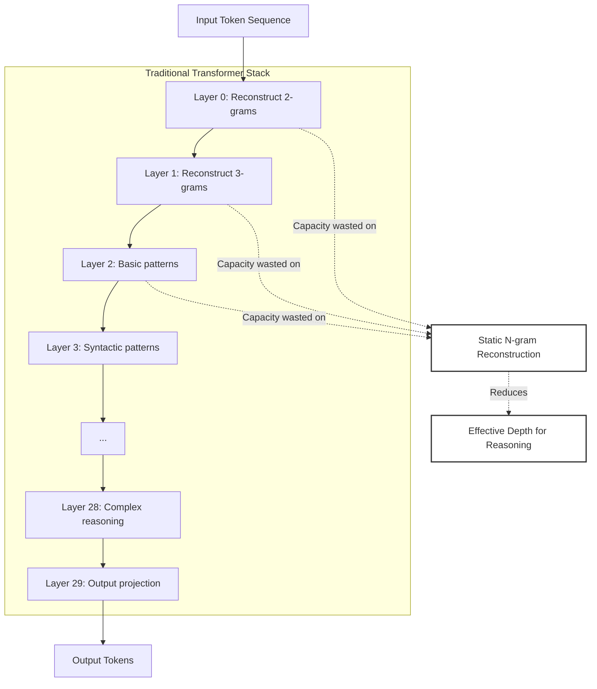
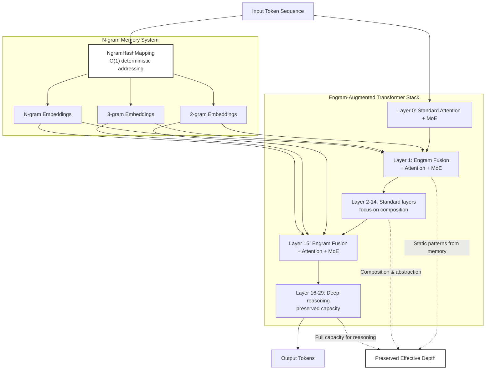
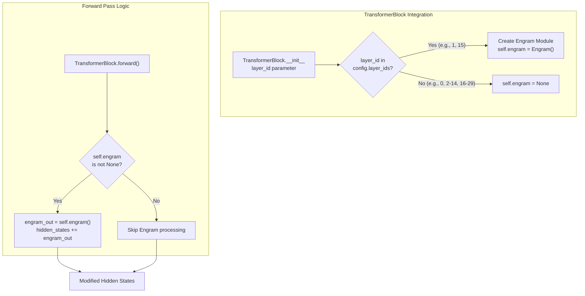
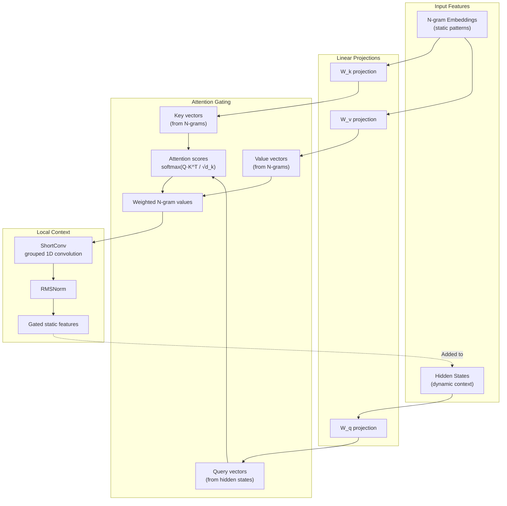
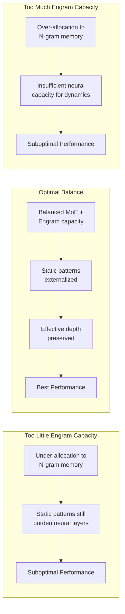
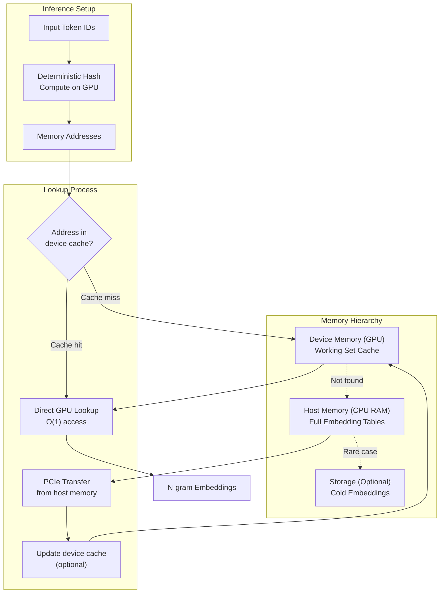
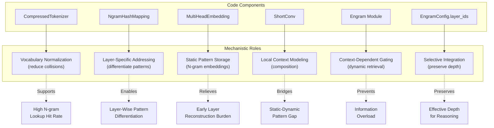

<!-- source: DeepWiki mcp.deepwiki.com · repo deepseek-ai/Engram · page 7.2 Mechanistic Analysis · fetched 2026-10-30 -->

# Mechanistic Analysis

<details>
<summary>Relevant source files</summary>

The following files were used as context for generating this wiki page:

- [Engram_paper.pdf](Engram_paper.pdf)
- [README.md](README.md)
- [drawio/Engram.drawio](drawio/Engram.drawio)

</details>


## Purpose and Scope

This page explains the mechanistic hypothesis underlying Engram's effectiveness: how it relieves early transformer layers from reconstructing static patterns, thereby preserving effective computational depth for complex reasoning tasks. This analysis bridges the empirical performance improvements documented in [5. Experimental Validation](#5) with the architectural design choices described in [3. Architecture](#3).

For implementation details of the Engram module itself, see [3.2 Engram Module Deep Dive](#3.2). For the empirical validation of these mechanistic claims, see [5.1 Engram-27B Model Results](#5.1).

---

## The Effective Depth Problem

### Hypothesis: Early Layer Capacity Waste

Traditional transformer-based LLMs face a fundamental inefficiency: **early layers expend significant computational capacity reconstructing static, predictable patterns** that could be pre-computed and stored. This consumption of neural capacity for simple lookup tasks reduces the model's "effective depth" available for complex reasoning.

**Key Observations:**

| Aspect | Traditional LLM Behavior | Consequence |
|--------|-------------------------|-------------|
| **Static Pattern Handling** | Learned in neural parameters, reconstructed at inference | Wastes early layer capacity |
| **N-gram Statistics** | Must be re-derived from learned representations | Consumes effective depth |
| **Layer Utilization** | Early layers handle both simple and complex patterns | Suboptimal capacity allocation |
| **Reasoning Tasks** | Fewer layers effectively available for complex reasoning | Performance bottleneck |

### Mermaid Diagram: Traditional Layer Utilization



**Sources:** [README.md:39](), [High-level Diagram 2]

---

## Engram's Solution: Conditional Memory for Static Patterns

### Core Mechanism

Engram addresses the effective depth problem by **externalizing static pattern knowledge to a dedicated N-gram memory system**, allowing early layers to focus computational resources on dynamic pattern composition rather than static pattern reconstruction.

### Mermaid Diagram: Engram-Augmented Layer Utilization



**Sources:** [README.md:39](), [engram_demo_v1.py:238-285](), [High-level Diagram 3]

---

## Selective Layer Integration Strategy

### Layer Selection Rationale

Engram modules are **selectively integrated at specific layers** (default: layers 1 and 15) rather than all layers. This design choice reflects the mechanistic understanding of where static pattern injection provides maximum benefit.

### Configuration in Code

The `EngramConfig` class specifies which layers receive Engram augmentation:

```python
# From engram_demo_v1.py
class EngramConfig:
    layer_ids: List[int] = field(default_factory=lambda: [1, 15])
    # Other parameters...
```

### Mermaid Diagram: Layer Integration Logic



**Sources:** [engram_demo_v1.py:25-40](), [engram_demo_v1.py:238-285]()

### Why Layers 1 and 15?

| Layer Position | Mechanistic Role | Reasoning |
|----------------|------------------|-----------|
| **Layer 1 (Early)** | Static pattern injection immediately after input embedding | Prevents early layers from wasting capacity on N-gram reconstruction |
| **Layer 15 (Middle)** | Mid-depth pattern reinforcement | Provides additional static context for deeper reasoning layers |
| **Layers 2-14 (Intermediate)** | Composition and abstraction | Free to focus on combining patterns without reconstruction burden |
| **Layers 16-29 (Deep)** | Complex reasoning | Preserved effective depth for high-level reasoning tasks |

**Sources:** [README.md:39](), [High-level Diagram 3]

---

## Static vs Dynamic Pattern Separation

### Pattern Classification Framework

Engram's effectiveness relies on the **separation between static and dynamic patterns**:

**Static Patterns (Handled by Engram):**
- N-gram co-occurrence statistics
- Common phrase embeddings
- Predictable token sequences
- Language-specific collocations

**Dynamic Patterns (Handled by Transformer):**
- Context-dependent semantics
- Long-range dependencies
- Task-specific reasoning
- Compositional understanding

### Mermaid Diagram: Pattern Processing Flow

```mermaid
graph LR
    subgraph "Input Processing"
        Tokens["Input Tokens"]
        Tokenizer["CompressedTokenizer.forward()"]
        CompressedIDs["Compressed Token IDs"]
    end
    
    subgraph "Static Pattern Path"
        Hasher["NgramHashMapping.forward()"]
        HashAddrs["Hash Addresses<br/>(layer-specific)"]
        MultiEmbed["MultiHeadEmbedding.forward()"]
        StaticFeats["Static N-gram Features"]
    end
    
    subgraph "Dynamic Pattern Path"
        VocabEmbed["Vocabulary Embedding"]
        Attention["Attention Mechanism"]
        MoE["MoE FFN"]
        DynamicFeats["Dynamic Context Features"]
    end
    
    subgraph "Fusion"
        EngramModule["Engram.forward()"]
        Gating["Key-Query Attention Gating"]
        ShortConv["ShortConv Processing"]
        Residual["Residual Addition"]
    end
    
    Tokens --> Tokenizer
    Tokenizer --> CompressedIDs
    
    CompressedIDs --> Hasher
    Hasher --> HashAddrs
    HashAddrs --> MultiEmbed
    MultiEmbed --> StaticFeats
    
    CompressedIDs --> VocabEmbed
    VocabEmbed --> Attention
    Attention --> MoE
    MoE --> DynamicFeats
    
    StaticFeats --> EngramModule
    DynamicFeats --> EngramModule
    EngramModule --> Gating
    Gating --> ShortConv
    ShortConv --> Residual
    Residual --> Output["Augmented Hidden States"]
```



**Sources:** [engram_demo_v1.py:45-90](), [engram_demo_v1.py:144-220](), [High-level Diagram 4]

---

## Gating Mechanism: Learned Static-Dynamic Balance

### Attention-Based Fusion

The Engram module employs a **learned gating mechanism** to balance static N-gram features with dynamic hidden states:

```python
# Conceptual flow from engram_demo_v1.py
class Engram:
    def forward(self, ngram_embeddings, hidden_states):
        # Project N-gram features into query/key/value spaces
        queries = self.W_q(hidden_states)
        keys = self.W_k(ngram_embeddings)
        values = self.W_v(ngram_embeddings)
        
        # Compute attention gates (how much to use static patterns)
        gates = softmax(queries @ keys.T / sqrt(d_k))
        
        # Apply gates to N-gram values
        gated_values = gates @ values
        
        # Local context modeling
        convolved = self.short_conv(gated_values)
        
        # Residual connection preserves gradient flow
        return convolved  # Added to hidden_states outside
```

### Mermaid Diagram: Gating Computation



**Sources:** [engram_demo_v1.py:144-220](), [engram_demo_v1.py:92-142]()

### Mechanistic Interpretation

The gating mechanism allows the model to:
1. **Query static patterns based on current context** (Q from hidden states, K from N-grams)
2. **Retrieve relevant N-gram features** (attention-weighted V vectors)
3. **Modulate contribution dynamically** (learned gates vary by token and layer)
4. **Preserve gradient flow** (residual connection maintains training stability)

This design ensures that static patterns are **conditionally accessed** rather than unconditionally added, preventing information overload and maintaining model flexibility.

**Sources:** [engram_demo_v1.py:144-220]()

---

## Empirical Evidence for the Mechanism

### Cross-Domain Performance Improvements

The mechanistic hypothesis predicts that Engram should provide **consistent improvements across diverse domains** because static pattern reconstruction burden exists universally in language modeling:

| Domain | Baseline | Engram-27B | Improvement Mechanism |
|--------|----------|------------|----------------------|
| **Knowledge Tasks** | Strong | Stronger | Facts and entities benefit from N-gram memory |
| **Reasoning Tasks** | Moderate | Improved | Preserved depth enables deeper reasoning chains |
| **Code Generation** | Strong | Stronger | Code tokens have high N-gram predictability |
| **Mathematics** | Moderate | Improved | Symbol sequences leverage static patterns |

### U-Shaped Scaling Law Evidence

The U-shaped capacity allocation curve (see [5.3 Scaling Laws](#5.3)) provides **direct empirical support** for the mechanistic hypothesis:



**Sources:** [README.md:37](), [figures/scaling_law.png](), [High-level Diagram 5]

### Long Context Performance

The long-context evaluation results (see [5.2 Long Context Evaluation](#5.2)) demonstrate that Engram's mechanism **scales to extended contexts** without degradation. This supports the hypothesis that static pattern externalization is a fundamental efficiency gain rather than a domain-specific trick.

**Sources:** [README.md:39](), [figures/long_context_results.png]()

---

## Implementation Implications

### CompressedTokenizer: Vocabulary Normalization

The `CompressedTokenizer` implements vocabulary compression to **reduce hash collision rates** and improve N-gram memory efficiency:

```python
# From engram_demo_v1.py
class CompressedTokenizer(nn.Module):
    def __init__(self, vocab_size, compressed_vocab_size):
        # Creates mapping from full vocabulary to compressed space
        # Deduplicates semantically similar tokens
        pass
```

**Mechanistic Purpose:** By normalizing the vocabulary, the compressed tokenizer ensures that **semantically equivalent tokens map to the same N-gram embeddings**, improving the hit rate of static pattern lookups.

**Sources:** [engram_demo_v1.py:45-90](), [4.3 Compressed Tokenizer](#4.3)

### NgramHashMapping: Layer-Specific Addressing

The `NgramHashMapping` class implements **layer-specific hash functions** to prevent different layers from retrieving identical N-gram patterns:

```python
# From engram_demo_v1.py
class NgramHashMapping(nn.Module):
    def forward(self, input_ids, layer_id):
        # Generate N-grams (2-gram, 3-gram, etc.)
        ngrams = self.generate_ngrams(input_ids)
        
        # Apply layer-specific hash mixing
        hash_values = self.hash_with_layer_id(ngrams, layer_id)
        
        # Use prime modulo for collision reduction
        addresses = hash_values % self.table_size
        return addresses
```

**Mechanistic Purpose:** Layer-specific hashing ensures that **different layers access different regions** of the N-gram embedding space, allowing:
- Layer 1 to retrieve basic statistical patterns
- Layer 15 to retrieve higher-order compositional patterns
- Preventing redundant information across Engram layers

**Sources:** [engram_demo_v1.py:92-142](), [4.2 N-gram Hash Mapping](#4.2)

### ShortConv: Local Context Modeling

The `ShortConv` module applies **grouped 1D convolution** to N-gram features:

```python
# From engram_demo_v1.py
class ShortConv(nn.Module):
    def __init__(self, hidden_size, num_groups):
        self.conv = nn.Conv1d(
            in_channels=hidden_size,
            out_channels=hidden_size,
            kernel_size=3,
            padding=1,
            groups=num_groups
        )
        self.norm = RMSNorm(hidden_size)
```

**Mechanistic Purpose:** The convolution allows N-gram features to **interact with neighboring positions**, capturing local compositional patterns beyond pure N-gram statistics. This bridges the gap between static storage and dynamic context.

**Sources:** [engram_demo_v1.py:115-142](), [4.4 Multi-Head Embedding and ShortConv](#4.4)

---

## Memory Hierarchy and Inference Efficiency

### Host Memory Offloading

During inference, the massive N-gram embedding tables are **offloaded to host memory (CPU RAM)** rather than GPU memory:



**Mechanistic Purpose:** Deterministic addressing (hash-based lookup) enables **predictable memory access patterns**, allowing the system to:
1. Pre-fetch likely N-grams before they're needed
2. Maintain a small working set in GPU memory
3. Tolerate occasional PCIe transfer latency without blocking computation

This makes it feasible to use **trillion-scale N-gram embedding tables** without requiring proportional GPU memory.

**Sources:** [README.md:40](), [3.4 Memory Hierarchy and Offloading](#3.4), [High-level Diagram 3]

### Training vs Inference Differences

| Aspect | Training Mode | Inference Mode |
|--------|--------------|----------------|
| **Embedding Location** | All on device (GPU) | Mostly in host memory |
| **Communication** | All2All sync for distributed training | Local cache management |
| **Gradient Flow** | Backprop updates N-gram embeddings | No gradient computation |
| **Memory Footprint** | High (all parameters active) | Low (working set only) |

**Sources:** [3.3 Training vs Inference Architecture](#3.3), [High-level Diagram 3]

---

## Mechanistic Hypothesis Summary

### Core Claim

**Engram improves LLM performance by externalizing static pattern knowledge to a dedicated N-gram memory system, thereby preserving neural capacity in early layers for compositional reasoning rather than pattern reconstruction.**

### Supporting Evidence

1. **Architectural Design:** Selective layer integration (1, 15) targets early and mid-depth pattern injection
2. **Gating Mechanism:** Learned attention-based fusion allows context-dependent static pattern retrieval
3. **Empirical Results:** Consistent improvements across diverse domains (knowledge, reasoning, code, math)
4. **Scaling Law:** U-shaped allocation curve validates optimal balance between neural and memory capacity
5. **Long Context:** Performance scales to 16K+ tokens without degradation
6. **System Efficiency:** Deterministic addressing enables massive-scale deployment

### Implementation-to-Mechanism Mapping



**Sources:** [engram_demo_v1.py:25-298](), [README.md:39](), [High-level Diagrams 2, 3, 4, 6]

---

## Relationship to Prior Work

### N-gram Models vs Engram

Traditional N-gram models suffer from:
- **Discrete probability estimation** (no continuous representations)
- **Exponential parameter growth** (vocabulary^N)
- **No contextualization** (fixed probabilities regardless of context)

Engram addresses these by:
- **Continuous embeddings** (dense vector representations)
- **Hash-based compression** (fixed memory footprint)
- **Attention-gated retrieval** (context-dependent contribution)

### MoE vs Engram

Mixture-of-Experts (MoE) provides **conditional computation** but not **conditional memory**:

| Sparsity Axis | Mechanism | What It Provides |
|--------------|-----------|------------------|
| **MoE** | Route tokens to subset of expert FFNs | Dynamic neural capacity scaling |
| **Engram** | Retrieve subset of N-gram embeddings | Static knowledge lookup |

These are **complementary** rather than competing approaches, as demonstrated by the U-shaped scaling law showing optimal allocation requires both.

**Sources:** [README.md:34-38](), [2.1 Conditional Memory vs Conditional Computation](#2.1)

---

## Future Research Directions

The mechanistic analysis suggests several promising research directions:

1. **Adaptive Layer Selection:** Learn which layers benefit most from Engram rather than using fixed layer IDs
2. **Dynamic N-gram Order:** Adjust N-gram sizes (2-gram, 3-gram, etc.) based on task requirements
3. **Cross-Layer N-gram Sharing:** Investigate parameter sharing across Engram layers while maintaining layer-specific addressing
4. **Mechanistic Interpretability:** Develop visualization tools to observe which N-grams are retrieved for specific inputs
5. **Multi-Modal Extensions:** Apply conditional memory to vision-language models for visual N-gram patterns

**Sources:** [README.md:36-39](), [7.1 Paper Summary](#7.1)

---

## Conclusion

The mechanistic analysis reveals that Engram's effectiveness stems from a fundamental architectural insight: **separating static pattern storage from dynamic pattern composition**. By externalizing N-gram statistics to a dedicated memory system with deterministic O(1) lookup, Engram preserves early layer computational capacity for complex reasoning tasks.

The implementation achieves this through:
- **Vocabulary compression** reducing hash collisions
- **Layer-specific addressing** differentiating pattern types
- **Attention-based gating** enabling context-dependent retrieval
- **Selective layer integration** targeting optimal injection points
- **Memory hierarchy** enabling massive-scale deployment

This mechanistic understanding provides both theoretical justification for Engram's design and practical guidance for future conditional memory research.

**Sources:** [README.md:32-40](), [engram_demo_v1.py:1-298](), [Engram_paper.pdf](), [All high-level diagrams]

---

