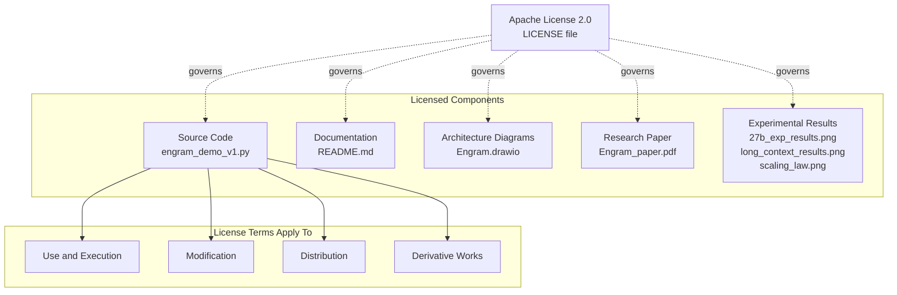
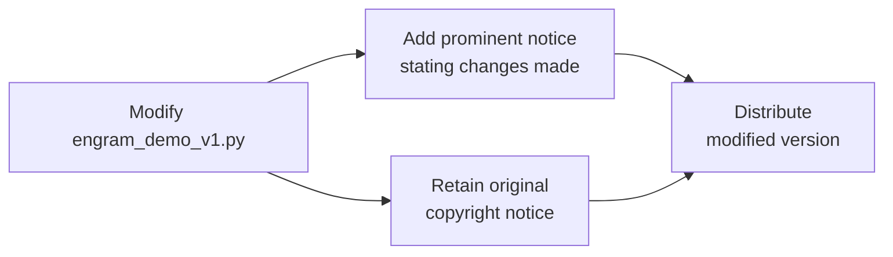
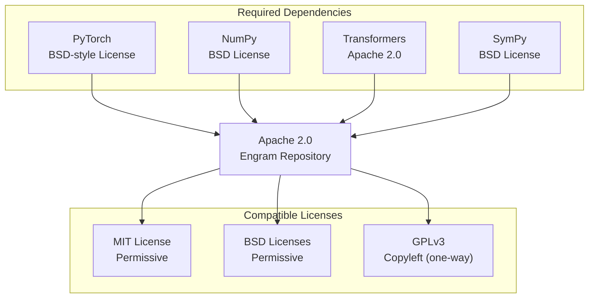

<!-- source: DeepWiki mcp.deepwiki.com · repo deepseek-ai/Engram · page 8 License and Contributing · fetched 2026-10-30 -->

# License and Contributing

<details>
<summary>Relevant source files</summary>

The following files were used as context for generating this wiki page:

- [LICENSE](LICENSE)
- [README.md](README.md)

</details>


This document provides information about the licensing terms for the Engram repository, copyright ownership, patent grants, and guidelines for using and contributing to the codebase. For detailed license terms, see [Apache 2.0 License](#8.1). For citation guidelines, see [Citation](#8.2).

---

## Overview

The Engram repository is released under the **Apache License, Version 2.0**, a permissive open-source license that allows broad usage rights while protecting contributors through patent grants and disclaimer of warranties. The copyright is held by DeepSeek (2023).

**Sources:** [LICENSE:1-202](), [README.md:92-93]()

---

## Copyright and License Summary

The Engram codebase, including the implementation in `engram_demo_v1.py`, experimental results, and documentation, is subject to Apache 2.0 licensing terms.

| Aspect | Details |
|--------|---------|
| **License Type** | Apache License 2.0 |
| **Copyright Holder** | DeepSeek |
| **Copyright Year** | 2023 |
| **License URL** | http://www.apache.org/licenses/LICENSE-2.0 |
| **Full License Text** | [LICENSE:1-202]() |

**Sources:** [LICENSE:190](), [README.md:24-26]()

---

## License Scope and Application

The license applies to all components of the Engram system:



**Sources:** [LICENSE:1-6](), [README.md:92-93]()

---

## Key Permissions

The Apache 2.0 license grants the following permissions to users:

### Copyright License (Section 2)

Users receive a **perpetual, worldwide, non-exclusive, no-charge, royalty-free, irrevocable** copyright license to:

- **Reproduce** the work
- **Prepare Derivative Works** based on the code
- **Publicly display** and **publicly perform** the work
- **Sublicense** the work
- **Distribute** the work and derivative works in source or object form

**Sources:** [LICENSE:67-72]()

### Patent License (Section 3)

Contributors grant a **perpetual, worldwide, non-exclusive, no-charge, royalty-free, irrevocable** patent license to:

- **Make**, **have made**, **use**, **offer to sell**, **sell**, **import**, and **otherwise transfer** the work
- Use patent claims necessarily infringed by contributions

**Important Patent Termination Clause:** If you initiate patent litigation alleging that the work infringes a patent, any patent licenses granted to you under this license terminate as of the date the litigation is filed.

**Sources:** [LICENSE:74-88]()

---

## Key Restrictions and Obligations

While the Apache 2.0 license is permissive, it imposes certain requirements:

### Redistribution Requirements (Section 4)

When redistributing the work or derivative works, you must:

| Requirement | Description |
|-------------|-------------|
| **Include License** | Provide a copy of the Apache License 2.0 to recipients |
| **Mark Modifications** | Clearly indicate modified files with prominent notices |
| **Retain Notices** | Preserve copyright, patent, trademark, and attribution notices from the source |
| **Include NOTICE File** | If present, include attribution notices in derivative works |

**Sources:** [LICENSE:90-122]()

### Modifications to Engram Components

When modifying components such as `NgramHashMapping`, `MultiHeadEmbedding`, or the `Engram` module class, you must:



**Sources:** [LICENSE:98-99]()

### Trademark Restrictions (Section 6)

The license does **not** grant permission to use:
- Trade names of DeepSeek
- Trademarks
- Service marks
- Product names

Exception: Reasonable and customary use for describing the origin of the work.

**Sources:** [LICENSE:139-142]()

---

## Warranties and Liability

### Disclaimer of Warranty (Section 7)

The work is provided on an **"AS IS" BASIS**, without warranties or conditions of any kind, including but not limited to:

- **No warranty of MERCHANTABILITY**
- **No warranty of FITNESS FOR A PARTICULAR PURPOSE**
- **No warranty of NON-INFRINGEMENT**
- **No warranty of TITLE**

Users are responsible for determining the appropriateness of using or redistributing the work and assume all associated risks.

**Sources:** [LICENSE:144-152]()

### Limitation of Liability (Section 8)

Contributors are **not liable** for damages arising from use or inability to use the work, including:

- Direct or indirect damages
- Special, incidental, or consequential damages
- Loss of goodwill
- Work stoppage
- Computer failure or malfunction
- Other commercial damages or losses

This limitation applies even if the contributor has been advised of the possibility of such damages.

**Sources:** [LICENSE:154-164]()

---

## Contributing to Engram

### Submission of Contributions (Section 5)

When submitting contributions to the Engram repository:

- All contributions are automatically under the Apache 2.0 license unless explicitly stated otherwise
- No additional terms or conditions apply beyond the license
- Separate license agreements with the licensor (if any) are not superseded

**Sources:** [LICENSE:131-137]()

### Definition of Contribution

A "Contribution" includes:

- The original version of the work
- Any modifications or additions to the work
- Derivative works
- Any work intentionally submitted for inclusion by the copyright owner or authorized representative

Submission methods include:
- Electronic communication
- Source code control systems
- Issue tracking systems
- Communication on mailing lists

**Sources:** [LICENSE:49-61]()

### Practical Guidelines

While the repository does not include a formal `CONTRIBUTING.md` file, contributors should:

1. **Understand the Implementation**: Review the demo implementation at [engram_demo_v1.py:1-510]() to understand the system architecture
2. **Maintain Code Quality**: Follow the existing structure with clear configuration classes (`EngramConfig`, `BackBoneConfig`)
3. **Document Changes**: Add comments explaining modifications to core components like `NgramHashMapping` or the `Engram` module
4. **Test Modifications**: Ensure changes work with the provided demo execution flow
5. **Respect License Terms**: Include appropriate notices when redistributing modified versions

---

## Contact and Support

For questions, issues, or contributions, contact the maintainers:

| Contact Method | Details |
|----------------|---------|
| **Email** | service@deepseek.com |
| **GitHub Issues** | Raise an issue at https://github.com/deepseek-ai/Engram |
| **Discord** | Join the DeepSeek AI Discord community |
| **Twitter** | Follow @deepseek_ai |

**Sources:** [README.md:95-97](), [README.md:17-22]()

---

## Applying the License to Your Work

If you create derivative works based on Engram, the Apache License recommends including this boilerplate notice:

```
Copyright (c) [year] [copyright holder]

Licensed under the Apache License, Version 2.0 (the "License");
you may not use this file except in compliance with the License.
You may obtain a copy of the License at

    http://www.apache.org/licenses/LICENSE-2.0

Unless required by applicable law or agreed to in writing, software
distributed under the License is distributed on an "AS IS" BASIS,
WITHOUT WARRANTIES OR CONDITIONS OF ANY KIND, either express or implied.
See the License for the specific language governing permissions and
limitations under the License.
```

**Sources:** [LICENSE:179-202]()

---

## Relationship to Model License

The README mentions that "The use of Engram models is subject to [the Model License](LICENSE)". This refers to the same Apache 2.0 license that governs the codebase. The license applies uniformly to:

- The implementation code (`engram_demo_v1.py`)
- Pre-trained model weights (when available)
- Documentation and diagrams
- Experimental results and figures

**Sources:** [README.md:92-93]()

---

## License Compatibility

Apache 2.0 is compatible with many other open-source licenses, enabling integration with broader ecosystems:



**Note:** When incorporating Engram into GPL-licensed projects, the combined work must be distributed under GPL terms. Apache 2.0 code can be included in GPL projects, but not vice versa.

**Sources:** [README.md:80-82]()

---

## Summary Table

| Topic | Key Information |
|-------|-----------------|
| **License** | Apache License 2.0 |
| **Copyright** | (c) 2023 DeepSeek |
| **Permissions** | Use, modify, distribute, sublicense, patent grants |
| **Requirements** | Include license, mark modifications, retain notices |
| **Warranty** | None - provided "AS IS" |
| **Liability** | Contributors not liable for damages |
| **Contributions** | Automatically under Apache 2.0 unless stated otherwise |
| **Contact** | service@deepseek.com |
| **Full Text** | [LICENSE:1-202]() |

**Sources:** [LICENSE:1-202](), [README.md:92-97]()

---

