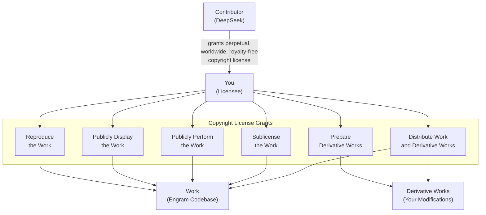
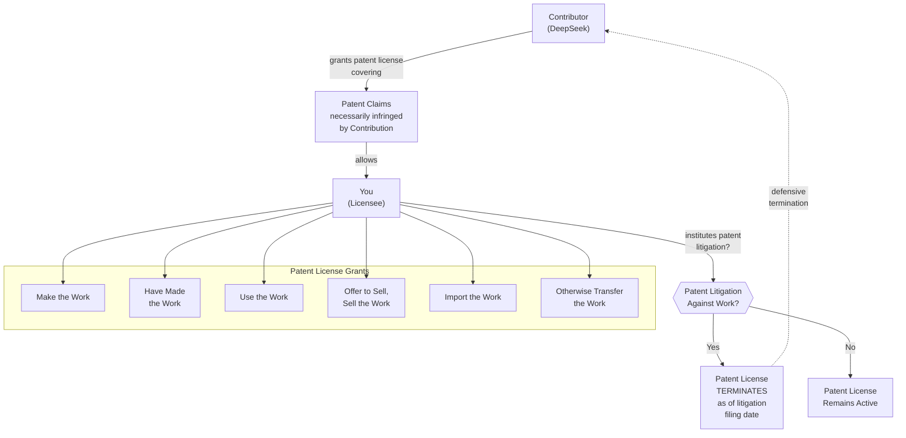
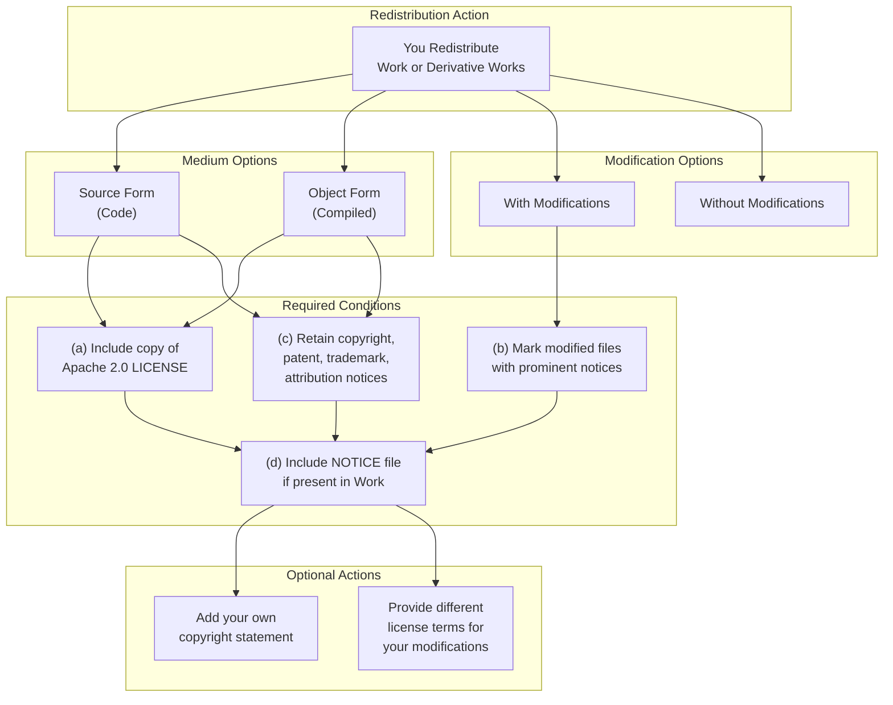
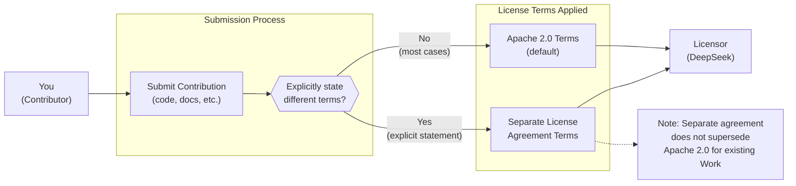
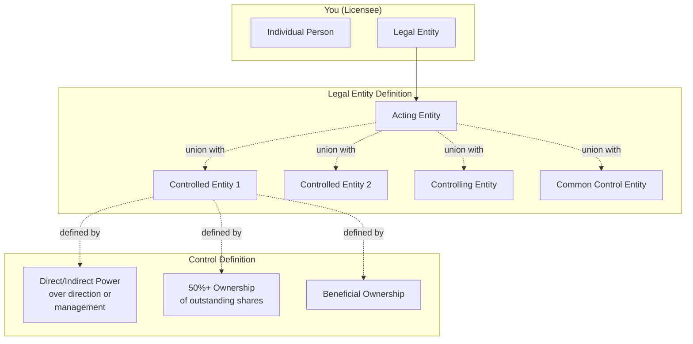
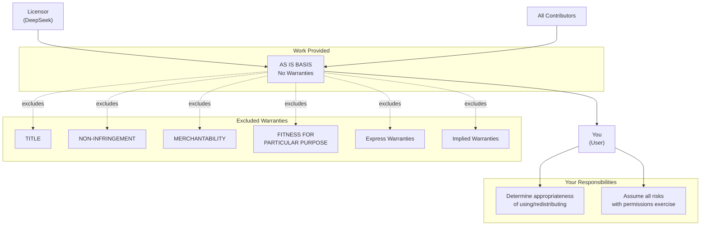
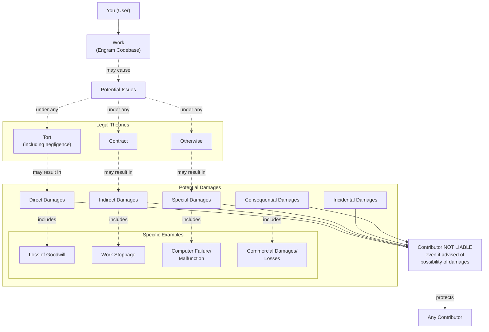
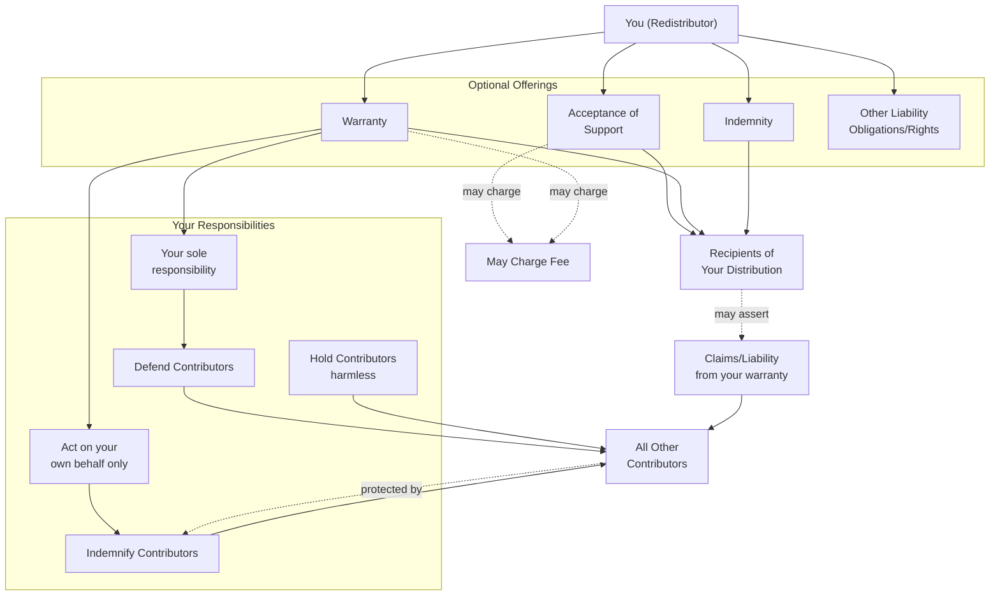

<!-- source: DeepWiki mcp.deepwiki.com · repo deepseek-ai/Engram · page 8.1 Apache 2.0 License · fetched 2026-10-30 -->

# Apache 2.0 License

<details>
<summary>Relevant source files</summary>

The following files were used as context for generating this wiki page:

- [LICENSE](LICENSE)

</details>


## Purpose and Scope

This page explains the Apache License, Version 2.0 terms under which the Engram codebase is distributed. It covers the grants provided by the license, redistribution requirements, patent provisions, warranty disclaimers, and liability limitations. This information is essential for understanding your rights and obligations when using, modifying, or distributing the Engram code.

For information about citing the Engram research work, see [Citation](#8.2).

## License Overview

The Engram repository is licensed under the Apache License, Version 2.0, dated January 2004. The copyright holder is DeepSeek (Copyright © 2023). The license text is located at [LICENSE:1-202]().

The Apache 2.0 License is a permissive open-source license that allows users to freely use, modify, and distribute the software for both commercial and non-commercial purposes, subject to specific conditions.

### Key Characteristics

| Characteristic | Description |
|---------------|-------------|
| **License Type** | Permissive open-source |
| **Version** | 2.0 (January 2004) |
| **Copyright Holder** | DeepSeek |
| **Copyright Year** | 2023 |
| **License Location** | [LICENSE:1-202]() |
| **Official URL** | http://www.apache.org/licenses/ |

Sources: [LICENSE:1-5](), [LICENSE:190-202]()

## Core License Grants

The Apache 2.0 License provides two primary grants to users: a copyright license and a patent license. These grants are perpetual, worldwide, non-exclusive, no-charge, royalty-free, and irrevocable (with specific exceptions for the patent license).

### Copyright License Grant

**Copyright License Grant Structure**



The copyright license grants you the right to [LICENSE:67-72]():

1. **Reproduce** the Work in any form
2. **Prepare Derivative Works** of the original code
3. **Publicly display** the Work
4. **Publicly perform** the Work
5. **Sublicense** the Work to others
6. **Distribute** the Work and Derivative Works in Source or Object form

Sources: [LICENSE:67-72]()

### Patent License Grant

The patent license provides protection for users implementing the Work, but includes a defensive termination clause to discourage patent litigation.

**Patent License and Termination Flow**



The patent license [LICENSE:74-88]():

1. Grants rights to **make, have made, use, offer to sell, sell, import, and otherwise transfer** the Work
2. Applies only to patent claims **necessarily infringed** by the Contribution
3. **Terminates automatically** if you initiate patent litigation alleging the Work infringes patents
4. Termination occurs **as of the date the litigation is filed**

Sources: [LICENSE:74-88]()

## Redistribution Requirements

When redistributing the Work or Derivative Works, you must comply with specific conditions to maintain license compliance.

### Required Conditions

**Redistribution Compliance Checklist**



#### Mandatory Requirements

The four mandatory conditions for redistribution [LICENSE:90-130]():

| Condition | Requirement | Applies To |
|-----------|-------------|------------|
| **(a) License Inclusion** | Provide recipients a copy of the Apache 2.0 License | All redistributions |
| **(b) Modification Notices** | Mark modified files with prominent change notices | Modified files only |
| **(c) Notice Retention** | Retain all copyright, patent, trademark, and attribution notices from Source form | Source form Derivative Works |
| **(d) NOTICE File** | Include readable copy of NOTICE file attributions (if present) | Derivative Works with NOTICE |

#### Optional Actions

You may optionally [LICENSE:124-129]():

1. Add your own **copyright statement** to your modifications
2. Provide **additional or different license terms** for your modifications
3. Ensure overall distribution complies with Apache 2.0 conditions

Sources: [LICENSE:90-130]()

### NOTICE File Requirements

If the Work includes a NOTICE text file, Derivative Works must include attribution notices in at least one of three locations [LICENSE:107-122]():

1. Within a **NOTICE text file** distributed with Derivative Works
2. Within **Source form or documentation** (if provided)
3. Within a **display generated by Derivative Works** where third-party notices normally appear

**Important:** NOTICE contents are informational only and do not modify the License terms.

Sources: [LICENSE:107-122]()

## Contribution Terms

### Default Contribution License

Any Contribution you intentionally submit for inclusion in the Work is automatically under Apache 2.0 terms unless you explicitly state otherwise [LICENSE:131-135]().

**Contribution Submission Flow**



### What Constitutes a Contribution

A "Contribution" is defined as [LICENSE:49-61]():

- Any work of authorship, including the **original version of the Work**
- Any **modifications or additions** to the Work or Derivative Works
- Intentionally **submitted to Licensor** for inclusion
- Submitted by the **copyright owner** or authorized individual/Legal Entity

**Submission methods** include electronic, verbal, or written communication sent to the Licensor via:
- Electronic mailing lists
- Source code control systems
- Issue tracking systems

**Exclusion:** Communication conspicuously marked as "Not a Contribution" is excluded.

Sources: [LICENSE:49-61](), [LICENSE:131-137]()

## Definitions and Key Terms

### Legal Entities

**Entity Relationship Structure**



Key term definitions [LICENSE:8-66]():

| Term | Definition | Reference |
|------|------------|-----------|
| **License** | Terms and conditions for use, reproduction, and distribution | [LICENSE:10-11]() |
| **Licensor** | Copyright owner or authorized entity granting the License (DeepSeek for Engram) | [LICENSE:13-14]() |
| **Legal Entity** | Union of acting entity and all controlled/controlling entities | [LICENSE:16-22]() |
| **You/Your** | Individual or Legal Entity exercising License permissions | [LICENSE:24-25]() |
| **Source** | Preferred form for modifications (source code, documentation, config files) | [LICENSE:27-29]() |
| **Object** | Mechanical transformation of Source (compiled code, generated docs) | [LICENSE:31-34]() |
| **Work** | Work of authorship made available under License (Engram codebase) | [LICENSE:36-39]() |
| **Derivative Works** | Work based on/derived from the Work with original authorship | [LICENSE:41-47]() |
| **Contribution** | Work of authorship intentionally submitted for inclusion | [LICENSE:49-61]() |
| **Contributor** | Licensor and any individual/entity whose Contribution is incorporated | [LICENSE:63-65]() |

Sources: [LICENSE:8-66]()

## Trademark Provisions

The License **does not grant permission** to use [LICENSE:139-142]():

- Trade names
- Trademarks
- Service marks
- Product names of the Licensor

**Exception:** Reasonable and customary use in:
- Describing the origin of the Work
- Reproducing the content of the NOTICE file

This means you cannot use "DeepSeek" or associated trademarks for endorsement purposes without separate permission.

Sources: [LICENSE:139-142]()

## Warranty Disclaimer

**Warranty and Risk Allocation**



The Work is provided **"AS IS"** without warranties of any kind [LICENSE:144-152]():

### No Warranties Provided

Neither the Licensor nor Contributors provide warranties or conditions of:
- **TITLE** - No guarantee of ownership rights
- **NON-INFRINGEMENT** - No guarantee against third-party IP claims
- **MERCHANTABILITY** - No guarantee of market fitness
- **FITNESS FOR A PARTICULAR PURPOSE** - No guarantee of suitability

This applies to both **express** and **implied** warranties.

### Your Responsibility

You are **solely responsible** for:
1. Determining the **appropriateness** of using or redistributing the Work
2. Assuming **any risks** associated with exercising License permissions

Sources: [LICENSE:144-152]()

## Limitation of Liability

**Liability Limitation Structure**



Contributors are **not liable** for damages under any legal theory [LICENSE:154-164]():

### No Liability For

- **Direct damages**
- **Indirect damages**
- **Special damages**
- **Incidental damages**
- **Consequential damages**

Including but not limited to:
- Loss of goodwill
- Work stoppage
- Computer failure or malfunction
- Any and all other commercial damages or losses

### Scope of Protection

This limitation applies:
- Under any **legal theory** (tort, contract, or otherwise)
- **Even if the Contributor has been advised** of the possibility of such damages
- Unless required by **applicable law** (such as deliberate and grossly negligent acts)
- Unless agreed to in **writing**

Sources: [LICENSE:154-164]()

## Accepting Additional Liability

**Optional Warranty and Support Framework**



When redistributing, you **may choose** to offer additional protections [LICENSE:166-175]():

### What You May Offer

- **Support** acceptance
- **Warranty** coverage
- **Indemnity** protection
- **Other liability obligations** and/or rights
- May **charge a fee** for these offerings

### Your Obligations When Offering

If you accept such obligations, you must:

1. **Act only on your own behalf** and on your sole responsibility
2. **Not act on behalf** of any other Contributor
3. **Indemnify, defend, and hold harmless** each Contributor for any liability incurred by or claims asserted against such Contributor by reason of your accepting any such warranty or additional liability

Sources: [LICENSE:166-175]()

## Application to Engram Codebase

### Copyright Notice

The Engram repository includes the following copyright notice [LICENSE:190-202]():

```
Copyright (c) 2023 DeepSeek

Licensed under the Apache License, Version 2.0 (the "License");
you may not use this file except in compliance with the License.
You may obtain a copy of the License at

    http://www.apache.org/licenses/LICENSE-2.0

Unless required by applicable law or agreed to in writing, software
distributed under the License is distributed on an "AS IS" BASIS,
WITHOUT WARRANTIES OR CONDITIONS OF ANY KIND, either express or implied.
See the License for the specific language governing permissions and
limitations under the License.
```

### Practical Implications for Engram Users

**Use Case Permissions Matrix**

| Use Case | Permitted | Conditions Required |
|----------|-----------|---------------------|
| **Use code for research** | ✓ Yes | None |
| **Use code commercially** | ✓ Yes | None |
| **Modify the code** | ✓ Yes | None |
| **Create derived systems** | ✓ Yes | None |
| **Redistribute original code** | ✓ Yes | Include LICENSE, retain notices |
| **Redistribute modified code** | ✓ Yes | Include LICENSE, mark modifications, retain notices |
| **Integrate into proprietary systems** | ✓ Yes | Include LICENSE, retain notices for Engram components |
| **Sublicense to third parties** | ✓ Yes | Under Apache 2.0 or compatible terms |
| **Use DeepSeek trademark** | ✗ No | Except for origin description |
| **Hold contributors liable** | ✗ No | Work provided AS IS |

### Specific Engram Components Covered

All components in the repository are covered by Apache 2.0 [LICENSE:1-202]():

- **Demo implementation**: [engram_demo_v1.py:1-end]()
- **Documentation**: [README.md:1-end]()
- **Architecture diagrams**: [Engram.drawio:1-end]()
- **Research paper**: [Engram_paper.pdf:1-end]()
- **Experimental results**: [figures/27b_exp_results.png:1-end](), [figures/long_context_results.png:1-end](), [figures/scaling_law.png:1-end]()
- **Visual assets**: [figures/arch.png:1-end](), [figures/case.png:1-end]()

Sources: [LICENSE:190-202]()

## Summary of Rights and Obligations

### Rights Granted to You

1. **Use** the Engram code for any purpose (commercial or non-commercial)
2. **Modify** the code to create Derivative Works
3. **Distribute** original or modified versions
4. **Sublicense** the code to others
5. **Patent protection** for claims necessarily infringed by Contributions (unless you initiate patent litigation)

### Your Obligations

1. **Include LICENSE** file with all distributions
2. **Mark modified files** with prominent notices of changes
3. **Retain all notices** (copyright, patent, trademark, attribution) in Source form
4. **Include NOTICE file** contents (if present) in Derivative Works
5. **Accept all risks** and responsibilities for using the Work

### What You Cannot Do

1. **Use trademarks** (e.g., "DeepSeek") for endorsement without permission
2. **Hold contributors liable** for damages or losses
3. **Claim warranties** exist for the Work
4. **Remove or modify** existing copyright and attribution notices

### Defensive Patent Provisions

Your patent license **terminates** if you:
- Institute patent litigation alleging the Work or any Contribution infringes patents
- File cross-claims or counterclaims in a lawsuit making such allegations
- The termination is effective as of the litigation filing date

This defensive termination clause protects the open-source community from patent trolling while maintaining free usage for good-faith users.

Sources: [LICENSE:1-202]()

---

