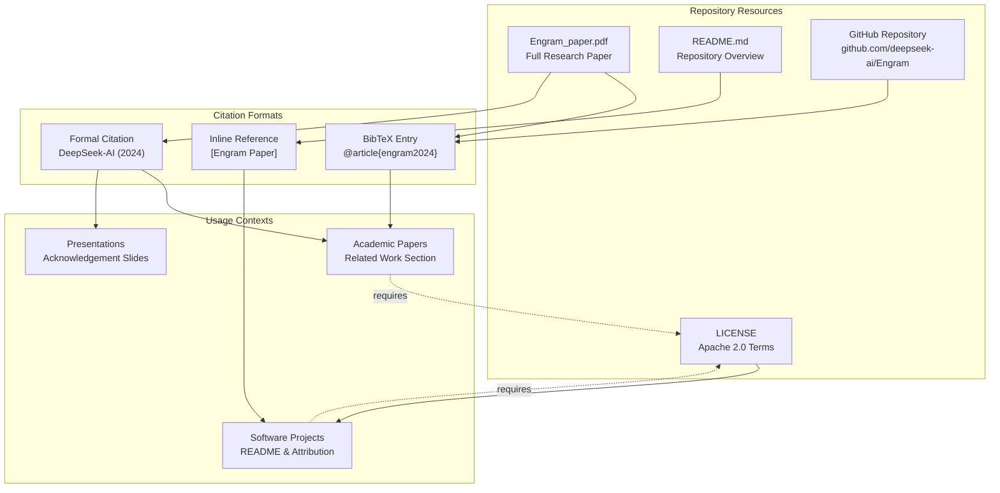
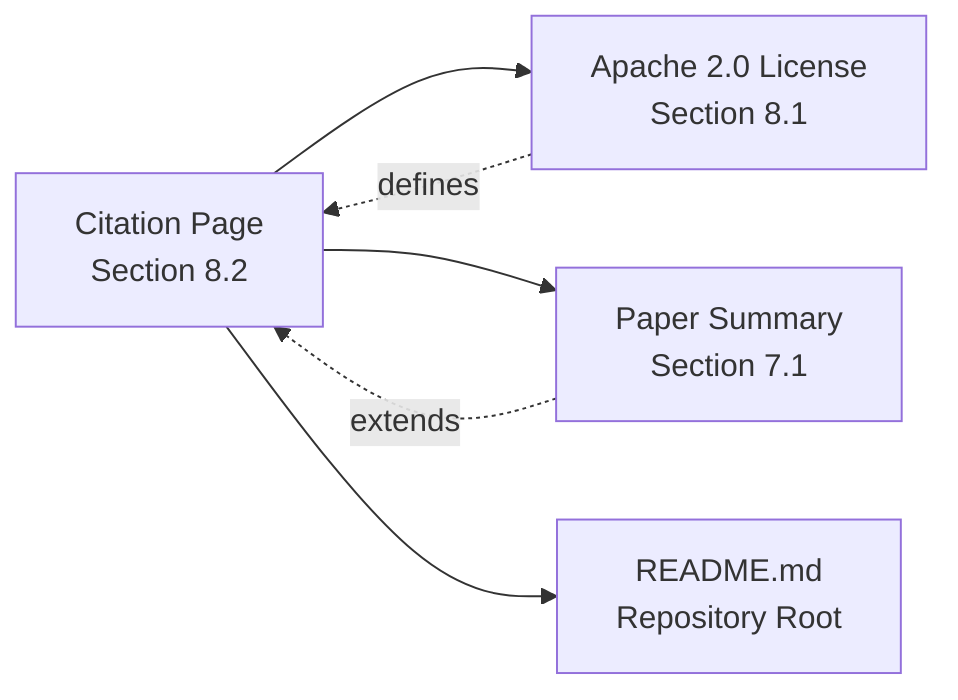

<!-- source: DeepWiki mcp.deepwiki.com · repo deepseek-ai/Engram · page 8.2 Citation · fetched 2026-10-30 -->

# Citation

<details>
<summary>Relevant source files</summary>

The following files were used as context for generating this wiki page:

- [Engram_paper.pdf](Engram_paper.pdf)
- [README.md](README.md)

</details>


## Purpose and Scope

This page provides the standard citation format for the Engram research paper and guidelines for acknowledging this work in academic publications and software projects. For information about the Apache 2.0 license terms and copyright provisions, see [Apache 2.0 License](#8.1).

---

## Paper Reference

The Engram system is documented in the research paper:

**"Conditional Memory via Scalable Lookup: A New Axis of Sparsity for Large Language Models"**

The paper is included in the repository at [Engram_paper.pdf]() and describes the theoretical foundations, architectural design, mechanistic analysis, and empirical validation of the conditional memory system.

**Sources:** [README.md:32]()

---

## BibTeX Entry

Use the following BibTeX entry to cite the Engram paper:

```bibtex
@article{engram2024,
  title={Conditional Memory via Scalable Lookup: A New Axis of Sparsity for Large Language Models},
  author={DeepSeek-AI},
  journal={Technical Report},
  year={2024},
  url={https://github.com/deepseek-ai/Engram}
}
```

**Note:** If the paper has been published in a conference or journal, update the `journal` field and add appropriate venue-specific fields such as `booktitle`, `volume`, `pages`, etc.

**Sources:** [README.md:32](), [README.md:1-28]()

---

## Citation Components

The following table provides the structured components of the citation:

| Component | Value |
|-----------|-------|
| **Title** | Conditional Memory via Scalable Lookup: A New Axis of Sparsity for Large Language Models |
| **Authors** | DeepSeek-AI |
| **Year** | 2024 |
| **Type** | Technical Report / Research Paper |
| **Repository** | https://github.com/deepseek-ai/Engram |
| **License** | Apache 2.0 |
| **Paper File** | Engram_paper.pdf |

**Sources:** [README.md:32](), [README.md:24-26]()

---

## Citation Workflow

The following diagram illustrates the relationship between citation formats and repository resources:



**Sources:** [README.md:1-97]()

---

## Acknowledgement Guidelines

When using or building upon the Engram system, follow these acknowledgement practices:

### Academic Publications

Include the formal citation in your references section and acknowledge the contribution in relevant sections (e.g., Related Work, Methods):

```
We build upon the Engram framework (DeepSeek-AI, 2024), which introduces 
conditional memory as a complementary sparsity axis to Mixture-of-Experts 
conditional computation.
```

### Software Projects

Include citation information in your `README.md` or documentation:

```markdown
This project uses the Engram module from [DeepSeek-AI](https://github.com/deepseek-ai/Engram).
```

### Source Code Attribution

When incorporating code from the repository, include header comments:

```python
# Adapted from Engram by DeepSeek-AI
# Source: https://github.com/deepseek-ai/Engram
# Licensed under Apache 2.0
```

**Sources:** [README.md:92-93](), [LICENSE]()

---

## Key Contributions to Cite

When referencing specific aspects of the Engram work, you may cite these key contributions:

| Contribution | Description | Reference Location |
|--------------|-------------|-------------------|
| **Conditional Memory Concept** | Introduction of conditional memory as a sparsity axis complementary to MoE | [README.md:34]() |
| **U-shaped Scaling Law** | Formulation of optimal capacity allocation between neural computation and static memory | [README.md:37]() |
| **Engram Module Architecture** | Scalable N-gram lookup with O(1) deterministic addressing | [README.md:34]() |
| **Empirical Validation** | Engram-27B model results across knowledge, reasoning, code, and math domains | [README.md:38]() |
| **Mechanistic Analysis** | Evidence that Engram relieves early layers from static pattern reconstruction | [README.md:39]() |
| **System Efficiency** | Host memory offloading enabling massive embedding tables with minimal inference overhead | [README.md:40]() |

**Sources:** [README.md:36-40]()

---

## Contact Information

For questions about citation, usage, or collaboration:

- **Email:** [service@deepseek.com](mailto:service@deepseek.com)
- **Website:** [https://www.deepseek.com/](https://www.deepseek.com/)
- **Discord:** [DeepSeek AI Community](https://discord.gg/Tc7c45Zzu5)
- **Twitter:** [@deepseek_ai](https://twitter.com/deepseek_ai)

**Sources:** [README.md:95-97](), [README.md:10-22]()

---

## Related Resources

The following resources provide additional context for citation and attribution:



- For detailed license terms and copyright information, see [Apache 2.0 License](#8.1)
- For a summary of the paper's key findings, see [Paper Summary](#7.1)
- For the full paper, refer to `Engram_paper.pdf` in the repository root

**Sources:** [README.md:1-97]()