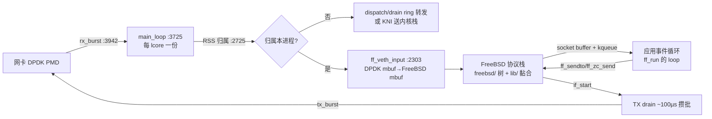

# F-Stack 新人入职文档（ONBOARDING）

> 事实锚点：commit `52514377`，知识图谱 1616 节点 / 2669 边 / 14 层 / 16 步 tour（`.understand-anything/knowledge-graph.json`）。行号与常量均经源码实测。

## 1. 这是什么项目

F-Stack 是腾讯开源的**用户态高性能网络框架**：把 FreeBSD 完整 TCP/IP 协议栈搬进用户态，收发包走 DPDK PMD 轮询（kernel bypass），绕过 Linux 内核栈的系统调用、软中断、锁竞争与内核↔用户态拷贝。性能口号：**千万级并发、500 万 RPS、100 万 CPS**。

**血统**：业务驱动——源于腾讯 DNSPod/腾讯云应对 DDoS，自研栈维护成本过高后整体移植 FreeBSD 协议栈（`README.md:24`），站在 libuinet（Kip Macy 2010，`lib/ff_syscall_wrapper.c` 版权头）与 libplebnet 肩上。版本勘误：README 写"FreeBSD 13.0"，但 `freebsd/sys/param.h` 的 `__FreeBSD_version=1500068`——v2.0 已升到 15.0（以 `docs/01-LAYER1-ARCHITECTURE.md:36` 为准）。

**部署模型：每核一进程（run-to-complete）**。`config.ini` 的 `lcore_mask` 位图决定进程数，`start.sh` 按 `--proc-type=primary|secondary --proc-id=N` 拉起 1 primary + N-1 secondary（`start.sh:59-64`）。每进程独占一核与一个网卡 RSS 队列，单线程跑完"收包→协议栈→应用"，进程间零共享零锁。v2.0 新增 `thread_mode=1`：一进程多线程、每线程独立 vnet 栈实例。

**定位**：不取代内核栈而是旁路共存——KNI 把非业务流量送回 Linux 内核栈、`FF_KERNEL_COEXIST` 同进程双栈、`adapter/` 的 LD_PRELOAD 存量应用零改造。与 netmap/PF_RING（只给包不给栈）、Seastar/mTCP（自研栈语义不完备）相比，差异点是**复用 FreeBSD 生产级协议栈**：TCP/UDP/IPv6、kqueue/epoll、sockopt 语义完备，nginx/Redis 级应用可直接迁移（`app/` 内置魔改版）。

## 2. 五分钟架构

数据面一条路（记住它就懂 F-Stack 一半）：

（行号均在 `lib/ff_dpdk_if.c`。）四条支撑线：**初始化**——`ff_init()` 四段式 `ff_load_config→ff_dpdk_init→ff_freebsd_init→ff_dpdk_if_up`，再 `ff_run(loop)`；**事件**——原生 kqueue（`ff_event.h` 复刻 kevent 契约），`ff_epoll.c` 在其上复刻 Linux epoll；**控制面**——`ff_top/ff_tcp/ff_route` 等工具进程经 `ff_msg.h` 的 IPC 环查询数据面；**热升级**——v2.0 招牌，见 4.3。

## 3. 目录地图

14 层归并为 7 组（前 6 组入图谱，第 7 组 vendored 不入）：

| 组 | 图谱层 | 内容 |
|---|---|---|
| `lib/` 协议栈核心 | L02-L08 | FreeBSD 兼容头（`lib/include/`）、DPDK 数据面（`ff_dpdk_if/ff_veth/ff_memory/ff_dpdk_kni/ff_dpdk_pcap`）、初始化配置（`ff_init/ff_config/ff_ini_parser`）、内核原语黏合（`ff_glue/ff_kern_*/ff_lock`）、ff_api 桥（`ff_api.h/ff_syscall_wrapper/ff_epoll`）、控制面 IPC（`ff_route/ff_ng_*/ff_msg`）、热升级（`ff_reload*`） |
| `adapter/` 接入层 | L09-L10 | `syscall/` LD_PRELOAD 双栈适配；`micro_thread/` 协程框架 |
| `example/` | L11 | helloworld 三变体、内核栈共存旗舰、issue 复现对 |
| `tests/` | L13-L14 | unit（cmocka 82 文件）/ integration（真实 EAL） |
| 构建与运行 | L01 | `lib/Makefile`、`mk/`、`config.ini`、`start.sh`、CI |
| `doc/`+`docs/` | L12 | 经典指南 + 三层架构知识库 |
| **vendored（裁出图谱）** | — | `dpdk/`（DPDK 全源码）、`freebsd/`（FreeBSD 15.0 协议栈源码，42 个顶层目录）、`app/`（nginx-1.28.0、redis-6.2.6）、`tools/`。`.understandignore` 显式排除——**图谱 1616 节点只覆盖 f-stack 自有代码** |

## 4. 核心子系统深读

### 4.1 ff_dpdk_if.c——数据面主循环

5420 行全仓最大。`ff_dpdk_init` 统筹 EAL/内存池/dispatch ring/消息环/端口启动；`main_loop`（L3725）每 lcore 一份：`rte_eth_rx_burst`（L3942）→ `ff_dpdk_process_packets`（L2725）按对称 toeplitz RSS 表判包归属（他进程的包经 dispatch ring 转走）→ `ff_veth_input`（L2303）mbuf 桥注入协议栈 → TX drain；`ff_hardclock`（L3810）按 `freebsd.hz` 驱动 callout tick-wheel（TCP 重传/keepalive 全靠它）；`ff_dpdk_run`（L4157）用 `rte_eal_mp_remote_launch` 把 main_loop 撒到每个 lcore（L4163）。配套：`ff_veth.c`（1289 行）把 DPDK 端口包装成 FreeBSD ifnet、含零拷贝 mbuf API；`ff_memory.c` 巨页基座+世代化 mempool（`FF_MBUF_GEN_MAX=2` 支撑热升级）；`ff_dpdk_kni.c` 内核旁路；`ff_dpdk_pcap.c` 抓包取证。

### 4.2 ff_api 桥与 ff_glue/ff_kern_* 黏合（勘误钉版）

**`lib/` 下不存在 `ff_api.c`**——对外 API = `ff_api.h`（声明总头）+ `ff_api.symlist`（100 行导出符号契约），**实现在 `ff_syscall_wrapper.c`（2302 行）**：先做 Linux→FreeBSD 常量与结构转换（fcntl/ioctl/sockopt 名、sockaddr/cmsghdr 布局），再进 `kern_*` 内核系统调用——`kern_bindat` L1760、`kern_connectat` L1800、`kern_accept/accept4` L1633/L1685、`kern_recvit` L1534。

黏合三件套让未修改的 FreeBSD 源码活在用户态：① `lib/include/` 头替身——`sys/mutex.h` 把 20+ 加锁宏置 `DO_NOTHING`、`mtx_owned` 恒 1（**单线程栈下锁语义整体空转**），amd64 `pcpu.h` 把"每 CPU"重定义为"每用户态线程"（`__thread` TLS）；② `ff_glue.c`（1474 行）补 copyin/ucred/ck_epoch 等符号，`ff_kern_synch.c`/`ff_kern_condvar.c` 睡眠唤醒退化为立即返回，`ff_kern_timeout.c` 是 callout 真身，`ff_lock.c` 五种锁映射 pthread；③ `ff_host_interface.c` 宿主服务出口（ff_malloc 走 libc、随机走 OpenSSL、`ff_os_errno` errno 映射）。

### 4.3 热升级 v2.0 子系统

nginx USR2 风格**优雅热升级**（binary upgrade 不丢连接）。契约 `lib/ff_reload.h`（683 行设计文档级注释）：`FF_RELOAD_GEN_MAX=2` 双世代乒乓（L54）、匿名 `MAP_SHARED` 控制块跨 fork/exec 存活（L39）、心跳 1000ms/回收 5000ms/slot 过期 2000ms 默认（L109/L117/L103）、跨进程字段一律 `__atomic`。分工：`ff_reload.c`（2147 行）master begin/complete/abort 状态机 + RX/KNI 硬件属主交接；`ff_reload_gendir.c` 巨页 memzone 世代目录——**唯一跨 exec 存活的实体**；`ff_drain_ring.c`（673 行）世代间双向 rte_ring 转发不归属包；`ff_flow_map.c` TCP 软件流表在排水窗口裁决 SYN 接纳（避免新流落入只能被 RST 的旧世代）；`ff_flow_peer.c` UDP 流对端表移交。**`graceful_reload=0` 时全部 no-op**，零回归。

### 4.4 adapter/syscall——LD_PRELOAD 双栈共存

`libff_syscall.so` 劫持约 40 个 socket 类调用，存量应用零改造接入。单一事实源 `ff_declare_syscalls.h`（31 行 X-macro，29 个 `FF_SYSCALL_DECL`）；`ff_hook_syscall.c`（3445 行）按 fd 归属分流——socket type 高位 `SOCK_FSTACK=0x01000000`/`SOCK_KERNEL=0x02000000`（`ff_adapter.h:7-8`）：F-Stack fd 走 `ff_socket_ops` 共享内存请求-应答（`FF_USE_RING_IPC` 构建时走 rte_ring 无锁环），kernel fd 由 `ff_linux_syscall.c` dlsym 回退 glibc；服务端 `fstack.c`（36 行）在主循环每轮 `ff_handle_each_context` 消费请求。四种运行模式见 `adapter/syscall/README.md`（39 节）。

双栈 fd 另一编码在 lib 侧：`FF_KERNEL_FD_BASE=0x40000000`（`ff_host_interface.h:128`）——内核 fd 编码为 `host_fd+0x40000000`，`ff_epoll.c` 检出后注册到懒建的 host epoll，`ff_epoll_wait` 以 timeout=0 轮询并与 kqueue 事件合并（L116/L271），**单一事件循环服务两个栈**。fd 数字异常大时先想到它。

### 4.5 micro_thread——协程框架

腾讯 MSEC 血统（`mt_version.h` "mt version: 0.2.4"），卖点是**同步风格写异步**：`arch_ctx.S`（157 行）x86_64/i386 汇编上下文切换；`micro_thread.cpp`（1437 行）MtFrame 单例管理就绪/IO/睡眠/挂起四链，DaemonRun 挂进 ff_run；`kqueue_proxy.cpp`（552 行）直接调 `ff_kqueue()/ff_kevent()`（原生 kqueue），KqueuerObj 虚函数唤醒挂起协程；`ff_hook.cpp`（167 行）用 `ff_fdisused(fd)`（L47 起）判 fd 归属双栈透明分流。业务侧 `mt_api.h` 暴露 `mt_tcpsendrcv` 等阻塞式 API，`echo.cpp` 最小示范。

## 5. 新人第一周路线（16 步 tour 概成 5 天）

- **Day 1 全局观**（step-01/02）：README+`config.ini` 各节+`start.sh`；`lib/Makefile` 特性开关、`mk/` 骨架。动手：备 DPDK 后 `make -C lib`。
- **Day 2 数据面**（step-03/04/05）：`ff_init.c` 四段式 → `ff_dpdk_if.c` main_loop（L3725 起）→ `ff_veth.c` mbuf 桥 → KNI/pcap。动手：跑 `example/main.c`。
- **Day 3 接口与黏合**（step-06/07/08/09/10）：`ff_api.h` → `ff_epoll.c` epoll↔kqueue 翻译 → `ff_glue.c`/`ff_kern_*`/`lib/include/` 头替身。动手：改 `main_epoll.c`。
- **Day 4 热升级与控制面**（step-11/12/15）：通读 `ff_reload.h`（就是设计文档）→ drain_ring/flow_map → `ff_route.c`/`ff_msg.h` → `helloworld_stacksel`（selftest 免 DPDK 可随处跑）。
- **Day 5 适配器与测试**（step-13/14/16）：micro_thread `echo.cpp` → `main_stack_epoll_kernel.c` 双栈 → `tests/unit` 跑通 + `tests/README.zh_CN.md`。动手：给 `test_ff_config.c` 加用例。

## 6. 构建与测试

**构建**：`dpdk/` 先编（v2.0 推荐 meson）；`lib/Makefile` 以 `freebsd/` 内核源树（`$S`）+ `pkg-config libdpdk` 编出 `libfstack.a`，`make install` 装头文件、`ff_start`、`/etc/f-stack.conf`（模板即 config.ini）。`mk/` 三件套是 FreeBSD 内核式编译骨架（`kern.pre.mk` 设 `-D__FreeBSD__ -D_KERNEL`，`kern.mk` 生成 IMACROS 预定义宏文件）。特性开关 `FF_KNI/FF_INET6/FF_KERNEL_COEXIST/FF_ZC_SEND` 在 lib/Makefile；example 两 Makefile 用 nm 探测符号优雅降级。

**单元测试**（`tests/unit/`，82 文件，cmocka ≥1.1.7，独立构建）：15 个二进制——`test_ff_config.c` 76 用例、`test_ff_dpdk_if.c` 75 用例领衔。基础设施：`common/rte_stub.c` 的 `__wrap_rte_exit/__wrap_rte_panic` 把致命路径转为可断言失败（linker --wrap）；`common/ff_log_stub.c` 提供 `ff_global_cfg` 唯一定义；`fixtures/` 58 个 valid/invalid INI 是**配置契约的一部分**。`coverage_threshold.sh` G8 逐文件分级阈值门禁；`valgrind.supp` 刻意零条目——任何泄漏都是真回归。

**集成测试**（`tests/integration/`）：4 个 `test_ff_*` 起真实 EAL（`--no-huge --no-pci --vdev=net_null0`）测 dpdk_if/KNI/gendir 跨进程/reload；`test_graceful_reload.sh` 是热升级**真机 harness**：驱动 nginx HUP/USR2/WINCH，cps/lc/outage/stream 四探针族量化重载期服务质量，`reload_supervisor.py` 收割进程树，`orphan_capture_analyze.py` 解析 pcap 找"同四元组双 SYN-ACK"孤儿现场。`tests/run_full_coverage.sh` 三阶段合并覆盖率。

## 7. 设计哲学与坑

**哲学四条**：① **run-to-complete 无锁**——每核一进程、栈内单线程，锁全空转、睡眠唤醒立即返回；代价是连接不跨核，靠对称 RSS 保证同流同核。② **TX 攒批 ~100µs**——`BURST_TX_DRAIN_US=100`（`ff_config.h:56`），`pkt_tx_delay` 默认 100 且钳制上限（`ff_dpdk_if.c:2097`）。③ **复用而非重造**——FreeBSD 栈整体搬+stub 黏合不改源码，跟上游升级。④ **共存而非替代**——KNI 回流、双栈、LD_PRELOAD，生态位是"业务流量走 F-Stack、其余照旧"。

**坑清单**：① **文档版本漂移三连**——README 写"FreeBSD 13.0"（实际 15.0）；`README.md:123`/`doc/F-Stack_Build_Guide.md:42`/`doc/F-Stack_Quick_Start_Guide.md:81`/`doc/Launch_F-Stack_on_AWS_EC2_in_one_minute.md:81` 写 `nginx-1.25.2`，`app/` 实为 **nginx-1.28.0**（仅 `doc/F-Stack_Nginx_APP_Guide.md:7` 已更正）；`VERSION` 与 `lib/Makefile` 的 `F-STACK_VERSION` 平行双源需人工同步——**一律以源码与目录名为准**。② **别找 ff_api.c**——不存在，实现是 `ff_syscall_wrapper.c`。③ **FF_KERNEL_FD_BASE=0x40000000** 高位编码，fd 异常大先想到它。④ **graceful_reload 硬前提**：`primary_slim=1 + nb_procs>=2 + thread_mode=0`（`config.ini:18-24`）。⑤ **多进程部署须关 ASLR**。⑥ 空闲功耗/时延用 `idle_sleep` 调（Roadmap 已弃中断模式：epoll_wait 最小 1ms 粒度不匹配）。

## 8. 深入索引

- **知识图谱**：`.understand-anything/knowledge-graph.json`（@52514377；`onboard-input.json` 含 14 层代表节点与 30 hub 摘要）。
- **14 层速查**：L01 构建运行 / L02 FreeBSD 兼容头 / L03 DPDK 数据面 / L04 初始化配置 / L05 内核原语黏合 / L06 ff_api 桥与事件 / L07 控制面 IPC / L08 热升级 / L09 LD_PRELOAD / L10 micro_thread / L11 示例 / L12 文档 / L13 单测夹具 / L14 集成 harness。
- **16 步 tour**：01 总览→02 构建→03 初始化→04 主循环→05 KNI/抓包→06 ff_api→07 epoll/kqueue→08/09/10 黏合 stub→11 热升级→12 控制面→13 协程→14 LD_PRELOAD→15 示例→16 测试与文档。
- **高连接 hub**：`lib/ff_dpdk_if.c`、`ff_api.h`、`ff_config.c/h`、`ff_host_interface.h/c`、`ff_reload.h`、`ff_syscall_wrapper.c`、`ff_glue.c`、`ff_msg.h`、`ff_event.h`、`adapter/micro_thread/*`、`tests/unit/test_ff_config.c` 等 30 个。
- **grep 词表**：`ff_hardclock`（时钟链）、`ff_veth_input`（收包注入）、`kern_recvit|kern_bindat`（协议栈入口）、`ff_fdisused`（双栈分流）、`SOCK_FSTACK`（归属标志）、`FF_RELOAD_GEN_MAX`（热升级契约）、`ff_global_cfg`（配置全局）、`__wrap_rte_exit`（测试桩）。
- **文档首读序**：`docs/F-Stack_Knowledge_Base_Summary.md` → `doc/F-Stack_Development_Guide.md` → `doc/F-Stack_Nginx_APP_Guide.md`（v2.0 热升级运维权威）。
