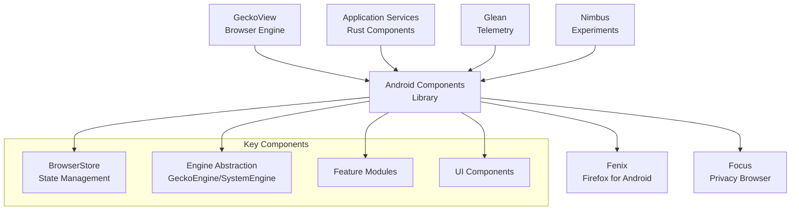
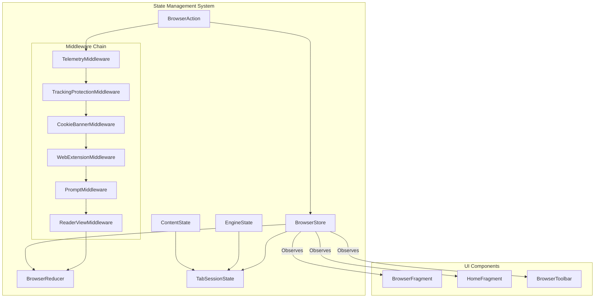
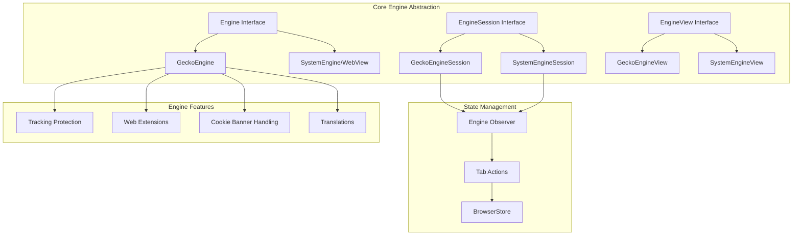
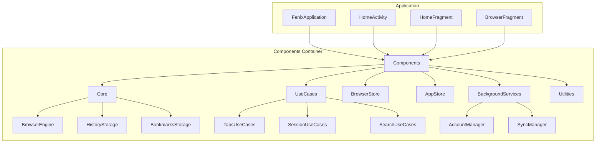
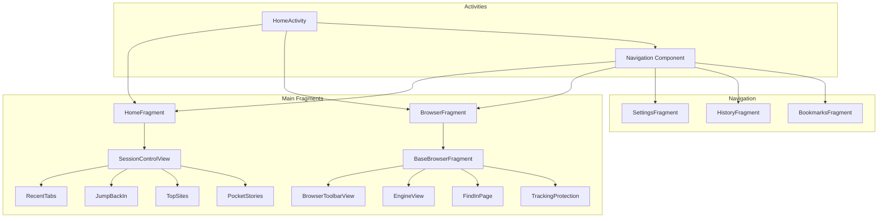
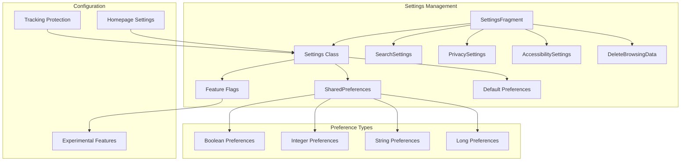
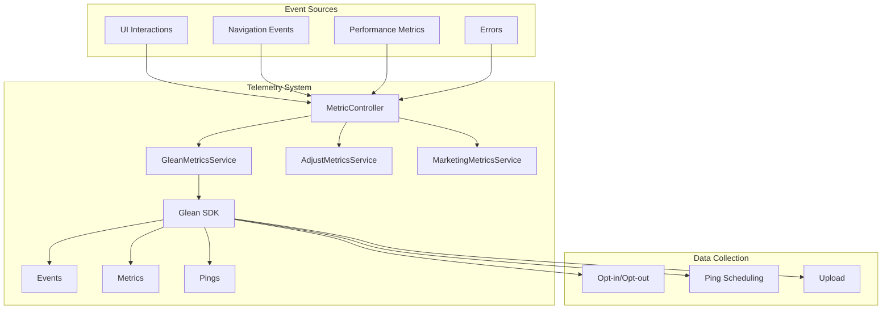
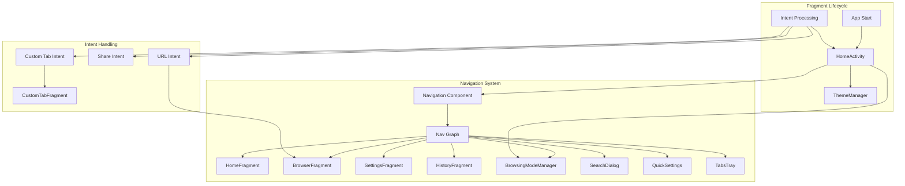

<!-- source: DeepWiki mcp.deepwiki.com · repo mozilla-mobile/firefox-android · page 1 Overview · fetched 2026-10-09 -->

# Overview

Relevant source files

The following files were used as context for generating this wiki page:

- [CODEOWNERS](CODEOWNERS)
- [LICENSE](LICENSE)
- [README.md](README.md)
- [android-components/.buildconfig.yml](android-components/.buildconfig.yml)
- [android-components/README.md](android-components/README.md)
- [android-components/automation/taskcluster/action/update_geckoview.sh](android-components/automation/taskcluster/action/update_geckoview.sh)
- [android-components/automation/taskcluster/action/update_publicsuffixlist.sh](android-components/automation/taskcluster/action/update_publicsuffixlist.sh)
- [android-components/components/browser/engine-gecko/src/main/java/mozilla/components/browser/engine/gecko/GeckoEngine.kt](android-components/components/browser/engine-gecko/src/main/java/mozilla/components/browser/engine/gecko/GeckoEngine.kt)
- [android-components/components/browser/engine-gecko/src/main/java/mozilla/components/browser/engine/gecko/GeckoEngineSession.kt](android-components/components/browser/engine-gecko/src/main/java/mozilla/components/browser/engine/gecko/GeckoEngineSession.kt)
- [android-components/components/browser/engine-gecko/src/test/java/mozilla/components/browser/engine/gecko/GeckoEngineSessionTest.kt](android-components/components/browser/engine-gecko/src/test/java/mozilla/components/browser/engine/gecko/GeckoEngineSessionTest.kt)
- [android-components/components/browser/engine-gecko/src/test/java/mozilla/components/browser/engine/gecko/GeckoEngineTest.kt](android-components/components/browser/engine-gecko/src/test/java/mozilla/components/browser/engine/gecko/GeckoEngineTest.kt)
- [android-components/components/browser/engine-system/src/main/java/mozilla/components/browser/engine/system/SystemEngine.kt](android-components/components/browser/engine-system/src/main/java/mozilla/components/browser/engine/system/SystemEngine.kt)
- [android-components/components/browser/engine-system/src/main/java/mozilla/components/browser/engine/system/SystemEngineSession.kt](android-components/components/browser/engine-system/src/main/java/mozilla/components/browser/engine/system/SystemEngineSession.kt)
- [android-components/components/browser/engine-system/src/test/java/mozilla/components/browser/engine/system/SystemEngineSessionTest.kt](android-components/components/browser/engine-system/src/test/java/mozilla/components/browser/engine/system/SystemEngineSessionTest.kt)
- [android-components/components/browser/state/src/main/java/mozilla/components/browser/state/action/BrowserAction.kt](android-components/components/browser/state/src/main/java/mozilla/components/browser/state/action/BrowserAction.kt)
- [android-components/components/browser/state/src/main/java/mozilla/components/browser/state/engine/EngineObserver.kt](android-components/components/browser/state/src/main/java/mozilla/components/browser/state/engine/EngineObserver.kt)
- [android-components/components/browser/state/src/main/java/mozilla/components/browser/state/reducer/ContentStateReducer.kt](android-components/components/browser/state/src/main/java/mozilla/components/browser/state/reducer/ContentStateReducer.kt)
- [android-components/components/browser/state/src/main/java/mozilla/components/browser/state/state/ContentState.kt](android-components/components/browser/state/src/main/java/mozilla/components/browser/state/state/ContentState.kt)
- [android-components/components/browser/state/src/test/java/mozilla/components/browser/state/action/ContentActionTest.kt](android-components/components/browser/state/src/test/java/mozilla/components/browser/state/action/ContentActionTest.kt)
- [android-components/components/browser/state/src/test/java/mozilla/components/browser/state/engine/EngineObserverTest.kt](android-components/components/browser/state/src/test/java/mozilla/components/browser/state/engine/EngineObserverTest.kt)
- [android-components/components/concept/engine/src/main/java/mozilla/components/concept/engine/Engine.kt](android-components/components/concept/engine/src/main/java/mozilla/components/concept/engine/Engine.kt)
- [android-components/components/concept/engine/src/main/java/mozilla/components/concept/engine/EngineSession.kt](android-components/components/concept/engine/src/main/java/mozilla/components/concept/engine/EngineSession.kt)
- [android-components/components/concept/engine/src/main/java/mozilla/components/concept/engine/Settings.kt](android-components/components/concept/engine/src/main/java/mozilla/components/concept/engine/Settings.kt)
- [android-components/components/concept/engine/src/test/java/mozilla/components/concept/engine/EngineSessionTest.kt](android-components/components/concept/engine/src/test/java/mozilla/components/concept/engine/EngineSessionTest.kt)
- [android-components/components/concept/engine/src/test/java/mozilla/components/concept/engine/EngineTest.kt](android-components/components/concept/engine/src/test/java/mozilla/components/concept/engine/EngineTest.kt)
- [android-components/components/concept/engine/src/test/java/mozilla/components/concept/engine/SettingsTest.kt](android-components/components/concept/engine/src/test/java/mozilla/components/concept/engine/SettingsTest.kt)
- [android-components/components/feature/containers/README.md](android-components/components/feature/containers/README.md)
- [android-components/components/feature/containers/proguard-rules.pro](android-components/components/feature/containers/proguard-rules.pro)
- [android-components/components/feature/containers/schemas/mozilla.components.feature.containers.db.ContainerDatabase/1.json](android-components/components/feature/containers/schemas/mozilla.components.feature.containers.db.ContainerDatabase/1.json)
- [android-components/components/feature/containers/src/main/AndroidManifest.xml](android-components/components/feature/containers/src/main/AndroidManifest.xml)
- [android-components/samples/browser/README.md](android-components/samples/browser/README.md)
- [android-components/samples/browser/build.gradle](android-components/samples/browser/build.gradle)
- [android-components/samples/browser/src/main/java/org/mozilla/samples/browser/BrowserFragment.kt](android-components/samples/browser/src/main/java/org/mozilla/samples/browser/BrowserFragment.kt)
- [android-components/samples/browser/src/main/java/org/mozilla/samples/browser/DefaultComponents.kt](android-components/samples/browser/src/main/java/org/mozilla/samples/browser/DefaultComponents.kt)
- [docs/changelog.md](docs/changelog.md)
- [fenix/app/metrics.yaml](fenix/app/metrics.yaml)
- [fenix/app/src/main/java/org/mozilla/fenix/FeatureFlags.kt](fenix/app/src/main/java/org/mozilla/fenix/FeatureFlags.kt)
- [fenix/app/src/main/java/org/mozilla/fenix/FenixApplication.kt](fenix/app/src/main/java/org/mozilla/fenix/FenixApplication.kt)
- [fenix/app/src/main/java/org/mozilla/fenix/HomeActivity.kt](fenix/app/src/main/java/org/mozilla/fenix/HomeActivity.kt)
- [fenix/app/src/main/java/org/mozilla/fenix/browser/BaseBrowserFragment.kt](fenix/app/src/main/java/org/mozilla/fenix/browser/BaseBrowserFragment.kt)
- [fenix/app/src/main/java/org/mozilla/fenix/browser/BrowserFragment.kt](fenix/app/src/main/java/org/mozilla/fenix/browser/BrowserFragment.kt)
- [fenix/app/src/main/java/org/mozilla/fenix/components/Core.kt](fenix/app/src/main/java/org/mozilla/fenix/components/Core.kt)
- [fenix/app/src/main/java/org/mozilla/fenix/components/UseCases.kt](fenix/app/src/main/java/org/mozilla/fenix/components/UseCases.kt)
- [fenix/app/src/main/java/org/mozilla/fenix/components/metrics/Event.kt](fenix/app/src/main/java/org/mozilla/fenix/components/metrics/Event.kt)
- [fenix/app/src/main/java/org/mozilla/fenix/components/metrics/GleanMetricsService.kt](fenix/app/src/main/java/org/mozilla/fenix/components/metrics/GleanMetricsService.kt)
- [fenix/app/src/main/java/org/mozilla/fenix/components/metrics/MetricController.kt](fenix/app/src/main/java/org/mozilla/fenix/components/metrics/MetricController.kt)
- [fenix/app/src/main/java/org/mozilla/fenix/home/HomeFragment.kt](fenix/app/src/main/java/org/mozilla/fenix/home/HomeFragment.kt)
- [fenix/app/src/main/java/org/mozilla/fenix/settings/SecretSettingsFragment.kt](fenix/app/src/main/java/org/mozilla/fenix/settings/SecretSettingsFragment.kt)
- [fenix/app/src/main/java/org/mozilla/fenix/settings/SettingsFragment.kt](fenix/app/src/main/java/org/mozilla/fenix/settings/SettingsFragment.kt)
- [fenix/app/src/main/java/org/mozilla/fenix/utils/Settings.kt](fenix/app/src/main/java/org/mozilla/fenix/utils/Settings.kt)
- [fenix/app/src/main/res/layout/preference_category_no_icon_style.xml](fenix/app/src/main/res/layout/preference_category_no_icon_style.xml)
- [fenix/app/src/main/res/navigation/nav_graph.xml](fenix/app/src/main/res/navigation/nav_graph.xml)
- [fenix/app/src/main/res/values/preference_keys.xml](fenix/app/src/main/res/values/preference_keys.xml)
- [fenix/app/src/main/res/values/static_strings.xml](fenix/app/src/main/res/values/static_strings.xml)
- [fenix/app/src/main/res/values/strings.xml](fenix/app/src/main/res/values/strings.xml)
- [fenix/app/src/main/res/xml/preferences.xml](fenix/app/src/main/res/xml/preferences.xml)
- [fenix/app/src/main/res/xml/secret_settings_preferences.xml](fenix/app/src/main/res/xml/secret_settings_preferences.xml)
- [fenix/app/src/test/java/org/mozilla/fenix/FenixApplicationTest.kt](fenix/app/src/test/java/org/mozilla/fenix/FenixApplicationTest.kt)
- [fenix/app/src/test/java/org/mozilla/fenix/components/metrics/MetricControllerTest.kt](fenix/app/src/test/java/org/mozilla/fenix/components/metrics/MetricControllerTest.kt)
- [fenix/app/src/test/java/org/mozilla/fenix/utils/SettingsTest.kt](fenix/app/src/test/java/org/mozilla/fenix/utils/SettingsTest.kt)
- [fenix/docs/metrics.md](fenix/docs/metrics.md)

This document provides a comprehensive overview of the Firefox Android repository architecture and structure. It covers the major components, their relationships, and the fundamental concepts that drive the Firefox for Android (Fenix) and Focus applications. This document serves as a starting point for understanding the codebase organization, key abstractions, and system design principles.

The Firefox Android repository contains both the application code for Firefox for Android (codename "Fenix") and Focus, as well as a collection of reusable browser components that power these applications. This overview aims to help developers understand the high-level architecture before diving into specific implementation details.

Sources:
[fenix/app/src/main/java/org/mozilla/fenix/FenixApplication.kt:123-127]()
[android-components/README.md:1-11]()
[fenix/app/src/main/java/org/mozilla/fenix/components/Core.kt:5-7]()

## Repository Structure

The Firefox Android repository is structured into two main parts:

1. **Android Components** - A collection of reusable Android libraries for building browsers or browser-like applications. These components provide the foundation for both Firefox for Android (Fenix) and Focus. The components are designed to be modular and reusable across different applications.

2. **Applications** - The actual browser applications built on top of Android Components:
   - **Fenix** - The main Firefox for Android application
   - **Focus** - The privacy-focused browser variant

The repository relies on several key external dependencies:
- **GeckoView** - Mozilla's browser engine implementation for Android
- **Application Services** - Rust-implemented cross-platform components for services like sync and logins
- **Glean** - Mozilla's telemetry collection library
- **Nimbus** - Mozilla's experimentation platform

Sources:
[android-components/.buildconfig.yml:1-20]()
[android-components/README.md:1-21]()
[fenix/app/src/main/res/values/static_strings.xml:1-9]()

## Core Architecture Components

The Firefox Android architecture follows a modular design pattern, where various functions are separated into distinct components. This section outlines the major architectural components.

### BrowserStore and State Management

The `BrowserStore` is the central state management component based on a Redux-like architecture. It stores the entire browsing state of the application, including:

- Open tabs (normal and private)
- Tab content (URL, title, loading state, etc.)
- Engine state
- Extensions state
- Download state

Actions dispatched to the store are processed through middleware chains before reaching reducers that update the state. The store emits state changes that components can observe and react to.

Sources:
[android-components/components/browser/state/src/main/java/mozilla/components/browser/state/action/BrowserAction.kt:5-59]()
[fenix/app/src/main/java/org/mozilla/fenix/components/Core.kt:25-38]()
[fenix/app/src/main/java/org/mozilla/fenix/browser/BaseBrowserFragment.kt:208-226]()

### Engine Abstraction

The browser engine is abstracted behind interfaces that allow Firefox Android to support multiple browser engines, though GeckoView is used in production. The key components of the engine abstraction are:

- **Engine Interface** - Defines operations that can be performed by a browser engine
- **EngineSession** - Represents a browsing session (similar to a tab)
- **EngineView** - UI component that renders web content

This abstraction allows for flexibility in the underlying engine implementation while providing a consistent API for the rest of the application.

Sources:
[android-components/components/concept/engine/src/main/java/mozilla/components/concept/engine/EngineSession.kt:35-48]()
[android-components/components/browser/engine-gecko/src/main/java/mozilla/components/browser/engine/gecko/GeckoEngineSession.kt:89-104]()
[android-components/components/browser/engine-gecko/src/main/java/mozilla/components/browser/engine/gecko/GeckoEngine.kt:5-22]()
[android-components/components/browser/engine-system/src/main/java/mozilla/components/browser/engine/system/SystemEngineSession.kt:1-4]()

### Application Components

The `Components` class serves as a dependency container that provides access to various browser components and features. The main components include:

The `FenixApplication` is the main Android application class that initializes core components and sets up global services like telemetry and crash reporting. It serves as the entry point for the Firefox Android application.

Sources:
[fenix/app/src/main/java/org/mozilla/fenix/components/Core.kt:5-7]()
[fenix/app/src/main/java/org/mozilla/fenix/FenixApplication.kt:126-139]()
[android-components/samples/browser/src/main/java/org/mozilla/samples/browser/DefaultComponents.kt:1-85]()

## User Interface Architecture

Firefox Android uses a fragment-based UI architecture with two main fragments:

1. **HomeFragment** - Displays the home screen with recent tabs, bookmarks, history, and other personalized content
2. **BrowserFragment** - Renders web content and provides browser controls

The UI components are organized into a hierarchy where:
- `HomeActivity` serves as the main container
- Navigation between fragments is managed by the Android Navigation Component
- Each fragment has its own view components and controllers

Sources:
[fenix/app/src/main/java/org/mozilla/fenix/HomeActivity.kt:145-189]()
[fenix/app/src/main/java/org/mozilla/fenix/home/HomeFragment.kt:150-177]()
[fenix/app/src/main/java/org/mozilla/fenix/browser/BrowserFragment.kt:71-85]()
[fenix/app/src/main/java/org/mozilla/fenix/browser/BaseBrowserFragment.kt:196-270]()
[fenix/app/src/main/res/navigation/nav_graph.xml:1-34]()

## Settings and Preferences

Firefox Android has an extensive settings system for managing user preferences:

The `Settings` class provides a centralized place for accessing and updating user preferences. It wraps Android's SharedPreferences with typed accessors and default values. Key settings include:

- Privacy and tracking protection options
- Homepage configuration
- Tab management preferences
- Theme and appearance settings
- Search engine configuration

Sources:
[fenix/app/src/main/java/org/mozilla/fenix/utils/Settings.kt:72-135]()
[fenix/app/src/main/java/org/mozilla/fenix/settings/SettingsFragment.kt:1-26]()
[fenix/app/src/main/res/values/preference_keys.xml:1-75]()
[fenix/app/src/main/java/org/mozilla/fenix/FeatureFlags.kt:1-14]()

## Telemetry and Metrics

Firefox Android uses Glean for collecting telemetry data about user interactions and application performance:

Telemetry collection is managed by the `MetricController` which delegates to various metric services. Firefox Android collects various types of metrics including:

- User interaction events
- Performance metrics
- Feature usage
- Error conditions

All telemetry collection respects user privacy settings and can be disabled by the user.

Sources:
[fenix/app/src/main/java/org/mozilla/fenix/components/metrics/Event.kt:7-57]()
[fenix/app/src/main/java/org/mozilla/fenix/components/metrics/GleanMetricsService.kt:1-103]()
[fenix/app/src/main/java/org/mozilla/fenix/components/metrics/MetricController.kt:1-13]()
[fenix/app/metrics.yaml:1-60]()
[fenix/docs/metrics.md:1-6]()

## Navigation and Lifecycle

The navigation in Firefox Android is primarily handled by the Android Navigation Component, which defines the flow between different screens in the application:

The navigation flow starts from the `HomeActivity` which uses the Navigation Component to manage transitions between fragments. Key navigation paths include:

- Home to Browser (when opening a URL)
- Browser to Tabs Tray (when viewing open tabs)
- Browser to Settings (when accessing preferences)
- Various dialogs for specific actions (search, quick settings, etc.)

The application handles different types of intents including URL intents, share intents, and custom tab intents.

Sources:
[fenix/app/src/main/java/org/mozilla/fenix/HomeActivity.kt:197-254]()
[fenix/app/src/main/res/navigation/nav_graph.xml:1-65]()
[fenix/app/src/main/java/org/mozilla/fenix/home/HomeFragment.kt:258-299]()

## Conclusion

Firefox Android is a sophisticated mobile browser built on a modular, component-based architecture. The codebase is organized into reusable components (Android Components) and application-specific code (Fenix and Focus). Key architectural patterns include:

1. Redux-like state management with the BrowserStore
2. Engine abstraction to support different browser engines
3. Fragment-based UI architecture
4. Component-based design for reusability
5. Telemetry collection with Glean

This architecture allows for maintainability, testability, and the ability to reuse components across different applications like Fenix and Focus.

Sources:
[android-components/README.md:1-21]()
[fenix/app/src/main/java/org/mozilla/fenix/FenixApplication.kt:126-153]()
[android-components/.buildconfig.yml:1-20]()

---

