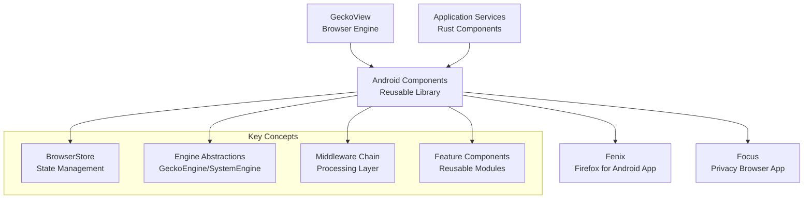
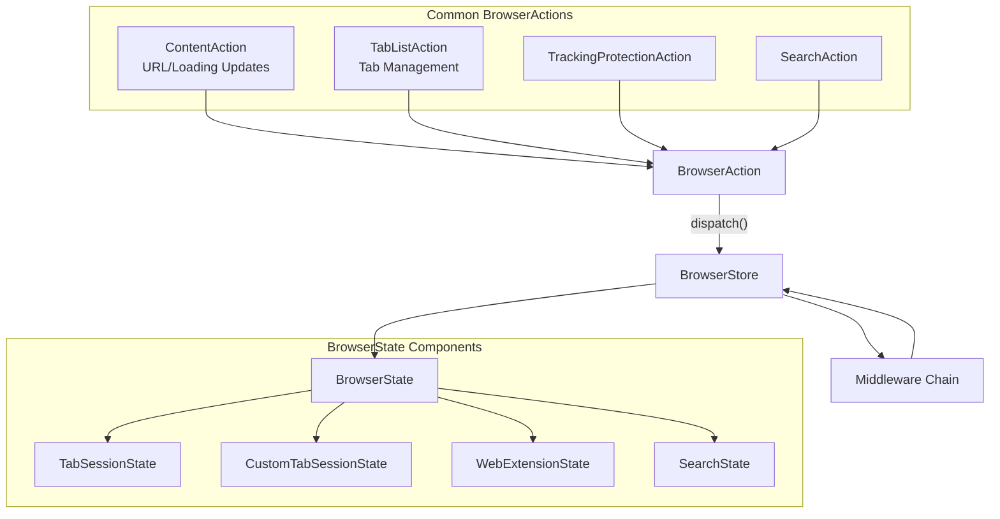
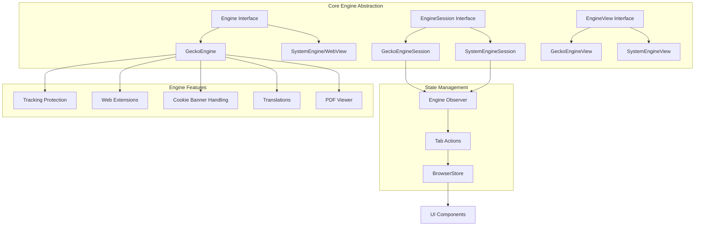
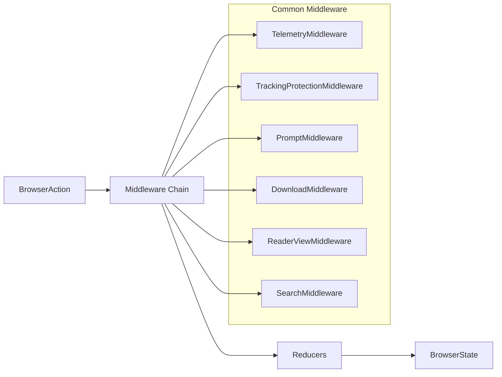
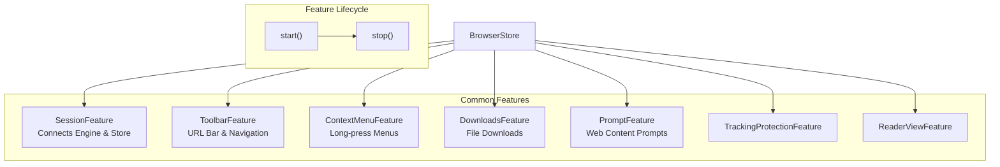
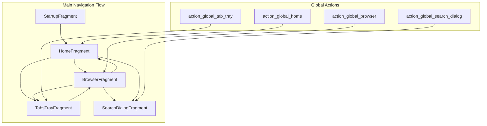
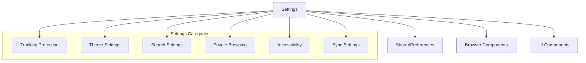
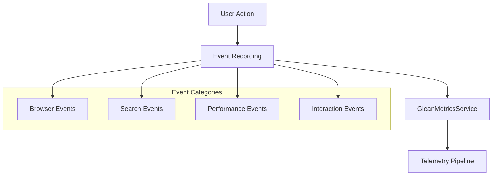
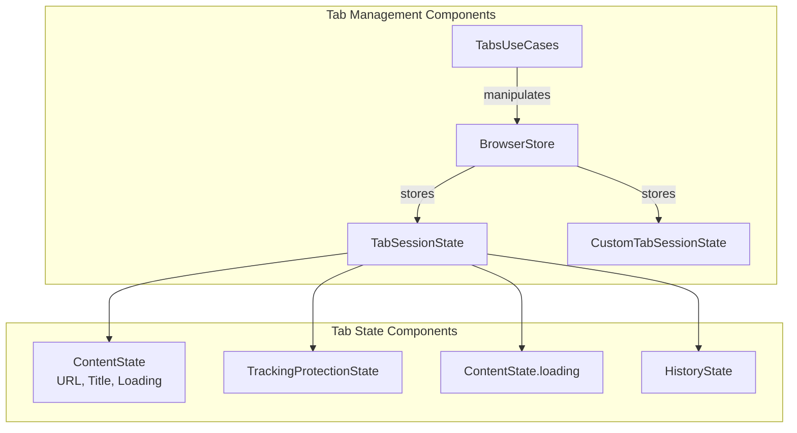

<!-- source: DeepWiki mcp.deepwiki.com · repo mozilla-mobile/firefox-android · page 1.1 Key Concepts and Terminology · fetched 2026-10-09 -->

# Key Concepts and Terminology

<details>
<summary>Relevant source files</summary>

The following files were used as context for generating this wiki page:

- [android-components/components/browser/engine-gecko/src/main/java/mozilla/components/browser/engine/gecko/GeckoEngine.kt](android-components/components/browser/engine-gecko/src/main/java/mozilla/components/browser/engine/gecko/GeckoEngine.kt)
- [android-components/components/browser/engine-gecko/src/main/java/mozilla/components/browser/engine/gecko/GeckoEngineSession.kt](android-components/components/browser/engine-gecko/src/main/java/mozilla/components/browser/engine/gecko/GeckoEngineSession.kt)
- [android-components/components/browser/engine-gecko/src/test/java/mozilla/components/browser/engine/gecko/GeckoEngineSessionTest.kt](android-components/components/browser/engine-gecko/src/test/java/mozilla/components/browser/engine/gecko/GeckoEngineSessionTest.kt)
- [android-components/components/browser/engine-gecko/src/test/java/mozilla/components/browser/engine/gecko/GeckoEngineTest.kt](android-components/components/browser/engine-gecko/src/test/java/mozilla/components/browser/engine/gecko/GeckoEngineTest.kt)
- [android-components/components/browser/engine-system/src/main/java/mozilla/components/browser/engine/system/SystemEngine.kt](android-components/components/browser/engine-system/src/main/java/mozilla/components/browser/engine/system/SystemEngine.kt)
- [android-components/components/browser/engine-system/src/main/java/mozilla/components/browser/engine/system/SystemEngineSession.kt](android-components/components/browser/engine-system/src/main/java/mozilla/components/browser/engine/system/SystemEngineSession.kt)
- [android-components/components/browser/engine-system/src/test/java/mozilla/components/browser/engine/system/SystemEngineSessionTest.kt](android-components/components/browser/engine-system/src/test/java/mozilla/components/browser/engine/system/SystemEngineSessionTest.kt)
- [android-components/components/browser/state/src/main/java/mozilla/components/browser/state/action/BrowserAction.kt](android-components/components/browser/state/src/main/java/mozilla/components/browser/state/action/BrowserAction.kt)
- [android-components/components/browser/state/src/main/java/mozilla/components/browser/state/engine/EngineObserver.kt](android-components/components/browser/state/src/main/java/mozilla/components/browser/state/engine/EngineObserver.kt)
- [android-components/components/browser/state/src/main/java/mozilla/components/browser/state/reducer/ContentStateReducer.kt](android-components/components/browser/state/src/main/java/mozilla/components/browser/state/reducer/ContentStateReducer.kt)
- [android-components/components/browser/state/src/main/java/mozilla/components/browser/state/state/ContentState.kt](android-components/components/browser/state/src/main/java/mozilla/components/browser/state/state/ContentState.kt)
- [android-components/components/browser/state/src/test/java/mozilla/components/browser/state/action/ContentActionTest.kt](android-components/components/browser/state/src/test/java/mozilla/components/browser/state/action/ContentActionTest.kt)
- [android-components/components/browser/state/src/test/java/mozilla/components/browser/state/engine/EngineObserverTest.kt](android-components/components/browser/state/src/test/java/mozilla/components/browser/state/engine/EngineObserverTest.kt)
- [android-components/components/concept/engine/src/main/java/mozilla/components/concept/engine/Engine.kt](android-components/components/concept/engine/src/main/java/mozilla/components/concept/engine/Engine.kt)
- [android-components/components/concept/engine/src/main/java/mozilla/components/concept/engine/EngineSession.kt](android-components/components/concept/engine/src/main/java/mozilla/components/concept/engine/EngineSession.kt)
- [android-components/components/concept/engine/src/main/java/mozilla/components/concept/engine/Settings.kt](android-components/components/concept/engine/src/main/java/mozilla/components/concept/engine/Settings.kt)
- [android-components/components/concept/engine/src/test/java/mozilla/components/concept/engine/EngineSessionTest.kt](android-components/components/concept/engine/src/test/java/mozilla/components/concept/engine/EngineSessionTest.kt)
- [android-components/components/concept/engine/src/test/java/mozilla/components/concept/engine/EngineTest.kt](android-components/components/concept/engine/src/test/java/mozilla/components/concept/engine/EngineTest.kt)
- [android-components/components/concept/engine/src/test/java/mozilla/components/concept/engine/SettingsTest.kt](android-components/components/concept/engine/src/test/java/mozilla/components/concept/engine/SettingsTest.kt)
- [docs/changelog.md](docs/changelog.md)
- [fenix/app/metrics.yaml](fenix/app/metrics.yaml)
- [fenix/app/src/main/java/org/mozilla/fenix/FeatureFlags.kt](fenix/app/src/main/java/org/mozilla/fenix/FeatureFlags.kt)
- [fenix/app/src/main/java/org/mozilla/fenix/FenixApplication.kt](fenix/app/src/main/java/org/mozilla/fenix/FenixApplication.kt)
- [fenix/app/src/main/java/org/mozilla/fenix/HomeActivity.kt](fenix/app/src/main/java/org/mozilla/fenix/HomeActivity.kt)
- [fenix/app/src/main/java/org/mozilla/fenix/browser/BaseBrowserFragment.kt](fenix/app/src/main/java/org/mozilla/fenix/browser/BaseBrowserFragment.kt)
- [fenix/app/src/main/java/org/mozilla/fenix/browser/BrowserFragment.kt](fenix/app/src/main/java/org/mozilla/fenix/browser/BrowserFragment.kt)
- [fenix/app/src/main/java/org/mozilla/fenix/components/Core.kt](fenix/app/src/main/java/org/mozilla/fenix/components/Core.kt)
- [fenix/app/src/main/java/org/mozilla/fenix/components/UseCases.kt](fenix/app/src/main/java/org/mozilla/fenix/components/UseCases.kt)
- [fenix/app/src/main/java/org/mozilla/fenix/components/metrics/Event.kt](fenix/app/src/main/java/org/mozilla/fenix/components/metrics/Event.kt)
- [fenix/app/src/main/java/org/mozilla/fenix/components/metrics/GleanMetricsService.kt](fenix/app/src/main/java/org/mozilla/fenix/components/metrics/GleanMetricsService.kt)
- [fenix/app/src/main/java/org/mozilla/fenix/components/metrics/MetricController.kt](fenix/app/src/main/java/org/mozilla/fenix/components/metrics/MetricController.kt)
- [fenix/app/src/main/java/org/mozilla/fenix/home/HomeFragment.kt](fenix/app/src/main/java/org/mozilla/fenix/home/HomeFragment.kt)
- [fenix/app/src/main/java/org/mozilla/fenix/settings/SecretSettingsFragment.kt](fenix/app/src/main/java/org/mozilla/fenix/settings/SecretSettingsFragment.kt)
- [fenix/app/src/main/java/org/mozilla/fenix/settings/SettingsFragment.kt](fenix/app/src/main/java/org/mozilla/fenix/settings/SettingsFragment.kt)
- [fenix/app/src/main/java/org/mozilla/fenix/utils/Settings.kt](fenix/app/src/main/java/org/mozilla/fenix/utils/Settings.kt)
- [fenix/app/src/main/res/layout/preference_category_no_icon_style.xml](fenix/app/src/main/res/layout/preference_category_no_icon_style.xml)
- [fenix/app/src/main/res/navigation/nav_graph.xml](fenix/app/src/main/res/navigation/nav_graph.xml)
- [fenix/app/src/main/res/values/preference_keys.xml](fenix/app/src/main/res/values/preference_keys.xml)
- [fenix/app/src/main/res/values/static_strings.xml](fenix/app/src/main/res/values/static_strings.xml)
- [fenix/app/src/main/res/values/strings.xml](fenix/app/src/main/res/values/strings.xml)
- [fenix/app/src/main/res/xml/preferences.xml](fenix/app/src/main/res/xml/preferences.xml)
- [fenix/app/src/main/res/xml/secret_settings_preferences.xml](fenix/app/src/main/res/xml/secret_settings_preferences.xml)
- [fenix/app/src/test/java/org/mozilla/fenix/FenixApplicationTest.kt](fenix/app/src/test/java/org/mozilla/fenix/FenixApplicationTest.kt)
- [fenix/app/src/test/java/org/mozilla/fenix/components/metrics/MetricControllerTest.kt](fenix/app/src/test/java/org/mozilla/fenix/components/metrics/MetricControllerTest.kt)
- [fenix/app/src/test/java/org/mozilla/fenix/utils/SettingsTest.kt](fenix/app/src/test/java/org/mozilla/fenix/utils/SettingsTest.kt)
- [fenix/docs/metrics.md](fenix/docs/metrics.md)

</details>


This page explains the fundamental concepts and terminology used throughout the Firefox for Android codebase. Understanding these core concepts is essential for effectively working with the browser's architecture, state management, and component system.

## High-Level Architecture Overview

Firefox for Android is built on a modular architecture with several key components:



Sources:
- [fenix/app/src/main/java/org/mozilla/fenix/FenixApplication.kt]()
- [fenix/app/src/main/java/org/mozilla/fenix/components/Core.kt]()

## BrowserStore: State Management

The BrowserStore is the central state management system for the browser, implementing Redux principles to maintain a consistent application state.



The BrowserStore serves as the single source of truth for the entire browser's state. Components observe the store to react to state changes and dispatch actions to modify the state.

Example of dispatching an action:

```kotlin
browserStore.dispatch(ContentAction.UpdateUrlAction(tabId, url))
```

Example of observing state:

```kotlin
browserStore.flowScoped(viewLifecycleOwner) { flow ->
    flow.map { it.selectedTab }.collect { tab ->
        // Update UI with tab information
    }
}
```

Sources:
- [android-components/components/browser/state/src/main/java/mozilla/components/browser/state/action/BrowserAction.kt]()
- [android-components/components/browser/state/src/main/java/mozilla/components/browser/state/reducer/ContentStateReducer.kt]()
- [fenix/app/src/main/java/org/mozilla/fenix/components/Core.kt:225-268]()
- [fenix/app/src/main/java/org/mozilla/fenix/browser/BaseBrowserFragment.kt:217-220]()

## Engine Abstraction Layer

Firefox for Android uses an engine abstraction to support different browser engines, primarily GeckoView (Mozilla's engine).



The engine abstraction consists of three main components:

| Component | Purpose | Main Implementation |
|-----------|---------|---------------------|
| Engine | Browser engine factory | GeckoEngine |
| EngineSession | Individual browsing session | GeckoEngineSession |
| EngineView | Visual component displaying web content | GeckoEngineView |

Common operations:

```kotlin
// Create a session
val engineSession = engine.createSession()

// Load a URL
engineSession.loadUrl("https://mozilla.org")

// Navigate
engineSession.goBack()
engineSession.goForward()

// Register observers
engineSession.register(object : EngineSession.Observer {
    override fun onLocationChange(url: String, hasUserGesture: Boolean) {
        // Update UI with new URL
    }
    
    override fun onProgress(progress: Int) {
        // Update loading progress
    }
})
```

Sources:
- [android-components/components/concept/engine/src/main/java/mozilla/components/concept/engine/Engine.kt]()
- [android-components/components/concept/engine/src/main/java/mozilla/components/concept/engine/EngineSession.kt]()
- [android-components/components/browser/engine-gecko/src/main/java/mozilla/components/browser/engine/gecko/GeckoEngine.kt]()
- [android-components/components/browser/engine-gecko/src/main/java/mozilla/components/browser/engine/gecko/GeckoEngineSession.kt]()

## Middleware

Middleware provides a processing layer between actions and state updates, allowing for side effects and additional processing.



Examples of middleware in Firefox for Android:

| Middleware | Purpose |
|------------|---------|
| PromptMiddleware | Manages web-content prompts (dialogs, alerts) |
| DownloadMiddleware | Handles file downloads |
| TrackingProtectionMiddleware | Implements tracking protection features |
| TelemetryMiddleware | Collects usage data |
| ReaderViewMiddleware | Handles reader view state |
| SessionMiddleware | Connects to engine sessions |

Sources:
- [fenix/app/src/main/java/org/mozilla/fenix/components/Core.kt:225-268]()
- [android-components/components/browser/state/src/main/java/mozilla/components/browser/state/action/BrowserAction.kt]()

## Feature Components

Feature components are self-contained modules that implement specific browser functionality, following a consistent lifecycle pattern.



Features are typically integrated in fragments using the ViewBoundFeatureWrapper:

```kotlin
private val downloadsFeature = ViewBoundFeatureWrapper<DownloadsFeature>()

override fun onViewCreated(view: View, savedInstanceState: Bundle?) {
    downloadsFeature.set(
        feature = DownloadsFeature(
            context = requireContext(),
            store = components.core.store,
            useCases = components.useCases.downloadUseCases,
            fragmentManager = childFragmentManager
        ),
        owner = viewLifecycleOwner,
        view = view
    )
}
```

Sources:
- [fenix/app/src/main/java/org/mozilla/fenix/browser/BaseBrowserFragment.kt:226-254]()
- [fenix/app/src/main/java/org/mozilla/fenix/home/HomeFragment.kt:233-376]()

## Navigation Architecture

Firefox for Android uses the Jetpack Navigation component for screen navigation, with a central navigation graph.



Navigation is typically performed using:

```kotlin
// Navigate using directions
findNavController().navigate(
    HomeFragmentDirections.actionHomeFragmentToBrowserFragment(tabId)
)

// Navigate using global actions
findNavController().navigate(NavGraphDirections.actionGlobalBrowser(tabId))
```

Sources:
- [fenix/app/src/main/res/navigation/nav_graph.xml]()
- [fenix/app/src/main/java/org/mozilla/fenix/HomeActivity.kt]()

## Settings System

Firefox for Android uses a unified Settings class to manage user preferences, backed by SharedPreferences.



Settings are accessed through extension properties:

```kotlin
// Access settings
val settings = context.settings()

// Read a setting
if (settings.showPrivateBrowsingShortcut) {
    // Do something
}

// Write a setting
settings.shouldUseTrackingProtection = true
```

Main settings are defined in [fenix/app/src/main/java/org/mozilla/fenix/utils/Settings.kt]() and use property delegates for easy access:

```kotlin
var showPrivateBrowsingShortcut by booleanPreference(
    appContext.getPreferenceKey(R.string.pref_key_add_private_browsing_shortcut),
    default = false
)
```

Sources:
- [fenix/app/src/main/java/org/mozilla/fenix/utils/Settings.kt]()
- [fenix/app/src/main/res/xml/preferences.xml]()
- [fenix/app/src/main/res/values/preference_keys.xml]()

## Metrics and Telemetry

Firefox for Android uses Mozilla's Glean library for telemetry collection.



Events are recorded using:

```kotlin
// Record simple event
Events.openedBookmark.record(NoExtras())

// Record event with extra data
Events.performedSearch.record(
    Events.PerformedSearchExtra(
        source = searchAccessPoint
    )
)
```

Common event categories:

| Category | Purpose |
|----------|---------|
| Events | General user interactions |
| BrowserMenuAction | Menu interactions |
| SearchAction | Search-related events |
| TabsTray | Tab management events |
| TrackingProtection | Tracking protection interactions |

Sources:
- [fenix/app/metrics.yaml]()
- [fenix/app/src/main/java/org/mozilla/fenix/components/metrics/GleanMetricsService.kt]()
- [fenix/app/src/main/java/org/mozilla/fenix/components/metrics/Event.kt]()
- [fenix/app/src/main/java/org/mozilla/fenix/components/metrics/MetricController.kt]()

## Browser Session Management

Browser session management handles the lifecycle of tabs and their content.



Common tabs operations:

```kotlin
// Add a new tab
tabsUseCases.addTab(
    url = "https://mozilla.org",
    private = false,
    selectTab = true
)

// Select a tab
tabsUseCases.selectTab(tabId)

// Remove a tab
tabsUseCases.removeTab(tabId)
```

Sources:
- [fenix/app/src/main/java/org/mozilla/fenix/browser/BaseBrowserFragment.kt]()
- [fenix/app/src/main/java/org/mozilla/fenix/home/HomeFragment.kt]()

## Conclusion

This document covered the key concepts and terminology used throughout the Firefox for Android codebase. These concepts form the foundation of the browser's architecture and are essential for understanding how the various components interact to provide a complete browsing experience.

---

