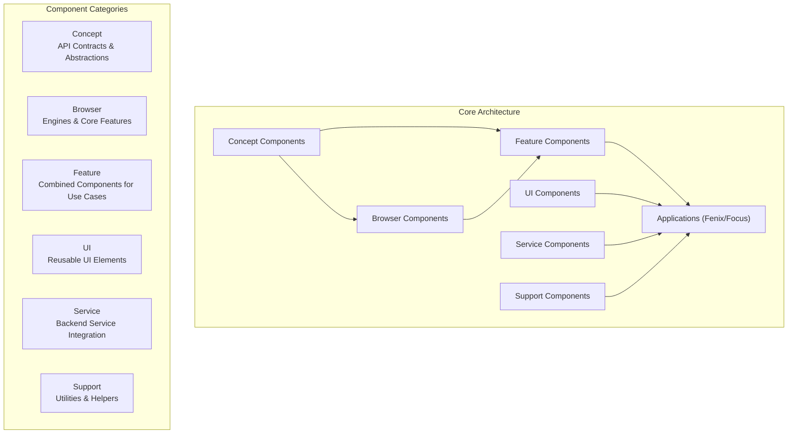
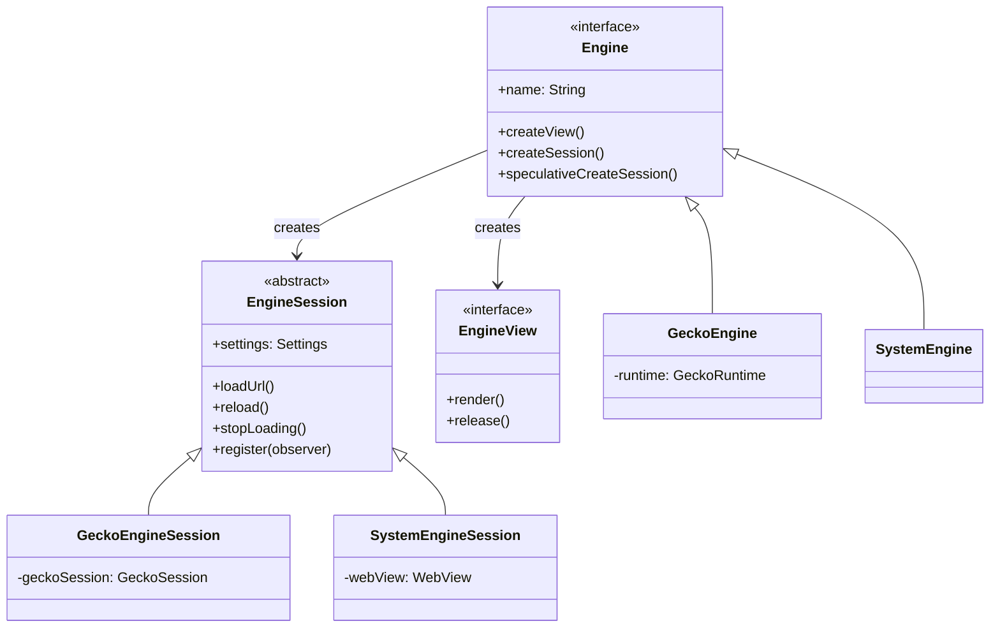
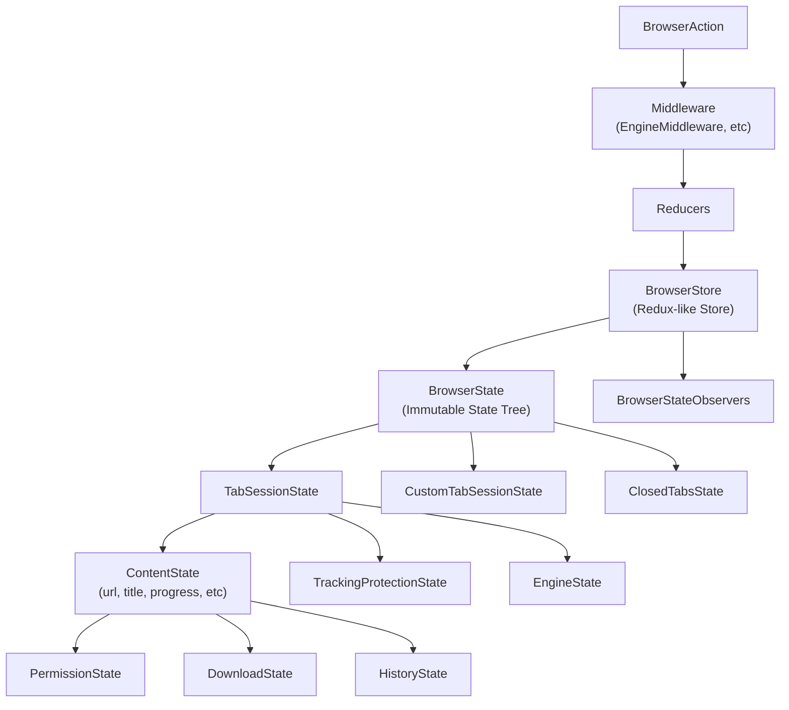
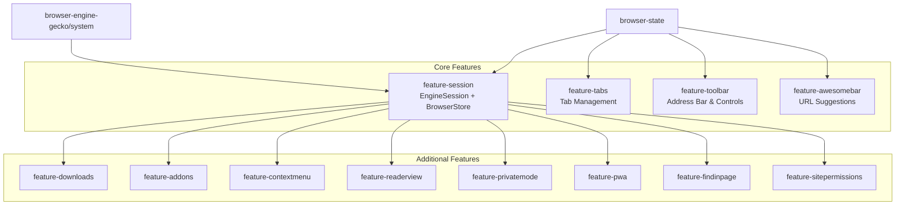
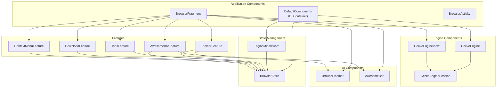

<!-- source: DeepWiki mcp.deepwiki.com · repo mozilla-mobile/firefox-android · page 2 Android Components · fetched 2026-10-09 -->

# Android Components

<details>
<summary>Relevant source files</summary>

The following files were used as context for generating this wiki page:

- [CODEOWNERS](CODEOWNERS)
- [LICENSE](LICENSE)
- [README.md](README.md)
- [android-components/.buildconfig.yml](android-components/.buildconfig.yml)
- [android-components/README.md](android-components/README.md)
- [android-components/automation/taskcluster/action/update_geckoview.sh](android-components/automation/taskcluster/action/update_geckoview.sh)
- [android-components/automation/taskcluster/action/update_publicsuffixlist.sh](android-components/automation/taskcluster/action/update_publicsuffixlist.sh)
- [android-components/components/browser/engine-gecko/src/main/java/mozilla/components/browser/engine/gecko/GeckoEngine.kt](android-components/components/browser/engine-gecko/src/main/java/mozilla/components/browser/engine/gecko/GeckoEngine.kt)
- [android-components/components/browser/engine-gecko/src/main/java/mozilla/components/browser/engine/gecko/GeckoEngineSession.kt](android-components/components/browser/engine-gecko/src/main/java/mozilla/components/browser/engine/gecko/GeckoEngineSession.kt)
- [android-components/components/browser/engine-gecko/src/test/java/mozilla/components/browser/engine/gecko/GeckoEngineSessionTest.kt](android-components/components/browser/engine-gecko/src/test/java/mozilla/components/browser/engine/gecko/GeckoEngineSessionTest.kt)
- [android-components/components/browser/engine-gecko/src/test/java/mozilla/components/browser/engine/gecko/GeckoEngineTest.kt](android-components/components/browser/engine-gecko/src/test/java/mozilla/components/browser/engine/gecko/GeckoEngineTest.kt)
- [android-components/components/browser/engine-system/src/main/java/mozilla/components/browser/engine/system/SystemEngine.kt](android-components/components/browser/engine-system/src/main/java/mozilla/components/browser/engine/system/SystemEngine.kt)
- [android-components/components/browser/engine-system/src/main/java/mozilla/components/browser/engine/system/SystemEngineSession.kt](android-components/components/browser/engine-system/src/main/java/mozilla/components/browser/engine/system/SystemEngineSession.kt)
- [android-components/components/browser/engine-system/src/test/java/mozilla/components/browser/engine/system/SystemEngineSessionTest.kt](android-components/components/browser/engine-system/src/test/java/mozilla/components/browser/engine/system/SystemEngineSessionTest.kt)
- [android-components/components/browser/state/src/main/java/mozilla/components/browser/state/action/BrowserAction.kt](android-components/components/browser/state/src/main/java/mozilla/components/browser/state/action/BrowserAction.kt)
- [android-components/components/browser/state/src/main/java/mozilla/components/browser/state/engine/EngineObserver.kt](android-components/components/browser/state/src/main/java/mozilla/components/browser/state/engine/EngineObserver.kt)
- [android-components/components/browser/state/src/main/java/mozilla/components/browser/state/reducer/ContentStateReducer.kt](android-components/components/browser/state/src/main/java/mozilla/components/browser/state/reducer/ContentStateReducer.kt)
- [android-components/components/browser/state/src/main/java/mozilla/components/browser/state/state/ContentState.kt](android-components/components/browser/state/src/main/java/mozilla/components/browser/state/state/ContentState.kt)
- [android-components/components/browser/state/src/test/java/mozilla/components/browser/state/action/ContentActionTest.kt](android-components/components/browser/state/src/test/java/mozilla/components/browser/state/action/ContentActionTest.kt)
- [android-components/components/browser/state/src/test/java/mozilla/components/browser/state/engine/EngineObserverTest.kt](android-components/components/browser/state/src/test/java/mozilla/components/browser/state/engine/EngineObserverTest.kt)
- [android-components/components/concept/engine/src/main/java/mozilla/components/concept/engine/Engine.kt](android-components/components/concept/engine/src/main/java/mozilla/components/concept/engine/Engine.kt)
- [android-components/components/concept/engine/src/main/java/mozilla/components/concept/engine/EngineSession.kt](android-components/components/concept/engine/src/main/java/mozilla/components/concept/engine/EngineSession.kt)
- [android-components/components/concept/engine/src/main/java/mozilla/components/concept/engine/Settings.kt](android-components/components/concept/engine/src/main/java/mozilla/components/concept/engine/Settings.kt)
- [android-components/components/concept/engine/src/test/java/mozilla/components/concept/engine/EngineSessionTest.kt](android-components/components/concept/engine/src/test/java/mozilla/components/concept/engine/EngineSessionTest.kt)
- [android-components/components/concept/engine/src/test/java/mozilla/components/concept/engine/EngineTest.kt](android-components/components/concept/engine/src/test/java/mozilla/components/concept/engine/EngineTest.kt)
- [android-components/components/concept/engine/src/test/java/mozilla/components/concept/engine/SettingsTest.kt](android-components/components/concept/engine/src/test/java/mozilla/components/concept/engine/SettingsTest.kt)
- [android-components/components/feature/containers/README.md](android-components/components/feature/containers/README.md)
- [android-components/components/feature/containers/proguard-rules.pro](android-components/components/feature/containers/proguard-rules.pro)
- [android-components/components/feature/containers/schemas/mozilla.components.feature.containers.db.ContainerDatabase/1.json](android-components/components/feature/containers/schemas/mozilla.components.feature.containers.db.ContainerDatabase/1.json)
- [android-components/components/feature/containers/src/main/AndroidManifest.xml](android-components/components/feature/containers/src/main/AndroidManifest.xml)
- [android-components/samples/browser/README.md](android-components/samples/browser/README.md)
- [android-components/samples/browser/build.gradle](android-components/samples/browser/build.gradle)
- [android-components/samples/browser/src/main/java/org/mozilla/samples/browser/BrowserFragment.kt](android-components/samples/browser/src/main/java/org/mozilla/samples/browser/BrowserFragment.kt)
- [android-components/samples/browser/src/main/java/org/mozilla/samples/browser/DefaultComponents.kt](android-components/samples/browser/src/main/java/org/mozilla/samples/browser/DefaultComponents.kt)
- [docs/changelog.md](docs/changelog.md)

</details>


Android Components is a collection of reusable Android libraries that form the foundation for building browser applications on Android. It provides modular building blocks for browser functionality including web rendering, state management, UI components, and various browser features. This page covers the architecture, core components, and how they work together to create a complete browser experience.

For information about specific Firefox for Android applications that use these components, see [Fenix (Firefox for Android)](#3) and [Focus Android](#4).

## Architecture Overview

Android Components is organized as a modular library collection with several categories of components that work together to create browser functionality. Each component is designed to be independent but composable, allowing applications to include only what they need.



Sources: [android-components/README.md:1-41](), [android-components/.buildconfig.yml:1-1437]()

### Component Types

Android Components are divided into the following categories:

| Category | Purpose | Examples |
|----------|---------|----------|
| Concept | Define API contracts and abstraction layers | `concept-engine`, `concept-toolbar` |
| Browser | Implement core browser functionality | `browser-engine-gecko`, `browser-state` |
| Feature | Combine components for specific use cases | `feature-tabs`, `feature-session` |
| UI | Provide reusable UI elements | `ui-colors`, `ui-icons` |
| Service | Interface with backend services | `service-firefox-accounts`, `service-glean` |
| Support | Utility functions and helpers | `support-ktx`, `support-base` |

Sources: [android-components/README.md:48-193](), [android-components/.buildconfig.yml:1-1437]()

## Core Systems

### Browser Engine Abstraction

One of the core systems in Android Components is the browser engine abstraction layer, which provides a common interface for different browser engines (Gecko or WebView).



The engine abstraction layer allows applications to be built on top of either GeckoView (Mozilla's browser engine) or Android's WebView, with the same APIs regardless of the underlying engine. This enables engine-agnostic browser implementations.

Sources: [android-components/components/concept/engine/src/main/java/mozilla/components/concept/engine/Engine.kt:1-25](), [android-components/components/concept/engine/src/main/java/mozilla/components/concept/engine/EngineSession.kt:1-56](), [android-components/components/browser/engine-gecko/src/main/java/mozilla/components/browser/engine/gecko/GeckoEngine.kt:1-118](), [android-components/components/browser/engine-system/src/main/java/mozilla/components/browser/engine/system/SystemEngine.kt:1-12]()

Key components:

- **Engine**: Interface for creating sessions and views
- **EngineSession**: Abstract representation of a browsing session
- **EngineView**: Displays web content
- **Settings**: Configuration for the engine behavior

### Browser State Management

The browser state management system provides a centralized place to store and manage the state of the browser, including tabs, sessions, and other browser data.



Sources: [android-components/components/browser/state/src/main/java/mozilla/components/browser/state/action/BrowserAction.kt:1-73](), [android-components/components/browser/state/src/main/java/mozilla/components/browser/state/state/ContentState.kt:1-25](), [android-components/components/browser/state/src/main/java/mozilla/components/browser/state/reducer/ContentStateReducer.kt:1-66]()

The browser state management system follows a Redux-like pattern:

1. **BrowserStore**: Central state container that holds the immutable browser state
2. **BrowserAction**: Actions that describe changes to the state
3. **Reducers**: Pure functions that take the current state and an action and return a new state
4. **Middleware**: Intercepts actions before they reach the reducers, useful for side effects

Key state components:

- **TabSessionState**: Represents a normal browser tab
- **CustomTabSessionState**: Represents a custom tab
- **ContentState**: Contains the actual content of a tab (URL, title, loading state, etc.)
- **EngineState**: Holds engine-specific state

## Feature Components

Feature components combine the basic building blocks to implement specific browser features. These components typically connect the browser state with the UI and handle user interactions.



Sources: [android-components/README.md:104-170](), [android-components/samples/browser/src/main/java/org/mozilla/samples/browser/DefaultComponents.kt:1-136]()

Major feature components include:

- **Session**: Connects an engine implementation with the browser session module
- **Tabs**: Manages tabs and provides a tabs tray UI
- **Toolbar**: Handles the browser toolbar/address bar
- **Awesomebar**: Provides URL suggestions and search results
- **Downloads**: Manages file downloads
- **Context Menu**: Displays context menus when long-pressing web content
- **Reader View**: Implements reader mode functionality
- **Private Mode**: Provides private browsing features

## Integration Example

The following example shows how Android Components are combined to create a complete browser:



Sources: [android-components/samples/browser/src/main/java/org/mozilla/samples/browser/DefaultComponents.kt:1-515](), [android-components/samples/browser/src/main/java/org/mozilla/samples/browser/BrowserFragment.kt:1-183]()

In the sample browser:

1. `DefaultComponents` serves as a dependency injection container that initializes all components
2. `BrowserFragment` connects UI components with features
3. Each feature connects to the central `BrowserStore` and relevant UI components
4. The engine components provide the actual web rendering capabilities

## Observer Pattern

Android Components extensively uses the observer pattern to notify components about changes:

```mermaid
classDiagram
    class Observable~T~ {
        +register(observer: T)
        +unregister(observer: T)
        +notifyObservers(block: T.() -> Unit)
    }
    
    class EngineSession {
        +register(observer: Observer)
        +notifyObservers { onLocationChange() }
        +notifyObservers { onProgress() }
    }
    
    class BrowserStore {
        +observeSelected()
        +observeFixed()
    }
    
    class Feature {
        -sessionId: String
        -store: BrowserStore
        +start()
        +stop()
    }
    
    Observable <|-- EngineSession
    EngineSession -- EngineSession.Observer
    BrowserStore -- Feature
```

Sources: [android-components/components/concept/engine/src/main/java/mozilla/components/concept/engine/EngineSession.kt:35-439](), [android-components/components/browser/engine-gecko/src/main/java/mozilla/components/browser/engine/gecko/GeckoEngineSession.kt:104-173]()

The observer pattern enables loose coupling between components. For example:

- `EngineSession` notifies observers about navigation events, page loads, etc.
- `BrowserStore` notifies features about state changes
- Features observe both the engine sessions and the browser store to react to changes

## Integration with Third-Party Applications

Android Components provides several features for integrating with third-party applications:

1. **Custom Tabs**: Allows apps to use a browser tab without leaving the app
2. **Web App support**: Enables Progressive Web Apps (PWAs)
3. **External App handling**: Handles opening links in external apps

Sources: [android-components/components/feature/customtabs/README.md](), [android-components/components/feature/pwa/README.md]()

## Using Android Components in Your Project

To use Android Components in a project, you need to add the Mozilla Maven repository and include the desired components as dependencies:

```groovy
repositories {
    maven {
        url "https://maven.mozilla.org/maven2"
    }
}

dependencies {
    implementation 'org.mozilla.components:browser-engine-gecko:+'
    implementation 'org.mozilla.components:browser-state:+'
    implementation 'org.mozilla.components:feature-session:+'
    // Add other components as needed
}
```

Sources: [android-components/README.md:23-42]()

## Common Components

Here's a list of the most commonly used components in Firefox Android applications:

| Component | Description | Usage |
|-----------|-------------|-------|
| `browser-engine-gecko` | Gecko engine implementation | Web rendering using GeckoView |
| `browser-state` | Browser state management | Manage browser tabs and sessions |
| `feature-session` | Session feature integration | Connect engine with browser state |
| `feature-tabs` | Tab management | Tab list and operations |
| `feature-toolbar` | Browser toolbar | Address bar and navigation controls |
| `feature-awesomebar` | URL suggestions | Address bar completion suggestions |
| `feature-prompts` | Web content dialogs | Handle prompts from websites |
| `feature-downloads` | Download management | Download files from websites |
| `feature-addons` | Add-ons support | Browser extension support |

Sources: [android-components/samples/browser/build.gradle:71-138](), [android-components/README.md:48-170]()

## Conclusion

Android Components provides a comprehensive set of reusable libraries for building browser applications on Android. By abstracting the browser engine and providing modular components that handle different aspects of browser functionality, it enables the creation of customized browser experiences while maintaining consistency and code reuse.

The component architecture allows Firefox for Android (Fenix) and Focus Android to share a common foundation, resulting in more consistent behavior and easier maintenance across Mozilla's Android browser products.

---

