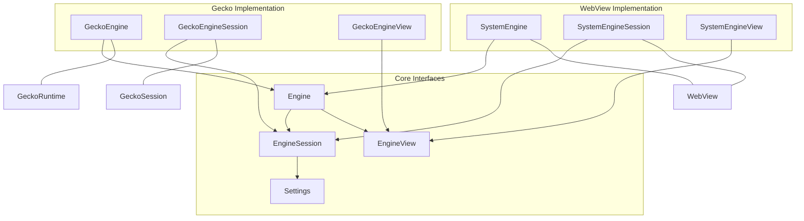
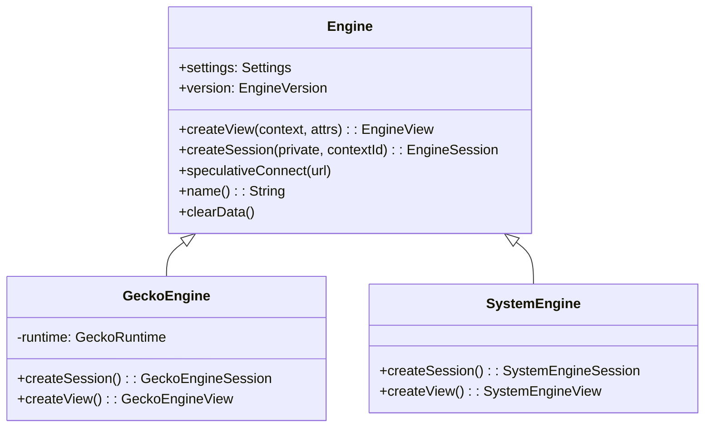
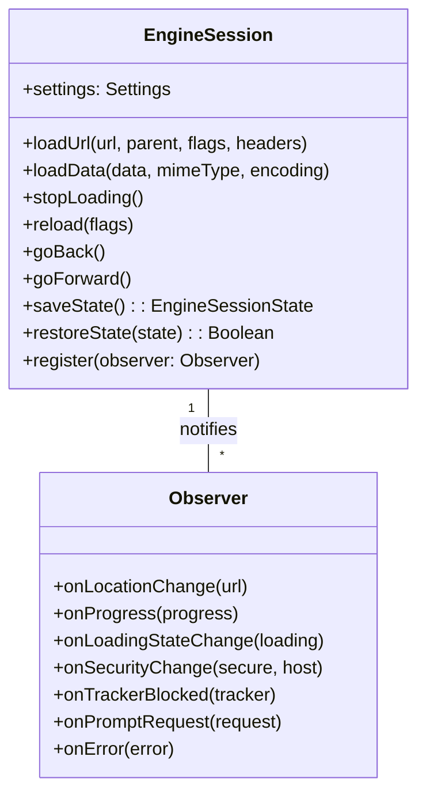
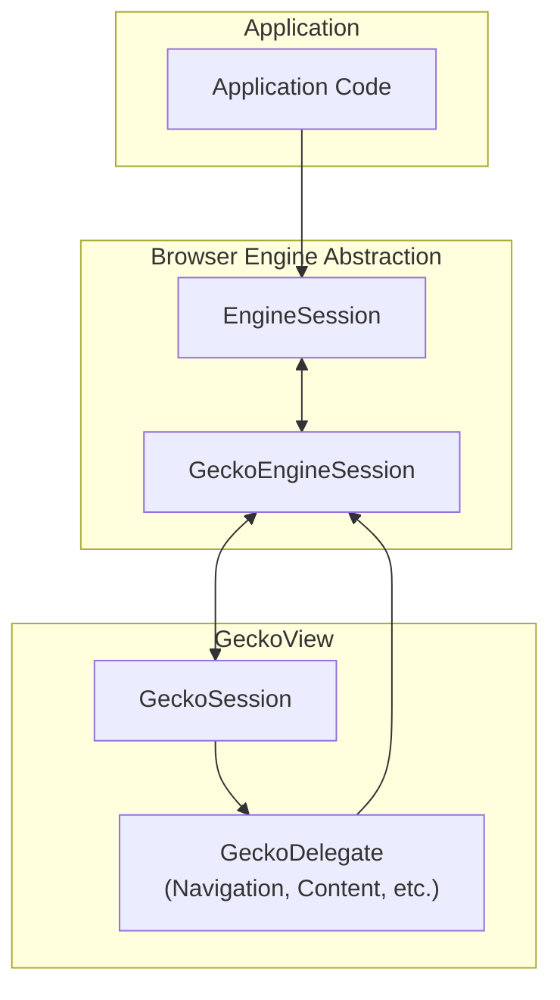
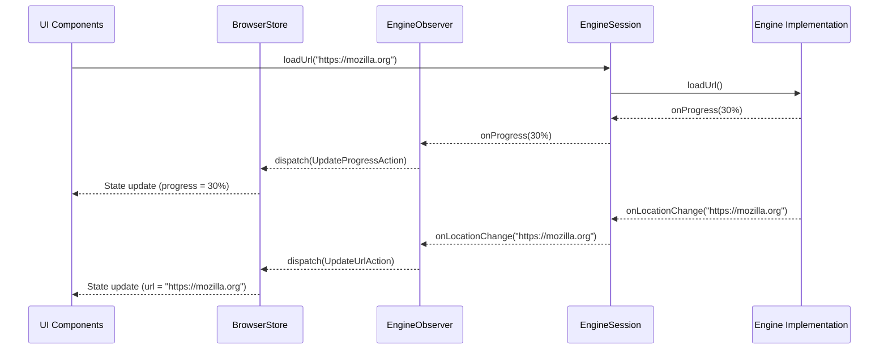

<!-- source: DeepWiki mcp.deepwiki.com · repo mozilla-mobile/firefox-android · page 2.1 Browser Engine Abstraction · fetched 2026-10-09 -->

# Browser Engine Abstraction

<details>
<summary>Relevant source files</summary>

The following files were used as context for generating this wiki page:

- [android-components/components/browser/engine-gecko/src/main/java/mozilla/components/browser/engine/gecko/GeckoEngine.kt](android-components/components/browser/engine-gecko/src/main/java/mozilla/components/browser/engine/gecko/GeckoEngine.kt)
- [android-components/components/browser/engine-gecko/src/main/java/mozilla/components/browser/engine/gecko/GeckoEngineSession.kt](android-components/components/browser/engine-gecko/src/main/java/mozilla/components/browser/engine/gecko/GeckoEngineSession.kt)
- [android-components/components/browser/engine-gecko/src/test/java/mozilla/components/browser/engine/gecko/GeckoEngineSessionTest.kt](android-components/components/browser/engine-gecko/src/test/java/mozilla/components/browser/engine/gecko/GeckoEngineSessionTest.kt)
- [android-components/components/browser/engine-gecko/src/test/java/mozilla/components/browser/engine/gecko/GeckoEngineTest.kt](android-components/components/browser/engine-gecko/src/test/java/mozilla/components/browser/engine/gecko/GeckoEngineTest.kt)
- [android-components/components/browser/engine-system/src/main/java/mozilla/components/browser/engine/system/SystemEngine.kt](android-components/components/browser/engine-system/src/main/java/mozilla/components/browser/engine/system/SystemEngine.kt)
- [android-components/components/browser/engine-system/src/main/java/mozilla/components/browser/engine/system/SystemEngineSession.kt](android-components/components/browser/engine-system/src/main/java/mozilla/components/browser/engine/system/SystemEngineSession.kt)
- [android-components/components/browser/engine-system/src/test/java/mozilla/components/browser/engine/system/SystemEngineSessionTest.kt](android-components/components/browser/engine-system/src/test/java/mozilla/components/browser/engine/system/SystemEngineSessionTest.kt)
- [android-components/components/browser/state/src/main/java/mozilla/components/browser/state/action/BrowserAction.kt](android-components/components/browser/state/src/main/java/mozilla/components/browser/state/action/BrowserAction.kt)
- [android-components/components/browser/state/src/main/java/mozilla/components/browser/state/engine/EngineObserver.kt](android-components/components/browser/state/src/main/java/mozilla/components/browser/state/engine/EngineObserver.kt)
- [android-components/components/browser/state/src/main/java/mozilla/components/browser/state/reducer/ContentStateReducer.kt](android-components/components/browser/state/src/main/java/mozilla/components/browser/state/reducer/ContentStateReducer.kt)
- [android-components/components/browser/state/src/main/java/mozilla/components/browser/state/state/ContentState.kt](android-components/components/browser/state/src/main/java/mozilla/components/browser/state/state/ContentState.kt)
- [android-components/components/browser/state/src/test/java/mozilla/components/browser/state/action/ContentActionTest.kt](android-components/components/browser/state/src/test/java/mozilla/components/browser/state/action/ContentActionTest.kt)
- [android-components/components/browser/state/src/test/java/mozilla/components/browser/state/engine/EngineObserverTest.kt](android-components/components/browser/state/src/test/java/mozilla/components/browser/state/engine/EngineObserverTest.kt)
- [android-components/components/concept/engine/src/main/java/mozilla/components/concept/engine/Engine.kt](android-components/components/concept/engine/src/main/java/mozilla/components/concept/engine/Engine.kt)
- [android-components/components/concept/engine/src/main/java/mozilla/components/concept/engine/EngineSession.kt](android-components/components/concept/engine/src/main/java/mozilla/components/concept/engine/EngineSession.kt)
- [android-components/components/concept/engine/src/main/java/mozilla/components/concept/engine/Settings.kt](android-components/components/concept/engine/src/main/java/mozilla/components/concept/engine/Settings.kt)
- [android-components/components/concept/engine/src/test/java/mozilla/components/concept/engine/EngineSessionTest.kt](android-components/components/concept/engine/src/test/java/mozilla/components/concept/engine/EngineSessionTest.kt)
- [android-components/components/concept/engine/src/test/java/mozilla/components/concept/engine/EngineTest.kt](android-components/components/concept/engine/src/test/java/mozilla/components/concept/engine/EngineTest.kt)
- [android-components/components/concept/engine/src/test/java/mozilla/components/concept/engine/SettingsTest.kt](android-components/components/concept/engine/src/test/java/mozilla/components/concept/engine/SettingsTest.kt)
- [docs/changelog.md](docs/changelog.md)

</details>


The Browser Engine Abstraction layer in the Firefox Android codebase provides a unified interface for interacting with different browser engines while hiding their implementation details. This enables Firefox for Android to primarily use Mozilla's GeckoView engine while maintaining a WebView-based alternative for certain scenarios. The abstraction allows higher-level components to remain independent from the specifics of the underlying browser engine.

For a broader overview of Firefox Android's architecture, see [Overview](#1).

## Architecture Overview

The Browser Engine Abstraction is composed of several key interfaces and their implementations:



Sources: 
- [android-components/components/concept/engine/src/main/java/mozilla/components/concept/engine/Engine.kt]()
- [android-components/components/concept/engine/src/main/java/mozilla/components/concept/engine/EngineSession.kt]()
- [android-components/components/browser/engine-gecko/src/main/java/mozilla/components/browser/engine/gecko/GeckoEngine.kt]()
- [android-components/components/browser/engine-gecko/src/main/java/mozilla/components/browser/engine/gecko/GeckoEngineSession.kt]()
- [android-components/components/browser/engine-system/src/main/java/mozilla/components/browser/engine/system/SystemEngine.kt]()

## Core Components

### Engine Interface

The `Engine` interface serves as the entry point for interacting with a browser engine implementation. It provides factory methods for creating sessions and views, and handles engine-wide configuration.

Key responsibilities:
- Creating `EngineSession` instances
- Creating `EngineView` instances
- Managing engine settings
- Managing WebExtensions
- Clearing browsing data
- Speculative connections for performance optimization



Sources:
- [android-components/components/concept/engine/src/main/java/mozilla/components/concept/engine/Engine.kt]()
- [android-components/components/browser/engine-gecko/src/main/java/mozilla/components/browser/engine/gecko/GeckoEngine.kt:87-203]()
- [android-components/components/browser/engine-system/src/main/java/mozilla/components/browser/engine/system/SystemEngine.kt:29-58]()

### EngineSession Interface

The `EngineSession` interface represents a single browsing session (equivalent to a browser tab). It provides methods for navigation, content manipulation, and state management.

Key functionalities:
- URL loading and navigation
- Session state serialization/restoration
- Tracking protection
- Find-in-page functionality
- Form handling
- History navigation
- PDF generation
- Translation services
- Shopping features



Sources:
- [android-components/components/concept/engine/src/main/java/mozilla/components/concept/engine/EngineSession.kt:34-779]()
- [android-components/components/browser/engine-gecko/src/main/java/mozilla/components/browser/engine/gecko/GeckoEngineSession.kt:89-811]()
- [android-components/components/browser/engine-system/src/main/java/mozilla/components/browser/engine/system/SystemEngineSession.kt:45-161]()

### EngineView Interface

The `EngineView` interface represents a visual component that renders web content from an `EngineSession`. It handles rendering, input, and interactions with the web content.

Key responsibilities:
- Rendering web content
- Capturing screenshots
- Input handling
- Lifecycle management

### Settings Interface

The `Settings` class holds configuration options that can be applied to engines or sessions. It provides a unified API for configuring browser behavior.

Key settings include:
- JavaScript enablement
- Tracking protection policy
- User agent string
- Web fonts
- Remote debugging
- Cookie handling
- Media autoplay behavior

```kotlin
// Example settings configuration
val settings = DefaultSettings(
    javascriptEnabled = true,
    webFontsEnabled = true,
    trackingProtectionPolicy = TrackingProtectionPolicy.recommended(),
    userAgentString = "Mozilla/5.0 (Android) Firefox"
)
```

Sources:
- [android-components/components/concept/engine/src/main/java/mozilla/components/concept/engine/Settings.kt:20-470]()
- [android-components/components/concept/engine/src/test/java/mozilla/components/concept/engine/SettingsTest.kt]()

## Implementation Details

### GeckoEngine / GeckoEngineSession

The primary implementation uses Mozilla's GeckoView as the underlying engine. GeckoView is a component that embeds the Gecko browser engine used in Firefox desktop, providing a full-featured browser engine.

Key features:
- Full Firefox rendering engine
- Enhanced tracking protection
- Web extension support
- Translation support
- PDF generation
- Cookie banner handling



Sources:
- [android-components/components/browser/engine-gecko/src/main/java/mozilla/components/browser/engine/gecko/GeckoEngine.kt]()
- [android-components/components/browser/engine-gecko/src/main/java/mozilla/components/browser/engine/gecko/GeckoEngineSession.kt]()
- [android-components/components/browser/engine-gecko/src/test/java/mozilla/components/browser/engine/gecko/GeckoEngineTest.kt]()

### SystemEngine / SystemEngineSession

The WebView-based implementation uses Android's built-in WebView component. This implementation has more limited capabilities but better platform integration. It serves as a fallback option in certain situations.

Key limitations:
- No WebExtension support
- Limited tracking protection
- No translation support
- No PDF operations
- No cookie banner handling

Sources:
- [android-components/components/browser/engine-system/src/main/java/mozilla/components/browser/engine/system/SystemEngine.kt]()
- [android-components/components/browser/engine-system/src/main/java/mozilla/components/browser/engine/system/SystemEngineSession.kt]()
- [android-components/components/browser/engine-system/src/test/java/mozilla/components/browser/engine/system/SystemEngineSessionTest.kt]()

## State Management and Observation

The engine abstraction uses the Observer pattern to notify components about state changes. These events are translated into actions that update the application's `BrowserStore`.



Key components in this flow:
- `EngineSession.Observer`: Interface for receiving engine events
- `EngineObserver`: Implementation that translates events to actions
- `ContentAction`: Actions that update content state (URL, title, progress, etc.)
- `BrowserStore`: Central store for browser state

Sources:
- [android-components/components/concept/engine/src/main/java/mozilla/components/concept/engine/EngineSession.kt:42-378]()
- [android-components/components/browser/state/src/main/java/mozilla/components/browser/state/engine/EngineObserver.kt]()
- [android-components/components/browser/state/src/main/java/mozilla/components/browser/state/action/BrowserAction.kt]()
- [android-components/components/browser/state/src/main/java/mozilla/components/browser/state/action/ContentAction.kt]()
- [android-components/components/browser/state/src/main/java/mozilla/components/browser/state/reducer/ContentStateReducer.kt]()

## Typical Usage Patterns

### Creating a Session and Loading Content

```kotlin
// Get the engine instance (typically from a component)
val engine = components.engine

// Create a new browsing session
val session = engine.createSession(private = false)

// Load a URL
session.loadUrl("https://www.mozilla.org")

// Or load HTML content directly
session.loadData("<html><body>Hello, world!</body></html>", "text/html", "UTF-8")
```

### Observing Session Changes

```kotlin
// Register an observer to receive events
session.register(object : EngineSession.Observer {
    override fun onLocationChange(url: String, hasUserGesture: Boolean) {
        // Update URL display
    }
    
    override fun onProgress(progress: Int) {
        // Update progress indicator
    }
    
    override fun onLoadingStateChange(loading: Boolean) {
        // Show/hide loading indicator
    }
    
    override fun onSecurityChange(secure: Boolean, host: String?, issuer: String?) {
        // Update security indicator
    }
})
```

### Rendering Content in a View

```kotlin
// Create a view
val engineView = engine.createView(context)

// Render a session in the view
engineView.render(session)
```

## Advanced Features

### Tracking Protection

The abstraction provides a unified API for configuring tracking protection, allowing applications to protect users from various types of online tracking.

```kotlin
// Configure tracking protection policy
val policy = TrackingProtectionPolicy.strict()
session.updateTrackingProtection(policy)
```

The policy can be configured to block different categories of trackers (ads, analytics, social, etc.) and control cookie behavior.

Sources:
- [android-components/components/concept/engine/src/main/java/mozilla/components/concept/engine/EngineSession.kt:424-477]()
- [android-components/components/browser/engine-gecko/src/main/java/mozilla/components/browser/engine/gecko/GeckoEngineSession.kt:389-407]()

### Cookie Banner Handling

GeckoEngine supports automatic cookie banner handling to improve user experience by automatically managing cookie consent prompts.

```kotlin
// Check if a cookie banner rule exists for the current session
session.hasCookieBannerRuleForSession(
    onResult = { hasRule -> /* Handle result */ },
    onException = { exception -> /* Handle error */ }
)
```

Sources:
- [android-components/components/browser/engine-gecko/src/main/java/mozilla/components/browser/engine/gecko/GeckoEngineSession.kt:489-515]()

### PDF Operations

GeckoEngine supports PDF generation, allowing users to save pages as PDF files.

```kotlin
// Request PDF generation
session.requestPdfToDownload()
```

Sources:
- [android-components/components/browser/engine-gecko/src/main/java/mozilla/components/browser/engine/gecko/GeckoEngineSession.kt:240-297]()

### Shopping Features

Recent additions include product analysis features for shopping, which can analyze product pages and provide recommendations.

```kotlin
// Request product analysis
session.requestProductAnalysis(
    url = "https://shop.example.com/product/123",
    onResult = { analysis -> /* Handle product analysis */ },
    onException = { exception -> /* Handle error */ }
)
```

Sources:
- [android-components/components/browser/engine-gecko/src/main/java/mozilla/components/browser/engine/gecko/GeckoEngineSession.kt:714-774]()

## Conclusion

The Browser Engine Abstraction provides a clean separation between the application code and the underlying browser engines. This abstraction allows Firefox for Android to primarily use Mozilla's GeckoView engine while maintaining a WebView-based alternative. The design enables the application to evolve independently from the engine implementations and provides a foundation for implementing advanced browser features.

For more information about specific components that build on top of this abstraction, see [Browser State Management](#2.2).

Sources:
- [android-components/components/concept/engine/src/main/java/mozilla/components/concept/engine/Engine.kt]()
- [android-components/components/concept/engine/src/main/java/mozilla/components/concept/engine/EngineSession.kt]()
- [android-components/components/browser/engine-gecko/src/main/java/mozilla/components/browser/engine/gecko/GeckoEngine.kt]()
- [android-components/components/browser/engine-gecko/src/main/java/mozilla/components/browser/engine/gecko/GeckoEngineSession.kt]()
- [android-components/components/browser/engine-system/src/main/java/mozilla/components/browser/engine/system/SystemEngine.kt]()
- [android-components/components/browser/engine-system/src/main/java/mozilla/components/browser/engine/system/SystemEngineSession.kt]()

---

