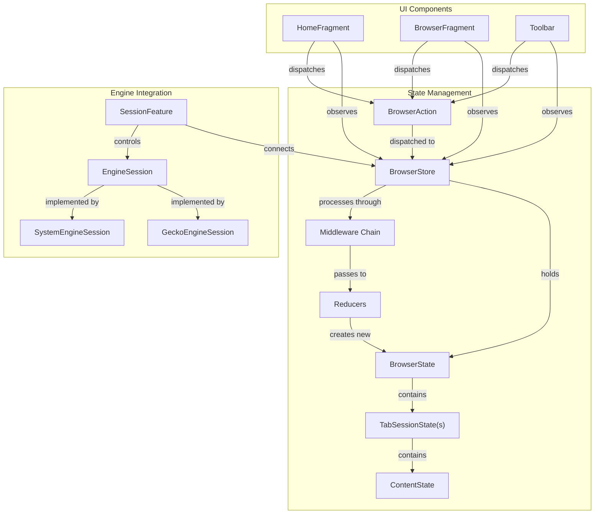
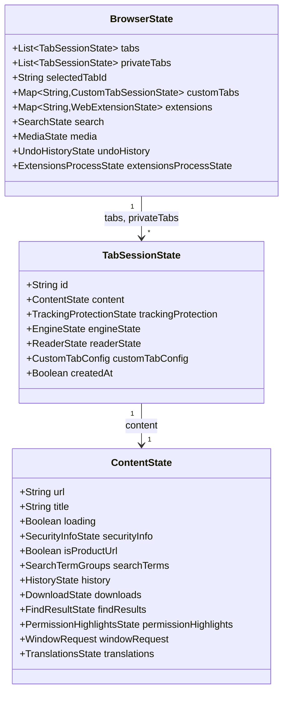
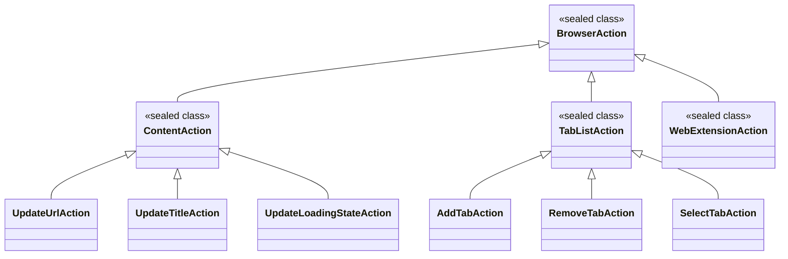
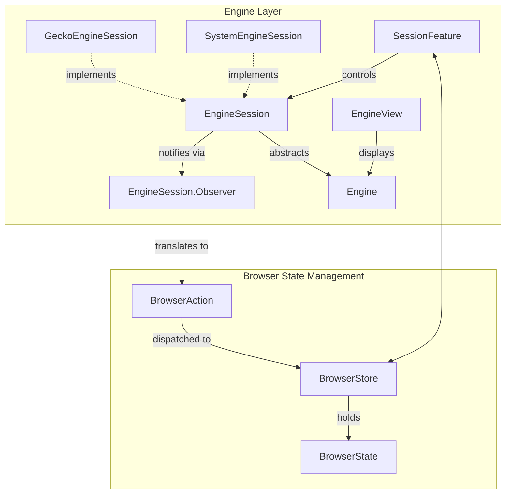
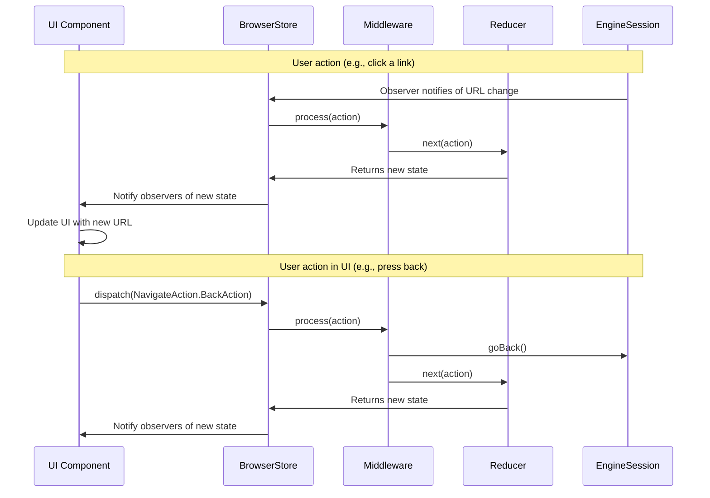

<!-- source: DeepWiki mcp.deepwiki.com · repo mozilla-mobile/firefox-android · page 2.2 Browser State Management · fetched 2026-10-09 -->

# Browser State Management

<details>
<summary>Relevant source files</summary>

The following files were used as context for generating this wiki page:

- [android-components/components/browser/engine-gecko/src/main/java/mozilla/components/browser/engine/gecko/GeckoEngine.kt](android-components/components/browser/engine-gecko/src/main/java/mozilla/components/browser/engine/gecko/GeckoEngine.kt)
- [android-components/components/browser/engine-gecko/src/main/java/mozilla/components/browser/engine/gecko/GeckoEngineSession.kt](android-components/components/browser/engine-gecko/src/main/java/mozilla/components/browser/engine/gecko/GeckoEngineSession.kt)
- [android-components/components/browser/engine-gecko/src/test/java/mozilla/components/browser/engine/gecko/GeckoEngineSessionTest.kt](android-components/components/browser/engine-gecko/src/test/java/mozilla/components/browser/engine/gecko/GeckoEngineSessionTest.kt)
- [android-components/components/browser/engine-gecko/src/test/java/mozilla/components/browser/engine/gecko/GeckoEngineTest.kt](android-components/components/browser/engine-gecko/src/test/java/mozilla/components/browser/engine/gecko/GeckoEngineTest.kt)
- [android-components/components/browser/engine-system/src/main/java/mozilla/components/browser/engine/system/SystemEngine.kt](android-components/components/browser/engine-system/src/main/java/mozilla/components/browser/engine/system/SystemEngine.kt)
- [android-components/components/browser/engine-system/src/main/java/mozilla/components/browser/engine/system/SystemEngineSession.kt](android-components/components/browser/engine-system/src/main/java/mozilla/components/browser/engine/system/SystemEngineSession.kt)
- [android-components/components/browser/engine-system/src/test/java/mozilla/components/browser/engine/system/SystemEngineSessionTest.kt](android-components/components/browser/engine-system/src/test/java/mozilla/components/browser/engine/system/SystemEngineSessionTest.kt)
- [android-components/components/browser/state/src/main/java/mozilla/components/browser/state/action/BrowserAction.kt](android-components/components/browser/state/src/main/java/mozilla/components/browser/state/action/BrowserAction.kt)
- [android-components/components/browser/state/src/main/java/mozilla/components/browser/state/engine/EngineObserver.kt](android-components/components/browser/state/src/main/java/mozilla/components/browser/state/engine/EngineObserver.kt)
- [android-components/components/browser/state/src/main/java/mozilla/components/browser/state/reducer/ContentStateReducer.kt](android-components/components/browser/state/src/main/java/mozilla/components/browser/state/reducer/ContentStateReducer.kt)
- [android-components/components/browser/state/src/main/java/mozilla/components/browser/state/state/ContentState.kt](android-components/components/browser/state/src/main/java/mozilla/components/browser/state/state/ContentState.kt)
- [android-components/components/browser/state/src/test/java/mozilla/components/browser/state/action/ContentActionTest.kt](android-components/components/browser/state/src/test/java/mozilla/components/browser/state/action/ContentActionTest.kt)
- [android-components/components/browser/state/src/test/java/mozilla/components/browser/state/engine/EngineObserverTest.kt](android-components/components/browser/state/src/test/java/mozilla/components/browser/state/engine/EngineObserverTest.kt)
- [android-components/components/concept/engine/src/main/java/mozilla/components/concept/engine/Engine.kt](android-components/components/concept/engine/src/main/java/mozilla/components/concept/engine/Engine.kt)
- [android-components/components/concept/engine/src/main/java/mozilla/components/concept/engine/EngineSession.kt](android-components/components/concept/engine/src/main/java/mozilla/components/concept/engine/EngineSession.kt)
- [android-components/components/concept/engine/src/main/java/mozilla/components/concept/engine/Settings.kt](android-components/components/concept/engine/src/main/java/mozilla/components/concept/engine/Settings.kt)
- [android-components/components/concept/engine/src/test/java/mozilla/components/concept/engine/EngineSessionTest.kt](android-components/components/concept/engine/src/test/java/mozilla/components/concept/engine/EngineSessionTest.kt)
- [android-components/components/concept/engine/src/test/java/mozilla/components/concept/engine/EngineTest.kt](android-components/components/concept/engine/src/test/java/mozilla/components/concept/engine/EngineTest.kt)
- [android-components/components/concept/engine/src/test/java/mozilla/components/concept/engine/SettingsTest.kt](android-components/components/concept/engine/src/test/java/mozilla/components/concept/engine/SettingsTest.kt)
- [docs/changelog.md](docs/changelog.md)
- [fenix/app/metrics.yaml](fenix/app/metrics.yaml)
- [fenix/app/src/main/java/org/mozilla/fenix/FeatureFlags.kt](fenix/app/src/main/java/org/mozilla/fenix/FeatureFlags.kt)
- [fenix/app/src/main/java/org/mozilla/fenix/FenixApplication.kt](fenix/app/src/main/java/org/mozilla/fenix/FenixApplication.kt)
- [fenix/app/src/main/java/org/mozilla/fenix/HomeActivity.kt](fenix/app/src/main/java/org/mozilla/fenix/HomeActivity.kt)
- [fenix/app/src/main/java/org/mozilla/fenix/browser/BaseBrowserFragment.kt](fenix/app/src/main/java/org/mozilla/fenix/browser/BaseBrowserFragment.kt)
- [fenix/app/src/main/java/org/mozilla/fenix/browser/BrowserFragment.kt](fenix/app/src/main/java/org/mozilla/fenix/browser/BrowserFragment.kt)
- [fenix/app/src/main/java/org/mozilla/fenix/components/Core.kt](fenix/app/src/main/java/org/mozilla/fenix/components/Core.kt)
- [fenix/app/src/main/java/org/mozilla/fenix/components/UseCases.kt](fenix/app/src/main/java/org/mozilla/fenix/components/UseCases.kt)
- [fenix/app/src/main/java/org/mozilla/fenix/components/metrics/Event.kt](fenix/app/src/main/java/org/mozilla/fenix/components/metrics/Event.kt)
- [fenix/app/src/main/java/org/mozilla/fenix/components/metrics/GleanMetricsService.kt](fenix/app/src/main/java/org/mozilla/fenix/components/metrics/GleanMetricsService.kt)
- [fenix/app/src/main/java/org/mozilla/fenix/components/metrics/MetricController.kt](fenix/app/src/main/java/org/mozilla/fenix/components/metrics/MetricController.kt)
- [fenix/app/src/main/java/org/mozilla/fenix/home/HomeFragment.kt](fenix/app/src/main/java/org/mozilla/fenix/home/HomeFragment.kt)
- [fenix/app/src/main/java/org/mozilla/fenix/settings/SecretSettingsFragment.kt](fenix/app/src/main/java/org/mozilla/fenix/settings/SecretSettingsFragment.kt)
- [fenix/app/src/main/java/org/mozilla/fenix/settings/SettingsFragment.kt](fenix/app/src/main/java/org/mozilla/fenix/settings/SettingsFragment.kt)
- [fenix/app/src/main/java/org/mozilla/fenix/utils/Settings.kt](fenix/app/src/main/java/org/mozilla/fenix/utils/Settings.kt)
- [fenix/app/src/main/res/layout/preference_category_no_icon_style.xml](fenix/app/src/main/res/layout/preference_category_no_icon_style.xml)
- [fenix/app/src/main/res/navigation/nav_graph.xml](fenix/app/src/main/res/navigation/nav_graph.xml)
- [fenix/app/src/main/res/values/preference_keys.xml](fenix/app/src/main/res/values/preference_keys.xml)
- [fenix/app/src/main/res/values/static_strings.xml](fenix/app/src/main/res/values/static_strings.xml)
- [fenix/app/src/main/res/values/strings.xml](fenix/app/src/main/res/values/strings.xml)
- [fenix/app/src/main/res/xml/preferences.xml](fenix/app/src/main/res/xml/preferences.xml)
- [fenix/app/src/main/res/xml/secret_settings_preferences.xml](fenix/app/src/main/res/xml/secret_settings_preferences.xml)
- [fenix/app/src/test/java/org/mozilla/fenix/FenixApplicationTest.kt](fenix/app/src/test/java/org/mozilla/fenix/FenixApplicationTest.kt)
- [fenix/app/src/test/java/org/mozilla/fenix/components/metrics/MetricControllerTest.kt](fenix/app/src/test/java/org/mozilla/fenix/components/metrics/MetricControllerTest.kt)
- [fenix/app/src/test/java/org/mozilla/fenix/utils/SettingsTest.kt](fenix/app/src/test/java/org/mozilla/fenix/utils/SettingsTest.kt)
- [fenix/docs/metrics.md](fenix/docs/metrics.md)

</details>


The purpose of this page is to document Firefox Android's core state management architecture. This covers how browser state like tabs, URLs, history, and other data is stored, updated, and observed by UI components. The system provides a predictable way to manage data flow throughout the application and keeps UI components in sync with the underlying browser engine.

For information about UI-specific state, see [Browser UI Components](#3.1).

## Architecture Overview

Firefox Android's state management follows a unidirectional data flow pattern similar to Redux. The centralized `BrowserStore` holds all browser state in a single, immutable data structure. Components dispatch actions to request state changes, and the store processes these actions through middleware and reducers to create a new state.



Sources:
- [fenix/app/src/main/java/org/mozilla/fenix/components/Core.kt]()
- [fenix/app/src/main/java/org/mozilla/fenix/browser/BaseBrowserFragment.kt]()
- [android-components/components/browser/state/src/main/java/mozilla/components/browser/state/action/BrowserAction.kt]()

## Key Components

### BrowserStore

The `BrowserStore` is the central repository for all browser state. It's implemented using Mozilla's `lib-state` component, which provides a Redux-like architecture. The store handles processing actions through middleware and reducers, and notifies observers when the state changes.

```kotlin
val store = BrowserStore(
    initialState = BrowserState(),
    middleware = listOf(
        EngineMiddleware.create(engine),
        ThumbnailsMiddleware(),
        PromptMiddleware()
        // Other middleware...
    )
)
```

The store is typically created in the `Core.kt` component and is accessible throughout the application via `context.components.core.store`.

Sources:
- [fenix/app/src/main/java/org/mozilla/fenix/components/Core.kt]()
- [fenix/app/src/main/java/org/mozilla/fenix/ext/Components.kt]()

### BrowserState

`BrowserState` is an immutable data class containing the complete state of the browser, including:

- Normal tabs (`tabs`)
- Private tabs (`privateTabs`)
- Selected tab ID (`selectedTabId`)
- Custom tabs (`customTabs`)
- Web extensions (`extensions`)
- Container state (`containers`)
- Search state (`search`)
- Media state (`media`)
- And more...



Sources:
- [android-components/components/browser/state/src/main/java/mozilla/components/browser/state/state/BrowserState.kt]()
- [android-components/components/browser/state/src/main/java/mozilla/components/browser/state/state/TabSessionState.kt]()
- [android-components/components/browser/state/src/main/java/mozilla/components/browser/state/state/ContentState.kt]()

### Actions

Actions are the only way to modify the browser state. They are dispatched to the `BrowserStore` and processed by reducers to create a new state. Firefox Android uses a hierarchy of sealed classes to represent different types of actions:



Common actions include:
- `ContentAction.UpdateUrlAction`: Update the URL of a tab
- `ContentAction.UpdateTitleAction`: Update the title of a tab
- `TabListAction.AddTabAction`: Add a new tab
- `TabListAction.RemoveTabAction`: Remove a tab
- `TabListAction.SelectTabAction`: Select a tab

Actions are dispatched to the store using:
```kotlin
store.dispatch(ContentAction.UpdateUrlAction(tabId, url))
```

Sources:
- [android-components/components/browser/state/src/main/java/mozilla/components/browser/state/action/BrowserAction.kt]()
- [android-components/components/browser/state/src/main/java/mozilla/components/browser/state/action/ContentAction.kt]()
- [android-components/components/browser/state/src/main/java/mozilla/components/browser/state/action/TabListAction.kt]()

### Reducers

Reducers are pure functions that take the current state and an action, and return a new state. The main reducers include:

- `TabListReducer`: Handles actions related to tabs (add, remove, select)
- `ContentStateReducer`: Handles actions related to tab content (URL, title, loading state)
- `WebExtensionReducer`: Handles actions related to web extensions
- And many others...

Each reducer processes only the actions it knows how to handle, ignoring the rest.

Sources:
- [android-components/components/browser/state/src/main/java/mozilla/components/browser/state/reducer/ContentStateReducer.kt]()
- [android-components/components/browser/state/src/main/java/mozilla/components/browser/state/reducer/TabListReducer.kt]()

### Middleware

Middleware intercepts actions before they reach the reducer. They can perform side effects, transform actions, or dispatch additional actions. Important middleware includes:

- `EngineMiddleware`: Synchronizes state between the browser engine and BrowserStore
- `ThumbnailsMiddleware`: Manages thumbnails for tabs
- `PromptMiddleware`: Handles prompt requests from web content
- `ReaderViewMiddleware`: Manages reader view state
- `LastAccessMiddleware`: Updates the last access time for tabs
- `UndoMiddleware`: Provides undo functionality for tab closures

Sources:
- [fenix/app/src/main/java/org/mozilla/fenix/components/Core.kt]()

## Engine Integration

The browser state management system is tightly integrated with the browser engine (GeckoView or WebView) through several components:



### EngineSession

`EngineSession` is an abstract interface representing a single browsing session in the engine. It provides methods to:
- Load URLs
- Navigate (back, forward)
- Reload pages
- Find in page
- Toggle tracking protection
- And many more browser functions

Two main implementations are provided:
- `GeckoEngineSession`: Uses GeckoView as the browser engine
- `SystemEngineSession`: Uses Android's WebView

The `EngineSession` notifies observers of events like URL changes, title changes, loading state changes, etc., through the `EngineSession.Observer` interface.

### SessionFeature

The `SessionFeature` is the bridge between the browser engine and the `BrowserStore`:

1. It observes engine events and dispatches corresponding actions to the `BrowserStore`
2. It observes the `BrowserStore` state and updates the engine when needed
3. It handles user interactions with the engine, like navigation

The feature is initialized in fragment classes like `BaseBrowserFragment` and tied to the fragment's lifecycle.

Sources:
- [android-components/components/concept/engine/src/main/java/mozilla/components/concept/engine/EngineSession.kt]()
- [android-components/components/browser/engine-gecko/src/main/java/mozilla/components/browser/engine/gecko/GeckoEngineSession.kt]()
- [android-components/components/browser/engine-system/src/main/java/mozilla/components/browser/engine/system/SystemEngineSession.kt]()
- [fenix/app/src/main/java/org/mozilla/fenix/browser/BaseBrowserFragment.kt]()

## Data Flow in the System

The data flow in the browser state management system follows a unidirectional pattern:



This pattern ensures a consistent, predictable data flow throughout the application.

Sources:
- [fenix/app/src/main/java/org/mozilla/fenix/browser/BaseBrowserFragment.kt]()
- [android-components/components/browser/state/src/main/java/mozilla/components/browser/state/action/BrowserAction.kt]()

## Integration with UI Components

Various UI components integrate with the `BrowserStore` to display and modify browser state:

### HomeFragment

`HomeFragment` observes the `BrowserStore` to display:
- Recent tabs
- Synced tabs
- Tab groups
- Home screen customization state

```kotlin
// Example of HomeFragment observing browser state
components.core.store.flowScoped(viewLifecycleOwner) {
    it.map { state -> state.tabs }
       .distinctUntilChanged()
       .collect { tabs ->
           // Update UI with tabs
       }
}
```

### BrowserFragment

`BrowserFragment` and its parent `BaseBrowserFragment` use the `BrowserStore` to:
- Display the current tab
- Update the toolbar with the current URL and loading state
- Handle navigation (back, forward, reload)
- Manage reader mode, tracking protection, and other browser features

```kotlin
// Example of BrowserFragment dispatching an action
requireComponents.core.store.dispatch(
    ContentAction.UpdateLoadingStateAction(tab.id, loading = true)
)
```

### Toolbar Components

Toolbar components like `BrowserToolbarView` observe the `BrowserStore` to display:
- Current URL
- Loading state
- Security information
- Reader mode availability
- Tracking protection state

Sources:
- [fenix/app/src/main/java/org/mozilla/fenix/home/HomeFragment.kt]()
- [fenix/app/src/main/java/org/mozilla/fenix/browser/BrowserFragment.kt]()
- [fenix/app/src/main/java/org/mozilla/fenix/browser/BaseBrowserFragment.kt]()

## Advanced Topics

### State Restoration

The browser state can be preserved across application restarts using the `SessionStorage` component, which:
1. Serializes the `BrowserState` to disk
2. Restores it when the application restarts
3. Recreates engine sessions for each tab

This ensures that users' browsing sessions are maintained even if the application is killed by the system.

### Testing

The state management architecture makes testing easier because:
1. State is centralized and immutable
2. Actions and their effects are predictable
3. Components can be tested in isolation with mocked states
4. Reducers are pure functions that can be unit tested

### Performance Optimizations

Several optimizations help maintain good performance:
1. Selective state observation with `flow` and `distinctUntilChanged()`
2. Lazy creation of engine sessions
3. Tab prioritization to focus resources on the active tab
4. Background processing of heavy operations in middleware

Sources:
- [fenix/app/src/main/java/org/mozilla/fenix/components/metrics/Event.kt]()
- [fenix/app/src/main/java/org/mozilla/fenix/utils/Settings.kt]()

By following this architecture, Firefox Android maintains a clear, predictable flow of data throughout the application, ensuring that UI components stay in sync with the browser's state and providing a solid foundation for complex browser features.

---

