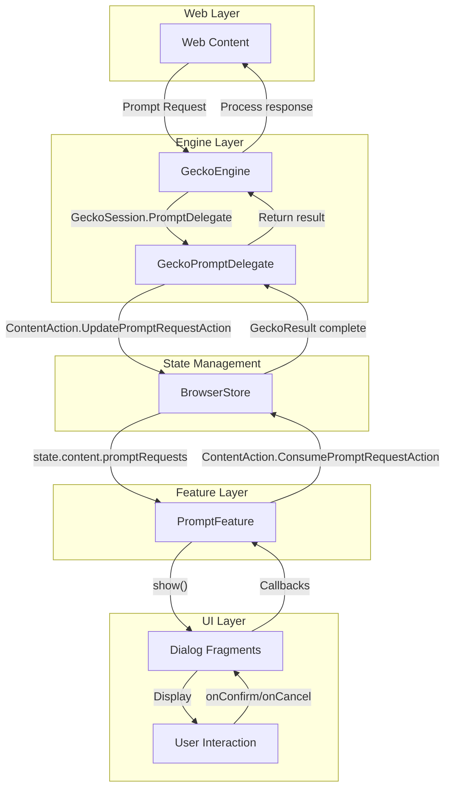
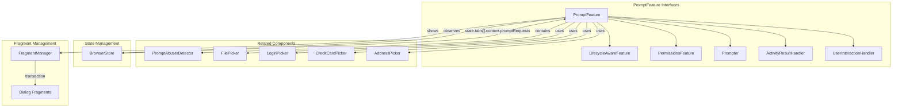
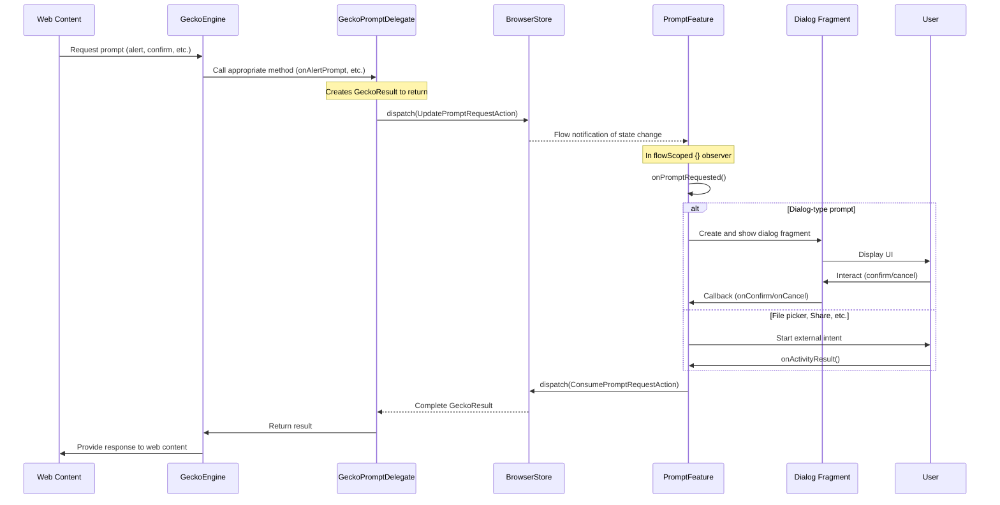

<!-- source: DeepWiki mcp.deepwiki.com · repo mozilla-mobile/firefox-android · page 2.3 Prompts and Dialog System · fetched 2026-10-09 -->

# Prompts and Dialog System

Relevant source files

The following files were used as context for generating this wiki page:

- [android-components/build.gradle](android-components/build.gradle)
- [android-components/components/browser/engine-gecko/src/main/java/mozilla/components/browser/engine/gecko/prompt/GeckoPromptDelegate.kt](android-components/components/browser/engine-gecko/src/main/java/mozilla/components/browser/engine/gecko/prompt/GeckoPromptDelegate.kt)
- [android-components/components/browser/engine-gecko/src/test/java/mozilla/components/browser/engine/gecko/prompt/GeckoPromptDelegateTest.kt](android-components/components/browser/engine-gecko/src/test/java/mozilla/components/browser/engine/gecko/prompt/GeckoPromptDelegateTest.kt)
- [android-components/components/concept/engine/src/main/java/mozilla/components/concept/engine/prompt/PromptRequest.kt](android-components/components/concept/engine/src/main/java/mozilla/components/concept/engine/prompt/PromptRequest.kt)
- [android-components/components/concept/engine/src/test/java/mozilla/components/concept/engine/prompt/PromptRequestTest.kt](android-components/components/concept/engine/src/test/java/mozilla/components/concept/engine/prompt/PromptRequestTest.kt)
- [android-components/components/feature/prompts/src/main/java/mozilla/components/feature/prompts/PromptFeature.kt](android-components/components/feature/prompts/src/main/java/mozilla/components/feature/prompts/PromptFeature.kt)
- [android-components/components/feature/prompts/src/main/res/values/strings.xml](android-components/components/feature/prompts/src/main/res/values/strings.xml)
- [android-components/components/feature/prompts/src/test/java/mozilla/components/feature/prompts/PromptFeatureTest.kt](android-components/components/feature/prompts/src/test/java/mozilla/components/feature/prompts/PromptFeatureTest.kt)
- [focus-android/app/nimbus.fml.yaml](focus-android/app/nimbus.fml.yaml)

The Prompts and Dialog System is responsible for displaying native dialogs in response to web content prompts in Firefox for Android. This system bridges web content with native Android UI components, handling various prompt types including alerts, confirmations, file pickers, authentication dialogs, and form autofill interactions.

## Architecture Overview

The Prompts and Dialog System translates web requests into native dialogs and feeds user responses back to web content through the browser state management system.

Sources:
- [android-components/components/feature/prompts/src/main/java/mozilla/components/feature/prompts/PromptFeature.kt:160-331]()
- [android-components/components/browser/engine-gecko/src/main/java/mozilla/components/browser/engine/gecko/prompt/GeckoPromptDelegate.kt:73-95]()
- [android-components/components/concept/engine/src/main/java/mozilla/components/concept/engine/prompt/PromptRequest.kt:28-45]()

## Key Components

### PromptFeature

`PromptFeature` is the central coordinator that:
- Observes browser state for prompt requests
- Creates and displays appropriate dialog fragments
- Manages dialog lifecycle (creation, display, dismissal)
- Routes user responses back to the browser engine
- Handles activity results for file pickers and other external prompts

Sources:
- [android-components/components/feature/prompts/src/main/java/mozilla/components/feature/prompts/PromptFeature.kt:160-186]()
- [android-components/components/feature/prompts/src/main/java/mozilla/components/feature/prompts/PromptFeature.kt:307-351]()

### PromptRequest Hierarchy

`PromptRequest` is a sealed class with numerous subclasses representing different types of prompt requests:

```mermaid
classDiagram
    PromptRequest <|-- Alert
    PromptRequest <|-- Confirm
    PromptRequest <|-- TextPrompt
    PromptRequest <|-- SingleChoice
    PromptRequest <|-- MultipleChoice
    PromptRequest <|-- MenuChoice
    PromptRequest <|-- Authentication
    PromptRequest <|-- File
    PromptRequest <|-- TimeSelection
    PromptRequest <|-- Color
    PromptRequest <|-- SaveLoginPrompt
    PromptRequest <|-- SelectLoginPrompt
    PromptRequest <|-- SaveCreditCard
    PromptRequest <|-- SelectCreditCard
    PromptRequest <|-- SelectAddress
    PromptRequest <|-- Popup
    PromptRequest <|-- Share
    PromptRequest <|-- BeforeUnload
    PromptRequest <|-- Repost
    PromptRequest <|-- IdentityCredential
    IdentityCredential <|-- SelectProvider
    IdentityCredential <|-- SelectAccount
    IdentityCredential <|-- PrivacyPolicy
    
    class PromptRequest {
        +shouldDismissOnLoad: Boolean
        +uid: String
    }
    
    class Dismissible {
        <<interface>>
        +onDismiss(): Unit
    }
    
    Alert ..|> Dismissible
    Confirm ..|> Dismissible
    TextPrompt ..|> Dismissible
    SingleChoice ..|> Dismissible
    MultipleChoice ..|> Dismissible
    MenuChoice ..|> Dismissible
    Authentication ..|> Dismissible
    File ..|> Dismissible
    TimeSelection ..|> Dismissible
    Color ..|> Dismissible
    SaveLoginPrompt ..|> Dismissible
    SelectLoginPrompt ..|> Dismissible
    SaveCreditCard ..|> Dismissible
    SelectCreditCard ..|> Dismissible
    SelectAddress ..|> Dismissible
    Popup ..|> Dismissible
    Share ..|> Dismissible
    IdentityCredential ..|> Dismissible
    Repost ..|> Dismissible
```

Sources:
- [android-components/components/concept/engine/src/main/java/mozilla/components/concept/engine/prompt/PromptRequest.kt:28-445]()

### GeckoPromptDelegate

`GeckoPromptDelegate` bridges between GeckoView's prompt system and Firefox Android's prompt system by:
- Implementing `GeckoSession.PromptDelegate` to intercept GeckoView prompt events
- Converting GeckoView prompt data to `PromptRequest` objects
- Dispatching these requests to the browser state
- Returning user-provided results back to GeckoView

Sources:
- [android-components/components/browser/engine-gecko/src/main/java/mozilla/components/browser/engine/gecko/prompt/GeckoPromptDelegate.kt:73-95]()

## Prompt Request Flow

When a web page requests user input through a prompt, this is the complete flow from request to response:

Sources:
- [android-components/components/feature/prompts/src/main/java/mozilla/components/feature/prompts/PromptFeature.kt:365-429]()
- [android-components/components/browser/engine-gecko/src/main/java/mozilla/components/browser/engine/gecko/prompt/GeckoPromptDelegate.kt:420-442]()

## Supported Prompt Types

The Prompts and Dialog System handles a wide range of prompt types:

| Prompt Type | Description | Web API or Element | Native UI |
|-------------|-------------|-------------------|-----------|
| Alert | Simple message dialog | `window.alert()` | AlertDialogFragment |
| Confirm | Yes/no dialog | `window.confirm()` | ConfirmDialogFragment |
| TextPrompt | Text input dialog | `window.prompt()` | TextPromptDialogFragment |
| SingleChoice | Single selection list | `<select>` | ChoiceDialogFragment |
| MultipleChoice | Multi-selection list | `<select multiple>` | ChoiceDialogFragment |
| MenuChoice | Menu selection | Context menu | ChoiceDialogFragment |
| Authentication | Username/password dialog | HTTP Authentication | AuthenticationDialogFragment |
| File | File selector | `<input type="file">` | Intent or FilePicker |
| TimeSelection | Date/time picker | `<input type="date">` etc. | TimePickerDialogFragment |
| Color | Color picker | `<input type="color">` | ColorPickerDialogFragment |
| SaveLoginPrompt | Save login credentials | Form submission | SaveLoginDialogFragment |
| SelectLoginPrompt | Select stored credentials | Form detection | LoginPicker UI |
| SaveCreditCard | Save credit card | Form submission | CreditCardSaveDialogFragment |
| SelectCreditCard | Select stored card | Form detection | CreditCardPicker UI |
| SelectAddress | Select stored address | Form detection | AddressPicker UI |
| Popup | Permission for popup window | `window.open()` | AlertDialogFragment variant |
| Share | Native share dialog | Web Share API | Intent to system share |
| BeforeUnload | Confirm page navigation | `onbeforeunload` | MultiButtonDialogFragment |
| Repost | Confirm form resubmission | Form resubmission | MultiButtonDialogFragment |

Sources:
- [android-components/components/concept/engine/src/main/java/mozilla/components/concept/engine/prompt/PromptRequest.kt:38-440]()
- [android-components/components/feature/prompts/src/main/java/mozilla/components/feature/prompts/PromptFeature.kt:547-588]()

## Dialog Management

### Creation and Display

The `PromptFeature` handles dialog lifecycle through the following process:

1. Detects new `PromptRequest` in the `BrowserStore` via `flowScoped` observation
2. Determines the appropriate dialog type in `onPromptRequested` and `handleDialogsRequest`
3. Creates the dialog fragment with the necessary data
4. Shows the dialog using the `FragmentManager`
5. Keeps track of active prompts via `activePrompt` and `activePromptsToDismiss`

### Dismissal Logic

Dialogs can be dismissed through several mechanisms:

1. **User action**: User confirms or cancels the dialog
2. **Navigation**: Page navigation triggers dialog dismissal if `shouldDismissOnLoad` is true
3. **New prompt**: A new prompt of the same type replaces the previous one
4. **Tab closure**: When a tab is closed, all its prompts are dismissed
5. **Manual dismissal**: Calling `dismissDialogRequest()` or `dismissSelectPrompts()`

The system manages this through the `dismissPromptScope` flow collector that monitors state changes.

Sources:
- [android-components/components/feature/prompts/src/main/java/mozilla/components/feature/prompts/PromptFeature.kt:365-429]()
- [android-components/components/feature/prompts/src/main/java/mozilla/components/feature/prompts/PromptFeature.kt:440-461]()
- [android-components/components/feature/prompts/src/main/java/mozilla/components/feature/prompts/PromptFeature.kt:480-482]()

## Special Features

### Prompt Abuse Detection

The `PromptAbuserDetector` prevents websites from showing excessive dialogs by:
- Tracking how many dialogs a site has shown
- Offering a "Prevent this page from creating additional dialogs" checkbox
- Providing reset mechanisms when pages are reloaded

Sources:
- [android-components/components/feature/prompts/src/main/java/mozilla/components/feature/prompts/PromptFeature.kt:199]()
- [android-components/components/feature/prompts/src/main/java/mozilla/components/feature/prompts/PromptFeature.kt:635-659]()

### FilePicker Integration

The `FilePicker` component handles file selection through:
- Camera capture for images/video
- File system browsing
- Multiple file selection
- Permission handling

It communicates with the system via `onActivityResult` and `onPermissionsResult`.

Sources:
- [android-components/components/feature/prompts/src/main/java/mozilla/components/feature/prompts/PromptFeature.kt:307-309]()
- [android-components/components/feature/prompts/src/main/java/mozilla/components/feature/prompts/PromptFeature.kt:492-504]()
- [android-components/components/feature/prompts/src/main/java/mozilla/components/feature/prompts/PromptFeature.kt:529-531]()

### Autofill Integration

The system provides specialized pickers for various autofill scenarios:

1. **LoginPicker**: Displays saved login credentials for autofill
2. **CreditCardPicker**: Shows saved credit cards for payment forms
3. **AddressPicker**: Provides address autofill options

These components have their own UI elements that appear inline rather than as dialogs.

Sources:
- [android-components/components/feature/prompts/src/main/java/mozilla/components/feature/prompts/PromptFeature.kt:311-351]()
- [android-components/components/feature/prompts/src/main/java/mozilla/components/feature/prompts/PromptFeature.kt:559-585]()

## Best Practices for Extension

When adding new prompt types:

1. Add a new subclass to `PromptRequest` in the concept module
2. Create a new dialog fragment if needed
3. Add handling in `PromptFeature.onPromptRequested()` and `handleDialogsRequest()`
4. Add integration in `GeckoPromptDelegate` if it relates to web content

For specialized pickers (like the login and credit card pickers):

1. Create a new picker class
2. Define appropriate delegate interfaces
3. Add initialization in the `PromptFeature` constructor
4. Hook up state observation and callbacks

Sources:
- [android-components/components/concept/engine/src/main/java/mozilla/components/concept/engine/prompt/PromptRequest.kt:28-445]()
- [android-components/components/feature/prompts/src/main/java/mozilla/components/feature/prompts/PromptFeature.kt:540-587]()

---

